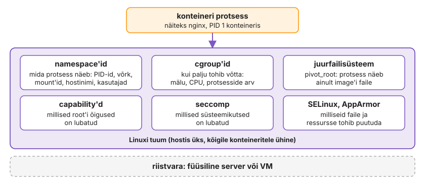
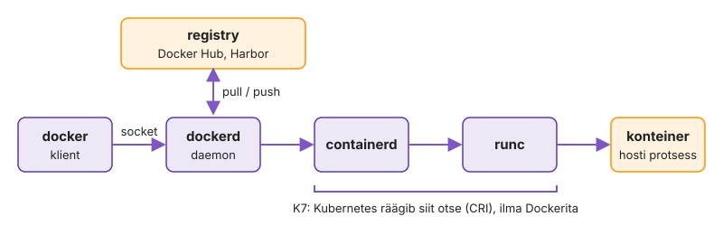
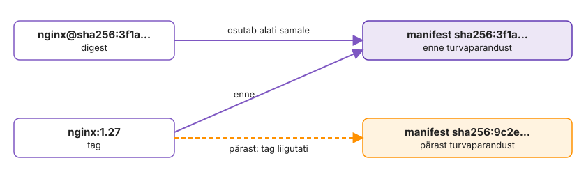
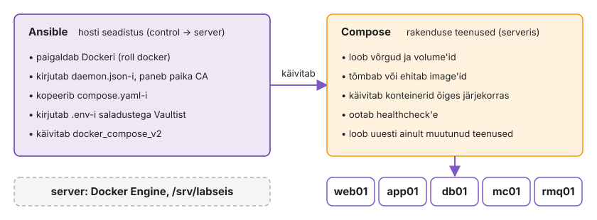
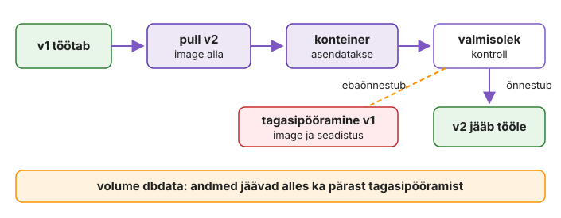
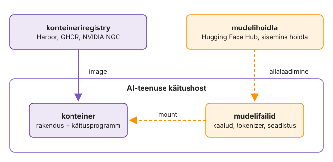
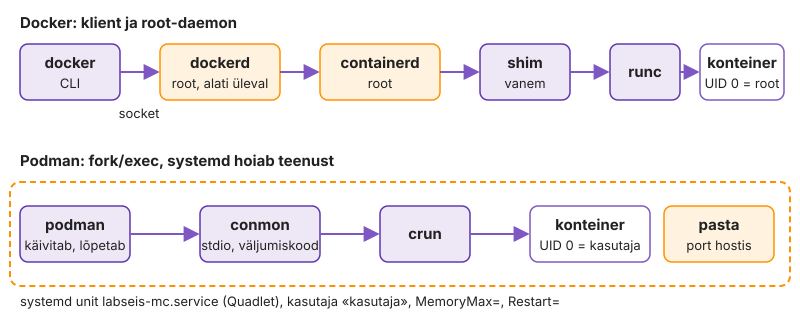
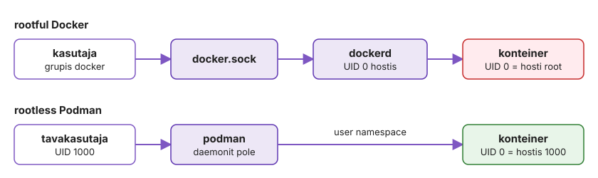

---
tags:
  - Docker
  - Podman
  - Loeng
---

# Loeng: konteinerid lähemalt

Loeng jätkab IS1 [konteineriseerimise loengut](https://hkhk-tk.github.io/is1-automatiseerimine/k03/loeng/): tuuma eraldus, Docker Engine, ressursipiirid, Dockerfile mitte-root kasutajaga, tag ja digest, Ansible ja Docker koos, deploy, registry, tarneahel, Podman ja litsentsid.

## Kuidas tuum konteinerit eraldab

[Konteiner](https://docs.docker.com/get-started/docker-concepts/the-basics/what-is-a-container/) on hosti tuumas töötav tavaline protsess. Konteineri eraldamisel lahendab tuum kaks ülesannet: piirab, mida protsess süsteemist näeb, ja piirab, kui palju ressursse see kasutada saab.

Esimest ülesannet täidavad [namespace'id](https://man7.org/linux/man-pages/man7/namespaces.7.html). Konteineris on protsessil oma protsesside nimekiri, kus ta ise on PID 1, oma võrguliidesed, failisüsteemi vaade ja hostinimi. Teist ülesannet täidavad [cgroup'id](https://man7.org/linux/man-pages/man7/cgroups.7.html): need piiravad mälu, CPU-aega ja protsesside arvu. systemd kasutab samu mehhanisme teenuste piiramiseks.

<figure markdown="span">
  
  <figcaption>Joonis 3.7. Konteineri eraldatus tuleb hosti tuumast (Talvik, 2026).</figcaption>
</figure>

??? info "Süvenemiseks: teised tuuma mehhanismid ja konteineri protsess hostis"

    Need kaks ei ole tuuma ainsad vahendid. Docker kasutab protsessi käivitamisel korraga mitut tuuma mehhanismi: protsess näeb juurkataloogina ainult image'i faile, root'i õigusi on kitsendatud (capability'd), osa süsteemikutseid on keelatud (seccomp) ja RHEL-i peres piirab SELinux, milliseid faile protsess tohib puutuda. Kõik need on hosti tuumas, konteineris endas neid ei ole. Seepärast on hosti tuuma paikamine konteinerite turvalisuse osa.

    Hostis ja konteineris ei tööta kaks Nginx'i koopiat. Allolev näide vaatab sama protsessi kahe vaate kaudu: hostis on see tavaline protsess oma PID-iga, konteineris on sama protsess PID 1. Namespace muudab seda, mida protsess näeb, eraldi masinat see protsessile ei loo.

    ```bash
    docker run -d --name veeb nginx:alpine
    ps -o pid,user,cmd -C nginx          # hostis: tavaline protsess, kasutaja root
    docker exec veeb ps                   # konteineris: sama protsess on PID 1
    sudo lsns -p "$(pgrep -o nginx)"     # tema namespace'id
    ```

## Käsureast Docker Engine'ini

Konteinerit ei käivita käsureaprogramm ise. Käsk `docker run -d nginx:alpine` läbib järgmised sammud:

1. Käsurida `docker` saadab päringu socket'i `/var/run/docker.sock` kaudu daemonile `dockerd`.
2. `dockerd` kontrollib, kas image on hostis olemas.
3. Kui image'it pole, tõmbab `dockerd` selle registry'st.
4. `dockerd` loob konteineri: kirjutatava kihi, võrguliidese ja seadistuse.
5. `containerd` ja `runc` loovad namespace'id ja cgroup'i ning käivitavad protsessi. Käsurida lõpetab töö, konteiner jääb töötama.

Socket `/var/run/docker.sock` on protsessidevaheline suhtluskanal samas masinas: failisüsteemis paistab see failina, aga see pole tekstifail, mida loetakse. Selle kaudu antakse töötavale daemonile korraldusi. Sama kanali kaudu käib ka konteinerite loomine, peatamine ja hosti kataloogide mount'imine. Socket on seega juhtimisliides: selle kaudu saab teha kõike, mida Docker teeb.

<figure markdown="span">
  
  <figcaption>Joonis 3.8. Docker Engine'i osad: klient, daemon, containerd ja runc (Talvik, 2026).</figcaption>
</figure>

??? info "Süvenemiseks: Docker Engine'i osad ja daemoni taaskäivitus"

    *Tabel 3.4. Docker Engine'i osad*

    | Osa | Ülesanne |
    |---|---|
    | `docker` CLI | võtab kasutaja käsu ja saadab API-päringu |
    | `dockerd` | haldab konteinereid, image'eid, võrke ja volume'eid |
    | `containerd` | haldab konteinerite madalama taseme elutsüklit |
    | `containerd-shim` | jääb käivitatud konteineri juurde vahendajaks ja jälgijaks |
    | `runc` | loob namespace'id ja cgroup'i ning käivitab protsessi |

    `dockerd` annab töö edasi `containerd`-le, see käivitab iga konteineri jaoks `containerd-shim`-i ja shim kutsub välja `runc`-i. `runc` loob namespace'id ja [cgroup'i](https://docs.docker.com/engine/containers/resource_constraints/), käivitab protsessi ja lõpetab ise töö. Konteineri protsessi vanem on shim, mitte `dockerd`. Kas daemoni taaskäivitus konteinerid peatab, sõltub seadest [`live-restore`](https://docs.docker.com/engine/daemon/live-restore/), mis on vaikimisi välja lülitatud. Tavaline `apt upgrade` paketiga `docker-ce` taaskäivitab seega kõik hosti konteinerid. Paikamise plaanis on see sama oluline kui tuumauuendus.

## Ressursipiir kaitseb teisi teenuseid

cgroup'id kaitsevad naabreid siis, kui piir on seatud, ja vaikimisi seda pole. Lekkiv Java protsess võib võtta kogu hosti mälu. Siis valib tuuma mälupuuduse käsitleja (OOM killer) lõpetatava protsessi kogu hosti seast, võib-olla andmebaasi. Piiriga tapab tuum protsessi ainult selles cgroup'is ja konteiner lõpeb koodiga 137 (128 + `SIGKILL`).

Piire saab seada käivitusel (`-m 512m`, `--cpus 0.5`, `--pids-limit 100`) ja muuta töötaval konteineril käsuga `docker update`. Tegelikku kulu näitab `docker stats`: CPU, mälu koos piiriga ja protsesside arv konteineri kaupa.

## Dockerfile 2: millise kasutajana rakendus töötab

Rakendus on pakitud. Järgmine küsimus on, millise kasutajana see töötab ja kuhu peab see saama kirjutada. Tomcati ametlik image käivitab protsessi root'ina, ja kui rakendus kompromiteeritakse, on ründajal konteineris root'i õigused. Seepärast luuakse süsteemne kasutaja, antakse talle kaustad, kuhu Tomcat kirjutab (`logs`, `temp`, `work`, `webapps`), ja `USER` käivitab protsessi selle kasutajana. Väljavõte, mis lisandub esimesele Dockerfile'ile:

```dockerfile
RUN useradd --system --uid 10001 labseis \
 && chown -R 10001 logs temp work webapps
USER 10001
```

Rakenduse lisamine image'isse ja käitusõiguste määramine on eri ülesanded. Kui käituskasutaja muutub, tuleb üle vaadata ka kaustad, kuhu rakendus kirjutab, muidu ei käivitu Tomcat õiguste vea tõttu. Muud muudatust baas selles etapis ei vaja: ametliku image'i kaust `webapps` on juba tühi (Tomcati näiterakendused on kaustas `webapps.dist`) ja `curl`, mida healthcheck (osa 4) kasutab, on baasis olemas.

??? example "Täielik Dockerfile 2"

    ```dockerfile
    FROM tomcat:10.1-jre21-temurin
    WORKDIR /usr/local/tomcat
    RUN useradd --system --uid 10001 labseis \
     && chown -R 10001 logs temp work webapps
    COPY target/labori-seis.war webapps/ROOT.war
    USER 10001
    EXPOSE 8080
    CMD ["catalina.sh", "run"]
    ```

## Miks juhiste järjekord loeb

Ehituse vahemälu (build cache) kasutab kihi uuesti, kui juhis ja selle sisend pole muutunud, ja esimene muutunud kiht tühistab kõik järgmised ([head tavad](https://docs.docker.com/build/building/best-practices/)). Kolmandas Dockerfile'is kopeeritakse `pom.xml` enne lähtekoodi. Kui muutub ainult Java lähtekood, võetakse sõltuvuste kiht vahemälust ja Maven ei laadi sõltuvusi uuesti. Kui muutub `pom.xml`, ehitatakse sõltuvuste kiht uuesti, sest selle sisend muutus.

## Tag ja digest

Image'ile saab viidata kahel viisil. **Tag** on liigutatav viide manifestile. `latest` on lihtsalt vaikimisi tag ega tähenda „uusim“. `nginx:1.27` osutab pärast turvaparandust teisele sisule. **Digest** (`sha256:…`) on manifesti räsi: sama digest tähendab alati samu baite. Tootmises seotakse tag koodi versiooniga (git-commit'i SHA) ja kõige rangemates kohtades viidatakse digest'ile.

<figure markdown="span">
  
  <figcaption>Joonis 3.14. Tag on liigutatav viide, digest osutab alati samale sisule (Talvik, 2026).</figcaption>
</figure>

??? info "Süvenemiseks: mitu arhitektuuri ühe tag'i all"

    Üks tag võib osutada mitmele image'ile korraga. Ametlike image'ite tag viitab tavaliselt image index'ile (Dockeri terminites manifest list), mis sisaldab eraldi manifesti `amd64`, `arm64` ja teiste arhitektuuride jaoks, ning klient valib hosti arhitektuuri järgi. Index'i digest ja platvormi manifesti digest on erinevad. Kui konveier kirjutab üles `amd64` manifesti digest'i ja ARM-iga host proovib sama digest'i tõmmata, saab ta vale arhitektuuri image'i ja protsess lõpeb veaga `exec format error`. Kui hostide arhitektuurid erinevad, viita index'i digest'ile.

??? note "Teatmik: Dockerfile'i juhised, CMD ja ENTRYPOINT"

    *Tabel 3.7. Dockerfile'i juhised*

    | Juhis | Mida teeb | Kiht? |
    |---|---|---|
    | `FROM` | baas-image, millele kõik järgnev ehitatakse | baasi kihid |
    | `WORKDIR` | töökataloog järgmistele juhistele ja konteineris | metaandmed |
    | `COPY` | failid ehituskontekstist image'isse | jah |
    | `RUN` | käsk ehituse ajal (paketid, sõltuvused) | jah |
    | `ARG` | muutuja ainult ehituse ajaks (`--build-arg`) | ei |
    | `ENV` | keskkonnamuutuja image'is ja konteineris | metaandmed |
    | `USER` | kasutaja, kellena järgmised juhised ja konteiner töötavad; protsessil peavad olema kirjutusõigused kaustadesse, kuhu rakendus kirjutab | metaandmed |
    | `EXPOSE` | dokumenteerib pordi; hostis porti ei avalda, selleks on `-p` | metaandmed |
    | `CMD` | vaikimisi käivituskäsk | metaandmed |

    **CMD ja ENTRYPOINT**

    `CMD` määrab vaikimisi käivituskäsu. Kui on määratud ka `ENTRYPOINT`, määrab see käivitatava programmi ja `CMD` on selle vaikeargumendid. `docker run image arg` asendab `CMD`-i väärtuse, `--entrypoint` asendab programmi. Tööriista-image'ites (Trivy, curl) on programm `ENTRYPOINT`-is, nii et `docker run aquasec/trivy image nginx` annab argumendid otse Trivy'le. Mõlemad kirjutatakse exec-vormis (`["catalina.sh", "run"]`): shell-vormis (`CMD catalina.sh run`) on PID 1 shell ja `SIGTERM` rakenduseni ei jõua.

Kolmas Dockerfile ehitab rakenduse ja pakib käituskeskkonna. Andmebaasi parool ja andmed ei kuulu siiski sellesse faili ega image'isse: image on kõigil, kes selle alla laadivad, ja konteineri kirjutatav kiht kaob koos konteineriga (osa 3).

??? question "Kontrolli ennast"

    1. Tootmises parandati `docker exec`-iga Nginx'i konfiguratsioonifaili ja kõik töötas. Järgmisel päeval oli viga tagasi. Mis juhtus ja kuidas oleks pidanud tegema?
    2. Miks kopeeritakse Dockerfile'is `pom.xml` enne lähtekoodi?

## Kirjutuskaitstud konteiner

Kui konteiner ei pea oma failisüsteemi kirjutama, saab muuta konteineri juurfailisüsteemi kirjutuskaitstuks (`read_only: true`). Eraldi mount'itud kaustadel jäävad oma õigused. Kohad, kuhu teenus kirjutab ajutisi faile (näiteks Nginx'i vahemälu ja PID-fail), antakse `tmpfs`-ina, mis asub mälus ja kaob konteineri peatamisel. Nii ei saa konteinerisse sisse murdnud protsess veebijuurde faile lisada ega konfiguratsiooni muuta.

??? info "Süvenemiseks: olek hostis"

    Kui olek on konteinerist väljas, on see hostis ja administraatori vastutus jääb samaks. Volume'i kataloogi kopeerimine töötava MariaDB alt annab ebaühtlase koopia, täpselt nagu `rsync` töötava andmebaasi `/var/lib/mysql`-ist. Varundus käib endiselt andmebaasi tööriistaga (`mariadb-dump`, `mariadb-backup`) konteineri sees või kõrvalkonteineris, mis jagab sama volume'it, ja taastamist testitakse samamoodi nagu enne. Volume'id ei kuulu image'isse, nii et image'ite varundus ei asenda andmete varundust.

    Ka salvestusdraiveril on eeldused. `overlay2` XFS-i peal nõuab failisüsteemi, mis on loodud valikuga `ftype=1` ([overlay2 nõuded](https://docs.docker.com/engine/storage/drivers/overlayfs-driver/)). Vanad RHEL 7 aegsed XFS-id loodi mõnikord `ftype=0`-ga ja Docker keeldub neil overlay2 kasutamast. Tootmishostis pannakse `/var/lib/docker` eraldi LVM-i köitele, et image'id, kirjutatavad kihid ja `json-file` logid ei täidaks juurfailisüsteemi. `docker system df` näitab, kui palju sellest on image'id, konteinerid, volume'id ja build cache.

??? question "Kontrolli ennast"

    1. Muutsid `.env`-is `DB_PASSWORD`-i ja käivitasid `docker compose up -d`. Rakendus annab `Access denied`. Miks?
    2. Asutus varundab kindlaid hosti katalooge ja administraatorid haldavad andmete asukohta ise. Kas valiksid MariaDB jaoks volume'i või bind mount'i? Mida kontrollid enne otsust?

## 5. Ansible ja Docker koos

Compose kirjeldab, mis töötab ühe hosti konteinerites. Keegi peab aga paigaldama Dockeri, panema paika `daemon.json`-i ja CA-sertifikaadid, kopeerima hosti `compose.yaml`-i ja `.env`-i ning käivitama `up -d`. Viie hostiga on see jälle käsitsi töö, mille 1. ja 2. kohtumisel automatiseerisid.

Töö jaguneb kaheks. Ansible seadistab hosti ja viib sinna failid, Compose loob nende failide järgi rakenduse teenused. Selles lahenduses ei kirjelda me konteinereid Ansible'i ülesannetena. Ansible paigutab Compose'i faili serverisse ja käivitab Compose'i.

<figure markdown="span">
  
  <figcaption>Joonis 3.18. Ansible seadistab hosti, Compose käivitab rakenduse teenused (Talvik, 2026).</figcaption>
</figure>

Compose'i käivitamiseks on kogus [`community.docker`](https://docs.ansible.com/projects/ansible/latest/collections/community/docker/index.html) moodul [`docker_compose_v2`](https://docs.ansible.com/projects/ansible/latest/collections/community/docker/docker_compose_v2_module.html). See käivitab hostis `docker compose up` ja teatab `changed` ainult siis, kui mõni konteiner loodi, muudeti või kustutati. Idempotentsuse annab Compose ise, moodul loeb tema väljundit.

??? info "Süvenemiseks: playbook ja mooduli võtmed"

    Allolev playbook näitab tööjaotust ühes failis.

    ```yaml
    - name: Labori seis konteinerites
      hosts: docker
      become: true
      roles:
        - docker                                  # paketid, daemon.json, CA
      tasks:
        - name: Rakenduse kaust
          ansible.builtin.file:
            path: /srv/labseis
            state: directory
            mode: "0750"

        - name: Compose'i fail
          ansible.builtin.copy:
            src: compose.yaml
            dest: /srv/labseis/compose.yaml
            mode: "0640"

        - name: Saladused Vaultist .env-i
          ansible.builtin.template:
            src: env.j2
            dest: /srv/labseis/.env
            mode: "0600"
          no_log: true

        - name: Stack töötab
          community.docker.docker_compose_v2:
            project_src: /srv/labseis
            pull: missing
            wait: true
          register: stack
    ```

    Roll `docker` teeb samad sammud, mis Dockeri paigaldusjuhend käsitsi: eemaldab konfliktsed konteineripaketid (Ubuntu `docker.io`, `podman-docker`), lisab Dockeri GPG võtme ja ametliku repositooriumi (moodul `deb822_repository`), paigaldab paketid, kirjutab mallist `daemon.json`-i ja paneb paika kursuse CA. Rolli handler taaskäivitab Dockeri ainult siis, kui `daemon.json` muutus.

    Stacki jaoks handler'it vaja ei ole. Kui `compose.yaml` või `.env` muutus, näeb Compose seadistuse räsi muutust ja loob ainult puudutatud teenused uuesti. Kui midagi ei muutunud, peab teine käivitus andma `changed=0`. Kui teine käivitus teatab muudatusest, kontrolli genereeritud faile, kasutatud image'it ja mooduli võtmeid. Liikuv tag (näiteks `latest`) võib registry's osutada uuele image'ile, aga tag'i nimi üksi ei tähenda, et konteiner luuakse igal käivitusel uuesti.

    Mooduli kaks võtit määravad, kust image tuleb ja millal töö on lõppenud. `pull: missing` tõmbab image'i ainult siis, kui seda hostis pole, `pull: always` tõmbab igal käivitusel: nii viib sama playbook uue versiooni hostidesse, kui tag'i järgi on registry's uus sisu. `wait: true` ootab healthcheck'e nagu `docker compose up --wait`.

    Osa 4 näites ehitatakse app01 võtmega `build:`. Sel juhul peab ka rakenduse lähtekood (ehituskontekst) serveris olemas olema. Tootmises ehitatakse image tavaliselt enne konveieris ja laaditakse registry'sse, `compose.yaml`-is on `image:` ja server ainult tõmbab selle.

    Samas kogus on ka üksiku konteineri moodul `docker_container` ning `docker_image`, `docker_network` ja `docker_volume`. Need sobivad ühe tööriista-konteineri jaoks (näiteks monitooringuagent igas hostis). Rakenduse stacki kirjeldamine nendega tähendaks Compose'i faili kordamist YAML-is Ansible'i süntaksis, ja siis ei saa sama faili enam arendaja masinas `docker compose up`-iga käivitada.

    Kursuse Harbor on paigaldatud samamoodi. Playbook teeb kursuse CA-ga sertifikaadi, paigaldab rolliga Dockeri, laadib alla Harbori paigaldaja, kirjutab mallist `harbor.yml`-i ja käivitab Harbori Compose'i stacki. Kolmas play seadistab Harbori API kaudu (`ansible.builtin.uri`) Docker Hubi vahemälu ja Trivy skannimise. Kogu registry on uuesti ehitatav ühe käsuga.

    **Süvenemisküsimused**

    1. Miks ei kirjelda Ansible iga Labori seisu konteinerit eraldi `docker_container` mooduliga?
    2. `docker_compose_v2` annab teisel käivitusel `changed=1`. Kust hakkad põhjust otsima?

??? question "Kontrolli ennast"

    1. Mida valmistab ette Ansible ja mida kirjeldab Compose?

## 6. Deploy konteineritega

Konteineripõhise rakenduse uuendamisel ei muudeta tavaliselt vana konteineri sisu. Selle asemel luuakse uuest image'ist uus konteiner. Rakenduse uuendamisel tehakse järgmised toimingud:

1. Määratakse kasutatav image (tag lahendatakse digest'iks) ja laaditakse see alla.
2. Vana konteiner peatatakse ja sama seadistusega luuakse uus.
3. Kontrollitakse rakenduse valmisolekut. Seda teeb kasutuselevõtu automaatika (konveier, playbook) või administraator.
4. Ebaõnnestumise korral käivitatakse kokkulepitud tagasipööramine.
5. Vanad image'id eemaldatakse säilitusreeglite järgi.

**Deploy automatiseerimine** tähendab, et see jada käib igas hostis ühtemoodi ja jätab jälje. Otsustada tuleb, kes selle käivitab.

??? info "Süvenemiseks: push- ja pull-mudel"

    **Push-mudelis** käivitab selle väline osapool, konveier või playbook. See kirjutab hosti `.env`-i uue tag'i ning käivitab `docker compose pull` ja `up -d` (või `docker_compose_v2` mooduli). Versioon on Gitis, muudatus on commit ja korraga uuendatavate hostide arvu otsustab see, kes uuenduse käivitab. Piirang: konveier peab hostini jõudma ja tal on seal Dockeri socket'i ehk root'i õigus.

    **Pull-mudelis** jälgib host ise registry't ja tõmbab uue image'i, kui tag osutab uuele sisule. Dockeri jaoks on selleks kolmanda osapoole tööriistad, Podmanis on see sisse ehitatud.

    **Näide: pull-põhine uuendamine Podmaniga.**

    Podmanis teeb seda [`podman auto-update`](https://docs.podman.io/en/latest/markdown/podman-auto-update.1.html). Quadleti failis on `AutoUpdate=registry` ja `podman-auto-update.timer` käivitub vaikimisi iga päev keskööl. See võrdleb kohaliku image'i digest'i registry omaga ning muutuse korral tõmbab uue image'i ja taaskäivitab unit'i. Kui unit ei käivitu, läheb Podman tagasi eelmisele image'ile (`--rollback` on vaikimisi sees). Ebaõnnestumist näeb Podman aga ainult siis, kui konteiner annab sd_notify kaudu teada, et on valmis. Quadleti `Notify=healthy` seob selle teate healthcheck'iga. Ilma selleta loetakse õnnestunuks iga protsess, mis käivitus.

    Pull-mudel ei vaja sissetulevat ligipääsu ega konveieri õigusi hostis ja sobib paljudele väikestele hostidele kontorites või tehastes. Uuenduse sisu määrab aga see, kes registry's tag'i liigutab, ja kui kõigil hostidel on sama taimer, uuendavad nad samal ajal. Kui tag'i liigutamine ei käi läbi kokkulepitud kinnitusprotsessi, jõuab muudatus tootmisse ilma, et keegi oleks seda kinnitanud. Kui pull-mudel on tootmises, jälgib host kas tag'i, mida liigutab ainult heakskiidetud konveier (näiteks `prod`), või paiga taseme tag'i (`11.4`, mitte `latest`).

    Pull-mudeli tüüpiline intsident: sisevõrgu hostil jälgib automaatne uuendaja tag'i `mariadb:latest`. Öösel ilmub uus põhiversioon, uuendaja loob konteineri uue image'iga ja hommikul rakendus ei käivitu, sest olemasolev andmekataloog vajab `mariadb-upgrade`-i. Muudatusel pole piletit ja Gitist ei selgu, mis enne töötas.

Rakenduse versioon v1 töötab. Konveier muudab `.env`-failis image'i tag'i väärtuseks v2 ning käivitab `docker compose pull` ja `docker compose up -d`. Uus protsess käivitub, aga rakendus ei saa andmebaasiga ühendust ja `/health` vastab koodiga 503.

Uus konteiner võib töötada, kuigi rakendus ei ole veel kasutusvalmis. Pärast uuendust tuleb kontrollida rakenduse vastust ja logisid. Healthcheck näitab olekut, aga otsuse teeb konveier, playbook või administraator.

Kui uus versioon ei tööta, saab käivitada eelmise image'i, kui see on veel hostis või registry's. Selleks peab alles olema ka eelmine seadistus. Andmed ei pöördu image'i vahetamisega varasemasse seisu.

??? info "Süvenemiseks: miks tagasipööramine võib ebaõnnestuda"

    Compose'i healthcheck üksi tagasi ei pööra. Tagasipööramisel ei pruugi piisata eelmise image'i käivitamisest. Kui v2 vajas uut keskkonnamuutujat või muudetud konfiguratsioonifaili, tuleb taastada ka v1-ga sobiv konfiguratsioon. Andmed jäävad volume'isse: kui v2 muutis skeemi nii, et v1 seda ei talu, ei aita ainult image'i vahetus. Siis on vaja skeemi tagasi muuta või andmed varukoopiast taastada, ja varukoopiast taastamine kaotab pärast koopia tegemist lisandunud andmed. Seepärast tehakse skeemimuudatused tagasiühilduvaks (allpool „Deploy suures skaalas“).

<figure markdown="span">
  
  <figcaption>Joonis 3.19. Uuendus ja tagasipööramine: image vahetub, andmed volume'is jäävad (Talvik, 2026).</figcaption>
</figure>

Viimane samm on koristus. Cron'iga käivitatav `docker image prune -a` kustutab kõik image'id, mida ükski konteiner ei kasuta, ka tagasipööramise sihtmärgi. Ilma koristuseta kasvab `/var/lib/docker` iga uuendusega. Hostis hoitakse praegust ja eelmist versiooni, registry's väljalaskeid nii kaua, kui tagasipööramine on lubatud.

??? info "Süvenemiseks: deploy suures skaalas"

    Viiekümne hosti juures muutub uuendus võrguküsimuseks. Kui kõik hostid tõmbavad sama 800 MB image'i samal minutil, on kitsaskoht registry või kontori ühendus, mitte Docker. Kihid on räsi järgi jagatud, seega tõmmatakse ainult muutunud kihid, eeldusel et baas on sama. Pull-mudelis hajutatakse käivitusaeg taimeri `RandomizedDelaySec=` abil, push-mudelis piirab konveier korraga uuendatavate hostide arvu, nagu Ansible'i `serial` 2. kohtumisel.

    Pooleli jäänud uuendus on konteinerite puhul sama probleem nagu playbook'iga. Kui 50 hostist 12 said uue versiooni ja siis registry kadus, töötab tootmises kaks versiooni. Andmebaasiskeemi muudatus peab seepärast olema tagasiühilduv vähemalt ühe väljalaske ulatuses: kõigepealt lisatakse veerg, mida vana versioon ignoreerib, ja alles järgmises väljalaskes eemaldatakse vana. Ilma selleta ei saa tagasi pöörata, sest eelmine image ei tööta uue skeemiga.

    Muudatuste haldus ei kao, see muutub. Image'i tag'i muutus Gitis võib olla muudatustaotluse osa, kui asutuse protsess seda nii defineerib: commit näitab, mis muutus, konveieri logi tõendab, et muudatus tehti, ja eelmine digest on tagasipööramise plaan. Paljud organisatsioonid loevad sellise uuenduse ITIL-i standardmuudatuseks, mida ei pea iga kord muudatusnõukogus kinnitama, sest protsess ise on kinnitatud.

    Loe juurde: [Patch-haldus](https://hkhk-tk.github.io/is1-automatiseerimine/teemad/patch-haldus/).

    **Süvenemisküsimused**

    1. Kumb mudel, push või pull, sobib 40 kaupluse kassaserverile, kuhu sissetulevat ühendust ei lubata? Mida peab siis tag'ide kohta kokku leppima?
    2. Miks võib öine `docker image prune -a` muuta tagasipööramise võimatuks?

??? question "Kontrolli ennast"

    1. Miks asendatakse uue versiooni korral konteiner, mitte ei muudeta vana konteineri sees faile?
    2. Miks ei piisa uuenduse õnnestumise kinnitamiseks sellest, et `docker compose ps` näitab konteinerit töötavana?

## Pakkuja hallatav registry

**Avalikud registry'd** on internetis ja enamasti tasuta avalike image'ite jaoks. [Docker Hub](https://hub.docker.com/) on vaikimisi registry: nimi `nginx` tähendab `docker.io/library/nginx`. Hubis on igaühe image'id, ja päritolu järgi on neil märgised: **Docker Official Images** (`library/`, Dockeri hallatud kogumik, näiteks `nginx`, `mariadb`), **Verified Publisher** (tarkvaratootja enda image'id) ja **Docker-Sponsored Open Source** (avatud lähtekoodiga projektide image'id). Märgiseta image võib olla ükskõik kelle oma.

Teised avalikud registry'd on seotud konkreetse platvormiga. [GHCR](https://docs.github.com/en/packages/working-with-a-github-packages-registry/working-with-the-container-registry) (`ghcr.io`) on seotud GitHubi repositooriumide ja õigustega ning sobib, kui kood ja konveier on GitHubis. [Quay](https://quay.io/) on Red Hati registry, kus on paljud Kubernetese ja Red Hati projektide image'id. Pilvede registry'd (AWS ECR, Azure ACR, Google Artifact Registry) on seotud selle pilve õiguste ja teenustega, aga neid saab kasutada ka väljaspool pilve.

Avalik registry sobib avatud tarkvarale ja väikesele meeskonnale. Piiranguks on tõmbepiirid, sõltuvus internetiühendusest ja see, et asutuse image'id on kellegi teise serveris.

## Asutuse oma registry

**Oma registry** (on-prem) töötab asutuse võrgus. [Harbor](https://goharbor.io/) on CNCF-i projekt: projektid ja õigused, robotkontod konveierite jaoks, Trivy skannimine, säilitus- ja muutumatuse reeglid, replikatsioon teise registry'sse. Sonatype [Nexus Repository](https://www.sonatype.com/products/sonatype-nexus-repository) ja JFrog [Artifactory](https://jfrog.com/artifactory/) hoiavad image'ite kõrval ka Maveni, npm-i, PyPI ja apt-i pakette, mis on mugav, kui asutusel on juba üks artefaktide hoidla. GitLab ja Gitea pakuvad registry't koodihoidla juures. Kõige lihtsam on [`registry:2`](https://distribution.github.io/distribution/) ehk CNCF Distribution: üks konteiner ilma kasutajaliidese, õiguste ja skannimiseta. See on teiste registry'de alus, aga tootmisse sobib üksi harva.

## Ligipääs ja usaldus

Registry'ga suhtlemisel kaitseb TLS kahte asja: klient kontrollib sertifikaadi abil serveri identiteeti ja ühendus on krüpteeritud. Image'i päritolu (kes selle ehitas) see ei tõenda, selleks on allkirjad ja päritolutõendid. Asutuse oma CA-ga allkirjastatud sertifikaadi jaoks pannakse CA fail kausta `/etc/docker/certs.d/<registry>/ca.crt` (Podmanis `/etc/containers/certs.d/`). `insecure-registries` lülitab kontrolli välja ja parool liigub siis serverile, mille identiteeti keegi ei kontrolli.

??? info "Süvenemiseks: registry valik, artefaktihoidlad ja AI-rakenduste hoidlad"

    **Registry ja artefaktihoidla**

    Konteineriregistry hoiab ja levitab image'eid ning võib toetada ka teisi OCI-artefakte (näiteks Helm chart'e). **Artefaktihoidla** haldab mitut tüüpi tarkvarapakette ja ehitustulemeid. [Sonatype Nexus Repository](https://help.sonatype.com/en/formats.html) ja [JFrog Artifactory](https://jfrog.com/artifactory/) hoiavad eraldi repositooriumides näiteks Java `.jar`- ja `.war`-faile (Maven), npm- ja Pythoni pakette, konteineri image'eid, `.deb`- ja `.rpm`-pakette ning Helm chart'e. Sellepärast nimetab Google oma teenust Artifact Registry'ks, mitte ainult Container Registry'ks.

    Nexuses on kolme tüüpi [repositooriume](https://help.sonatype.com/en/repository-types.html). **Hosted** on asutuse oma pakettide hoidla: CI avaldab sinna näiteks ühise Java teegi ja teised rakendused kasutavad seda sõltuvusena. **Proxy** on välise hoidla vahemälu: Maven, pip või Docker küsib paketti Nexuselt, Nexus laadib puuduva Maven Centralist, PyPI-st või Docker Hubist ja hoiab selle alles. **Group** ühendab sama vormingu mitu hoidlat ühe aadressi taha, nii et Maven saab ühe URL-i kaudu nii asutuse oma teegid kui ka avalikud sõltuvused. Harbori projekt `dockerhub` on sama mõttega proxy, ainult image'itele.

    Labori seisus võiks Nexust kasutada kahes kohas: Maven laadib ehitamisel sõltuvused Nexuse proxy kaudu ja valmis WAR avaldatakse hosted-hoidlasse. Image laaditakse ikkagi registry'sse. WAR-i eraldi hoidmine ei ole kohustuslik, kui töövoog vajab ainult image'it.

    Hoidla valimisel tuleb eristada kolme küsimust: milliseid paketivorminguid on vaja, kes teenust haldab ja millised funktsioonid kuuluvad valitud väljaandesse. **Ise hallatav** (self-hosted) lahendus töötab asutuse serveris või pilve virtuaalmasinas ja serverid, varundus ning uuendused on asutuse kanda. **SaaS** tähendab, et teenust haldab pakkuja ja hind sõltub sageli ka salvestatud ja alla laaditud andmemahust.

    *Tabel 3.13. Artefaktihoidlate väljaanded*

    | Väljaanne | Mida hoiab | Tasuta | Ise hallatav | SaaS | Piirang |
    |---|---|---|---|---|---|
    | Nexus Repository Community Edition | mitme vormingu paketid, ka Docker/OCI image'id | jah | jah | ei | kuni 40 000 komponenti ja 100 000 päringut päevas; SSO ja kõrgkäideldavus ei kuulu sisse |
    | Nexus Repository tasulised tasemed (Pro, Pro+, Enterprise) | samad vormingud | ei | jah | jah | kasutuspõhine hind, funktsioonid sõltuvad tasemest |
    | JFrog Artifactory OSS | Java artefaktid (Maven) | jah | jah | ei | teisi paketivorminguid tasuta versioon ei hoia |
    | JFrog Container Registry (JCR) | Docker/OCI image'id, Helm, Generic | jah | jah | ei | teisi paketivorminguid pole; haavatavuste skannimine ainult pilveversioonis |
    | JFrog Artifactory tasulised paketid | kõik vormingud | ei | jah | jah | funktsioonid sõltuvad tellimusest |

    Allikad (kontrollitud 8. novembril 2026): [Nexuse väljaanded](https://help.sonatype.com/en/nexus-repository-tiers-and-feature-availability.html), [Nexus Community Edition](https://help.sonatype.com/en/ce-onboarding.html), [Artifactory OSS](https://jfrog.com/open-source/), [JFrog Container Registry](https://jfrog.com/container-registry/). Pull-through cache ei ole täielik varukoopia: selles on ainult need image'id, mida keegi on küsinud.

    Tasuta tarkvara ei tähenda tasuta teenust: ise hallates jäävad asutuse kanda serverid, salvestus, varundus, uuendused ja rikete lahendamine.

    **AI-rakenduste hoidlad**

    AI-teenus võtab käituskeskkonna, mudeli ja sõltuvused sageli eri kohtadest. Image tuleb tavalisest registry'st (Harbor, Docker Hub, GHCR) või NVIDIA GPU-tarkvara puhul [NVIDIA NGC](https://catalog.ngc.nvidia.com/) registry'st `nvcr.io`. Mudeli kaalud, tokenizer ja seadistus tulevad mudelihoidlast, näiteks [Hugging Face Hubist](https://huggingface.co/docs/hub/index) või asutuse sisemisest hoidlast. Pythoni paketid tulevad PyPI-st või asutuse paketiproxy kaudu. Artifactory ja Nexus oskavad uuemates versioonides vahendada ka Hugging Face'i sisu, aga funktsioonid sõltuvad versioonist ja väljaandest.

    <figure markdown="span">
      
      <figcaption>Joonis 3.21. AI-teenuse image ja mudel tulevad eri hoidlatest (Talvik, 2026).</figcaption>
    </figure>

    Mudel ja image ei pea olema üks artefakt. Mõnikord pakitakse väike mudel ka image'isse; see on arhitektuurivalik. Mudelifailid on sageli gigabaitides ja muutuvad teises tempos kui rakendus. Seepärast laaditakse mudel eraldi ja ühendatakse konteinerisse käivitamisel, samamoodi nagu andmebaasi andmed volume'ist.

    *Tabel 3.14. Registry valik*

    | Vajadus | Valik |
    |---|---|
    | avatud lähtekoodiga projekt, image kõigile | { .logo width="14" height="14" }Docker Hub, { .logo width="14" height="14" }GHCR, { .logo width="14" height="14" }Quay |
    | kood ja konveier GitHubis või GitLabis | GHCR, { .logo width="14" height="14" }GitLab Container Registry |
    | teenused ühes pilves | { .logo width="14" height="14" }ECR, ACR, { .logo width="14" height="14" }Artifact Registry |
    | asutuse võrk, õigused projektide kaupa, skannimine | { .logo width="14" height="14" }Harbor |
    | lisaks image'itele Maveni, npm-i ja Pythoni pakettide hoidla | { .logo width="14" height="14" }Nexus, { .logo width="14" height="14" }Artifactory |
    | test või üks meeskond ilma kasutajaliideseta | `registry:2` |
    | Docker Hubi piir või internetita võrk | pull-through cache (Harbor, Nexus, `registry:2` proxy) |

    **Harbori vahemälu Dockeris ja Podmanis.** Kursuse Harboril on kolm rolli: projekt `dockerhub` on Docker Hubi vahemälu, igal õppijal on privaatne projekt, kuhu ta oma image'id üles laadib, ja iga üleslaadimine (push) skannitakse Trivy'ga. Docker ei oska Harbori vahemälu kasutada vaikimisi peeglina (`registry-mirrors` toetab ainult registry juurt), seepärast on Dockeri image'ite nimes eesliide `harbor.lab.hkhk.lan/dockerhub/library/`. Podman oskab: `registries.conf` lubab peegli projekti all ja image'i nimi jääb `docker.io/…`.

    **Süvenemisküsimused**

    1. Klassis on 20 õppijat ühe NAT-aadressi taga ja igaüks tõmbab kümme image'it. Mis juhtub ilma vahemäluta?
    2. Miks on `insecure-registries` halb lahendus ka siis, kui registry on sisevõrgus?

??? question "Kontrolli ennast"

    1. Miks ei piisa sellest, et image on ainult arendaja arvutis?
    2. Milline osa image'i aadressist näitab registry't ja milline versiooni?

## 8. Baas-image'id ja tarneahel

### Kust image'i sisu pärineb

Labori seisu Dockerfile algab Tomcati baas-image'ist. Seetõttu sisaldab rakenduse image lisaks WAR-failile ka Tomcati, Java käituskeskkonda ja baasi süsteemiteeke. Kõike, mis jõuab image'isse teistelt (baas-image, paketid, teegid, ehitustööriistad), nimetatakse **tarneahelaks**.

Hosti uuendamine ei muuda juba ehitatud image'i sisu. Baasis oleva vea parandamiseks tuleb rakenduse image parandatud baasiga uuesti ehitada ja uus versioon kasutusele võtta.

Kursuse Harbor skannib iga üleslaaditud image'i Trivy'ga ja näitab selle komponentides teadaolevaid haavatavusi.

??? info "Süvenemiseks: Log4Shell, baas-image'ite haldus, SBOM ja skannimine"

    Näide, miks see oluline on: detsembris 2021 avaldati Log4j-s [Log4Shell](https://logging.apache.org/security.html) (CVE-2021-44228), mis lubas kaugelt koodi käivitada, ja [RIA hoiatas](https://www.err.ee/1608432728/ria-java-turvanorkus-ohustab-ka-eesti-ettevotteid-ja-asutusi) Eesti asutusi. Paikamisest raskem oli leida, millistesse rakendustesse teek oli pakitud. Asutuses, kus 40 Dockerfile'i alustavad 12 erinevast `FROM`-ist, on sama küsimus iga OpenSSL-i paiga puhul.

    **Kuidas asutus baas-image'eid haldab**

    **SOE** (standard operating environment) oli 1. kohtumisel piiratud hulk toetatud OS-i ja seadistuse kombinatsioone. Konteinerite puhul on SOE väike hulk heakskiidetud baas-image'eid, näiteks üks JRE, üks Pythoni ja üks minimaalne OS-image, mida ehitab platvormimeeskond. Baas tuleb ülesvoolu (upstream) fikseeritud digest'ist, sisaldab asutuse CA-sertifikaate, ajavööndit ja mitte-root kasutajat ning on skannitud ja avaldatud asutuse registry's. Ülesvoolu valikul loeb, kui kaua ja kui kiiresti turvaparandused tulevad: Debian slim, Alpine, distroless ja Red Hat UBI (vabalt levitatav, RHEL-i elutsükliga) erinevad just selle poolest.

    `FROM` kopeerib baasi kihid rakenduse image'isse ja hosti `apt upgrade` neid ei puuduta. Parandatud baas ei paranda ühtegi rakendust enne, kui need on uuesti ehitatud ja uuendatud. Sellest tuleneb image'i elutsükkel.

    *Tabel 3.15. Baas-image'i elutsükkel*

    | Etapp | Mis juhtub | Kes |
    |---|---|---|
    | Ehitus | baas ehitatakse ajakava järgi (näiteks kord nädalas) ja kriitilise CVE korral kohe; kuupäevaga tag ja liikuv tag | platvormimeeskond |
    | Kontroll | skannimine, SBOM, test, alles siis avaldamine | konveier |
    | Kasutus | rakenduse Dockerfile viitab baasi digest'ile; Renovate või Dependabot avab PR-i, kui digest muutub | rakenduse meeskond |
    | Aegumine | vana baasiga image saab tähtaja, mis ajaks see uuesti ehitatakse | platvormimeeskond |
    | Eemaldus | registry säilitusreegel kustutab tag'id, mida ükski keskkond ei kasuta | registry |

    Ühine baas teeb küsimuse „kus see teek on“ lihtsaks, aga on ka ühine rikkepunkt. Vigane baas nurjab korraga kõik ehitused ja iga baasi uuendus käivitab kümnete image'ite ehituse ja uuenduse. Viide digest'ile fikseerib baasi, aga ei tee üksi kogu ehitust korratavaks (ehitusel laaditakse ka pakette) ja baas ei uuene ise. Liikuv tag (näiteks `11.4`) toob paigad järgmisel tõmbamisel ja ehitusel, aga ehitus ei ole korratav. Tööriistad nagu Renovate ühendavad mõlemad: Dockerfile viitab digest'ile ja tööriist avab pull request'i, kui baasist ilmub uus versioon. E-ITS-i moodul [SYS.1.6 Konteinerdus](https://eits.ria.ee/et/versioon/2024/eits-poohidokumendid/etalonturbe-kataloog/sys-itsuesteemid/sys1-server/sys16-konteinerdus) käsitleb ka image'ite päritolu ja uuendamist.

    **Tarneahela rünnakud**

    Baas on tarneahela esimene lüli, järgnevad ehituse ajal alla laaditud paketid, ehitus ise, registry ja deploy. 2024. aasta [xz tagauks](https://nvd.nist.gov/vuln/detail/CVE-2024-3094) jõudis laialt kasutatud paketti hooldaja kaudu. Märtsis 2026 jõudis ründaja Trivy enda GitHub Actioni tag'idesse ([Microsoft](https://www.microsoft.com/en-us/security/blog/2026/03/24/detecting-investigating-defending-against-trivy-supply-chain-compromise/)). Digest'i või commit'i SHA järgi viidanud konveiereid see ei puudutanud.

    Baas-image'ite hooldamiseks on kolm teed. Asutus ehitab ja hooldab oma baasid ise (SOE ülal). Asutus võtab aluseks välise pakkuja hooldatud baasid, näiteks [Docker Hardened Images](https://docs.docker.com/dhi/) või Red Hat UBI. Või ühendab mõlemad: võtab hooldatud baasi ja lisab sellele oma CA, ajavööndi ja kasutaja. Docker Hardened Images on alates detsembrist 2025 tasuta ja Apache 2.0 litsentsiga ([pressiteade](https://www.docker.com/press-release/docker-makes-hardened-images-free-open-and-transparent-for-everyone/)), tasulistes tasemetes (Select, Enterprise) on lisaks kiirem paikamine (kriitilised haavatavused alla 7 päeva) ja vastavusnõuded (kontrollitud 8. novembril 2026). Pakkuja väide „peaaegu null CVE-d“ ei ole garantii: rakenduse meeskond peab oma image'it ikka skannima, testima ja uuesti ehitama.

    **Kuidas teada, mis image'is on**

    **SBOM** (software bill of materials) kirjeldab image'ist tuvastatud tarkvarakomponente standardvormingus, näiteks [CycloneDX](https://cyclonedx.org/). [Trivy](https://trivy.dev/docs/latest/) loeb image'i kihtidest paketihalduri andmebaasi (`/var/lib/dpkg/status`, `/lib/apk/db/installed`) ja rakenduse teegid (JAR-ide `pom.properties`) ning võrdleb neid CVE-andmebaasiga, mis uueneb mitu korda päevas. Salvestatud SBOM-i uus skannimine vastab küsimusele „kas meil on see teek kuskil“ sekunditega, image'eid alla laadimata. Leiu korral uuendad baasi, uuendad teeki või aktsepteerid riski kirjaliku otsusena koos aegumiskuupäevaga (Trivy `.trivyignore` toetab `exp:` välja). Harbor teeb sama skannimise iga push'i ajal ja võib keelata image'i tõmbamise, kui leidudes on kriitiline haavatavus. SBOM sisaldab ainult seda, mida tööriist image'ist tuvastas: allikast kompileeritud binaar ilma paketiinfota jääb välja, ja leid ei tähenda veel, et haavatavust saab selles rakenduses ära kasutada.

    Trivy skannib ka enne ehitust: `trivy fs .` otsib haavatavaid teeke lähtekoodi sõltuvustest (näiteks `pom.xml`) ja `trivy config .` leiab Dockerfile'ides ja Compose'i failides seadistusvigu, näiteks root'ina töötava image'i. Need sobivad konveieri algusesse, enne kui ehitusele kulub aega. Image'i skannimine (`trivy image`) näeb lisaks ka OS-pakette.

    Trivy ei ole ainus skanner. [Docker Scout](https://docs.docker.com/scout/) kasutab samuti image'i komponentide nimekirja ja haavatavuste andmebaasi, näitab leide Docker Desktopis ja Hubis ning soovitab, millisele baasile üle minna. Mõlemad koostavad image'i komponentide nimekirja, võrdlevad seda haavatavuste andmebaasiga, ja leiu põhjal otsustab inimene, mida teha.

    **Mida teha skanneri leiuga**

    Skanneri tulemus vajab tõlgendamist. Debiani baasil image annab sageli kümneid leide, millest osa on teekides, mida rakendus ei kasuta, või haavatavustes, millele distributsioon pole veel paika avaldanud. Leiu juures vaata mõjutatud komponenti, paranduse olemasolu, rakenduse kasutusviisi ja ründe eeltingimusi. Kui konveier peatub iga `HIGH` leiu peale, hakkavad meeskonnad ignoreerimisfaile pikendama ja reegel kaotab mõtte. Üks võimalus on peatada konveier ainult parandatavate (`--ignore-unfixed`) kriitiliste leidude korral ja jälgida ülejäänut raportina. Sellise reegli korral ei peata ülejäänud leiud kasutuselevõttu. Nende jälgimiseks ja käsitlemiseks tuleb määrata vastutaja. Väiksem baas vähendab leidude arvu, sest pakette on vähem. Alpine sisaldab tavaliselt shelli (BusyBox) ja paketihaldurit `apk`. Distroless-tüüpi käitusimage'ites neid üldjuhul pole, nii et veaotsing tuleb kavandada teisiti, näiteks eraldi silumiskonteineriga.

    **Süvenemisküsimus**

    1. Täna näitas Trivy 0 CRITICAL leidu. Kas image on kuu aja pärast ka puhas, kui sa midagi ei muuda? Kuidas aitab SBOM?

Loe juurde: [Standard Operating Environment ja IT-süsteemi elutsükkel](https://hkhk-tk.github.io/is1-automatiseerimine/teemad/soe-ja-elutsukkel/), [Turvaautomaatika, compliance ja riskihaldus](https://hkhk-tk.github.io/is1-automatiseerimine/teemad/turvaautomaatika/)

??? question "Kontrolli ennast"

    1. Miks ei piisa hosti `apt upgrade`-ist, kui OpenSSL-is avaldatakse kriitiline haavatavus, ja mida teed konteinerite puhul selle asemel?

## 9. Konteiner ilma daemonita: Podman ja systemd

AlmaLinuxi ja RHEL-i serveris on vaikimisi [Podman](https://docs.podman.io/), mitte Docker: `dnf install docker` paigaldab paketi `podman-docker`. Image'id on samad OCI image'id, erinev on see, kes konteinerit käitab.

Podmani põhikäsud on teadlikult Dockeri omadega sarnased (`podman pull`, `podman run -d --name veeb -p 8080:80 docker.io/library/nginx:alpine`, `podman ps`, `podman logs`). Podman ehitab image'eid, laadib neid registry'st alla ja üles ning käivitab konteinereid. Erinevus on selles, kuidas konteinereid taustal juhitakse.

Kohaliku Dockeri kasutamisel saadab käsurida korraldused püsivalt töötavale Docker daemonile. Podmani kohalik kasutamine samasugust keskset daemonit ei vaja: käsk loob konteineri ise ja teenusena hoiab seda töös systemd.

Selle loengu põhimõisted ei sõltu tööriistast: image, konteiner, võrk ja püsisalvestus on samad ka Podmani kasutamisel.

??? info "Süvenemiseks: rootless, SELinux ja Podmani konteiner systemd teenusena"

    <figure markdown="span">
      
      <figcaption>Joonis 3.22. Docker on klient ja root-daemon. Podman käivitab konteineri ise ja lõpetab, teenust hoiab systemd (Talvik, 2026).</figcaption>
    </figure>

    **Daemonita mudel.** Peamine arhitektuuri erinevus on juhtimismudel. Dockeris saadab CLI käsu kesksele daemonile, mis töötab kogu aeg. `podman run -d` loob konteineri ise `crun`-iga, jätab selle juurde väikese jälgija `conmon` ja käsk ise lõpetab. Daemonita ei tähenda protsessideta: iga konteineri juures on `conmon`, nagu Dockeris `containerd-shim`. Puudub kõiki konteinereid juhtiv keskne teenus, mille taaskäivitus peataks kõik konteinerid. Piirang: pärast masina taaskäivitust ei käivita konteinerit keegi, kui seda ei tee systemd.

    *Tabel 3.16. Docker ja Podman: juhtimine*

    | Aspekt | Docker | Podman |
    |---|---|---|
    | kohalik juhtimine | CLI → API → daemon | CLI haldab konteinereid ise teekide ja käitusprogrammi kaudu |
    | keskne daemon | vajalik | kohalikuks kasutuseks pole vaja |
    | API | arhitektuuri keskne osa | eraldi teenus (`podman.socket`), lülitatakse vajadusel sisse |
    | töötava konteineri jälgija | `containerd-shim` | `conmon` |
    | rootless | toetatud: kasutajal töötab oma `dockerd` | toetatud ilma kasutaja daemonita |
    | teenus pärast taaskäivitust | daemon ja restart-poliitika | systemd (Quadlet) |

    **Kuidas rootless muudab kasutaja õigusi?** Rootless-režiim on olemas mõlemal, aga eri kujul. Rootless Dockeris töötab tavakasutaja oma `dockerd`. Rootless Podmanis keskset teenust pole. Turvalisuse küsimus on usalduspiir: kelle õigustes töötab juhtimiskomponent ja kelleks kaardistatakse konteineri kasutajad. Rootful Dockeri juhtimisõigus on sisuliselt hosti administraatori õigus. Rootless Podman võimaldab hallata konteinereid tavakasutaja õiguste piires. Tabel 3.17 näitab, kelleks konteineri root hostis muutub.

    *Tabel 3.17. Konteineri UID 0 hostis*

    | Käitusrežiim | Konteineri UID 0 hostis |
    |---|---|
    | rootful Docker vaikimisi | hosti UID 0, aga piiratud capability'te ja seccomp'iga |
    | Docker `userns-remap`-iga | hosti mitte-root UID; daemon ise jääb root'iks |
    | rootless Docker | daemon ja konteinerid töötavad tavakasutaja õigustes |
    | rootless Podman | käivitanud tavakasutaja; teised UID-d `/etc/subuid` vahemikust |

    <figure markdown="span">
      
      <figcaption>Joonis 3.23. Usalduspiir: rootful Dockeris on konteineri root hosti root, rootless Podmanis tavakasutaja (Talvik, 2026).</figcaption>
    </figure>

    Tavakasutaja konteinerid töötavad tema user namespace'is: konteineri UID 0 on hostis see kasutaja, ülejäänud UID-d tulevad `/etc/subuid` vahemikust. Kui ründaja pääseb konteinerist välja tavalise vea kaudu, on tal tavakasutaja õigused. See vähendab õiguste ülempiiri, aga ei kaitse andmeid, mis on konteinerisse mount'itud, ega tuuma haavatavuste eest. Piirid tulevad tuumast: port alla 1024 vajab sysctl'i `ip_unprivileged_port_start`, võrk käib kasutajaruumi `pasta` kaudu ja cgroup v2 piirangud kehtivad ainult kontrolleritega, mille systemd on kasutajale delegeerinud.

    **Miks bind mount SELinuxiga ei tööta?** Mõlemad tööriistad kasutavad samu tuuma kaitsemehhanisme (capability'd, seccomp, SELinux või AppArmor). Erinevus on selles, et RHEL-i peres on SELinux vaikimisi sees ja Podman arvestab sellega. Konteineri protsess töötab domeenis `container_t` ja SELinuxi poliitika lubab sel lugeda üldjuhul ainult silti `container_file_t` kandvaid faile. Bind mount kodukaustast annab AVC keelu, kuigi failiõigused lubavad. `:Z` annab failile selle konteineri privaatse sildi (MCS kategooriad), `:z` jagatud sildi. Ubuntus testitud bind mount võib seepärast AlmaLinuxis ebaõnnestuda.

    **Kuidas Podmani konteiner systemd teenuseks teha?** mc01 teenus Quadleti failina:

    ```ini
    # ~/.config/containers/systemd/labseis-mc.container
    [Container]
    Image=docker.io/library/memcached:1.6-alpine
    ContainerName=labseis-mc
    PublishPort=11211:11211
    HealthCmd=sh -c 'echo stats | nc -w 1 127.0.0.1 11211 | grep -q uptime'

    [Service]
    Restart=on-failure
    MemoryMax=128M

    [Install]
    WantedBy=default.target
    ```

    Fail `labseis-mc.container` muutub `systemctl --user daemon-reload`-il generaatori abil unit'iks `labseis-mc.service`. db01 jaoks lisanduvad samasse vormi read `Volume=` ja `Secret=`. `PublishPort=` on näites sellepärast, et rakendus töötab teises masinas. Kui teenused on samas hostis ja ühises võrgus, ei pea vahemälu ega andmebaasi porti hostis avaldama. Taaskäivituse, `MemoryMax=`, logid ja sõltuvused annab systemd. Kasutaja teenus käivitub masina käivitumisel ainult `loginctl enable-linger`-iga. `podman generate systemd` on aegunud.

    **Mitu kasutajat ühes hostis**

    Iga rootless kasutaja vajab failides `/etc/subuid` ja `/etc/subgid` oma vahemikku, vaikimisi 65 536 UID-d. Kui vahemikud kattuvad, on kahe kasutaja konteinerid hosti vaates sama UID ja pääsevad teineteise failidele ligi. Kesksete kontodega (FreeIPA, Active Directory) hallatakse vahemikke seetõttu keskselt, mitte iga hosti `useradd`-iga. Rootless overlay töötab tuumas alates versioonist 5.13. Vanemal tuumal kasutab Podman `fuse-overlayfs`-i, mis on aeglasem ja kulutab CPU-d kasutajaruumis.

    **Mis on mõlemal ühine.** Konteineri turvalisus ei sõltu ainult sellest, kas käsk on `docker` või `podman`. Mõlemal tuleb vaadata, millise kasutajana rakendus töötab, millised hosti kataloogid on konteinerisse mount'itud, millised capability'd on antud, kas juhtimisliides (socket või API) on kellelegi kättesaadav ja kas hosti turvamehhanismid (SELinux või AppArmor) on sees.

    **Ühilduvus.** `podman.socket` pakub Dockeri REST API-t, nii et `docker` CLI töötab `DOCKER_HOST`-iga, Swarm mitte. `podman kube generate` teeb konteinerist Kubernetese `Pod` manifesti.

    **Süvenemisküsimused**

    1. AlmaLinuxi serveris töötab Quadleti teenus pärast `systemctl --user start`-i, aga pärast masina taaskäivitust mitte, kuni keegi sisse logib. Miks ja mis on parandus?
    2. Konteineri protsess ei saa faili lugeda, kuigi faili õigused on `644`. Koosta kontrollimise järjekord.

**Millal mida.** Podman koos Quadletiga sobib RHEL-i pere serverisse, kus töötab üks või paar teenust: haldus, logid ja audit käivad samade tööriistadega mis teistel teenustel. Docker sobib näiteks arendaja masinasse, CI agendile ja sinna, kus tööriistad eeldavad Compose'i ja Dockeri socket'it.

??? info "Süvenemiseks: Dockeri alternatiivid"

    **Dockeri alternatiivid**

    Podman ei ole ainus alternatiiv. Kuna image'i vorming ja käitamine on OCI standardis kirjas, saab Dockeri iga osa asendada teise tööriistaga ja image jääb samaks ([ülevaade Dockeri alternatiividest](https://spacelift.io/blog/docker-alternatives)). Alternatiivid ei asenda Dockerit tervikuna, vaid ühte kihti: arendaja töökeskkonda, image'i ehitamist, mootorit, madala taseme käitusaega või mitme serveri haldust.

    <figure markdown="span">
      
      <figcaption>Joonis 3.24. Dockeri osad ja nende alternatiivid kihtide kaupa (Talvik, 2026).</figcaption>
    </figure>

    *Tabel 3.18. Dockeri alternatiivid*

    | Tööriist | Mida asendab | Millal valida |
    |---|---|---|
    | [Podman](https://podman.io/) | Docker Engine ja käsurida | RHEL-i pere server, rootless, systemd teenused (Quadlet) |
    | [containerd](https://containerd.io/) ja [nerdctl](https://github.com/containerd/nerdctl) | Docker Engine | sama käitusaeg, mida kasutavad Docker ja Kubernetes; Dockeriga sarnane käsurida |
    | [Buildah](https://buildah.io/) | `docker build` | image'ite ehitamine konveieris ilma daemonita |
    | runc, crun | madala taseme käitusaeg | tavaliselt ei vali kasutaja, need on mootori sees; Podman kasutab crun-i |
    | [LXC](https://linuxcontainers.org/) | (teine konteineritüüp) | süsteemikonteiner, mida hallatakse nagu väikest serverit (Proxmoxi CT) |
    | Podman Desktop, [Rancher Desktop](https://rancherdesktop.io/), OrbStack, Colima | Docker Desktop | arendaja Windowsi või macOS-i masin; litsentsid osas 10 |
    | Kubernetes, OpenShift | Docker Swarm, käsitsi hallatud hostid | palju servereid, kõrgkäideldavus (7. kohtumine) |
    | virtuaalmasin, Kata Containers | konteineri isolatsioon | tugevam eraldatus, usaldamatu kood, teine OS |
    | PaaS (Heroku, AWS Elastic Beanstalk, Google App Engine) | kogu käituskeskkonna haldus | meeskond ei soovi konteinereid ise hallata; hinnaks on sõltuvus teenusepakkujast |

??? question "Kontrolli ennast"

    1. Mis vahe on keskse daemoniga (Docker) ja daemonita (Podman) juhtimisel?
    2. Kas Podmani kasutamiseks peab Labori seisu rakenduse koodi ümber kirjutama? Milline osa lahendusest muutub?

## 10. Litsentsid ja kulud

Konteineritööriistade nimed on sarnased, aga litsentsid ja hinnad erinevad. Enne kui meeskond tööriista standardiks valib, tuleb teada, mis on tasuta ja mille eest makstakse.

Siin on kolm eristust:

1. Docker Engine ja Docker Desktop ei ole sama toode. Docker Engine on Linuxi serveris tasuta, Docker Desktopi ärikasutus suures ettevõttes vajab tasulist tellimust.
2. Tasuta tarkvara kasutamisel jäävad alles haldamise ja infrastruktuuri kulud.
3. Image'i sees olevatel komponentidel on oma litsentsitingimused.

??? info "Süvenemiseks: Docker Hub, image'i sisu ja litsentsimuutused"

    **Docker Hub** on teenus, mitte tarkvara. Tasuta kasutusel on tõmbepiir (7. osa) ja privaatsete repositooriumide arv on piiratud. Tasulised tellimused tõstavad piire ja lisavad meeskonna õigused. Sellepärast hoiab asutus oma image'id oma registry's ja Docker Hubi image'id vahemälus.

    **Image'i sisu** on eraldi küsimus. Image on pakettide kogum ja igal paketil on oma litsents: Debiani baasis on GPL-i, LGPL-i, MIT-i ja BSD paketid, Java teekides enamasti Apache 2.0. Kui asutus levitab image'it klientidele, kehtivad nende pakettide tingimused, näiteks GPL-i nõue teha lähtekood kättesaadavaks. Kui SBOM-i koostamise tööriist litsentse tuvastab, on need samas failis, mida kasutad haavatavuste otsimiseks. Litsentsiinfo võib olla puudulik ja selle tõlgendamine (näiteks millistele failidele GPL-i kohustused rakenduvad) vajab juriidilist hinnangut.

    **Näide: litsentsid image'i SBOM-ist.**

    Käsupaar koostab image'ist SBOM-i ja loeb kokku, mitu komponenti mingi litsentsiga on. Tulemusest otsitakse litsentse, mille tingimused levitamisel midagi nõuavad (GPL, AGPL), ja komponente, mille litsents on tundmatu.

    ```bash
    trivy image --format cyclonedx -o sbom.json labori-seis-app:dev
    jq -r '[.components[].licenses[]?.license | (.id // .name)] | group_by(.) | map("\(length) \(.[0])") | .[]' sbom.json | sort -rn | head
    ```

    Litsentsi muutus on tarneahela risk samamoodi nagu haavatavus. HashiCorp viis 2023. aastal Terraformi ja Vaulti BSL-i litsentsile, mis piirab konkureerivat kasutust. Kogukond tegi neist avatud harud OpenTofu ja OpenBao, mida kasutame 4. kohtumisel. Sama küsimus kehtib iga tööriista kohta, mille ümber meeskond oma automaatika ehitab: kes projekti omab ja mis juhtub, kui litsents muutub.

    *Tabel 3.19. Tööriistad ja litsentsid*

    | Tööriist | Litsents | Tasu |
    |---|---|---|
    | Docker Engine, CLI, Compose | Apache 2.0 | tasuta |
    | Docker Desktop | kommertslitsents | tasuta alla 250 töötaja ja alla 10 M$ käibe; suurem ettevõte ja valitsusasutus maksavad |
    | Podman, Podman Desktop, Buildah | Apache 2.0 | tasuta |
    | containerd, runc, Kubernetes | Apache 2.0 | tasuta |
    | Harbor, CNCF Distribution (`registry:2`) | Apache 2.0 | tasuta |
    | Docker Hub | teenus | tasuta piirangutega, tasulised tellimused |
    | Nexus, Artifactory | sõltub väljaandest | vt tabel 3.13 osas 7 |
    | Trivy | Apache 2.0 | tasuta |
    | Docker Hardened Images | Apache 2.0 (alates 12.2025) | tasuta; kiirem paikamine ja vastavusnõuded tasulistes tasemetes |
    | Docker Scout | teenus | tasuta kontoga 1 repositoorium, rohkem tasulistes tellimustes |
    | Docker Sandboxes | Dockeri toode | kohalik kasutus tasuta, ka äriliselt; Cloud Sandboxes ja AI Governance tasulised |

    Allikad (kontrollitud 8. novembril 2026): projektide LICENSE-failid GitHubis, [Docker Desktopi litsents](https://docs.docker.com/subscription/desktop-license/), [Docker hinnad](https://www.docker.com/pricing/), [Docker Hardened Images](https://docs.docker.com/dhi/), [Docker Sandboxes](https://docs.docker.com/ai/sandboxes/).

    **Docker Engine'i ja Desktopi tingimused.** Docker Engine (Moby projekt, `dockerd`, CLI, Compose, BuildKit) on avatud lähtekoodiga [Apache 2.0](https://www.apache.org/licenses/LICENSE-2.0) litsentsiga ja Linuxi serveris tasuta ka ettevõttele. **Podman**, **containerd**, **runc** ja **Harbor** on samuti Apache 2.0. **Docker Desktop** (Windowsi ja macOS-i rakendus, mis käivitab taustal Linuxi VM-i) on teine toode. Selle [tingimuste](https://docs.docker.com/subscription/desktop-license/) järgi on ärikasutus tasuta väikeettevõttele, kus on alla 250 töötaja ja aastakäive alla 10 miljoni USA dollari (kontrollitud 8. novembril 2026). Suuremate organisatsioonide professionaalne kasutus ja valitsusasutuste kasutus vajavad tasulist tellimust. Isiklikule, hariduslikule ja mitteärilisele avatud lähtekoodiga kasutusele kehtivad erandid. Arendaja sülearvutis on tasuta alternatiivid Podman Desktop, Rancher Desktop või Docker Engine WSL-is.

    **Süvenemisküsimused**

    1. 400 töötajaga ettevõtte arendajad tahavad Windowsis konteinereid käivitada. Millised on valikud ja mis on nende hind?
    2. Kust leiad, millise litsentsiga paketid on sinu app-image'is?

??? question "Kontrolli ennast"

    1. Miks ei saa Docker Engine'i kasutustingimuste põhjal otsustada Docker Desktopi kasutustingimuste üle?

## Lisamaterjal

??? info "Lisamaterjal: AI-agentide eraldatud keskkonnad"

    Koodi kirjutav AI-agent (näiteks Claude Code või Codex) ei piirdu teksti soovitamisega. See muudab ja kustutab projektifaile, paigaldab sõltuvusi, käivitab teste ja ehitusskripte, käivitab andmebaasi ja ehitab image'eid. Kui agent töötab otse sinu terminalis, teeb ta seda kõike sinu kasutaja õigustes ja ka sinu Dockeri kaudu.

    [Docker Sandboxes](https://docs.docker.com/ai/sandboxes/) annab agendile eraldi keskkonna: väikese virtuaalmasina (microVM), millel on oma tuum ja oma Docker Engine. Agent näeb projektikausta, mille talle annad, ning võrgusihtkohti ja tööriistu, mis on lubatud. Hosti Docker, teised projektid ja isiklikud failid ei ole vaikimisi tema keskkonna osa. Sama põhimõte oli osas 1 Kata Containersi juures: kui koodi ei usaldata, ei piisa namespace'idest.

    Näiteks annad agendile ülesande parandada Labori seisu andmebaasiühendus ja kontrollida, et testid õnnestuvad. Sandbox'is loeb ja muudab agent projekti koodi, käivitab Maveni, ehitab app-image'i, käivitab oma Docker Engine'is MariaDB ja rakenduse, loeb logisid ja parandab vigu. Kõik see käib sandbox'i privaatse Docker Engine'i kaudu, mitte hosti socket'i kaudu.

    ```text
    Sinu arvuti
    ├── projektikaust ── lubatud ligipääs ──► sandbox (microVM, oma tuum)
    │                                         ├── AI-agent
    │                                         ├── ehitus- ja testitööriistad
    │                                         └── privaatne Docker Engine
    │                                             ├── rakenduse konteiner
    │                                             └── testandmebaasi konteiner
    └── hosti Docker, muud projektid, isiklikud failid: agendi keskkonnast väljas
    ```

    Sandbox piirab tegevuse ulatust, aga ei kontrolli, kas agendi muudatus on sisuliselt õige. Kui projektikaust on kirjutatav, saab agent selle faile muuta. Kui annad ligipääsu välisele teenusele, tuleb selle teenuse õigused eraldi läbi mõelda. Koodi ülevaatus ja testid jäävad vajalikuks. Kui küsid AI-lt ainult selgitust või koodinäidet ja käivitad kõik ise, ei ole sandbox'i vaja.

    Kohalik Docker Sandboxes on tasuta ka äriliseks kasutuseks. Pilves käitamine (Cloud Sandboxes) ja organisatsiooni keskne haldus (AI Governance) on tasulised ning AI-mudeli kasutamise kulud arvestatakse eraldi ([tingimused](https://www.docker.com/products/docker-sandboxes/), kontrollitud 8. novembril 2026).

??? note "Mõistete teatmik"

    | Mõiste | Lühidalt |
    |---|---|
    | konteiner | hosti protsess, vaadet eraldavad namespace'id, ressursse piiravad cgroup'id; PID 1 lõpp peatab konteineri |
    | grupp `docker` | võrdub root'i õigusega, auditeeri nagu `sudoers`-it |
    | image | muutumatu kihtidest artefakt; parandus Dockerfile'i ja uude image'isse |
    | tag ja digest | tag liigub, digest on sisu räsi; tootmises git-SHA tag või digest |
    | olek | andmed volume'is, saladused failides, logid stdout'is rotatsiooniga |
    | healthcheck | märgib oleku; `service_healthy` ootab, taaskäivitust ei tee |
    | Ansible ja Compose | Ansible paigaldab Dockeri ja viib failid serverisse, Compose'i fail kirjeldab teenused; moodul `docker_compose_v2` |
    | push ja pull | uuenduse käivitab konveier või host ise; tagasipööramiseks hoia eelmine image alles |
    | registry | avalik (Docker Hub, GHCR, Quay), oma (Harbor, Nexus), pull-through cache |
    | baas-image ja SBOM | baasi paik vajab rakenduse uut ehitust; SBOM ütleb, mida ehitada ja millised litsentsid |
    | Podman ja Quadlet | daemonita, rootless, systemd teenus; linger ja `:Z` |
    | litsentsid | Engine ja Podman Apache 2.0, Docker Desktop tasuline suures ettevõttes |
