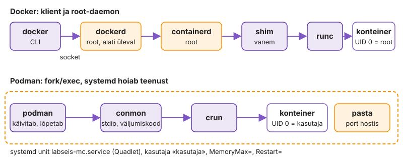
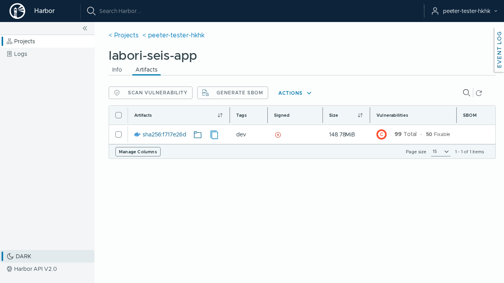
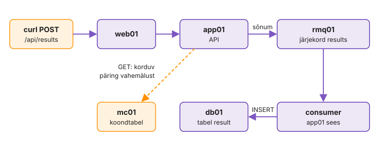
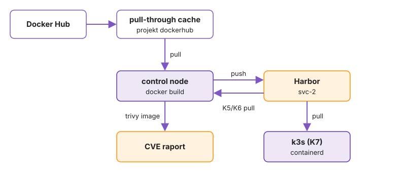
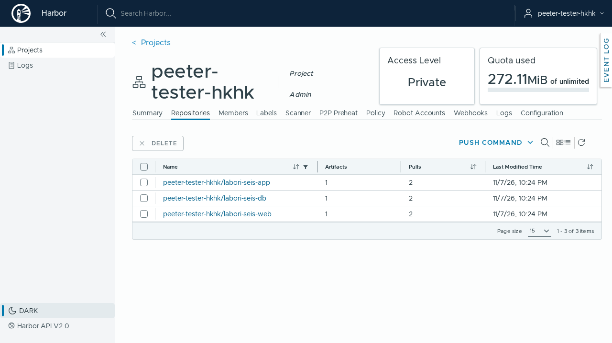

---
tags:
  - Docker
  - Podman
  - Praktikum
---

# Süvenemine: Docker ja Podman

Need osad jätkavad IS1 praktikumi [Labori seis konteinerites](https://hkhk-tk.github.io/is1-automatiseerimine/k03/lab/) stacki. Käsud käivitad control'is kaustas `~/kursus/k03-docker`, kui sammu juures pole kirjas teist masinat.

## Osa 1 · Võrgud, ressursid ja käivitusvõtmed

Need katsed jätkavad praktikumi 1. osa. Käivitad konteinereid control'is käsitsi ja vaatad, kuidas võrk, mälupiirid ja käivitusvõtmed hostis välja paistavad.

### 1.1 Võrgudraiverid: bridge, host ja none

Siiani olid kõik konteinerid vaikevõrgus `bridge`. Dockeril on veel kaks sisseehitatud võrku: `host`, kus konteiner kasutab otse hosti võrku, ja `none`, kus võrku pole üldse. Tootmisserveris vajab host-võrku näiteks monitooringuagent. Host-võrgus pole konteineril võrguisolatsiooni: see näeb kõiki hosti liideseid ja võib kuulata mis tahes porti.

Vaata Dockeri võrke ja vaikevõrgu aadresse:

```bash
docker network ls
docker network inspect bridge -f '{{range .IPAM.Config}}{{.Subnet}} gw {{.Gateway}}{{end}}'
ip -br addr show docker0
```

??? success "Oodatav tulemus"

    Võrgud on `bridge`, `host` ja `none`. `bridge` alamvõrk on `172.17.0.0/16` ja lüüs on sama aadress, mis hosti liidesel `docker0`: sild on hosti liides ja konteinerid on selle taga.

**Host-võrk.** Kontrolli, et port 80 on hostis vaba, ja käivita Nginx host-võrgus:

```bash
sudo ss -tlnp | grep ':80 '
docker run -d --name hostnet --network host -p 9999:80 $HUB/nginx:1.30-alpine
```

Vaata, kes kuulab porte 80 ja 9999:

```bash
sudo ss -tlnp | grep -E ':(80|9999) '
docker port hostnet
```

??? success "Oodatav tulemus"

    Esimene `ss` ei näita midagi: port 80 on vaba. `docker run` hoiatab, et `-p` jäetakse kõrvale. Pordil 80 kuulab `nginx` ise, mitte `docker-proxy`, pordil 9999 ei kuula keegi ja `docker port` on tühi. NAT-reeglit pole, seega kehtib siin hosti tulemüür tavapäraselt.

??? warning "Kui `hostnet` lõpetab kohe"

    `docker logs hostnet` näitab `Address in use`: port 80 oli hõivatud. Host-võrgus tekib pordikonflikt, kui sama porti kasutab hosti teenus.

**Võrguta konteiner.** Käivita konteiner ilma võrguta ja vaata selle liideseid:

```bash
docker run --rm --network none $HUB/alpine:3.22 ip addr
```

Proovi sellest internetti jõuda:

```bash
docker run --rm --network none $HUB/alpine:3.22 wget -qO- -T 3 http://example.com
```

??? success "Oodatav tulemus"

    Konteineril on ainult liides `lo` ja `wget` ebaõnnestub. Võrguta konteiner sobib tööle, mis ei tohi võrku puutuda, näiteks võtmete genereerimiseks.

Eemalda konteiner `hostnet`:

```bash
docker rm -f hostnet
```

### 1.2 Mälu, CPU ja protsessid

Vaikimisi piiranguid pole: konteiner näeb kogu hosti mälu ja CPU-d nagu iga teine protsess. Mälulekkega teenus ilma piiranguta käivitab hosti OOM killeri, mis võib lõpetada hoopis `sshd` või andmebaasi.

**Mälupiir.** Käivita konteiner 64 MB mälupiiriga ja ilma swap'ita. Programm `tail /dev/zero` võtab järjest rohkem mälu:

```bash
docker run --name oom -m 64m --memory-swap 64m $HUB/alpine:3.22 tail /dev/zero
echo $?
```

Vaata, kes konteineri lõpetas:

```bash
docker inspect -f '{{.State.OOMKilled}} {{.State.ExitCode}}' oom
sudo dmesg | grep -i 'killed process' | tail -1
```

??? success "Oodatav tulemus"

    Väljumiskood on 137 ja `OOMKilled` on `true`. 137 on 128 + 9: protsess sai signaali SIGKILL. `OOMKilled: true` tähendab, et protsessi lõpetas tuum mälupiiri tõttu.

**CPU ja protsesside arv.** Käivita konteiner poole tuuma piiranguga (`--cpus 0.5`) ja kuni 50 protsessiga (`--pids-limit 50`). Programm `yes` koormab CPU-d:

```bash
docker run -d --name cpu --cpus 0.5 --pids-limit 50 $HUB/alpine:3.22 sh -c 'yes > /dev/null'
docker stats --no-stream cpu
```

Piirangud on cgroup'i failides. Vaata neid konteineri seest:

```bash
docker exec cpu cat /sys/fs/cgroup/cpu.max
docker exec cpu cat /sys/fs/cgroup/pids.max
```

??? success "Oodatav tulemus"

    `docker stats` näitab umbes 50% CPU-d. `cpu.max` on `50000 100000` (50 ms igast 100 ms-st) ja `pids.max` on `50`.

**Piirangu muutmine.** Muuda töötava konteineri mälupiiri ja vaata cgroup'i faili uuesti:

```bash
docker update --memory 128m --memory-swap 128m cpu
docker exec cpu cat /sys/fs/cgroup/memory.max
```

??? success "Oodatav tulemus"

    `memory.max` on `134217728` (128 MB). `docker update` muutis piirangut ilma protsessi taaskäivitamata, sest piirang on lihtsalt cgroup'i fail. Hostis on sama fail kaustas `/sys/fs/cgroup/system.slice/docker-<id>.scope/`.

Eemalda katse konteinerid:

```bash
docker rm -f oom cpu
```

### 1.3 Käivitusvõtmed, mida admin vajab

`docker run`-il on sadu võtmeid, aga igapäevatöös kordub umbes viis. Need samad võtmed kirjutad hiljem Compose'i faili teiste nimedega: `env_file`, `user`, `init`, `volumes` ja `entrypoint`. Iga katse näitab ühte lõksu.

**Keskkonnamuutujad failist.** Teenused loevad paroole ja aadresse keskkonnamuutujatest. Tee fail kahe muutujaga:

```bash
printf 'A=yks\nB="kaks"\n' > /tmp/k03.env
cat /tmp/k03.env
```

Käivita konteiner, mis prindib oma keskkonnamuutujad. `--env-file` loeb muutujad failist, `-e` annab ühe muutuja käsureal ja `--rm` kustutab konteineri kohe pärast lõppu:

```bash
docker run --rm --env-file /tmp/k03.env -e C=kolm $HUB/alpine:3.22 env
docker ps -a
```

??? success "Oodatav tulemus"

    `env` näitab ridu `A=yks`, `B="kaks"` ja `C=kolm`. `B` väärtus on koos jutumärkidega: `--env-file` ei tõlgenda jutumärke, Compose'i `.env` tõlgendab. `docker ps -a` seda konteinerit ei näita, sest `--rm` kustutas selle.

**Kasutaja.** Konteineri protsess töötab vaikimisi root'ina. Kui see kirjutab hosti kausta, kuulub fail hostis root'ile. Tee kaust ja kirjuta sinna üks fail root'ina ja teine oma kasutajana:

```bash
mkdir /tmp/k03-user
docker run --rm -v /tmp/k03-user:/w $HUB/alpine:3.22 touch /w/root.txt
docker run --rm --user "$(id -u):$(id -g)" -v /tmp/k03-user:/w $HUB/alpine:3.22 touch /w/mina.txt
ls -l /tmp/k03-user
sudo rm -rf /tmp/k03-user
```

??? success "Oodatav tulemus"

    `root.txt` kuulub root'ile ja `mina.txt` sulle. Seepärast käivitad tööriista-konteineri, mis kirjutab sinu kausta, alati `--user`-iga.

**Peatamine.** `docker stop` saadab konteineri PID 1-le signaali SIGTERM ja ootab 10 sekundit. Kui protsess selle ajaga ei lõpeta, tapab Docker selle. Käivita kaks konteinerit, teine võtmega `--init`:

```bash
docker run -d --name noinit $HUB/alpine:3.22 sleep 300
docker run -d --name init --init $HUB/alpine:3.22 sleep 300
docker top init
```

Peata mõlemad ja vaata, kui kaua kumbki aega võttis:

```bash
time docker stop noinit
time docker stop init
docker rm noinit init
```

??? success "Oodatav tulemus"

    `docker top init` näitab kaht protsessi, `docker-init` ja selle all `sleep`. `noinit` peatus umbes 10 sekundiga, sest `sleep` PID 1-na ei käsitle SIGTERM-i. `--init` pani PID 1-ks väikese init'i, mis andis signaali edasi, ja `init` peatus alla sekundi.

**Hosti kaust, mida pole olemas.** Proovi ühendada konteinerisse hosti kaust, mida pole olemas. Esimene käsk kasutab lühikest võtit `-v`:

```bash
docker run --rm -v /tmp/k03-puudub:/data $HUB/alpine:3.22 ls /data
ls -ld /tmp/k03-puudub
sudo rmdir /tmp/k03-puudub
```

Sama katse pika võtmega `--mount`:

```bash
docker run --rm --mount type=bind,src=/tmp/k03-puudub,dst=/data $HUB/alpine:3.22 ls /data
```

??? success "Oodatav tulemus"

    `-v` lõi puuduva kausta hoiatuseta ja omanikuks sai root. `--mount` keeldus veaga `bind source path does not exist`. Vale tee jääb `--mount`-iga kohe silma, mitte alles siis, kui teenus käivitub tühja konfiguratsiooniga.

**Konteiner, mis lõpetab kohe.** Tee Nginxile vigane konfiguratsioonifail ja käivita Nginx sellega:

```bash
printf 'server { listen 80 }\n' > /tmp/k03-ngx.conf
docker run -d --name ngx -v /tmp/k03-ngx.conf:/etc/nginx/conf.d/default.conf:ro $HUB/nginx:1.30-alpine
docker ps -a --filter name=ngx
docker logs ngx
docker exec ngx sh
```

Konteiner lõpetas ja `exec` sinna enam ei pääse. Käivita sama image teise käivituskäsuga: `--entrypoint sh` avab Nginxi asemel shelli.

```bash
docker run --rm -it --entrypoint sh -v /tmp/k03-ngx.conf:/etc/nginx/conf.d/default.conf:ro $HUB/nginx:1.30-alpine
```

Konteineris käivita `nginx -t`, siis `exit`. Lõpuks kustuta katse konteiner:

```bash
docker rm ngx
```

??? success "Oodatav tulemus"

    `docker ps -a` näitab `ngx` olekuga `Exited (1)`, logis on vigane rida ja `docker exec` ütleb `is not running`. Shelliga konteineris näitab `nginx -t` sama viga koos rea numbriga. `--rm` kustutab koos konteineriga ka selle logi: kui konteiner ebaõnnestub ja tahad teada, miks, käivita see ilma `--rm`-ita.

### 1.4 Sisemine võrk

Võrk `--internal` laseb konteineritel üksteist näha, aga internetti välja ei lase. Seda kasutad 2. osas andmebaasi võrgu jaoks: kui andmebaasi konteineris on haavatavus, ei saa ründaja sealt koodi alla laadida ega andmeid otse välja saata.

Katse vajab praktikumi sammu 1.10 võrku `labnet` ja konteinerit `mc01`. Kui eemaldasid need, loo need uuesti:

```bash
docker network create labnet
docker run -d --name mc01 --network labnet $HUB/memcached:1.6-alpine
```

Tee sisemine võrk ja proovi sellest internetti jõuda:

```bash
docker network create --internal sisemine
docker run --rm --network sisemine $HUB/alpine:3.22 wget -qO- -T 3 http://example.com
```

Ühenda töötav `mc01` lisaks ka sisemisse võrku ja küsi sellelt sisemisest võrgust olekut:

```bash
docker network connect sisemine mc01
docker run --rm --network sisemine $HUB/busybox:1.37 sh -c 'echo stats | nc -w 1 mc01 11211' | head -2
```

Vaata, mis võrkudes `mc01` nüüd on:

```bash
docker inspect -f '{{json .NetworkSettings.Networks}}' mc01 | jq 'keys'
```

??? success "Oodatav tulemus"

    `wget` internetti ebaõnnestub veaga `bad address`: sisemises võrgus ei lahenda Dockeri DNS välist nime. IP-aadressiga (`wget http://1.1.1.1`) on viga `Network unreachable`, sest vaikemarsruuti pole. `mc01` vastab sisemises võrgus reaga `STAT pid`. `mc01` on kahes võrgus, `labnet` ja `sisemine`: tal on kaks liidest ja kaks IP-d. Samamoodi on prod-failis web01 korraga välimises ja sisemises võrgus.

Eemalda katse konteiner ja võrgud:

```bash
docker rm -f mc01
docker network rm labnet sisemine
```

??? info "Miks see nii töötab"

    **Mälupiir cgroup'is.** Mälupiir on cgroup'i fail `memory.max`. Docker määrab cgroup'is mälupiiri, piirangut jõustab tuum. Kubernetes teeb sama `resources.limits` kaudu.

    **Võrgudraiverid.** Praktikumis kasutasid draivereid `bridge`, `host` ja `none`. Sisseehitatud draivereid on veel: `macvlan` ja `ipvlan` annavad konteinerile oma aadressi otse kohtvõrgus, nagu oleks see eraldi masin, ja `overlay` ühendab konteinereid mitme hosti vahel. `overlay`-võrku kasutab Swarm.

    **`--init`.** Võti `--init` seab PID 1-ks `docker-init`-protsessi (`tini`), mis edastab signaalid põhiprotsessile ja koristab zombie-protsessid. Seda vajab image, mille põhiprotsess ei ole kirjutatud PID 1 rolli jaoks, näiteks shelliskript, mis käivitab alamprotsesse.

    **`--env-file`.** `docker run --env-file` loeb read sõna-sõnalt: jutumärgid jäävad väärtuse osaks ja `${…}` viiteid ei asendata. Compose'i `.env` ja `env_file` tõlgendavad jutumärke ja viiteid. Näiteks rida `DB_HOST="db01"` annab `docker run --env-file` korral väärtuse `"db01"` koos jutumärkidega, Compose'is aga väärtuse `db01`.

    **`--mount` ja `-v`.** `--mount` kasutab selgesõnalist võti=väärtus-süntaksit ja annab puuduva allikakataloogi korral vea. `-v` on vanem lühivorm, mis loob puuduva kataloogi hostis vaikselt.

    **`--user`.** `--user` töötab ka numbrilise UID-ga, mida image'i failis `/etc/passwd` ei leidu.

## Osa 2 · Tootmiskeskkonda sobiv stack

Lisad stackile tootmise seaded eraldi failis `compose.prod.yaml`: mälupiirid, paroolid failidest, sisemise võrgu, kirjutuskaitse ja logide piirid. Põhifail `compose.yaml` jääb muutmata, sest seda kasutavad automaatkontroll ja 5. kohtumise konveier. Lõpus varundad ja taastad andmebaasi volume'i ning paned paika koristuse.

Tabel 3.12 näitab prod-faili sisu ühes kohas. Iga rida vastab küsimustele: kui palju ressursse teenus tohib kasutada, millistesse võrkudesse see kuulub ja mis on selles kirjutuskaitstud. Mälupiiride summa on umbes 2 GB ja on valitud control'i mälu järgi. Tootmisserveris mõõdad need `docker stats`-iga koormuse all.

??? note "Tabel 3.12. Prod-faili sisu teenuste kaupa"

    | Teenus | Mälu | CPU | PID-id | Võrgud | Muu |
    |---|---|---|---|---|---|
    | db01 | 512m | 1.0 | 200 | back | saladused failidest |
    | mc01 | 128m | 0.5 | 100 | back | `read_only`, `command: ["memcached", "-m", "64"]` |
    | rmq01 | 512m | 1.0 | 300 | back, front | UI ainult `127.0.0.1:15672` |
    | app01 | 768m | 1.5 | 300 | back | saladused failidest, `CATALINA_OPTS`, journald |
    | web01 | 64m | 0.5 | 100 | front, back | `read_only` + `tmpfs` |

### 2.1 Prod-fail ja ressursipiirangud

Prod-fail on teine Compose'i fail, mis liidetakse põhifaili peale. Alustad ressursipiirangutest, sest need on kõige lihtsamad ja nende mõju näed kohe `docker stats`-is. Ilma piiranguteta võib üks teenus teistelt ressursid ära võtta: Java võtab mälu, mida MariaDB vajaks puhvriteks, ja hosti OOM killer valib ohvri kogu masina seast.

Tee kaustas `k03-docker/` fail `.gitignore` ridadega `secrets/`, `backup/`, `trivy.txt`, `sbom-*.json`, `intsident/data/`.

??? example "Ülesanne: `compose.prod.yaml` algus"

    Igale teenusele `deploy.resources.limits` tabeli 3.12 järgi ja mc01-le `command`. Faili `name:` ega `build:` ei kordu, need tulevad `compose.yaml`-ist.

    ```yaml
    # Tootmise erisused: docker compose -f compose.yaml -f compose.prod.yaml …
    services:
      db01:
        deploy:
          resources:
            limits: {memory: 512m, cpus: "1.0", pids: 200}

      mc01:
        deploy:
          resources:
            limits: {memory: 128m, cpus: "0.5", pids: 100}
        command: ["memcached", "-m", "64"]

      rmq01:
        deploy:
          resources:
            limits: {memory: 512m, cpus: "1.0", pids: 300}

      app01:
        deploy:
          resources:
            limits: {memory: 768m, cpus: "1.5", pids: 300}

      web01:
        deploy:
          resources:
            limits: {memory: 64m, cpus: "0.5", pids: 100}
    ```

Vaata liidetud tulemust ja käivita stack mõlema failiga. `COMPOSE_FILE` kehtib selle shelli lõpuni, `--wait` ootab, kuni kõik teenused on `healthy`.

```bash
export COMPOSE_FILE=compose.yaml:compose.prod.yaml
docker compose config | grep -A4 'limits:' | head -12
docker compose up -d --wait && docker compose ps
docker stats --no-stream
docker compose exec app01 cat /sys/fs/cgroup/memory.max
docker compose exec app01 sh -c 'java -XX:+PrintFlagsFinal -version 2>/dev/null | grep -E "MaxHeapSize|MaxRAMPercentage"'
```

Lisa app01-le `environment`-i `CATALINA_OPTS: "-XX:MaxRAMPercentage=75"`, uuenda stacki ja vaata Tomcati käsurida: `docker compose exec app01 ps -o args= -p 1`.

??? success "Oodatav tulemus"

    `docker stats` näitab igal teenusel LIMIT-veerus tabeli väärtust, app01 `memory.max` on `805306368` ja vaikimisi `MaxHeapSize` on umbes veerand sellest. Pärast muudatust on Tomcati käsureal `-XX:MaxRAMPercentage=75`.

    JVM luges cgroup'i piiri ja arvutas heap'i selle järgi. Vaikimisi veerand 768 MB-st on alla 200 MB, ja raske päring võib anda `OutOfMemoryError`, kuigi konteiner pole piirile lähedalgi. `MaxRAMPercentage=75` annab heap'ile kolm neljandikku ja jätab ülejäänu metaspace'ile ja lõimedele. `java -XX:+PrintFlagsFinal` käivitab uue JVM-i ilma `CATALINA_OPTS`-ita, seepärast vaatad Tomcati väärtust protsessi käsurealt.

### 2.2 Piir peab vastu: protsesside arv

Mälupiiri nägid juba `docker run -m`-iga. Protsesside piir kaitseb teise vea eest: fork-pomm või skript, mis käivitab protsesse lõputult. Ilma `pids`-piiranguta täidab üks konteiner hosti protsessitabeli. Siis ei saa ka `sshd` uut sessiooni avada ja masinat saad parandada ainult konsoolist. Proovid seda web01-s, mille piir on 100.

**Küsimus enne käsku:** mitu protsessi käivitub ja kas `/health` vastab sel ajal?

```bash
docker compose exec web01 sh -c 'for i in $(seq 150); do sleep 30 & done' 2>&1 | sort | uniq -c
docker stats --no-stream --format '{{.Name}} {{.PIDs}}' labori-seis-web01-1
curl -s -o /dev/null -w '%{http_code}\n' localhost:8080/health
sleep 30; docker stats --no-stream --format '{{.Name}} {{.PIDs}}' labori-seis-web01-1
```

??? success "Oodatav tulemus"

    Osa `sleep`-e andis `can't fork`, PIDs jõudis 100-ni, `/health` andis 200 ja pärast ootamist on PIDs jälle tavalisel tasemel. Kui piir täis sai, keeldus tuum uut protsessi loomast. Hosti ülejäänud protsessid ei saanud sellest mõju. Nginx teenindas päringuid edasi, sest olemasolevad workerid ei vaja uusi protsesse. Konteinerit polnud vaja taaskäivitada.

### 2.3 Saladused failidest

`docker inspect` näitab praegu paroole igaühele, kes pääseb socket'i juurde. Keskkonnamuutuja lekib mitmest kohast: `docker inspect`, `/proc/<pid>/environ`, rakenduse veateade, mis väljastab keskkonna, ja iga alamprotsess, mis selle pärib. Faili sisu ei jõua neist ühtegi. Tee paroolidest failid ja anna need teenustele [`secrets:`](https://docs.docker.com/compose/how-tos/use-secrets/) kaudu. Konteiner näeb faili kaustas `/run/secrets/` ja keskkonda jääb ainult faili tee.

```bash
docker inspect -f '{{json .Config.Env}}' labori-seis-app01-1 | tr ',' '\n' | grep -iE 'pass|token'
mkdir -m 700 secrets
set -a; . ./.env; set +a
for k in DB_PASSWORD DB_ROOT_PASSWORD RABBITMQ_PASSWORD TEACHER_TOKEN; do printf '%s' "${!k}" > "secrets/$k"; done
chmod 644 secrets/*; ls -la secrets; git status --short
```

`printf '%s'` kirjutab väärtuse ilma reavahetuseta. `echo` lisaks reavahetuse ja see läheks parooli osaks.

??? example "Ülesanne: saladused prod-faili"

    Lisa faili lõppu tipptaseme jaotis `secrets:` nelja kirjega:

    ```yaml
    secrets:
      DB_PASSWORD:
        file: ./secrets/DB_PASSWORD
      DB_ROOT_PASSWORD:
        file: ./secrets/DB_ROOT_PASSWORD
      RABBITMQ_PASSWORD:
        file: ./secrets/RABBITMQ_PASSWORD
      TEACHER_TOKEN:
        file: ./secrets/TEACHER_TOKEN
    ```

    db01 ja app01 juurde. [`!override`](https://docs.docker.com/reference/compose-file/merge/) on vajalik: ilma selleta liidetakse mapping'ud ja `MARIADB_PASSWORD` jääb alles.

    ```yaml
      db01:
        secrets: [DB_ROOT_PASSWORD, DB_PASSWORD]
        environment: !override
          MARIADB_ROOT_PASSWORD_FILE: /run/secrets/DB_ROOT_PASSWORD
          MARIADB_PASSWORD_FILE: /run/secrets/DB_PASSWORD
          MARIADB_DATABASE: labseis
          MARIADB_USER: labseis

      app01:
        secrets: [DB_PASSWORD, RABBITMQ_PASSWORD, TEACHER_TOKEN]
        environment: !override
          SPRING_CONFIG_IMPORT: "optional:configtree:/run/secrets/"
          CATALINA_OPTS: "-XX:MaxRAMPercentage=75"
    ```

```bash
docker compose config | grep -E '_FILE|SPRING_CONFIG|PASSWORD:'
docker compose up -d --wait && docker compose ps
docker inspect -f '{{json .Config.Env}}' labori-seis-app01-1 | tr ',' '\n' | grep -iE 'pass|token'
docker compose exec app01 ls -l /run/secrets; curl -s localhost:8080/health; echo
```

??? success "Oodatav tulemus"

    `git status` ei näita kausta `secrets/`. `config` ei näita db01 ja app01 all ühtegi `MARIADB_PASSWORD:` ega `DB_PASSWORD:` rida, `inspect` ei leia app01 keskkonnast parooli ja `/health` on `UP`. Pärast `!override`-i on keskkonnas ainult failide teed ja configtree import. `/health` UP tõestab, et rakendus luges paroolid failidest ja need klappisid volume'i omadega. Kui parool oleks failis reavahetusega, oleks `db` DOWN.

    Failide õigused on `644`, sest konteiner näeb faili hosti omaniku ja õigustega ja app01 töötab UID 10001-na. Kaitse annab kausta õigus `700`: hostis ei pääse teised kasutajad failideni.

### 2.4 Sisemine võrk ja halduse UI loopback'il

`--internal` võrku proovisid käsitsi. Nüüd jagad stacki kaheks: `front` väljapoole ja `back` ilma väljapääsuta. web01 on mõlemas ja on ainus sild nende vahel. Kui app01 on kompromiteeritud, ei saa ründaja sealt otse internetti ühendust võtta ega tööriistu alla laadida. Halduse UI, mis on nähtav kogu VPN-ile, on parooli äraarvamise sihtmärk. Loopback'il näeb seda ainult SSH-ga sisse loginud administraator.

??? example "Ülesanne: võrgud"

    Tipptasemele:

    ```yaml
    networks:
      front: {}
      back:
        internal: true
    ```

    Igale teenusele `networks` tabeli 3.12 järgi. rmq01 halduse UI ainult loopback'ile. Avaldatud port vajab mitte-sisemist võrku, seepärast on rmq01 ka `front`-is.

    ```yaml
      db01:
        networks: [back]
      mc01:
        networks: [back]
      rmq01:
        networks: [back, front]
        ports: !override
          - "127.0.0.1:15672:15672"
      app01:
        networks: [back]
      web01:
        networks: [front, back]
    ```

```bash
docker compose up -d --wait && docker compose ps
docker network inspect -f '{{.Name}} {{.Internal}}' labori-seis_back labori-seis_front
docker compose exec app01 curl -sS -m 5 https://example.com -o /dev/null; echo "app01 kood $?"
docker compose exec web01 wget -q -T 5 -O /dev/null http://example.com; echo "web01 kood $?"
sudo ss -tlnp | grep -E ':(8080|15672) '
docker run --rm --network labori-seis_back labseis-kontroll:test; echo
```

Ava oma arvutist SSH-tunnel ja seejärel brauseris `http://localhost:15672`:

```bash
ssh -L 15672:127.0.0.1:15672 kasutaja@<control IP>
```

??? success "Oodatav tulemus"

    `back` on `true`. app01 ei jõua internetti (kood pole 0), web01 jõuab (kood 0): segmenteerimine töötab mõlemas suunas õigesti. `ss` näitab, et 15672 kuulab ainult `127.0.0.1`-l: VPN-is olev teine kasutaja ei näe halduse UI-d enam. UI avaneb tunneli kaudu. Kontroll-image `back`-võrgust annab `/health` JSON-i: teenuste vaheline DNS töötab ka sisemises võrgus.

### 2.5 Kirjutuskaitstud konteinerid

Kirjutuskaitstud juurfailisüsteem tähendab, et konteineris ei saa ükski protsess faile muuta väljaspool kaustu, mille sa eraldi lubad. Veebiserveri kompromiteerimise tavaline järgmine samm on veebijuurde faili lisamine või konfiguratsiooni muutmine. `read_only` lõpetab selle failisüsteemi tasandil, sõltumata sellest, mis kasutajana ründaja protsess töötab. Kirjutuskaitse saavad kaks teenust, mis seda kergesti taluvad.

??? example "Ülesanne: `read_only`"

    ```yaml
      mc01:
        read_only: true
      web01:
        read_only: true
        tmpfs: [/var/cache/nginx, /run, /tmp, /etc/nginx/conf.d]
    ```

    `tmpfs` on kaustad, kuhu Nginx kirjutab. Kausta `/etc/nginx/conf.d` kirjutab entrypoint mallist `default.conf`-i.

```bash
docker compose up -d --wait && docker compose ps web01 mc01
docker compose exec web01 touch /usr/share/nginx/html/x; docker compose exec web01 touch /tmp/x && echo tmp-ok
docker inspect -f '{{.HostConfig.ReadonlyRootfs}} {{json .HostConfig.Tmpfs}}' labori-seis-web01-1
curl -s localhost:8080/health; echo
```

Eemalda ajutiselt `/etc/nginx/conf.d` `tmpfs`-i nimekirjast, uuenda stacki ning vaata `docker compose logs web01 | head -15` ja `curl -s -o /dev/null -w '%{http_code}\n' localhost:8080/health`. Taasta eemaldatud rida.

??? success "Oodatav tulemus"

    `touch` veebijuurde annab `Read-only file system`, `/tmp` on kirjutatav, `ReadonlyRootfs` on `true` ja `/health` on `UP`. Viga tuli tuumalt, mitte Nginx'ilt. Ilma `conf.d` tmpfs'ita ei saanud entrypoint mallist konfiguratsiooni kirjutada ja Nginx näitas vaikelehte. See on tüüpiline viga, kui `read_only` lisatakse ilma teenuse kirjutuskohti uurimata.

### 2.6 Logid: rotatsioon ja journald

Logide puhul on kaks küsimust: kui suureks logifail kasvab ja kuhu logid lõpuks jõuavad. `json-file` draiveri vaikeseade on `max-size: -1`: `*-json.log` kasvab piiramatult ja seda ei pööra ka hosti `logrotate`, mis neid faile ei tunne. Compose'i `logging` kaitseb ainult Compose'i teenuseid. Daemoni vaikeseade kaitseb ka konteinereid, mida keegi Compose'iga ei käivita. Lisa logide piirid faili `/etc/docker/daemon.json`, mille praktikumi sammus 1.6 lõid.

??? example "Ülesanne: `/etc/docker/daemon.json`"

    ```json
    {
      "log-driver": "json-file",
      "log-opts": {
        "max-size": "10m",
        "max-file": "3"
      }
    }
    ```

    `max-file` on JSON-is tekst, mitte number.

**Küsimus enne käsku:** mis juhtub töötavate konteineritega, kui daemon taaskäivitub?

```bash
sudo dockerd --validate --config-file /etc/docker/daemon.json
sudo systemctl restart docker
docker info --format '{{.LoggingDriver}}'
docker run --rm -d --name logtest $HUB/alpine:3.22 sleep 30
docker inspect -f '{{json .HostConfig.LogConfig}}' logtest
docker compose ps
```

??? success "Oodatav tulemus"

    Taaskäivitus peatas kõik konteinerid ja stack käivitus uuesti tänu `restart: unless-stopped`-ile. `logtest` sai rotatsiooniseaded daemonilt, mitte käsurealt. `daemon.json`-i `log-opts` kehtib ainult pärast seda loodud konteineritele.

Saada app01 logid hosti journal'isse. Kui logikoguja juba loeb journal'it, kogub see ka need logid ilma lisaseadistuseta.

??? example "Ülesanne: app01 journald"

    `logging` vajab `!override`-i: liitmisel jääksid põhifaili `options` (`max-size`) alles ja journald neid ei tunne.

    ```yaml
      app01:
        logging: !override
          driver: journald
          options:
            tag: "labseis/{{.Name}}"
    ```

    [journald draiver](https://docs.docker.com/engine/logging/drivers/journald/) kirjutab iga rea juurde välja `CONTAINER_NAME`.

```bash
docker compose up -d --wait app01
sudo journalctl CONTAINER_NAME=labori-seis-app01-1 -n 5 --no-pager
sudo journalctl -t labseis/labori-seis-app01-1 -n 200 --no-pager | grep -m1 'Server startup'
docker compose logs app01 | tail -3
```

??? success "Oodatav tulemus"

    `journalctl` leiab app01 read mõlemal viisil ja `docker compose logs` töötab edasi. app01 read on journal'is koos hosti teiste logidega ja filtreeritavad konteineri nime või tag'i järgi.

### 2.7 Volume'i varundus ja taastamine

Volume ilma varukoopiata on ühe `docker compose down -v` kaugusel andmete kaotusest. See käsk on Compose'i veaotsingus soovitatud, ja keegi kasutab seda varem või hiljem valel masinal. Peatad andmebaasi teenuse ja varundad selle volume'i abikonteineriga ja taastad selle uude volume'isse. Andmebaasis on tulemus, mille lisasid 4. osas POST-iga, nii et taastamist kontrollid selle reaga.

```bash
mkdir -p backup && docker compose stop app01 db01
docker run --rm -v labori-seis_dbdata:/data:ro -v "$PWD/backup:/backup" $HUB/ubuntu:24.04 \
    tar czf "/backup/dbdata-$(date +%F).tgz" -C /data .
docker compose start db01 app01; ls -lh backup
```

Taasta arhiiv uude volume'isse nii, et omanikud jäävad numbritena alles:

```bash
docker volume create dbdata-taaste
docker run --rm -v dbdata-taaste:/data -v "$PWD/backup:/backup:ro" $HUB/ubuntu:24.04 \
    tar xzf "/backup/dbdata-$(date +%F).tgz" --numeric-owner -C /data
docker run --rm -v dbdata-taaste:/data $HUB/ubuntu:24.04 ls -ln /data | head -4
```

Käivita taastatud volume'iga eraldi MariaDB konteiner ja küsi oma tulemust:

```bash
docker run -d --name dbtaaste -v dbdata-taaste:/var/lib/mysql $HUB/mariadb:11.4
sleep 20; docker exec dbtaaste mariadb -ulabseis -p"$(cat secrets/DB_PASSWORD)" labseis \
    -e "SELECT lab_code, check_name, status FROM result WHERE lab_code='lab-03'"
docker rm -f dbtaaste && docker volume rm dbdata-taaste
```

??? success "Oodatav tulemus"

    `backup/` all on arhiiv, taastatud failide omanik on `999`, taastatud baas näitab rida `lab-03 compose OK` ja stack on jälle `healthy`. Koopia on kasutatav, mitte ainult olemas. Taastamine ei vajanud root-parooli ega init-skripte: andmekataloog oli valmis ja entrypoint jättis algseadistuse vahele. Seisak kestis `stop`-ist `start`-ini. Suurema baasi puhul seisak pikeneb ja siis on õige valik `mariadb-dump` (vt „Miks see nii töötab“).

    Failikoopia on järjepidev ainult peatatud andmebaasist.

### 2.8 Kettaruum ja koristuspoliitika

Iga ehitus jätab vanad kihid ja cache'i alles ning ketas täitub vaikselt. Täis ketas on konteinerihostis üks levinumaid öiseid rikkeid. Vale koristus on veel hullem: `system prune --volumes` kustutab ka peatatud stacki andmebaasi, ja seda ei saa tagasi võtta. Kirjutad skripti, mis koristab vanuse järgi ega puuduta kunagi andmeid.

```bash
docker system df
docker system df -v | grep -A8 'Build cache' | head -10
docker image ls --filter dangling=true
```

Nõuded failile `prune.sh`: `set -euo pipefail`; võti `-n` näitab ainult, mida koristataks, tundmatu võti annab koodi 2; volume'eid ei puuduta kunagi (`docker volume prune` ja `system prune --volumes` puuduvad); koristab peatatud konteinerid vanemad kui 24 h, `<none>` image'id, kasutamata image'id vanemad kui `KEEP_IMAGES` (vaikimisi `168h`) ja build cache'i vanem kui `KEEP_CACHE` (vaikimisi `72h`); `docker system df` enne ja pärast, kokkuvõte `logger -t labseis-prune` kaudu journal'isse.

??? example "Lahendus: `prune.sh`"

    ```bash
    #!/usr/bin/env bash
    # Dockeri koristus vanuse järgi. Volume'eid ei puuduta kunagi.
    #   ./prune.sh -n   näitab, mida koristataks
    set -euo pipefail

    KEEP_IMAGES=${KEEP_IMAGES:-168h}
    KEEP_CACHE=${KEEP_CACHE:-72h}
    kuiv=0

    while getopts ":n" o; do
        case "$o" in
            n) kuiv=1 ;;
            *) echo "kasutus: $0 [-n]" >&2; exit 2 ;;
        esac
    done

    enne=$(docker system df --format '{{.Type}} {{.Reclaimable}}' | tr '\n' ';')

    if [[ $kuiv -eq 1 ]]; then
        echo "== peatatud konteinerid (koristatakse need, mis on vanemad kui 24 h)"
        docker ps -a --filter status=exited --format '{{.Names}} {{.Status}}'
        echo "== <none> image'id"
        docker image ls --filter dangling=true --format '{{.ID}} {{.CreatedSince}}'
        echo "== image'id ja vanus (kustutatakse kasutamata image'id, mis on vanemad kui $KEEP_IMAGES)"
        docker image ls --format '{{.Repository}}:{{.Tag}} {{.CreatedSince}}'
        echo "== build cache"
        docker system df | grep -i 'build cache'
        exit 0
    fi

    docker container prune -f --filter "until=24h" > /dev/null
    docker image prune -f > /dev/null
    docker image prune -af --filter "until=$KEEP_IMAGES" > /dev/null
    docker builder prune -f --filter "until=$KEEP_CACHE" > /dev/null

    parast=$(docker system df --format '{{.Type}} {{.Reclaimable}}' | tr '\n' ';')
    docker system df
    logger -t labseis-prune "enne: $enne pärast: $parast"
    ```

```bash
sudo apt-get install -y shellcheck
chmod +x prune.sh && shellcheck -S warning prune.sh
./prune.sh -n
```

Vaata kuivkäigu nimekiri üle. Kui seal pole midagi, mida tahad alles hoida, käivita koristus:

```bash
./prune.sh
docker volume ls | grep labori-seis
sudo journalctl -t labseis-prune -n 1 --no-pager
```

??? success "Oodatav tulemus"

    ShellCheck ei anna hoiatusi, `-n` ei muutnud midagi, `RECLAIMABLE` vähenes, `labori-seis_dbdata` ja `labori-seis_rmqdata` on alles ja journal'is on `labseis-prune` rida. `-n` näitas plaani, mitte tegevust: nii testid koristust tootmises enne tegelikku käivitust. Journal'i rida on jälg, mida saad hiljem vaadata, kui keegi küsib, kuhu image kadus.

### 2.9 Tagasi põhistacki peale ja commit

5\. kohtumise konveier käivitab ainult `compose.yaml`-i. Kui jätad prod-faili peale, loob konveier app01 vaikevõrku ja see ei leia `back`-võrgus olevat andmebaasi. Seepärast valideerid prod-faili ja lähed tagasi põhistacki peale.

```bash
docker compose config -q && echo "prod OK"
unset COMPOSE_FILE && docker compose up -d --wait && docker compose ps
(cd .. && bash autograde/check.sh k03 compose && bash autograde/check.sh k03 deps)
(cd ~/kursus && git add k03-docker && git commit -m "k03: tootmise erisused, logid, prune.sh" && git push)
git ls-files | grep -E 'secrets|backup'
```

??? success "Oodatav tulemus"

    Viis teenust on põhistackiga `healthy`, `compose` ja `deps` annavad `OK` ja viimane käsk ei väljasta midagi. Prod-fail on Gitis ja valideerub, aga see kehtib ainult siis, kui see käivitamisel teadlikult kaasa võetakse. Nii jääb `compose.yaml` kõigile ühiseks aluseks ja tootmise erisused on ühes failis üle vaadatavad.

??? info "Miks see nii töötab"

    **RabbitMQ parool.** Selles praktikumis kasutatav image `rabbitmq:4.1-management-alpine` ei toeta muutujat `RABBITMQ_DEFAULT_PASS_FILE`. Seetõttu jääb rmq01 parool keskkonnamuutujasse. See on selle image'i piirang. Parooli kasutatakse ainult esimesel käivitusel tühja andmekataloogiga. Parooli saab anda failist, kui mount'id saladuse failina `/etc/rabbitmq/conf.d/20-labseis.conf` ridadega `default_user = labseis` ja `default_pass = …`. See näitab, miks „kasuta alati `_FILE`-muutujat“ ei ole universaalne reegel: image'i ametlik entrypoint määrab, milliseid saladuse edastamise viise teenus tegelikult toetab.

    **Spring Boot'i configtree.** Spring Boot'i configtree loeb kaustast `/run/secrets/` iga faili konfiguratsiooniomaduseks, mille nimi on failinimi. Rakenduse `application.properties` viitab `${DB_PASSWORD}`-ile ja rakendus saab väärtuse failist kätte samamoodi nagu keskkonnamuutujast.

    **Avaldatud port ja `internal` võrk.** `internal: true` võrgul pole ühendust hostist väljapoole, seetõttu ei seo Docker sellise võrgu kaudu konteineri porti hosti pordiga. Avaldatud port (`ports`) vajab vähemalt ühte võrku, mis pole `internal`. Seepärast on rmq01 lisaks `back`-võrgule ka `front`-võrgus: halduse UI port `127.0.0.1:15672` seotakse hostiga `front`-võrgu kaudu.

    **Docker ja hosti tulemüür.** Docker lisab avaldatud portidele oma NAT-reeglid (iptables või nftables). Kas UFW või firewalld neid porte piirab, sõltub tulemüüri taustaprogrammist ja Dockeri versioonist. Tavapärase UFW seadistusega jõuab liiklus avaldatud pordini UFW reeglitest mööda. Seetõttu kontrolli pordi ligipääsetavust eraldi, näiteks teisest masinast käsuga `nc -zv <host> 8080`. Kui porti pole väljast vaja, seo see aadressiga (`127.0.0.1:8080:80`), selle asemel et loota hosti tulemüürile.

    **PID-piir.** PID-piir on cgroup'i `pids.max`. Linuxi protsesside arvestuses kuuluvad lõimed samasse piirangusse, sest tuum loeb iga lõime eraldi ülesandeks. Java teenusele, millel on sadu lõimi, tuleb piir seetõttu seada suuremaks kui Nginx'ile.

    **`read_only` ja `tmpfs`.** Võtmega `read_only` on konteineri juurfailisüsteem kirjutuskaitstud ja ajutised kirjutuskohad (näiteks `/tmp` või Nginx'i vahemälukataloog) tuleb määrata `tmpfs`-ina. `tmpfs` asub mälus ja tühjeneb konteineri peatamisel, seetõttu ei jää ükski muudatus väljaspool volume'eid alles.

    **Saladusefailide piir.** Saladusefailid ei kaitse kõige eest. Hosti root ja iga grupi `docker` liige loevad neid ikkagi, kas hostist või `docker exec`-iga. Need kaitsevad juhuslike lekete eest logis, veateates, `inspect`-i väljundis ja ekraanipildil, mis on intsidentides sagedased lekkekohad.

    **Varukoopia ilma katkestuseta.** Loogiline koopia loeb andmed andmebaasi enda kaudu. `mariadb-dump --single-transaction` loeb InnoDB tabelid ühest tehingust ega vaja seisakut. Koopia on SQL-tekst: taastamine on aeglasem kui failide lahtipakkimine, aga see ei sõltu MariaDB versioonist.

    ```bash
    docker compose exec -T db01 sh -c 'mariadb-dump -uroot -p"$(cat /run/secrets/DB_ROOT_PASSWORD)" --single-transaction labseis' | gzip > backup/labseis.sql.gz
    docker run -d --name dbt -e MARIADB_ROOT_PASSWORD=x -e MARIADB_DATABASE=labseis $HUB/mariadb:11.4
    sleep 20; gunzip -c backup/labseis.sql.gz | docker exec -i dbt mariadb -uroot -px labseis
    docker exec dbt mariadb -uroot -px labseis -e "SELECT COUNT(*) FROM result"; docker rm -f dbt
    ```

    Põhistackiga (ilma prod-failita) on root-parool keskkonnas ja käsus on `-p"$MARIADB_ROOT_PASSWORD"`. Parool `-p` järel on konteineri protsessinimekirjas nähtav, Seda väldib võtmega `--defaults-extra-file` antud fail. Konteineri eripära on see, kust käsk käivitub: `docker compose exec` töötab db01 sees, nii et dump'i tööriist ja serveri versioon on alati samast image'ist. Ilma seisakuta füüsilise koopia annab `mariadb-backup`, mis on samuti MariaDB image'is olemas.

## Osa 3 · Trivy käsurealt ja SBOM

Harbor skannib image'i alles pärast push'i. Trivy käsurealt skannib image'i, lähtekoodi ja konfiguratsiooni juba control'is, ning SBOM näitab, mis image'is täpselt on.

### 3.1 Trivy käsurealt

Harbor skannib push'i ajal. Sama Trivy töötab ka käsurealt ja konveieris. Trivy loeb image'i kihtidest paketid ja teegid ning võrdleb neid haavatavuste andmebaasiga. OS-paketid tuvastab ta paketihalduri andmebaasist (`/var/lib/dpkg/status`, `/lib/apk/db/installed`) ja Java teegid WAR-i sees olevate JAR-ide `pom.properties` failidest. Allikast kompileeritud C-binaar, millel pole paketi- ega manifestiinfot, jääb skannerile nähtamatuks.

Paigalda Trivy [ametliku juhendi](https://trivy.dev/docs/latest/getting-started/installation/) järgi (Ubuntu apt repositoorium). Esimene käivitus laeb haavatavuste andmebaasi alla.

```bash
sudo curl -fsSL https://aquasecurity.github.io/trivy-repo/deb/public.key -o /etc/apt/keyrings/trivy.asc
sudo tee /etc/apt/sources.list.d/trivy.sources <<EOF
Types: deb
URIs: https://aquasecurity.github.io/trivy-repo/deb
Suites: generic
Components: main
Signed-By: /etc/apt/keyrings/trivy.asc
EOF
sudo apt-get update && sudo apt-get install -y trivy
trivy --version
```

Samad sammud lisad kodutöös rolli.

Skanni kõik kolm image'it ja salvesta tulemus faili:

```bash
R=harbor.lab.hkhk.lan/<github-kasutaja>
for i in app db web; do
    trivy image --severity HIGH,CRITICAL --format table "$R/labori-seis-$i:$TAG"
done > trivy.txt 2>&1
grep -E '^Total|labori-seis' trivy.txt
trivy image -q --severity HIGH,CRITICAL --ignore-unfixed "$R/labori-seis-app:$TAG" | grep -E '^Total'
```

Ava `trivy.txt` ja leia: millises image'is on kõige rohkem leide ja kas need on OS-paketid või Java teegid? Vali üks CRITICAL või HIGH leid: millist paketti leid puudutab ja millises versioonis on parandus (`Fixed Version`)? Mida teed: uuendad baasimage'it, teeki `pom.xml`-is või aktsepteerid riski? Miks?

??? success "Oodatav tulemus"

    `trivy.txt` sisaldab kolme image'i tabelit ja arvud on samas suurusjärgus kui Harboris. Leidude jaotus ütleb, kus tööd teha. OS-paketi leid kaob baasimage'i uuendusega, Java teegi leid vajab `pom.xml`-i muudatust ja uut ehitust. `--ignore-unfixed` vahe näitab, kui paljudega sa praegu midagi teha ei saa. Need on aktsepteerimise või komponendi vahetamise küsimused.

### 3.2 Trivy lähtekoodile ja konfiguratsioonile

Image'it skannitakse pärast ehitust. `fs` ja `config` kontrollivad lähtekoodi ja sobivad seepärast konveieri algusesse, enne kui keegi minuteid ehitusele kulutab. Root'ina töötav image või liiga laialt avatud port on seadistusviga, mida CVE-skannimine ei näe. Selle leiab ainult konfiguratsiooni kontroll, ja just sellised vead teevad haavatavuse ärakasutamise lihtsaks.

```bash
trivy fs --severity HIGH,CRITICAL ..
trivy config --severity HIGH,CRITICAL .
```

Proovi Trivy't konteinerist ja vaata, mida ENTRYPOINT teeb:

```bash
V=$(trivy --version | awk 'NR==1{print $2}')
docker run --rm harbor.lab.hkhk.lan/dockerhub/aquasec/trivy:"$V" --version
docker run --rm harbor.lab.hkhk.lan/dockerhub/aquasec/trivy:"$V" trivy --version
docker run --rm --entrypoint "" harbor.lab.hkhk.lan/dockerhub/aquasec/trivy:"$V" trivy --version
```

??? success "Oodatav tulemus"

    `fs` leidis `pom.xml`-ist Java teegid ilma OS-pakettideta, sest lähtekoodis pole OS-pakette. Image'i skannimine näeb mõlemat. `config` ei märgi app-Dockerfile'i root-kasutaja pärast (db ja web võivad olla märgitud). Konteinerist töötasid esimene ja kolmas käsk, teine andis `unknown command "trivy"`: programm on juba ENTRYPOINT ja teine `trivy` sai argumendiks, sama muster nagu sinu kontroll-image'il. Konveier kasutab Trivy't just konteinerina. `aquasec/trivy` ei ole ametlik image, seepärast on nimes `library` asemel `aquasec`.

### 3.3 SBOM

SBOM (Software Bill of Materials) on image'i komponentide nimekiri. Haavatavuste andmebaas muutub iga päev, image mitte: SBOM-i vastu skannimine ei vaja image'it. Kui avaldatakse uus kriitiline CVE laialt kasutatud teegis (nagu Log4Shell), on esimene küsimus „kus meil see teek on“. SBOM-idega vastad minutitega, ilma kõiki image'eid tõmbamata ja lahti pakkimata.

```bash
trivy image --format cyclonedx --output sbom-app.json "$R/labori-seis-app:$TAG"
jq -r '.bomFormat, .specVersion, (.components | length)' sbom-app.json
jq -r '.components[] | select(.name | test("spring-core|tomcat-embed-core")) | "\(.name) \(.version)"' sbom-app.json
jq -r '[.components[].licenses[]?.license | (.id // .name)] | group_by(.) | map("\(length) \(.[0])") | .[]' sbom-app.json | sort -rn | head -5
trivy sbom --severity HIGH,CRITICAL sbom-app.json | grep -E '^Total'
grep -A2 'labori-seis-app' trivy.txt | grep -E '^Total'
```

Harboris saad SBOM-i teha ka veebiliidesest: artefakti juures **Generate SBOM**. Siis on see registry's image'i kõrval.

??? success "Oodatav tulemus"

    `bomFormat` on `CycloneDX`, komponente on sadu, Springi ja Tomcati versioonid on nähtavad ja `trivy sbom` annab leide samas suurusjärgus kui image'i skannimine. Sama suurusjärk tõestab, et SBOM sisaldab kõike, mida Trivy image'ist leiab. Homme saad sama faili uuesti skannida uuema andmebaasiga. Litsentside päring näitab, et enamik komponente on Apache 2.0 või MIT litsentsiga: SBOM vastab ka küsimusele, kas tohid image'it levitada.

## Osa 4 · Sama teenus Podmaniga

Viid mc01 ja db01 teenused samades AlmaLinuxi masinates Podmani konteineritesse. AlmaLinuxis ja RHEL-is Dockerit vaikimisi pole ja Podman töötab ilma daemonita, tavakasutajana ja systemd teenusena SELinuxiga. Kõik käsud käivitad control'ist kasutajana `kasutaja`, `sudo` ainult seal, kus see on kirjas.

Osa eeldab, et mc01-s ja db01-s töötavad 2. kohtumise teenused `memcached` ja `mariadb` ning app01 Tomcat.

??? warning "Kui 2. kohtumise teenuseid mc01-s, db01-s ja app01-s pole"

    Tee enne 2. kohtumise praktikumi osad 1 ja 2 (`labseis.yml` koos kolme parandusega). Kontroll: `ssh web01 curl -s localhost/health` annab neli `UP`-i.

<figure markdown="span">
  
  <figcaption>Joonis 3.12. Docker klient-serverina ja Podman systemd teenusena (Talvik, 2026).</figcaption>
</figure>

Tabel 3.13 seob Podmani mõisted sellega, mida tegid Dockeriga control'is.

??? note "Tabel 3.13. Docker ja Podman sama töö juures"

    | Docker control'is | Podman mc01-s ja db01-s |
    |---|---|
    | `dockerd` root'ina, socket `/var/run/docker.sock` | daemonit pole, iga konteineri juures `conmon`, kasutaja `kasutaja` |
    | `restart: unless-stopped` | systemd unit `Restart=on-failure`, `[Install] WantedBy=default.target` |
    | `compose.yaml` teenus | `~/.config/containers/systemd/<nimi>.container` |
    | nimega volume | `<nimi>.volume` või `Volume=nimi:/tee` |
    | `secrets:` failist | `podman secret` + `Secret=` |
    | `deploy.resources.limits.memory` | `MemoryMax=` unit'i cgroup'is |
    | `/etc/docker/certs.d/` | `/etc/containers/certs.d/` |
    | `$HUB` image'i nimes | `registries.conf` mirror, nimi jääb `docker.io/…` |

### 4.1 Podman hostis

Enne muudatust teed mõlemast VM-ist snapshot'i ja kontrollid, milline Podman on paigaldatud. Quadleti võtmed `Notify=healthy` ja `HealthOnFailure=` vajavad Podmani 5. põhiversiooni. Vanem versioon annab `daemon-reload`-il vea, mis ei ütle, et põhjus on versioonis.

Proxmoxis tee mc01-st ja db01-st snapshot `enne-podman` ilma RAM-ita. Seejärel paigalda Podman ja kontrolli versiooni, rootless-režiimi, cgroup'i versiooni, võrgu taustaprogrammi ja `subuid` vahemikku:

```bash
for h in mc01 db01; do
    ssh "$h" 'hostname; command -v podman >/dev/null || sudo dnf install -y -q podman; podman --version
        podman info --format "rootless={{.Host.Security.Rootless}} cgroup={{.Host.CgroupsVersion}} net={{.Host.NetworkBackend}} store={{.Store.GraphDriverName}}"
        grep "^$USER:" /etc/subuid; sysctl -n net.ipv4.ip_unprivileged_port_start; getenforce'
done
```

??? success "Oodatav tulemus"

    Mõlemal VM-il on snapshot `enne-podman`, Podman on 5.x, väljund ütleb `rootless=true cgroup=v2 net=netavark store=overlay`, `subuid` rida on olemas ja `getenforce` annab `Enforcing`.

    Rootless tähendab, et kõik konteinerid töötavad kasutaja `kasutaja` user namespace'is: konteineri UID 0 on hostis `kasutaja`, ülejäänud UID-d tulevad `/etc/subuid` vahemikust. Pordid 11211 ja 3306 on üle `ip_unprivileged_port_start` piiri, nii et kumbki ei vaja sysctl'i muutmist.

??? warning "Kui `rootless=false` või käsk küsib parooli"

    Käsk käivitus `sudo`-ga või `su`-ga. Rootless vajab kasutaja sessiooni (`/run/user/<UID>`), mille loob ainult SSH- või konsoolisisselogimine (`pam_systemd`). `sudo -u` seda ei tee.

### 4.2 Image Harborist

AlmaLinuxi host tõmbab samad image'id samast registry'st kui control, aga Podmani seadistus on teises kohas. Docker Hubi image'id tulevad Harbori vahemälu kaudu ja sinu image'id praktikumi sammus 5.3 loodud robotkontoga, millel on ainult tõmbamise õigus: server ei vaja õigust image'eid lükata ega kustutada.

Podman oskab seda, mida Docker ei oska: peegel võib olla registry projekti all. Kirjuta faili `/etc/containers/registries.conf.d/50-harbor.conf`, et `docker.io` image'id tuleksid Harborist ja image'i nimi jääks `docker.io/library/…`:

??? example "Ülesanne: peegel ja CA mõlemasse masinasse"

    ```bash
    for h in mc01 db01; do
        scp roles/docker/files/harbor-ca.crt "$h":/tmp/harbor-ca.crt
        ssh "$h" 'sudo mkdir -p /etc/containers/certs.d/harbor.lab.hkhk.lan
            sudo cp /tmp/harbor-ca.crt /etc/containers/certs.d/harbor.lab.hkhk.lan/ca.crt
            printf "[[registry]]\nlocation = \"docker.io\"\n\n[[registry.mirror]]\nlocation = \"harbor.lab.hkhk.lan/dockerhub\"\n" |
                sudo tee /etc/containers/registries.conf.d/50-harbor.conf'
    done
    ```

    `[[registry]]` kirjeldab registry't, mille nime image kasutab. `[[registry.mirror]]` on koht, kust Podman proovib esimesena tõmmata. Kui peegel ei vasta, proovib Podman `docker.io`-d ennast. CA läheb kausta `certs.d`, mitte `--tls-verify=false`.

Tõmba mc01-s `docker.io/library/memcached:1.6-alpine` ja db01-s oma `labori-seis-db` sama tag'iga, mis Harboris. Robotkonto nimes on `$`, seepärast on nimi ülakomade vahel. Sisselogimise andmed salvestuvad faili, mis säilib ka pärast taaskäivitust (`--authfile ~/.config/containers/auth.json`).

```bash
R=harbor.lab.hkhk.lan/<github-kasutaja>; TAG=<Harbori TAG>
docker image inspect -f '{{index .RepoDigests 0}}' "$R/labori-seis-db:$TAG"
ssh -t db01 "podman login --authfile ~/.config/containers/auth.json harbor.lab.hkhk.lan -u 'robot\$<github-kasutaja>+podman' &&
    podman pull -q $R/labori-seis-db:$TAG && podman image inspect --format '{{json .RepoDigests}}' $R/labori-seis-db:$TAG"
ssh mc01 'podman --log-level=debug pull docker.io/library/memcached:1.6-alpine 2>&1 | grep -m1 "Trying to access"'
```

??? success "Oodatav tulemus"

    db01-s on `labori-seis-db` sama tag'iga, Dockeri `RepoDigests` väärtus on Podmani `RepoDigests` nimekirjas ja `~/.config/containers/auth.json` on db01-s olemas. mc01 debug-rida näitab `Trying to access "harbor.lab.hkhk.lan/dockerhub/library/memcached:1.6-alpine"`: tõmme läks Harbori kaudu.

    Sama digest kahes eri tööriistas tõestab, et OCI image ei sõltu käitusprogrammist (runtime): kihid ja manifest on samad baidid. Vaikimisi kirjutab `podman login` faili `$XDG_RUNTIME_DIR/containers/auth.json`, mis on tmpfs'is ja kaob taaskäivitusel. Kasutaja teenus, mis peab image'i hiljem uuesti tõmbama, ei leiaks siis volitusi.

??? warning "Kui `Error: short-name \"memcached:1.6-alpine\" did not resolve`"

    Kirjuta image täisnimega `docker.io/library/memcached:1.6-alpine`. `short-name-mode = "enforcing"` ei luba ilma terminalita registry't valida ja systemd teenusel terminali pole.

### 4.3 mc01: teenus konteineriks

Alustad lihtsamast teenusest, mille olek ei pea alles jääma. Peatad native Memcachedi, käivitad sama pordiga konteineri ja vaatad hostist, milline protsess on millise vanemprotsess. Kontrolli teenust sealt, kust seda kasutatakse: app01 `/health` web01 kaudu.

```bash
ssh mc01 'sudo systemctl disable --now memcached
    podman run -d --name mc-proov -p 11211:11211 docker.io/library/memcached:1.6-alpine
    ps -o pid,ppid,user,cmd -C conmon,memcached,pasta'
sleep 15; curl -s http://web01/health; echo
ssh mc01 'podman rm -f mc-proov'
```

??? success "Oodatav tulemus"

    `/health` näitas `"cache":"UP"` ilma app01 taaskäivituseta. `ps` näitas kolme protsessi. `memcached` töötab UID-ga `subuid` vahemikust, mitte root'ina ega `kasutaja`-na. Selle vanem on `conmon`, mis hoiab konteineri stdio't ja väljumiskoodi. Porti hoiab `pasta`, mis kuulab hostis kasutaja õigustega ja suunab ühendused konteineri võrgu namespace'i. `podman` protsessi ennast enam pole: käsk lõpetas töö pärast käivitamist ja ühtegi daemonit, mille taaskäivitus konteineri peataks, ei ole. Seepärast ei käivita seda konteinerit pärast masina taaskäivitust ka keegi uuesti.

### 4.4 Quadlet: konteiner systemd teenusena

Quadlet on systemd generaator: `systemctl --user daemon-reload` loeb kaustast `~/.config/containers/systemd/` faile `.container`, `.volume` ja `.network` ning genereerib neist tavalised `.service` unit'id. Sina kirjeldad konteinerit, systemd hoiab seda töös.

Nõuded failile mc01-s `~/.config/containers/systemd/labseis-mc.container` ([võtmete viide](https://docs.podman.io/en/latest/markdown/podman-systemd.unit.5.html)): image täisnimega ja versiooni tag'iga, konteineri nimi `labseis-mc`, port 11211; healthcheck sama käsuga mis Compose'i mc01-l, `unhealthy` olek lõpetab konteineri ja `systemctl --user start` ootab `healthy` olekut; `[Service]`: taaskäivitus vea korral ja mälupiir 128 MB; `[Install]`: teenus käivitub koos kasutaja systemd'ga.

??? example "Lahendus: `labseis-mc.container`"

    ```ini
    [Unit]
    Description=Labori seis: memcached

    [Container]
    Image=docker.io/library/memcached:1.6-alpine
    ContainerName=labseis-mc
    PublishPort=11211:11211
    HealthCmd=sh -c 'echo stats | nc -w 1 127.0.0.1 11211 | grep -q uptime'
    HealthInterval=10s
    HealthRetries=3
    HealthOnFailure=kill
    Notify=healthy

    [Service]
    Restart=on-failure
    MemoryMax=128M

    [Install]
    WantedBy=default.target
    ```

    Kirjuta fail mc01-sse:

    ```bash
    ssh mc01 'mkdir -p ~/.config/containers/systemd && cat > ~/.config/containers/systemd/labseis-mc.container' < labseis-mc.container
    ```

Vaata enne käivitamist, mis unit'i generaator teeb, ja käivita teenus:

```bash
ssh mc01 '/usr/libexec/podman/quadlet -dryrun -user | grep -E "^ExecStart|^MemoryMax|^Restart"
    systemctl --user daemon-reload && systemctl --user start labseis-mc
    systemctl --user status labseis-mc --no-pager | head -5; podman healthcheck run labseis-mc && echo healthy'
```

Luba kasutaja teenustel käivituda ilma sisselogimiseta ja tee taaskäivituse test. Kontrolli väljast enne SSH-sisselogimist, sest sisselogimine ise käivitab kasutaja systemd ja peidaks vea.

```bash
ssh mc01 'sudo loginctl enable-linger kasutaja && sudo systemctl reboot'; sleep 90
curl -s http://web01/health; echo
ssh mc01 'systemctl --user is-active labseis-mc; loginctl show-user kasutaja -p Linger'
```

??? success "Oodatav tulemus"

    `-dryrun` näitas `ExecStart=/usr/bin/podman run … --name labseis-mc …`, teenus on `active` ja `healthy`, pärast taaskäivitust andis `/health` enne sisselogimist `"cache":"UP"` ja `Linger=yes`.

    `systemctl --user enable labseis-mc` annab vea, sest genereeritud unit'it ei saa lubada: käivituse annab `[Install]` jaotis Quadleti failis, mille generaator muudab `default.target.wants` lingiks. `-dryrun` väljund näitab, et `MemoryMax` ja `Restart` on tavalised systemd võtmed ja `podman run` on ainult `ExecStart` rida.

??? warning "Kui `daemon-reload` järel `Unit labseis-mc.service not found`"

    Fail on vales kaustas, vale laiendiga või tundmatu võtmega (vanem Podman). Generaator jätab vigase faili vahele ja kirjutab põhjuse ainult `-dryrun` väljundisse ja journal'isse.

### 4.5 db01 SELinuxiga

Muudatus tehakse tootmise reeglite järgi: andmebaas kolib native teenusest konteinerisse hooldusaknas, ükski tulemus ei kao, parool ei satu üheski kohas keskkonnamuutujasse ega käsureale ja SELinux jääb režiimi `Enforcing`. Andmed tulevad native MariaDB dump'ist, mille konteiner impordib esimesel käivitusel.

Ava hooldusaken: peata app01 Tomcat, et dump'i ja vahetuse vahel ei tuleks kirjeid juurde, ning salvesta algseis.

```bash
ssh app01 sudo systemctl stop tomcat10
ssh db01 "sudo mariadb -N -e 'SELECT COUNT(*) FROM labseis.result'"
ssh db01 'mkdir -p ~/labseis && sudo mariadb-dump --single-transaction labseis > ~/labseis/03-dump.sql &&
    chmod 644 ~/labseis/03-dump.sql && ls -Z ~/labseis/03-dump.sql'
```

Loo kaks `podman secret`-it: `labseis-db-pass` 2. kohtumise Vaulti väärtusega `vault_db_password` (app01 kasutab sama parooli) ja `labseis-db-root` uue juhusliku väärtusega. Väärtus läheb `podman secret create <nimi> -` sisendisse (stdin), mitte käsurea argumendiks, ja shelli muutuja kustutatakse kohe pärast kasutamist.

??? example "Lahendus: saladused"

    ```bash
    cd ../k02-ansible
    P=$(ansible-vault view group_vars/all/vault.yml | awk '/^vault_db_password:/ {print $2}' | tr -d '"')
    cd ../k03-docker
    printf '%s' "$P" | ssh db01 podman secret create labseis-db-pass -
    unset P
    ssh db01 'openssl rand -base64 18 | tr -d "\n" | podman secret create labseis-db-root -; podman secret ls'
    ```

    Kui Vaulti fail on teises kohas või võti teise nimega, leia see `grep -rn vault_db ../k02-ansible`. Kui 2. kohtumise Vault on tegemata, on parool otse `labseis.yml`-is.

Nõuded failidele db01-s `labseis-db.volume` ja `labseis-db.container`: image sinu `labori-seis-db` tag'iga, konteineri nimi `labseis-db`, port 3306, andmed `.volume` failist `/var/lib/mysql` alla; `~/labseis/03-dump.sql` bind mount'ina `/docker-entrypoint-initdb.d/03-dump.sql` kirjutuskaitstud kujul, **esimesel katsel ilma SELinuxi sildita**; paroolid `Secret=` ridadelt failidena ja image'i `MARIADB_*_FILE` muutujatega, andmebaas ja kasutaja `labseis`; healthcheck sama käsuga mis Compose'i db01-l, `start` ootab `healthy` olekut, käivitusaeg vähemalt 300 s; mälupiir 512 MB, taaskäivitus vea korral, `[Install]` nagu mc01-l.

??? example "Lahendus: `labseis-db.volume` ja `labseis-db.container` (esimene katse)"

    ```ini
    # labseis-db.volume
    [Volume]
    VolumeName=labseis-db-data
    ```

    ```ini
    # labseis-db.container
    [Unit]
    Description=Labori seis: MariaDB

    [Container]
    Image=harbor.lab.hkhk.lan/<github-kasutaja>/labori-seis-db:<TAG>
    ContainerName=labseis-db
    PublishPort=3306:3306
    Volume=labseis-db.volume:/var/lib/mysql
    Volume=%h/labseis/03-dump.sql:/docker-entrypoint-initdb.d/03-dump.sql:ro
    Secret=labseis-db-pass,type=mount,target=/run/secrets/labseis-db-pass
    Secret=labseis-db-root,type=mount,target=/run/secrets/labseis-db-root
    Environment=MARIADB_DATABASE=labseis MARIADB_USER=labseis
    Environment=MARIADB_PASSWORD_FILE=/run/secrets/labseis-db-pass
    Environment=MARIADB_ROOT_PASSWORD_FILE=/run/secrets/labseis-db-root
    HealthCmd=healthcheck.sh --connect --innodb_initialized
    HealthInterval=10s
    HealthRetries=10
    HealthStartPeriod=300s
    Notify=healthy

    [Service]
    Restart=on-failure
    MemoryMax=512M
    TimeoutStartSec=600

    [Install]
    WantedBy=default.target
    ```

    `labseis-db.volume:` viitab teisele Quadleti failile: generaator loob volume'i enne konteinerit. `%h` on kasutaja kodukaust. `TimeoutStartSec` peab olema pikem kui algseadistus, sest `Notify=healthy` hoiab teenuse olekus `activating`, kuni healthcheck õnnestub.

    ```bash
    for f in labseis-db.volume labseis-db.container; do
        ssh db01 "mkdir -p ~/.config/containers/systemd && cat > ~/.config/containers/systemd/$f" < "$f"
    done
    ```

Peata native MariaDB, käivita konteiner ja leia, miks esimene käivitus ebaõnnestus. `systemctl --user status` võib minuti pärast näidata `active`: `Restart=on-failure` tegi teise katse. Vaata esimest käivitust journal'ist.

```bash
ssh db01 'sudo systemctl disable --now mariadb
    systemctl --user daemon-reload; systemctl --user start labseis-db
    journalctl --user -u labseis-db --no-pager | grep -m3 -iE "denied|initdb|error"
    sudo ausearch -m avc -ts recent | grep -m2 03-dump'
```

**Hüpotees:** miks konteiner ei saa lugeda faili, millel on õigused `644`?

??? tip "Tõend"

    Journal'is ja `ausearch` väljundis on `03-dump.sql` keeld: `denied { read }`, `scontext=…container_t`, `tcontext=…user_home_t`. Konteineri protsess töötab domeenis `container_t` ja dump'il on silt `user_home_t`. Poliitika keelab lugemise, kuigi failiõigused lubavad. Ubuntu control'is Docker seda ei näita, sest seal SELinuxit pole.

Paranda bind mount'i rida. Enne uut käivitust mõtle, mis olekus on volume pärast poolikut algseadistust ja pärast teist katset, ning tee nii, et import käivitub uuesti.

??? example "Paranda"

    `:Z` annab failile sildi `container_file_t` koos selle konteineri MCS kategooriatega, nii et teine konteiner sama faili lugeda ei saa. `:z` jagatud sildiga lubaks.

    ```ini
    Volume=%h/labseis/03-dump.sql:/docker-entrypoint-initdb.d/03-dump.sql:ro,Z
    ```

    Volume algseadistati esimesel katsel poolikult: kataloog, skeem ja algandmed tekkisid, enne kui dump'i lugemine ebaõnnestus. Teine katse leidis valmis kataloogi ja jättis impordi vahele. Seepärast tühjendad volume'i:

    ```bash
    ssh db01 'systemctl --user stop labseis-db; podman volume rm labseis-db-data
        systemctl --user daemon-reload && systemctl --user start labseis-db'
    ```

Kontrolli ridade arvu, silti ja paroolide asukohta, siis sulge hooldusaken:

```bash
ssh db01 'ls -Z ~/labseis/03-dump.sql
    podman exec labseis-db sh -c "MYSQL_PWD=\$(cat /run/secrets/labseis-db-pass) mariadb -ulabseis -N -e \"SELECT COUNT(*) FROM labseis.result\""
    podman inspect labseis-db --format "{{.Config.Env}}" | grep -oiE "[a-z_]*pass[a-z_]*=[^ ]*"
    systemctl --user cat labseis-db | grep -iE "secret|pass"; getenforce'
ssh app01 sudo systemctl start tomcat10; sleep 30; curl -s http://web01/health; echo
```

??? success "Oodatav tulemus"

    Failil on pärast parandust silt `container_file_t`, ridade arv konteineris võrdub algseisuga, `podman inspect` ei näita ühtegi parooli väärtust (ainult `_FILE` teed), `systemctl --user cat` näitab ainult `Secret=` ja `_FILE` ridu, `getenforce` on endiselt `Enforcing` ja `/health` annab `"db":"UP"`.

    Teine katse oli `active`, sest MariaDB entrypoint algseadistab ainult tühja andmekataloogi. Teenus töötas, aga andmed polnud täielikud, ja seda näitas ainult ridade arv.

??? warning "Kui app01-s pole teenust `tomcat10`"

    Vaata nime: `ssh app01 systemctl list-units 'tomcat*'`.

### 4.6 Piirangud cgroup'is

Rootless-režiimis kehtib piirang ainult siis, kui systemd on kasutaja teenusele vastava cgroup'i kontrolleri delegeerinud. Vaatad, kus `MemoryMax` tegelikult kehtib ja milliseid piiranguid sa sellel hostil üldse seada saad.

```bash
ssh mc01 'cg=$(systemctl --user show -p ControlGroup --value labseis-mc)
    systemd-cgls --no-pager --user-unit labseis-mc | head -6
    cat "/sys/fs/cgroup$cg/memory.max"
    cat "/sys/fs/cgroup/user.slice/user-$(id -u).slice/user@$(id -u).service/cgroup.controllers"
    podman run --rm --memory 64m docker.io/library/memcached:1.6-alpine cat /sys/fs/cgroup/memory.max
    podman run --rm --cpus 0.5 docker.io/library/memcached:1.6-alpine true; echo "cpus kood $?"'
```

??? success "Oodatav tulemus"

    `memory.max` on `134217728`, `--memory 64m` konteiner näitas `67108864`. `systemd-cgls` näitas, et `conmon` ja konteineri protsess on mõlemad unit'i `labseis-mc.service` cgroup'is: Quadlet käivitab konteineri `--cgroups=split`-iga, nii et unit'i `MemoryMax` piirab kogu teenust koos `conmon`-iga. `--memory` ja `--cpus` töötavad ainult siis, kui `cgroup.controllers` loetelus on `memory` ja `cpu`.

### 4.7 Docker API ja Kubernetese YAML

Osa tööriistu (Trivy, Testcontainers, CI agendid) eeldab Dockeri socket'it. Podman pakub sama REST API-t kasutaja socket'il ilma root-daemonita. Proovid, kui kaugele see ühilduvus ulatub, ja teed töötavast konteinerist Kubernetese manifesti.

Lülita mc01-s sisse API socket ja saada päring otse sellele, siis control'i `docker` CLI-ga üle SSH-tunneli:

```bash
ssh mc01 'systemctl --user enable --now podman.socket
    curl -s --unix-socket "$XDG_RUNTIME_DIR/podman/podman.sock" http://d/version | python3 -m json.tool | grep -E "\"(Version|ApiVersion|Name)\"" | head -5'
U=$(ssh mc01 id -u); rm -f /tmp/mc01-podman.sock
ssh -fNL /tmp/mc01-podman.sock:/run/user/$U/podman/podman.sock mc01
DOCKER_HOST=unix:///tmp/mc01-podman.sock docker ps
DOCKER_HOST=unix:///tmp/mc01-podman.sock docker inspect -f '{{.State.Health.Status}}' labseis-mc
```

Tee töötavast konteinerist Kubernetese YAML ja käivita see teise pordiga pod'ina:

```bash
ssh mc01 'podman kube generate labseis-mc > ~/labseis-mc-kube.yaml && grep -E "kind|image|hostPort" ~/labseis-mc-kube.yaml
    sed "s/hostPort: 11211/hostPort: 11212/" ~/labseis-mc-kube.yaml > ~/labseis-mc-11212.yaml
    podman kube play ~/labseis-mc-11212.yaml && sleep 3
    exec 3<>/dev/tcp/127.0.0.1/11212; printf "version\r\n" >&3; read -r -t 3 l <&3; echo "$l"
    podman kube down ~/labseis-mc-11212.yaml'
```

??? success "Oodatav tulemus"

    `/version` näitas Podmani komponenti ja API versiooni, pod vastas pordil 11212 `VERSION 1.6…`-ga ja on maha võetud. `docker` CLI ei tea, et teisel pool on Podman: see räägib sama HTTP API-ga ja leppis kokku vanema API versiooni, mida server toetab. Mis ei tööta, on peaaegu alati Dockeri-spetsiifiline lisa (Swarm, BuildKit'i võtmed, pluginad). `kube generate` andis `Pod` objekti, mille sees on sama image ja port. Healthcheck ja `MemoryMax` sinna ei jõua, sest need on systemd poolel.

### 4.8 Tagasi algseisu ja commit

Quadleti failid lähevad Giti ja masinad lähevad tagasi native teenustele: 4. kohtumine ja Ansible'i rollid eeldavad, et db01-s ja mc01-s töötavad `mariadb` ja `memcached` systemd teenustena. Konteineri ajal lisatud tulemused jäävad volume'isse ja native baasi tagasi ei tule.

```bash
mkdir -p quadlet
scp mc01:.config/containers/systemd/labseis-mc.container 'db01:.config/containers/systemd/labseis-db.*' quadlet/
```

Vii masinad tagasi algseisu ühel kahest viisist: Proxmoxi snapshot'i `enne-podman` rollback või käsitsi (teenused peatatud, Quadleti failid kaustast `~/.config/containers/systemd/` välja, `daemon-reload`, `podman.socket` välja, native teenused `enable --now`). Seejärel kontrolli, et seis vastab algseisule:

```bash
for h in mc01 db01; do ssh "$h" 'systemctl --user list-units "labseis-*" --no-legend; sudo ss -tlnp | grep -E ":(3306|11211) "'; done
(cd ../k02-ansible && ansible-playbook site.yml --limit db,cache | tail -3)
curl -s http://web01/health; echo
(cd ~/kursus && git add k03-docker && git status --short && git commit -m "k03: sama teenus Podmaniga" && git push)
```

??? success "Oodatav tulemus"

    Kummaski masinas pole `labseis-*` unit'eid, porte 3306 ja 11211 kuulavad otse masinasse paigaldatud teenused, `ansible-playbook` andis `changed=0`, `/health` on `UP` ja commit on GitHubis. Kui 2. kohtumise rollid on tegemata, käivita `site.yml` asemel `labseis.yml`.

??? info "Miks see nii töötab"

    **Fork/exec, mitte klient-server.** `docker run` saadab päringu daemonile ja konteineri vanem on `containerd-shim`. `podman run` on tavaline programm, mis loob konteineri ise (`crun` kaudu), jätab selle juurde `conmon`-i ja lõpetab.

    **Quadlet on generaator.** `daemon-reload` käivitab generaatori `/usr/lib/systemd/user-generators/podman-user-generator`, mis kirjutab `.service` failid kausta `$XDG_RUNTIME_DIR/systemd/generator/`. Need failid on ajutised ja tehakse iga `daemon-reload`-iga uuesti, seepärast muudad ainult `.container` faili. Varasem `podman generate systemd` on aegunud: see tegi staatilise unit'i, mis ei uuenenud koos konteineri seadistusega.

    **Linger.** Kasutaja systemd (`user@<UID>.service`) käivitub tavaliselt esimese sisselogimisega ja lõpetab viimase väljalogimisega. `loginctl enable-linger` loob faili `/var/lib/systemd/linger/<kasutaja>`, ja siis käivitub kasutaja systemd masina käivitumisel ning `default.target` käivitab Quadleti teenused.

    **SELinuxi sildid.** AlmaLinuxi poliitikas tohib `container_t` protsess lugeda ja kirjutada ainult sildiga `container_file_t` faile. Podman paneb `:Z` sildi iga konteineri käivitusel uuesti, `:z` annab ühise sildi ilma MCS kategooriateta. Kodukaustale või `/etc`-le ega nende suurtele alamkaustadele `:Z`-d ei panda: silt muutub kogu puul ja hosti teised teenused võivad ligipääsu kaotada. Kui dump'i hiljem kustutad, eemalda ka `Volume=` rida, muidu ei käivitu konteiner, sest bind mount'i allikas puudub.

    **Registry peegel projekti all.** Podmani `registries.conf` lubab peeglil olla tee (`harbor.lab.hkhk.lan/dockerhub`). Image'i nimi jääb `docker.io/library/…` ja sama Quadleti fail töötab nii peegliga kui ilma. Dockeri `registry-mirrors` toetab ainult registry juurt.

    **Rootless võrk.** `pasta` tõlgib konteineri namespace'i võrgupaketid hosti tavalisteks socket'iteks kasutaja õigustega. Sissetulev ühendus läbib hosti `firewalld`-i nagu native teenuse puhul, nii et 2. kohtumisel avatud pordid kehtivad ka konteinerile. Rootful Dockeri NAT-reegleid, mis lähevad tulemüürist mööda, siin pole.

    **Healthcheck Podmanis.** Podman käivitab healthcheck'i systemd taimeriga, mitte daemoni sees. `HealthOnFailure=kill` lõpetab `unhealthy` konteineri ja unit'i `Restart=` käivitab selle uuesti: seda Docker Compose ei tee. `Notify=healthy` hoiab unit'i olekus `activating`, kuni healthcheck läbib, nii et teised unit'id saavad sellest `After=`-iga sõltuda.

    **Kahe tööriista hind.** Podman sobib serverisse, kus töötab üks või paar teenust ja AlmaLinux/RHEL on standard: systemd, journald, SELinux ja auditilogi on samad mis teistel teenustel. Docker jääb arendusmasinasse, CI-sse ja sinna, kus tööriistad eeldavad Compose'i ja Dockeri socket'it. Kubernetes võtab mõlemast sama OCI image'i.

## Osa 5 · Image'i ehitus lähemalt

Need katsed jätkavad praktikumi 3. osa. Uurid sama app-image'i ehituse vahemälu, kihte kettal ja seda, kuidas konteiner signaali kätte saab.

### 5.1 Cache töötab ja läheb katki

Cache lühendab korduva ehituse sekunditeni, aga ainult siis, kui juhiste järjekord seda lubab. Esimene muutunud kiht tühistab kõik järgnevad. CI-s tähendab purunenud cache iga commit'iga minuteid lisaaega ja uusi kihte, mis tuleb igale masinale uuesti tõmmata.

Muuda üht rida mõnes Java-failis (näiteks kommentaar failis `../src/main/java/…/VersionController.java`) ja ehita uuesti sama käsuga nagu praktikumi sammus 3.2. Seejärel tõsta ajutiselt `ARG GIT_SHA` ja `ENV GIT_SHA` käitusastme algusesse (kohe `FROM …tomcat…` järele) ja ehita kaks korda erineva väärtusega.

**Küsimus enne käsku:** kas WAR-i kopeerimise kiht (`COPY --from=build`) ehitatakse teisel korral uuesti?

```bash
docker build --build-arg HUB -f app/Dockerfile --build-arg GIT_SHA=aaa -t labseis-app:multi .. 2>&1 | grep -E 'CACHED|COPY --from' | head -5
docker build --build-arg HUB -f app/Dockerfile --build-arg GIT_SHA=bbb -t labseis-app:multi .. 2>&1 | grep -E 'CACHED|COPY --from' | head -5
```

Pane read tagasi lõppu ja võta Java-faili muudatus tagasi: `git restore ../src`.

??? success "Oodatav tulemus"

    Esimesel katsel oli `dependency:go-offline` samm `CACHED` ja uuesti käivitusid ainult `COPY src` ja järgmised: `pom.xml`-i eraldi kopeerimine töötab. Teisel katsel tehti `COPY --from=build` iga SHA-ga uuesti, kuigi WAR ei muutunud: ka üks `ARG` vales kohas ehitab kõik järgnevad kihid uuesti, sest muutuja väärtus on kihi sisendi osa. Mida sagedamini juhis muutub, seda lähemal faili lõpule see peab olema.

### 5.2 Kihid kettal: history, GraphDriver ja kirjutatav kiht

Kui saladus või suur fail satub ühte kihti ja järgmine `RUN rm` selle „eemaldab“, jääb see registry'sse ja igale masinale alles. Igaüks, kes image'i tõmbab, saab kihi lahti pakkida ja faili kätte ilma konteinerit käivitamata.

Vaata app-image'i kihte koos suuruse ja juhisega, kihtide arvu ja salvestusdraiverit:

```bash
docker history --format '{{.Size}}\t{{.CreatedBy}}' labseis-app:multi | head -8 | cut -c1-100
docker image inspect -f '{{len .RootFS.Layers}} kihti' labseis-app:multi; docker info -f '{{.Driver}}'
docker image inspect labseis-app:multi | jq '.[0].GraphDriver // "GraphDriver puudub: containerd store"'
```

Ehita proov-image, kus fail luuakse ühes kihis ja kustutatakse järgmises:

```bash
printf 'FROM %s/alpine:3.22\nRUN head -c 50000000 /dev/urandom > /suur\nRUN rm /suur\n' "$HUB" | docker build -q -t kihtproov -
docker image ls kihtproov; docker history kihtproov | head -4
```

Käivita app konteinerina, kirjuta konteineris fail ja vaata kirjutatavat kihti `docker diff`-iga ja hostist:

```bash
docker run -d --name kiht labseis-app:multi && sleep 20
docker exec kiht sh -c 'echo proov > /tmp/minu.txt'; docker diff kiht | head -8
U=$(sudo grep -o 'upperdir=[^,]*' /proc/"$(docker inspect -f '{{.State.Pid}}' kiht)"/mountinfo | head -1 | cut -d= -f2)
echo "$U"; sudo ls -l "$U/tmp"; docker rm -f kiht
```

??? success "Oodatav tulemus"

    `history` näitas, et suured on ainult apt'i ja WAR-i kihid. `ENV`, `LABEL` ja `CMD` on 0 B, sest need muudavad ainult metaandmeid. `kihtproov` on üle 50 MB, kuigi Alpine ise on alla 10 MB ja `/suur` on kustutatud: 50 MB kiht on alles ja `rm` lisas paari KB suuruse kihi, mis ainult peidab faili. `docker diff` näitas `A` (lisatud) ja `C` (muudetud) ridu, ka Tomcati `work` ja `logs` muudatusi, ning rida `A /tmp/minu.txt`. Sama fail paistis hostis kirjutatava kihi kaustas. Konteineri kirjutatav kiht on lihtsalt kataloog hosti kettal ja kaob `docker rm`-iga.

    `overlay2` draiveriga näitab `GraphDriver.Data` kihtide kaustu (`LowerDir`, `UpperDir`) otse. containerd'i image store'iga (`overlayfs`) välja `GraphDriver` pole ja kausta leiad konteineri mount'ide andmetest, nagu viimases plokis. See töötab mõlemaga.

### 5.3 Kes on PID 1

`docker stop` saadab PID 1-le SIGTERM-i ja ootab 10 sekundit. Kas Tomcat selle kätte saab, sõltub CMD vormist. Tomcat, mis ei saa SIGTERM-i, ei lõpeta pooleliolevaid päringuid ega sulge andmebaasi ühendusi. Iga uuendus katkestab siis kasutajate päringuid ja lisab 10 sekundit seisakut.

```bash
docker run -d --name appt labseis-app:multi
docker exec appt cat /proc/1/cmdline | tr '\0' ' '; echo
time docker stop appt
docker rm appt
```

Muuda viimane rida ajutiselt shell-vormi `CMD catalina.sh run`, ehita, käivita uue konteinerina ja korda samu käske. Seejärel pane exec-vorm tagasi ja ehita uuesti.

??? success "Oodatav tulemus"

    Exec-vormiga on PID 1 `java` ja `stop` võtab paar sekundit. Shell-vormiga on PID 1 `/bin/sh -c …` ja `stop` kestab umbes 10 s. Shell ei andnud signaali edasi ja 10 sekundi pärast lõpetas Docker protsessi SIGKILL-iga. Exec-vormis sai Java signaali ja lõpetas paari sekundiga. Kui `docker logs appt` näitab pärast peatamist `Stopping service [Catalina]`, jõudis signaal kohale.

    Olek `unhealthy` on siin ootuspärane: andmebaasi pole ja `/health` annab 503. Rakendus ise vastab: `docker exec appt curl -s localhost:8080/health/live`.

## Osa 6 · Praktikumi lisasammud

Need sammud jätkavad IS1 praktikumi põhirada: Docker Engine hostis, restart-poliitika, image'i sisemus, mitte-root kasutaja, töötava teenuse uurimine ja Harbori projekti seaded. Iga sammu alguses on kirjas, millal seda teha.

### 6.1 Engine hostis: teenus, kataloog ja konfiguratsioonifail

Tee see pärast IS1 praktikumi sammu 1.5.

Docker on tavaline systemd teenus oma kataloogi, konfiguratsioonifaili ja logiga, täpselt nagu Nginx või MariaDB, mida 2. kohtumisel seadistasid. Kui tead, kus need asuvad, parandad Dockerit samamoodi nagu iga teist teenust.

Vaata, millised üksused Dockeri moodustavad ja kes socket'it kuulab:

```bash
systemctl is-active docker containerd docker.socket
systemctl cat docker | grep -E '^(ExecStart|Requires|After)='
sudo ss -xlp | grep docker.sock
```

Vaata daemoni seadeid ja seda, mis tema andmekataloogis ruumi võtab:

```bash
docker info --format '{{.Driver}} {{.DockerRootDir}} {{.CgroupDriver}} {{.LoggingDriver}}'
docker info | grep -iE 'storage driver|driver-type|live restore'
sudo du -sh /var/lib/docker/* 2>/dev/null | sort -h | tail -6
```

Daemoni konfiguratsioonifail on `/etc/docker/daemon.json`. Paigaldus seda faili ei loo ja Docker töötab vaikeseadetega. Kõige sagedasem põhjus, miks `dockerd` ei käivitu, on käsitsi muudetud `daemon.json`. Vaikimisi on `live-restore` välja lülitatud, seega iga `systemctl restart docker` peatab kõik hosti konteinerid ja vigase konfiguratsiooniga need enam ei käivitu.

Loo fail ühe seadega ja kontrolli seda daemonit peatamata. Seejärel tee meelega vigane koopia ja kontrolli seda. Alles siis taaskäivita daemon:

```bash
echo '{ "log-driver": "json-file" }' | sudo tee /etc/docker/daemon.json
sudo dockerd --validate --config-file /etc/docker/daemon.json
printf '{ "log-driver": "json-file", }\n' > /tmp/vigane.json
sudo dockerd --validate --config-file /tmp/vigane.json; echo "kood $?"
sudo systemctl restart docker
sudo journalctl -u docker --since '30 min ago' --no-pager | grep -iE 'starting up|daemon has completed' | tail -3
```

??? success "Oodatav tulemus"

    Kolm üksust on `active`. Kehtiv konfiguratsioon annab `configuration OK`, vigane koopia annab veateate ja koodi, mis pole 0. Journal'is on daemoni viimane käivitus.

    `docker.socket` kuulab socket'it ka siis, kui `dockerd` seisab: esimene `docker` käsk käivitab daemoni. `containerd` on eraldi teenus, mis konteinereid tegelikult käitab, ja `dockerd` suhtleb temaga. `DockerRootDir` on kataloog, mida jälgid kettaruumi monitooringus, sest seal on konteinerite logid, volume'id ja build cache. `--validate` leidis vea ilma teenust peatamata, nagu `nginx -t` või `sshd -t`.

    `Driver` väärtus `overlay2` tähendab klassikalist kihisalvestust `/var/lib/docker/overlay2` all. `overlayfs` tähendab containerd'i image store'i, kus kihid on `/var/lib/containerd` all. Kursuse käsud töötavad mõlemaga.

### 6.2 Restart-poliitika: kes konteineri uuesti käivitab

Tee see pärast IS1 praktikumi sammu 1.7.

Konteineris pole systemd'd. Pärast tõrget või masina taaskäivitust käivitab konteineri uuesti `dockerd` restart-poliitika järgi. Vale poliitika annab kaks tüüpilist viga: teenus ei käivitu pärast hooldusjärgset taaskäivitust või käivitub teenus, mille sa meelega peatasid.

**Protsess lõpetab.** Käivita Nginx poliitikaga `unless-stopped`:

```bash
docker run -d --name rs --restart unless-stopped $HUB/nginx:1.30-alpine
```

Lõpeta konteineri PID 1 hostist, oota paar sekundit ja vaata konteineri olekut:

```bash
sudo kill -9 $(docker inspect -f '{{.State.Pid}}' rs)
sleep 3
docker inspect -f '{{.RestartCount}} {{.State.Status}}' rs
```

??? success "Oodatav tulemus"

    `RestartCount` on 1 ja olek `running`. Daemon märkas, et PID 1 lõpetas, ja käivitas sama konteineri uuesti.

**Daemon taaskäivitub.** Käivita teine konteiner poliitikaga `always`. Seejärel peata mõlemad käsitsi:

```bash
docker run -d --name ra --restart always $HUB/nginx:1.30-alpine
docker stop rs ra
```

**Küsimus enne käsku:** kumb konteiner on pärast daemoni taaskäivitust `Up`, `rs` või `ra`?

```bash
sudo systemctl restart docker
docker ps -a --filter name=rs --filter name=ra
```

??? success "Oodatav tulemus"

    `ra` on `Up` ja `rs` on `Exited`. `always` ei arvesta, et peatasid konteineri käsitsi, `unless-stopped` arvestab. Seepärast kasutab sinu `compose.yaml` hiljem `unless-stopped`-i.

**Konteiner, mis ebaõnnestub alati.** Poliitika `on-failure:3` proovib kolm korda ja jätab siis konteineri seisma:

```bash
docker run -d --name rf --restart on-failure:3 $HUB/alpine:3.22 sh -c 'sleep 2; exit 1'
sleep 30
docker inspect -f '{{.RestartCount}} {{.State.Status}} {{.State.ExitCode}}' rf
```

??? success "Oodatav tulemus"

    Väljund on `3 exited 1`. Katkine konteiner ei taaskäivitu lõputult ning logi ja väljumiskood jäävad uurimiseks alles.

Eemalda katse konteinerid:

```bash
docker rm -f rs ra rf
```

### 6.3 Mis on ametliku image'i sees

Tee see enne IS1 praktikumi sammu 2.1.

Ametlikus image'is on käivitusloogika juba olemas: entrypoint, vaikekasutaja, avatud pordid ja volume'id. Need on image'i metaandmetes ja `docker image inspect` näitab neid ilma konteinerit käivitamata. Kui sa ei tea, et MariaDB image kuulutab `/var/lib/mysql` volume'iks, tekib iga testkonteineriga hosti uus nimeta volume. Need kogunevad kausta `/var/lib/docker/volumes` ja hiljem pole näha, millise katse jaoks need tehti.

```bash
docker pull -q $HUB/mariadb:11.4
docker image inspect $HUB/mariadb:11.4 --format '{{json .Config.Entrypoint}} {{json .Config.Cmd}}'
docker image inspect $HUB/mariadb:11.4 --format '{{json .Config.Volumes}} {{json .Config.ExposedPorts}} {{.Config.User}}'
docker image inspect $HUB/nginx:1.30-alpine --format '{{json .Config.Entrypoint}} {{json .Config.Cmd}}'
docker run --rm --entrypoint ls $HUB/nginx:1.30-alpine /docker-entrypoint.d
```

??? success "Oodatav tulemus"

    MariaDB ENTRYPOINT on skript `docker-entrypoint.sh`, mis algseadistab tühja `/var/lib/mysql` ja loeb kausta `/docker-entrypoint-initdb.d/`. Nginx'i entrypoint käivitab enne Nginx'it skriptid kaustast `/docker-entrypoint.d/`, nende seas `20-envsubst-on-templates.sh`, mis teeb mallist lõpliku konfiguratsiooni.

    Tühi `User` tähendab, et image käivitub root'ina ja entrypoint vahetab kasutaja ise, kui ettevalmistus on tehtud. `Volumes` väljal olev kataloog saab iga konteineriga anonüümse volume'i, kui sa ise nime ei anna. Nginx'i kaust `/docker-entrypoint.d` on hook: iga sinna pandud skript käivitub enne Nginx'it.

### 6.4 Init-skripti lõks

Tee see pärast IS1 praktikumi sammu 2.1.

Init-skriptid käivituvad ainult tühja andmekataloogiga. Tõestad selle ise: muudad seed-faili, ehitad image'i uuesti ja vaatad, kas muudatus jõuab baasi. Tootmises tähendab see, et skeemi muudatus ei saa tugineda init-skriptile. Olemasolev baas vajab migratsiooni (Flyway, Liquibase või käsitsi SQL), mitte uut image'it.

Lisa faili `../db/seed.sql` lõppu ajutiselt rida, mis lisab tabelisse `course` kursuse `('TEST', 'proov')`. Vaata faili algusest, kuidas teised read on kirjutatud. Ehita image uuesti ja käivita `dbt` uue volume'iga:

```bash
docker rm -f dbt
docker build -q --build-arg HUB -f db/Dockerfile -t labseis-db:test ..
docker run -d --name dbt -v dbt:/var/lib/mysql -e MARIADB_ROOT_PASSWORD=x -e MARIADB_DATABASE=labseis labseis-db:test
sleep 20; docker exec dbt mariadb -uroot -px labseis -e "SELECT * FROM course"
```

Muuda lisatud real `'TEST'` väärtuseks `'TEST2'`, ehita uuesti ja käivita `dbt` **sama volume'iga** `dbt`.

**Küsimus enne käsku:** kas `TEST2` jõuab baasi?

```bash
docker rm -f dbt
docker build -q --build-arg HUB -f db/Dockerfile -t labseis-db:test ..
docker run -d --name dbt -v dbt:/var/lib/mysql -e MARIADB_ROOT_PASSWORD=x -e MARIADB_DATABASE=labseis labseis-db:test
sleep 20; docker exec dbt mariadb -uroot -px labseis -e "SELECT * FROM course"
git restore ../db/seed.sql
docker rm -f dbt && docker volume rm dbt
```

??? success "Oodatav tulemus"

    Esimesel käivitusel oli `TEST` tabelis, teisel `TEST2` ei olnud. Teine käivitus leidis volume'ist valmis andmekataloogi ja jättis kogu `/docker-entrypoint-initdb.d/` vahele. Image oli uus, andmed vanad. Sama juhtub parooliga: muudetud `MARIADB_PASSWORD` ei muuda olemasoleva kasutaja parooli. Compose'i stackis on see kõige sagedasem `Access denied` põhjus.

### 6.5 Mis juhtub, kui app01 puudub

Tee see pärast IS1 praktikumi sammu 2.2.

Sinu web-image peab käivituma ka siis, kui app01 veel pole. Staatilise upstream'iga Nginx keeldub käivitumast, kui nimi ei lahendu. Compose'is tähendaks see, et web01 ebaõnnestub iga kord, kui app01 alles käivitub, ja restart-poliitika taaskäivitab seda tsüklis. Proovid seda testvõrgus ilma app01-ta ja võrdled tavalise staatilise `proxy_pass`-iga, mida enamik veebinäiteid kasutab.

```bash
docker network create k03web
docker run -d --name webt --network k03web labseis-web:test
sleep 3; docker exec webt wget -qO- -T 3 http://127.0.0.1/; echo "kood $?"
docker logs webt 2>&1 | grep -m1 'could not be resolved'
docker run --rm --network k03web $HUB/nginx:1.30-alpine sh -c \
  'echo "server { listen 80; location / { proxy_pass http://app01:8080; } }" > /etc/nginx/conf.d/default.conf && nginx -t'
docker rm -f webt && docker network rm k03web
```

??? success "Oodatav tulemus"

    `webt` oli `Up` ja `wget` sai 502 (kood pole 0), logis oli `could not be resolved`. Staatiline konfiguratsioon andis `host not found in upstream`. Sinu image käivitus ja vastas 502-ga: konfiguratsioon on korras, puudu on ainult backend. Staatilise konfiguratsiooniga Nginx ei jõudnudki porti kuulama: `nginx -t` ebaõnnestus juba nime lahendamisel. 502 tähendab, et Nginx töötab, aga upstream ei vasta. `Exited (1)` tähendab, et konfiguratsioon ei läbi kontrolli.

### 6.6 Naiivne variant ja selle suurus

Tee see enne IS1 praktikumi sammu 3.1, kui tahad näha, kui suur on üheastmeline image.

Võrdluseks teed kõigepealt image'i nii, nagu enamik veebinäiteid: ühes astmes, kuhu kopeeritakse kogu repositoorium ja kus Maven ehitab rakenduse. See töötab, aga image kannab kaasas JDK, Maveni ja kogu sõltuvuste vahemälu.

Kirjuta ajutine `app/Dockerfile.naive` (Giti see ei lähe): üks aste `maven:3-eclipse-temurin-21` peal, `COPY . .` ja `mvn -B -q package -DskipTests`, käivitus `java -jar target/labori-seis.war` (WAR on käivitatav, Tomcat on selle sees).

??? example "Lahendus: `app/Dockerfile.naive`"

    ```dockerfile
    ARG HUB=docker.io/library
    FROM ${HUB}/maven:3-eclipse-temurin-21
    WORKDIR /src
    COPY . .
    RUN mvn -B -q package -DskipTests
    CMD ["java", "-jar", "target/labori-seis.war"]
    ```

```bash
time docker build --build-arg HUB -f app/Dockerfile.naive -t labseis-app:naive ..
docker image ls labseis-app
```

??? success "Oodatav tulemus"

    Image on suurusjärgus 800 MB või rohkem ja esimene ehitus oli aeglane. Aega võttis peamiselt sõltuvuste allalaadimine, mahtu ehitustööriistad.

??? warning "Kui `COPY . .` ei too lähtekoodi kaasa"

    Lubamisnimekiri töötab: kontrolli, et `pom.xml` ja `src` on `.dockerignore`-is lubatud.

### 6.7 Mis lõppimage'isse jõudis

Tee see pärast IS1 praktikumi sammu 3.1.

Lisaks suurusele vaata image'i sisu: mis programmid on image'is olemas ja mida ründaja konteineris kasutada saaks. Kompilaator ja ehitustööriistad tootmise image'is on ründajale tööriistakast: nendega saab konteineris koodi ehitada, sõltuvusi alla laadida ja oma tööriistu kokku panna.

```bash
docker run --rm --entrypoint sh labseis-app:naive -c 'command -v java mvn javac'
docker run --rm --entrypoint sh labseis-app:multi -c 'command -v java mvn javac; java -version 2>&1 | head -1'
docker run --rm --entrypoint ls labseis-app:multi -l /usr/local/tomcat/webapps
docker run --rm --entrypoint sh labseis-app:multi -c 'ls /src 2>&1; find / -name "*.java" 2>/dev/null | head -3'
```

??? success "Oodatav tulemus"

    `naive` näitab kolme teed, `multi` ainult `java` teed (JRE). `webapps` all on ainult `ROOT.war`, Tomcati näiterakendusi pole. `/src` puudub: lähtekood jäi ehitusastmesse, mida registry'sse ei lükata.

### 6.8 Mitte-root kasutaja

Tee see pärast IS1 praktikumi sammu 3.1.

Ametlik Tomcati image töötab root'ina, ja konteineri root on hosti root, kui user namespace'i pole (vaikimisi pole). Kui rakenduses on kaugkäivituse haavatavus, saab root'ina töötav protsess üle kirjutada Tomcati binaarid ja konfiguratsiooni. UID 10001-na saab ründaja kirjutada ainult logidesse ja ajutistesse kaustadesse.

Nõuded:

- käitusastmes luuakse süsteemikasutaja UID-ga 10001 ilma kodukataloogi ja shellita (`useradd --system`);
- kasutajale kuuluvad ainult `logs`, `temp`, `work`, `webapps` ja `conf/Catalina` kaust `/usr/local/tomcat` all, ülejäänu jääb root'ile;
- WAR kopeeritakse `COPY --from=build --chown=10001:10001`;
- `USER 10001` numbrina, enne `CMD`-i;
- kasutaja loomine, kausta loomine ja omanike muutmine on ühes `RUN`-is, et kihte juurde ei tuleks.

??? example "Lahendus: käitusaste"

    ```dockerfile
    FROM ${HUB}/tomcat:10.1-jre21-temurin
    RUN useradd --system --uid 10001 --no-create-home --shell /usr/sbin/nologin labseis \
     && mkdir -p /usr/local/tomcat/conf/Catalina \
     && chown -R 10001:10001 /usr/local/tomcat/logs /usr/local/tomcat/temp /usr/local/tomcat/work \
          /usr/local/tomcat/webapps /usr/local/tomcat/conf/Catalina
    COPY --from=build --chown=10001:10001 /src/target/labori-seis.war /usr/local/tomcat/webapps/ROOT.war
    EXPOSE 8080
    HEALTHCHECK --interval=10s --timeout=3s --start-period=60s --retries=3 \
      CMD curl -fsS http://localhost:8080/health || exit 1
    ARG GIT_SHA=unknown
    ENV GIT_SHA=${GIT_SHA}
    LABEL org.opencontainers.image.revision="${GIT_SHA}"
    USER 10001
    CMD ["catalina.sh", "run"]
    ```

```bash
docker rm -f appt; docker build -q --build-arg HUB -f app/Dockerfile -t labseis-app:multi ..
docker run -d --name appt labseis-app:multi && sleep 40
docker exec appt id; docker exec appt curl -s localhost:8080/health/live; echo
docker exec appt touch /usr/local/tomcat/conf/x
docker image inspect -f '{{.Config.User}}' labseis-app:multi
```

??? success "Oodatav tulemus"

    `id` näitab `uid=10001`, `/health/live` vastab `{"status":"UP"}`, `touch` annab `Permission denied` ja image'i `User` on `10001`. Konfiguratsioon on kirjutuskaitstud ka töötavale rakendusele. `/health/live` vastas, seega said kõik kirjutatavad kaustad õige omaniku. Numbrilist `User`-it kontrollivad Trivy `config` ja hiljem Kubernetes.

??? warning "Kui Tomcat ei käivitu ja logis on `Permission denied`"

    Mõni kirjutatav kaust kuulub veel root'ile.

### 6.9 Töötava teenuse uurimine

Tee see pärast IS1 praktikumi sammu 4.4.

Töötavat stacki uurid samade küsimustega nagu iga teist teenust, kui kasutaja ütleb „läks aeglaseks“ või „annab vahel vea“. Iga käsk vastab ühele küsimusele: mis juhtub praegu (`logs -f`), mis juhtus viimasel ajal (`--since`), milline on seadistus (`inspect --format`), kui palju ressurssi kulub (`stats`), mis protsessid töötavad (`top`) ja milline fail konteineris on (`cp`). `docker restart` säilitab konteineri ja tema logi, aga `up -d --force-recreate` loob uue konteineri ja `json-file` logi kaob koos vanaga. Enne konteineri uuesti loomist salvesta vajalikud väljad ja logiread.

Jälgi teises terminalis web01 logi (`docker compose logs -f --since 1m web01`) ja tee esimeses päringuid:

```bash
for i in 1 2 3; do curl -s -o /dev/null localhost:8080/; done
curl -s -o /dev/null -w '%{http_code}\n' localhost:8080/olematu
```

Küsi app01 kohta ainult neid välju, mida vajad:

```bash
C=labori-seis-app01-1
docker inspect -f '{{.State.Health.Status}} restart={{.RestartCount}} start={{.State.StartedAt}}' $C
docker inspect -f '{{index .Config.Labels "com.docker.compose.service"}} {{.Config.Image}}' $C
docker inspect -f '{{range $n, $v := .NetworkSettings.Networks}}{{$n}}={{$v.IPAddress}} {{end}}' $C
docker inspect -f '{{range .State.Health.Log}}{{.ExitCode}} {{end}}' $C
```

Vaata ressursse, protsesse ja viimase kümne minuti vigu:

```bash
docker stats --no-stream --format 'table {{.Name}}\t{{.CPUPerc}}\t{{.MemUsage}}\t{{.PIDs}}'
docker top $C -eo pid,user,rss,args | cut -c1-110
docker compose logs --since 10m --timestamps app01 | grep -ciE 'error|exception'
```

Kopeeri web01-st välja konfiguratsioon, mille entrypoint mallist tegi, ja võrdle seda oma malliga:

```bash
docker compose cp web01:/etc/nginx/conf.d/default.conf /tmp/web01-default.conf
diff web/nginx.conf /tmp/web01-default.conf
```

??? success "Oodatav tulemus"

    Logis tekkisid read samal hetkel, kui tegid päringu, ja päring `/olematu` andis logisse 404 rea, mida saad otsida ilma kogu logi kerimata. Inspect-päringud andsid `healthy`, teenuse nime, võrgu ja IP. `Health.Log` hoiab viie viimase kontrolli väljumiskoode: nullid tähendavad, et healthcheck on järjest õnnestunud. `-1` või `1` alguses tähendab, et kontroll ei õnnestunud ajal, kui Tomcat alles käivitus. `stats` näitab, et kõige rohkem mälu kasutavad app01 ja db01. `top` näitab Java protsessi hosti PID-iga ja kasutajaga `10001`, sest hostis sellel UID-l nime pole. `diff` näitab erinevust ainult `resolver` real: entrypoint asendas `${NGINX_LOCAL_RESOLVERS}` DNS-serveri aadressiga ja kõik muu on sinu fail.

    `docker cp` töötab ka teises suunas, hostist konteinerisse. See sobib silumiseks, aga mitte parandamiseks: kui Compose konteineri uuesti loob (muutunud image või seadistus, `down` ja `up`), kaob sinu fail. Püsiv parandus käib lähtefaili ja image ehitatakse uuesti.

### 6.10 Muudatus ja idempotentsus

Tee see pärast IS1 praktikumi sammu 4.4.

Ansible'i playbook andis teisel käivitusel `changed=0`. Compose'i `up -d` võrdleb iga teenuse seadistuse räsi konteineri sildiga `com.docker.compose.config-hash` ja loob uuesti ainult selle, mis erineb. Kui sa ei tea, mida `up -d` puudutab, kardad seda tootmises käivitada ja hakkad konteinereid käsitsi parandama. Nii tekib erinevus faili ja tegeliku oleku vahel (triiv), ja järgmine `up -d` kirjutab sinu käsitsi parandused üle.

**Küsimus enne käsku:** kas muutmata failiga `up -d` loob mõne konteineri uuesti?

```bash
docker compose up -d
```

Muuda `.env`-is `WEB_PORT` väärtuseks `8088` ja uuenda stacki.

**Küsimus enne käsku:** millised teenused luuakse pordi muutmise järel uuesti?

```bash
sed -i 's/^WEB_PORT=.*/WEB_PORT=8088/' .env && docker compose up -d --wait
docker compose ps --format '{{.Service}} {{.RunningFor}} {{.Ports}}'
curl -s -o /dev/null -w '%{http_code}\n' http://localhost:8088/health
sed -i 's/^WEB_PORT=.*/WEB_PORT=8080/' .env && docker compose up -d
```

??? success "Oodatav tulemus"

    Esimene `up -d` ütles kõigi kohta `Running`: midagi ei muutunud ja midagi ei loodud. Pordi muutmise järel loodi uuesti ainult web01, sest ainult selle seadistus erines. `RunningFor` näitab, et teised jäid alles. `/health` vastas pordil 8088. Kui `up -d` loob ilma muudatuseta midagi uuesti, on failis väärtus, mis muutub iga käivitusega.

### 6.11 Trivy skannib push'i ajal

Tee see pärast IS1 praktikumi sammu 5.1.

Harbori projektis on seade **Automatically scan images on push**. Iga uus image skannitakse Trivy'ga kohe pärast push'i ja tulemus on image'i juures. Nii näeb iga image'i kasutaja leide enne tõmbamist, ka siis, kui ise Trivy't käivitama ei hakka.

Ava Harboris `labori-seis-app`. Veerg **Vulnerabilities** näitab leidude arvu raskusastme kaupa. Klõpsa sellel, et näha leide pakettide kaupa.

<figure markdown="span">
  
  <figcaption>Joonis 3.11. Trivy tulemus Harboris app-image'i juures (Talvik, 2026).</figcaption>
</figure>

??? question "Leia Harboris"

    1. Mitu CRITICAL leidu on app-image'il ja mitu db-image'il?
    2. Vali üks CRITICAL leid: mis pakett ja millises versioonis on parandus (`Fixed in version`)?
    3. Mis on image'i **Build History** viimased read ja kust need tulevad?

??? success "Vastus"

    Leide on app-image'il kõige rohkem, peamiselt Java teekides ja Ubuntu pakettides. Web-image'il (Alpine) on neid kõige vähem. Build History on sama, mida näitab `docker history`: Dockerfile'i juhised.

### 6.12 Oma projekti seaded

Tee see pärast IS1 praktikumi sammu 5.1.

Oma projektis oled **projectAdmin**: saad seadistada samu asju, mida ettevõtte registry administraator teeb iga meeskonna projektile. Iga seade on üks klõps, aga igal neist on tagajärg. Harbori juhend: [Project configuration](https://goharbor.io/docs/2.14.0/working-with-projects/project-configuration/).

**Muutumatud tag'id.** Ava projekt, **Policy → Tag Immutability → Add Rule**, repositooriumid `**`, tag'id `k03`. Proovi siis sama tag'i üle kirjutada:

```bash
docker tag $HUB/nginx:1.30-alpine "$W:k03"
docker push "$W:k03"
docker tag "$W:$TAG" "$W:k03"
```

Esimene `docker tag` seob nime `k03` teise image'iga (tavalise Nginxiga). Viimane rida tõstab kohaliku nime tagasi sinu web-image'ile.

??? success "Oodatav tulemus"

    Push ebaõnnestub teatega, et tag on muutumatu. Kui keegi lükkab sama tag'i alla uue image'i, saab järgmine `pull` teise sisu, ilma et keegi seda märkaks. Muutumatu tag tähendab, et `k03` jääb igaveseks samaks image'iks. Kustutada saad reegli samast vaatest.

**Haavatava image'i tõmbamise keeld.** **Configuration → Deployment security → Prevent vulnerable images from running**, piiriks **Critical**, salvesta. Seejärel:

**Küsimus enne käsku:** kas oma app-image'i saad veel tõmmata?

```bash
docker image rm "harbor.lab.hkhk.lan/<github-kasutaja>/labori-seis-app:$TAG"
docker pull "harbor.lab.hkhk.lan/<github-kasutaja>/labori-seis-app:$TAG"
```

??? success "Oodatav tulemus"

    Kui image'il on CRITICAL leide, tõmme ebaõnnestub: Harbor keeldub andmast image'it, mida ta peab ohtlikuks, ükskõik kes seda küsib: arendaja, konveier või klaster. Kui 6.11-s CRITICAL leide polnud, õnnestub tõmme ja see on samuti õige tulemus. Lülita seade välja, muidu ei käivitu stack IS1 praktikumi sammus 5.2 registry'st. Tootmises lisatakse aktsepteeritud leiud projekti **CVE allowlist**'i koos põhjendusega.

**Robotkonto.** **Robot Accounts → New Robot Account**: nimi `podman`, aegumine 30 päeva, õigus **Repository: Pull**. Salvesta saladus kohe: Harbor näitab seda ainult ühe korra. Seda kontot kasutad [osas 4](#osa-4-sama-teenus-podmaniga): AlmaLinuxi server vajab ainult image'i tõmbamist, mitte lükkamist ega kustutamist.

??? success "Oodatav tulemus"

    Kontol on nimi kujul `robot$<github-kasutaja>+podman`. Robotkonto ei saa veebiliidesesse sisse logida ja sellel on ainult need õigused, mis talle andsid.

### 6.13 Tag ja digest

Tee see pärast IS1 praktikumi sammu 5.1.

Tag on silt, mida saab ümber tõsta. Digest on manifesti räsi ja ei muutu kunagi. Digest'iga viide tagab, et tootmises töötab täpselt see, mida testisid. Vaatad, et sinu kaks web-tag'i viitavad samale digest'ile, ja tõmbad image'i digest'i järgi.

```bash
docker image inspect -f '{{json .RepoDigests}}' "$W:$TAG" | jq .
D=$(docker image inspect -f '{{index .RepoDigests 0}}' "$W:k03")
docker pull "$D" && docker image ls --digests "$W"
docker compose config --images
docker compose images
```

??? success "Oodatav tulemus"

    `RepoDigests` näitab mõlemal tag'il sama `sha256:` väärtust, `pull "$D"` ütles `Image is up to date` ja `image ls --digests` näitab kaht rida sama digest'iga. Nimi on erinev, sisu sama. `pull` digest'i järgi ei laadinud midagi alla, sest kõik kihid olid olemas. Compose'is ja Kubernetes'es saab image'i kirjutada kujul `nimi@sha256:…`, ja siis ei muuda ükski uus push seda, mis töötab. Harboris näed sama digest'i artefakti real.

## Osa 7 · IS1 praktikumi jätk: Harbor, vigane stack ja lõppkontroll

Need sammud jätkavad IS1 praktikumi [Labori seis konteinerites](https://hkhk-tk.github.io/is1-automatiseerimine/k03/lab/) stacki pärast selle 4. osa. Sammude numbrid on samad, mis neil IS1 praktikumis olid.

### 3.2 ENTRYPOINT ja CMD: kontroll-image

Kontroll-image on tööriist, mis teeb ühe asja ja lõpetab: küsib Labori seisult olekut. Compose'i stackis kontrollid sellega stacki seestpoolt. `ENTRYPOINT` määrab programmi ja `CMD` selle vaikeargumendid, ja mõlemat saab käsureal asendada. Sama muster on Trivy, kubectl'i ja CI image'itel. Kui sa ei tea, mis on ENTRYPOINT, ei saa sa neid konveieris õigesti kasutada ja saad vea `unknown command`.

Nõuded failile `kontroll/Dockerfile` (kontekst on see kaust): baas `alpine:3.22` (eesliide `HUB`), `apk add --no-cache curl`, `LABEL org.opencontainers.image.description="Labori seisu kontroll"`, `USER nobody`, `ENTRYPOINT ["curl", "-fsS", "--max-time", "5"]` ja `CMD ["http://web01/health"]`.

??? example "Lahendus: `kontroll/Dockerfile`"

    ```dockerfile
    ARG HUB=docker.io/library
    FROM ${HUB}/alpine:3.22
    RUN apk add --no-cache curl
    LABEL org.opencontainers.image.description="Labori seisu kontroll"
    USER nobody
    ENTRYPOINT ["curl", "-fsS", "--max-time", "5"]
    CMD ["http://web01/health"]
    ```

Ehita ja käivita app testvõrgus. Seejärel käivita kontroll-image kolmel viisil: ilma argumendita, argumendiga ja asendatud ENTRYPOINT-iga.

```bash
docker build --build-arg HUB -t labseis-kontroll:test kontroll
docker network create k03test
docker rm -f appt; docker run -d --name appt --network k03test labseis-app:multi
docker run --rm --network k03test labseis-kontroll:test; echo "exit=$?"
sleep 30; docker run --rm --network k03test labseis-kontroll:test http://appt:8080/health/live; echo
docker run --rm --entrypoint sh labseis-kontroll:test -c 'id; head -2 /etc/os-release'
docker rm -f appt && docker network rm k03test
```

??? success "Oodatav tulemus"

    Esimene annab `Could not resolve host: web01` ja `exit=6`: töötas vaike-CMD. Teine annab `{"status":"UP"}`: argument asendas CMD-i. Kolmas annab `uid=65534(nobody)`: asendati programm ise. Kood 6 on curl'i kood „nime ei lahendatud“, nii et skript saab eristada nimeviga ühendusveast (7) või HTTP veast (22).

### 4.5 Tulemus web01-st db01-ni

`/health` ütleb, et ühendused on olemas. Roheline `/health` ei tõesta, et kasutaja andmed jõuavad kohale: sõnum võib järjekorda kinni jääda, kui consumer ei tööta, ja API vastab ikka `accepted`. Nüüd saadad ühe tulemuse läbi ahela web01 → app01 → rmq01 → consumer → db01 (consumer on app01 sees töötav RabbitMQ listener, mis kirjutab sõnumi baasi) ja loed koondtabelit mc01 kaudu. Demotoken `demo-kati-token` on failis `db/seed.sql`.

<figure markdown="span">
  
  <figcaption>Joonis 3.8. Ühe tulemuse teekond läbi stacki (Talvik, 2026).</figcaption>
</figure>

Joonis näitab, et POST- ja GET-päringud käivad eri teid. Kirjutamine on asünkroonne: app01 vastab kohe ja tulemus jõuab baasi alles siis, kui consumer sõnumi järjekorrast võtab. Lugemine käib vahemälu kaudu.

```bash
docker run --rm --network labori-seis_default labseis-kontroll:test; echo
curl -s -X POST http://localhost:8080/api/results \
  -H 'Authorization: Bearer demo-kati-token' -H 'Content-Type: application/json' \
  -d '{"lab":"lab-03","check":"compose","status":"OK","host":"'"$(hostname)"'"}'; echo
sleep 2; docker compose exec rmq01 rabbitmqctl list_queues name messages consumers
curl -s -H 'Authorization: Bearer demo-kati-token' http://localhost:8080/api/results | jq '.[] | {lab, check, status}'
T=$(grep '^TEACHER_TOKEN=' .env | cut -d= -f2)
for i in 1 2 3; do curl -s -o /dev/null "http://localhost:8080/?token=$T"; done
docker compose exec mc01 sh -c 'echo stats | nc -w 1 127.0.0.1 11211' | grep -E 'get_(hits|misses)'
```

??? success "Oodatav tulemus"

    Kontroll-image annab `/health` JSON-i, POST vastab `{"status":"accepted"}`, järjekorras `results` on 0 sõnumit ja 1 consumer, GET näitab `lab-03 / compose / OK` ja `get_hits` on suurem kui 0. 0 sõnumit ja 1 consumer tähendab, et sõnum läbis järjekorra: consumer võttis selle ja kirjutas baasi. Kui sõnumeid oleks 1 ja consumer'eid 0, töötaks API, aga andmed oleksid järjekorras kinni. `get_hits` üle nulli näitab, et korduv õpetaja vaate päring tuli vahemälust ega koormanud andmebaasi.

### 4.6 Riku ja vaata

Peatad ühe sõltuvuse, lood rakenduse uuesti ja taaskäivitad terve masina. Need kolm juhtuvad tootmises: järjekorraserver läheb hooldusse, konveier uuendab rakendust, host saab tuumauuenduse.

```bash
docker compose stop rmq01
curl -s -o /dev/null -w '%{http_code}\n' http://localhost:8080/health
sleep 45; docker compose ps app01 web01
docker compose start rmq01
docker compose up -d --force-recreate --no-deps app01
until curl -fs -o /dev/null http://localhost:8080/health; do sleep 3; done; echo ok
```

Taaskäivita control (`sudo reboot`) ja vaata pärast sisselogimist `docker compose ps`.

??? success "Oodatav tulemus"

    `/health` andis 503 ja app01 läks `unhealthy`, aga keegi seda ei taaskäivitanud. Kui rmq01 uuesti käivitus, taastas rakendus ühenduse ise. Uuesti loomise järel vastas web01 ilma 502-ta: `nginx.conf`-i `resolver` leidis app01 uue IP 10 sekundi jooksul. Pärast taaskäivitust käivitas stacki `restart: unless-stopped`, mitte sina.

### Harbor: push ja stack registry'st

Lükkad oma image'id Harborisse, kust 5. kohtumise konveier ja 7. kohtumise klaster neid tõmbavad. Harbor skannib iga image'i Trivy'ga.

**Eesmärk:** kolm image'it on sinu Harbori projektis SHA-tag'iga ja stack käivitub registry image'itest.  
**Kontroll:** automaatkontrolli test `tags` annab `OK` ja Harbori veebiliideses on kolm repositooriumi.  
**Kus:** control, kaust `~/kursus/k03-docker`, põhistack `compose.yaml`.

<figure markdown="span">
  
  <figcaption>Joonis 3.9. Image'i teekond: Docker Hub, Harbori vahemälu, sinu projekt ja kasutajad (Talvik, 2026).</figcaption>
</figure>

#### 5.1 Push Harborisse

Tag'iks saab commit'i lühike SHA, et iga image'i saaks seostada koodiga. Tag `latest` või `dev` ei ütle, mis kood image'is on. Kui midagi läheb katki, ei tea sa, millise versiooni juurde tagasi minna, ega saa tõestada, mis tootmises töötas.

1.5-s logisid Harborisse sisse. Pane `.env`-is tag'iks commit'i SHA, seejärel ehita image'id ja lükka need Harborisse:

```bash
TAG=$(git rev-parse --short HEAD) && sed -i "s/^TAG=.*/TAG=$TAG/" .env
grep -E '^(REGISTRY|OWNER|TAG)=' .env
docker compose build && docker compose push
```

Anna web-image'ile teine nimi ja lükka see ka selle nimega:

```bash
W=harbor.lab.hkhk.lan/<github-kasutaja>/labori-seis-web
docker tag "$W:$TAG" "$W:k03" && docker image ls "$W"
docker push "$W:k03"
```

Ava Harboris oma projekt ja vali **Repositories**.

<figure markdown="span">
  
  <figcaption>Joonis 3.10. Kolm image'it sinu Harbori projektis (Talvik, 2026).</figcaption>
</figure>

??? success "Oodatav tulemus"

    Harboris on kolm repositooriumi tag'iga `<lühike SHA>`, web-image'i kahel real on sama IMAGE ID ja teine push ütles iga kihi kohta `Layer already exists`. Registry hoiab kihte, mitte terveid image'eid: sama sisuga kiht salvestatakse üks kord. Uus tag on ainult uus nimi sama manifesti juurde, seepärast on IMAGE ID mõlemal real sama.

??? warning "Kui `denied: requested access to the resource is denied`"

    `OWNER` pole sinu Harbori kasutajanimi või logisid sisse teise kasutajana. Kasutajanimi ja projekti nimi on GitHubi kasutajanimi väikeste tähtedega.

??? warning "Kui `x509: certificate signed by unknown authority`"

    CA puudub kaustas `/etc/docker/certs.d/harbor.lab.hkhk.lan/`. Korda 1.5 sertifikaadi samme. `insecure-registries` ei ole lahendus: see lülitab sertifikaadi kontrolli välja ja parool liigub siis serverile, mille identiteeti keegi ei kontrolli.

??? note "Kui Harbor ei vasta: GHCR"

    GitHubi registry GHCR sobib samaks tööks. Loo GitHubis **Settings → Developer settings → Personal access tokens → Tokens (classic)** token õigusega `write:packages` ([juhend](https://docs.github.com/en/packages/working-with-a-github-packages-registry/working-with-the-container-registry)).

    ```bash
    sed -i -e 's/^REGISTRY=.*/REGISTRY=ghcr.io/' .env
    docker login ghcr.io -u <github-kasutaja>        # parooliks token
    docker compose build && docker compose push
    ```

    Pakett on vaikimisi privaatne. GitHubis näed seda profiili all **Packages**. Trivy skannimise saad siis teha käsurealt ([IS2, osa 3](https://hkhk-tk.github.io/is2-automatiseerimine/k03/syvenemine/)).

#### 5.2 Stack registry'st

Kustutad oma image'id kohalikult ja käivitad stacki ainult registry'st: nii käivitavad rakenduse konveier ja Kubernetese klaster. Kui mõni image on ainult sinu masinas, töötab käivitus sinu juures ja ebaõnnestub igal teisel masinal. Seda viga on lihtne mitte märgata, sest sinu masinas on kõik alati olemas.

```bash
docker compose down
docker image rm $(docker compose config --images | grep labori-seis-)
docker compose pull && docker compose up -d --no-build --wait
docker compose images
curl -s http://localhost:8080/version; echo
```

??? success "Oodatav tulemus"

    `pull` tõmbas app-, db- ja web-image'i Harborist (olemasolevad kihid `Already exists`), `docker compose images` näitab Harbori nimesid SHA-tag'iga ja `/version` sama SHA-d. Töötav kood on tõendatavalt see, mis on Gitis. 4. osas lisatud tulemus on andmebaasis alles, sest `down` ilma `-v`-ta ei puuduta volume'eid.

??? warning "Kui `pull` ebaõnnestub teatega `current image with … vulnerabilities cannot be pulled`"

    6.3 tõmbamise keeld on sees. Lülita see projekti **Configuration** all välja.

#### 5.3 Commit

```bash
(cd ~/kursus && git add k03-docker && git status --short && git commit -m "k03: image'id Harboris" && git push)
```

??? success "Oodatav tulemus"

    Commit on GitHubis ja `git status` ei näita `.env`-i ega `secrets/`-i.

??? info "Miks see nii töötab"

    **Registry sisselogimine.** `~/.docker/config.json` näitab, milliste registry'de autentimisandmed on salvestatud. Kui credential helper puudub, on parool seal Base64-kodeeringus, mitte krüpteeritult, seetõttu ei jagata faili kellegagi.

    **Registry prügikoristus.** Kustutatud tag ei vabasta kohe kettaruumi. Kihid jäävad registry's alles, kuni registry prügikoristus (garbage collection) need eemaldab. Harboris käivitab selle süsteemiadministraator ajakava järgi.

    **Robotkonto ja CI.** Inimese parool konveieris tähendab, et konveieril on kõik inimese õigused ja parooli vahetus katkestab konveieri töö. Robotkontol on ainult vajalik õigus (pull või push), aegumisaeg ja see ei saa veebiliidesesse sisse logida. Seepärast antakse CI-le eraldi robotkonto ja seda ei jagata kasutajate vahel.

    **Pull-through cache ja replikatsioon.** Harbori vahemälu projekt `dockerhub` tõmbab image'i esimesel küsimisel ja hoiab seda. Replikatsioon kopeerib image'eid ajakava järgi kahe registry vahel. Mõlemad on süsteemiadministraatori seaded, sest need puudutavad kogu registry't.

    **Trivy pakettide nimekiri.** `trivy image --list-all-pkgs --format json` näitab kõiki pakette, mille Trivy image'ist leidis. Samast paketiloendist koosneb ka SBOM.

    **`--ignore-unfixed`.** `--ignore-unfixed` peidab leiud, millele parandust veel pole. See sobib konveieri peatamise tingimuseks, aga mitte raportiks, sest parandamata riski peab keegi teadlikult aktsepteerima.

    **X-tee konteinerina.** Samad küsimused tulevad ette ka Eesti riigi taristus. X-tee turvaserverit levitatakse ka konteineri image'ina ([Security Server Sidecar](https://github.com/nordic-institute/X-Road-Security-Server-sidecar)), nii et asutus saab selle käivitada ilma eraldi virtuaalmasinat ehitamata. Ka selle image'i puhul tuleb jälgida versiooni, CVE-sid ja SBOM-i samamoodi nagu praktikumis.

### Vigane stack

**Kus:** control, kaust `~/kursus/k03-docker`, intsidendistack `intsident/compose.yaml` pordil 8090.

Failis `intsident/compose.yaml` on sama Labori seis eraldi projektina `labori-seis-intsident`. Fail on süntaktiliselt korras ja `docker compose config -q` laseb selle läbi, aga stack ei käivitu: selles on kolm viga ja restart-poliitika puudub. Paranda konfiguratsioon nii, et stack käivitub automaatselt ja läbib kontrolli. Parandused teed failis, mitte töötavas konteineris, ja lood uuesti ainult need teenused, mida parandus puudutab.

Teade `dependency failed to start` ütleb ainult, et keegi ahelas ei jõudnud `healthy` olekusse. Tabel 3.4 näitab, millise käsuga näed, milline teenus on katki.

??? note "Tabel 3.4. Compose'i stacki veaotsing"

    | Mida näed | Vaata esimesena | Tõenäoline koht |
    |---|---|---|
    | `up` lõpeb `dependency failed to start` | `docker compose ps -a`: kes on `Exited`, kes `unhealthy` | sõltuvus, mitte app01 ise |
    | teenus `Exited (1)` kohe pärast käivitust | `docker compose logs <teenus> \| tail -20` | andmekataloog, õigused, kasutaja |
    | teenus `unhealthy`, aga protsess töötab | `docker inspect -f '{{json .State.Health}}' <konteiner> \| jq` | healthcheck'i käsk, port |
    | web01 `unhealthy`, `curl` annab 502 | `docker compose exec web01 getent hosts app01` | võrgud: kes on millises võrgus |
    | kõik `healthy`, aga `/health` ütleb `DOWN` | `docker compose exec app01 curl -s localhost:8080/health` | parool või volume, mis algseadistati varem |

#### 6.1 Algseis

Control'is pole kahe stacki jaoks piisavalt mälu. Kahe stacki samaaegne käivitamine annab OOM-kille, mis näevad välja nagu stacki vead. Peata põhistack (volume'id jäävad alles) ja käivita intsidendistack:

```bash
docker compose down
docker compose -f intsident/compose.yaml --env-file .env config -q && echo OK
alias dci='docker compose -f intsident/compose.yaml --env-file .env'
dci up -d
dci ps -a
```

Alias `dci` kehtib ainult selles shellis. Uues terminalis defineeri see uuesti. Projekti nimi `labori-seis-intsident` hoiab konteinerid, võrgud ja volume'id põhistackist eraldi.

??? success "Oodatav tulemus"

    `config -q` annab `OK`, aga `up` lõpeb veaga `dependency failed to start`. `ps -a` näitab, millised teenused on `Exited` ja millised `unhealthy`. Teenused, mis ootavad sõltuvust, ei käivitunudki ja nende logid on tühjad. Alusta teenusest, mis on `Exited` või `unhealthy`, mitte ahela viimasest teenusest.

#### 6.2 db01 ei käivitu

**Mis ei tööta:** db01 lõpetab kohe pärast käivitust ja kõik teised teenused ootavad seda.

**Kontrolli:**

```bash
dci ps -a db01; dci logs db01 | tail -10
docker inspect -f '{{.Config.User}} {{json .Mounts}}' labori-seis-intsident-db01-1 | jq .
ls -ln intsident/data
```

??? success "Oodatav tulemus"

    Logis on õiguste viga andmekataloogis. MariaDB töötab kasutajana `999`, aga hosti kaust `intsident/data` kuulub root'ile (UID 0). Kausta lõi Docker bind mount'i jaoks, sest seda polnud olemas.

**Paranda** `intsident/compose.yaml`-is. `user: "999:999"` jääb alles, sest andmebaas ei tohi töötada root'ina. Parandus peab töötama ka uuel masinal ilma käsitsi `chown`-ita.

??? example "Lahendus"

    Nimega volume'i täidab Docker esimesel ühendamisel image'i kataloogi sisuga koos omanikuga (`mysql`, 999). Asenda db01 `volumes` rida ja lisa faili lõppu volume:

    ```yaml
        volumes:
          - dbdata:/var/lib/mysql
    ```

    ```yaml
    volumes:
      dbdata:
      rmqdata:
    ```

**Käivita uuesti:**

```bash
dci up -d --wait db01
dci exec db01 id
```

??? success "Oodatav tulemus"

    db01 on `(healthy)` ja `id` näitab `uid=999`. Tee commit: `git commit -am "fix(intsident): db01 nimega volume"`.

#### 6.3 mc01 on unhealthy

**Mis ei tööta:** mc01 protsess töötab, aga Docker märgib selle `unhealthy`-ks ja seepärast app01 ei käivitu.

**Kontrolli:**

```bash
docker inspect -f '{{json .State.Health}}' labori-seis-intsident-mc01-1 | jq '.Status, .Log[-1]'
dci exec mc01 sh -c 'netstat -tln 2>/dev/null || cat /proc/net/tcp'
dci exec mc01 sh -c 'echo stats | nc -w 1 127.0.0.1 11211 | head -2'
```

??? success "Oodatav tulemus"

    Memcached kuulab pordil 11211 ja vastab käsule `stats`. Healthcheck küsib teist porti, seepärast on iga kontroll ebaõnnestunud. Teenuse enda logis pole midagi, sest teenus töötab.

**Paranda** mc01 healthcheck nii, et see kontrollib porti, millel Memcached kuulab.

??? example "Lahendus"

    ```yaml
        healthcheck:
          test: ["CMD-SHELL", "echo stats | nc -w 1 127.0.0.1 11211 | grep -q uptime"]
    ```

**Käivita uuesti:**

```bash
dci up -d --wait mc01
dci up -d --wait app01
```

??? success "Oodatav tulemus"

    mc01 on `(healthy)` ja app01 jõuab `(healthy)` olekusse. Commit: `fix(intsident): mc01 healthcheck õigele pordile`.

#### 6.4 web01 annab 502

**Mis ei tööta:** app01 on `healthy`, aga web01 on `unhealthy` ja `curl -s -o /dev/null -w '%{http_code}\n' localhost:8090/` annab 502.

**Kontrolli:**

```bash
dci exec web01 getent hosts app01
dci logs web01 | grep -m3 -iE 'resolve|upstream|error'
docker network inspect -f '{{.Name}}: {{range .Containers}}{{.Name}} {{end}}' labori-seis-intsident_front labori-seis-intsident_back
```

??? success "Oodatav tulemus"

    `getent` ei leia nime `app01` ja logis on `could not be resolved`. web01 on ainult võrgus `front`, app01 ainult võrgus `back`. Nimi `app01` lahendub ainult võrgus, kus app01 on.

**Paranda** võrgud nii, et app01 jääb sisemisse võrku `back` ja väljast on nähtav ainult web01. Kui paned kõik teenused ühte võrku, töötab stack samuti, aga app01 ja andmebaas jäävad sisemisest võrgust välja.

??? example "Lahendus"

    web01 on mõlemas võrgus:

    ```yaml
      web01:
        networks: [front, back]
    ```

**Käivita uuesti:**

```bash
dci up -d --wait web01
curl -s localhost:8090/health; echo
```

??? success "Oodatav tulemus"

    web01 on `(healthy)` ja `/health` annab `"status":"UP"`. Commit: `fix(intsident): web01 ka back-võrku`.

#### 6.5 Stack pärast daemoni taaskäivitust

**Mis ei tööta:** pärast Dockeri või VM-i taaskäivitust jääb intsidendistack seisma. Taaskäivitamisel ei arvesta `dockerd` `depends_on`-i (see kehtib ainult `docker compose up`-i ajal) ja käivitab ainult need konteinerid, mille restart-poliitika seda lubab.

**Kontrolli:** peata mc01, nagu teeksid seda hoolduseks, ja taaskäivita daemon. Pärast seda ära anna ühtegi `dci` käsku peale `ps`-i.

```bash
dci stop mc01 && sudo systemctl restart docker
sleep 120; dci ps -a --format '{{.Service}} {{.Status}}'
curl -s -w ' HTTP %{http_code}\n' localhost:8090/health
```

??? success "Oodatav tulemus"

    Kõik teenused on `Exited` ja `/health` ei vasta. Vaata iga konteineri poliitikat: `docker inspect -f '{{.Name}} {{.HostConfig.RestartPolicy.Name}}' $(dci ps -aq)` annab `no`.

**Paranda** fail nende nõuete järgi:

- pärast daemoni taaskäivitust on db01, rmq01, app01 ja web01 120 s jooksul `healthy` ilma käsitsi sekkumiseta;
- käsitsi peatatud mc01 jääb olekusse `Exited`;
- poliitika on kirjas ühes kohas, mitte viie teenuse juures eraldi.

??? example "Lahendus"

    Sama ühine plokk nagu põhistackis. Faili algusesse pärast `name:` rida:

    ```yaml
    x-common: &common
      restart: unless-stopped
    ```

    ja iga teenuse esimeseks reaks `<<: *common`. `always` käivitaks ka käsitsi peatatud mc01.

**Käivita uuesti:** uuenda stacki (`dci up -d --wait`), korda selle sammu kontrollkäske ja lõpuks käivita mc01: `dci start mc01`.

??? success "Oodatav tulemus"

    120 s pärast on neli teenust `healthy` ja mc01 on `Exited`. `/health` annab HTTP 200 ja `"cache":"DOWN"`, pärast `dci start mc01` `"cache":"UP"`. Vahemälu on rakendusele valikuline: `/health` annab 503 ainult siis, kui andmebaas või järjekord puudub. Commit: `fix(intsident): restart-poliitika unless-stopped`.

#### 6.6 Konteinerid uuesti failist

Viimane kontroll eemaldab intsidendistacki konteinerid ja võrgud ning loob need failist uuesti. Volume'id jäävad alles, nii et see kontroll ei käivita andmebaasi algseadistust uuesti. See näitab, et parandused on failis, mitte varem käsitsi muudetud konteinerites.

```bash
dci down && dci up -d --wait
dci ps --format '{{.Service}} {{.Status}}'
curl -s localhost:8090/health; echo
```

??? success "Oodatav tulemus"

    Viis teenust on `healthy` ilma käsitsi sekkumiseta ja `/health` pordil 8090 on `UP`.

Eemalda intsidendistack koos andmetega ja käivita põhistack uuesti. `down -v` kustutab intsidendistacki volume'id ja `rm -rf` kausta, mille vigane bind mount lõi. Neis on ainult selle osa testandmed, põhistacki andmeid see ei puuduta.

```bash
dci down -v && sudo rm -rf intsident/data
docker compose up -d --wait && curl -s localhost:8080/health; echo
```

??? success "Oodatav tulemus"

    Põhistack on jälle üleval ja `/health` pordil 8080 on `UP`.

#### 6.7 Commit

```bash
(cd ~/kursus && git add k03-docker && git commit -m "k03: intsidendi parandused" && git push)
```

??? info "Miks see nii töötab"

    **Volume'i omanik.** Kui nimega volume on tühi, täidab Docker selle esimesel ühendamisel image'i sihtkataloogi sisuga, sealhulgas omaniku ja õigustega. Tulemus sõltub seega image'ist: kui image'is sihtkataloogi pole või selle omanik on root, ei saa mitte-root teenus volume'isse kirjutada.

    **Bind mount'i kaust.** Compose'i lühivorm (`- ./data:/var/lib/mysql`) loob puuduva hosti kausta root'i omana. Mitte-root teenus (`user: "999:999"`) ei saa siis oma andmekataloogi kirjutada.

    **Vale port healthcheck'is.** Healthcheck, mis küsib vale porti, muudab muidu töötava teenuse olekuks `unhealthy`. Kõik teenused, mille käivitamine sõltub selle teenuse olekust `service_healthy`, võivad jääda käivitamata.

    **Võrk teenuse omadusena.** Compose'is määratakse võrgud iga teenuse juures. Kui web01 ja app01 pole ühes võrgus, ei lahendu nimi `app01` ja Nginx vastab 502-ga.

    **Restart ja `depends_on`.** `depends_on` koos `condition: service_healthy`-ga on Compose'i kliendi loogika: `docker compose up` ootab enne järgmise teenuse loomist. Daemon ei tea sellest midagi. Pärast `dockerd` taaskäivitust käivitab see kõik konteinerid, mille restart-poliitika seda lubab, paralleelselt ja ilma järjekorrata. `unless-stopped` jätab vahele konteinerid, mille administraator peatas `docker stop`-iga, `always` käivitab ka need. Järjekorra puudumist peab taluma rakendus ise. app01 HikariCP pool (`initialization-fail-timeout=-1`) lubab Springil käivituda ka ilma andmebaasita ja ühendus luuakse hiljem, RabbitMQ listener proovib uuesti ja Nginx lahendab `app01` nime uuesti iga 10 s järel. Ühel YAML-ankrul (`x-…: &…`) põhinev ühine plokk hoiab poliitika ühes kohas nagu põhistacki `compose.yaml`-is.

    **Süntaktiliselt korras fail.** Kõigil kolmel rikkel on ühine joon: fail on süntaktiliselt korras ja `docker compose config -q` laseb selle läbi. Need vead avastab ainult käivitamine või test, mis kontrollib tulemust, mitte ainult faili süntaksit. Seetõttu on konveieris lisaks süntaksikontrollile (lint) ka samm, mis käivitab stacki ja küsib `/health`-i.

    **Ennetav kontroll.** Intsidendi järel lisatakse kontroll, mis püüab sama vea järgmine kord varem kinni, juba enne käivitamist.

### 7.2 Puhta klooni test

Kohalik kontroll käivitub sinu töökaustas, kus on ka commit'imata failid. Automaatkontroll alustab GitHubist tehtud puhtast kloonist. Sama teed ka sina: kloonid oma haru GitHubist, mitte kohalikust kaustast. See on klassikaline „minu masinas töötab“ olukord: Dockerfile kopeerib faili, mis on töökaustas, aga mitte Gitis, ja GitHubis ebaõnnestub ehitus, kuigi sinu juures läks kõik läbi.

```bash
(cd ~/kursus && git push)
rm -rf /tmp/k03-proov
(cd ~/kursus && gh repo clone "$(gh repo view --json nameWithOwner -q .nameWithOwner)" /tmp/k03-proov -- -q -b k03-docker)
ls -a /tmp/k03-proov/k03-docker
(cd /tmp/k03-proov && bash autograde/check.sh k03 files && bash autograde/check.sh k03 build)
rm -rf /tmp/k03-proov
```

??? success "Oodatav tulemus"

    Kloonis puuduvad `.env` ja `secrets/`, `files` ja `build` annavad `OK`. See on õige: automaatkontroll töötab `.env.example`-iga. Kui klooni ehitus õnnestus, ei sõltu image ühestki failist, mis on ainult sinu töökaustas. Kui see ebaõnnestus, näitab veateade puuduvat faili: lisa see Giti või `.dockerignore` lubamisnimekirja.

### 7.3 Lõppkontroll

Kontrolli seda, mida automaatkontroll ei näe: stacki täielikku taaskäivitust, versiooni, rikkele reageerimist ja vastust stacki seest tehtud päringule.

```bash
docker compose down && docker compose up -d --wait && docker compose ps
curl -s http://localhost:8080/version; echo
docker compose stop rmq01; curl -s -o /dev/null -w '%{http_code}\n' http://localhost:8080/health
docker compose start rmq01 && sleep 30; curl -s -o /dev/null -w '%{http_code}\n' http://localhost:8080/health
docker run --rm --network labori-seis_default labseis-kontroll:test; echo
```

??? success "Oodatav tulemus"

    Viis teenust on `(healthy)` pärast `down` ja `up`-i, `/version` näitab sama SHA-d mis Harbori image'i tag, `/health` annab rmq01 peatamisel 503 ja pärast käivitust 200 ilma app01 taaskäivituseta ning kontroll-image annab `/health` JSON-i.

??? note "Kontrollnimekiri"

    - [ ] `compose.yaml`, Dockerfile'id ja `.env.example` on Gitis, `.env` ja `secrets/` mitte
    - [ ] kolm image'it on Harboris SHA-tag'iga
    - [ ] intsidendistack käivitub pärast `dci down` ja `dci up -d --wait` ise ja `/health` pordil 8090 on `UP`

??? note "Tabel 3.9. Osa 5 · Harbor"

    | Mida näed | Kontrolli | Tõenäoline põhjus | Miks see juhtub |
    |---|---|---|---|
    | `x509: certificate signed by unknown authority` | `ls /etc/docker/certs.d/harbor.lab.hkhk.lan/` | kursuse CA puudub: korda 1.5 sertifikaadi samme; `insecure-registries` ei ole lahendus | Docker usaldab registry sertifikaati ainult süsteemi või `certs.d` CA põhjal |
    | `denied: requested access to the resource is denied` | `grep OWNER .env` | `OWNER` pole sinu Harbori kasutajanimi (GitHubi nimi väikeste tähtedega) või logisid sisse teise kasutajana | registry lubab push'i ainult oma namespace'i ja õigusega tokenile |
    | `unauthorized` pärast `docker login` | `cat ~/.docker/config.json \| jq '.auths \| keys'` | sisselogimisel kasutati vale registry nime või robotkonto on aegunud | volitused on salvestatud registry hostinime kaupa |
    | `docker pull <nimi>@sha256:…`: `manifest unknown` | `docker image inspect -f '{{json .RepoDigests}}' <image>` | digest on lokaalse image'i ID, mitte registry digest | image ID ja manifesti digest on eri räsid; registry tunneb ainult manifesti oma |
    | `docker compose pull` ehitab või ei leia image'it | `docker compose config --images` | `TAG` `.env`-is erineb push'itud tag'ist | Compose otsib registry'st täpselt seda nime ja tag'i, mis on failis |
    | `current image with … vulnerabilities cannot be pulled` | projekt → **Configuration** | haavatava image'i tõmbamise keeld on sees | Harbor kontrollib enne tõmbamist Trivy tulemust |
    | push: `… configured as immutable` | projekt → **Policy → Tag Immutability** | tag on muutumatu: kasuta uut tag'i | muutumatut tag'i ei saa üle kirjutada ega kustutada |

??? note "Tabel 3.10. Osa 6 · Vigane stack"

    | Mida näed | Kontrolli | Tõenäoline põhjus | Miks see juhtub |
    |---|---|---|---|
    | `dci: command not found` | `alias dci` | alias kehtib ainult selles shellis: defineeri uuesti | aliased ei pärandu uude shelli ega skripti |
    | `up` ütleb `dependency failed to start` | `dci ps -a` | sõltuvus on `Exited` või `unhealthy`; vaata veaotsingu tabelit | `service_healthy` tingimus ei käivita teenust enne, kui sõltuvus on terve |
    | pärast parandust on ikka sama viga | `dci config` | fail on parandatud, aga konteiner on vana: `dci up -d --wait <teenus>` | töötav konteiner ei loe faili uuesti; muudatus jõuab kohale alles uue konteineriga |
    | pärast `systemctl restart docker` on intsidendistack `Exited` | `docker inspect -f '{{.Name}} {{.HostConfig.RestartPolicy.Name}}' $(dci ps -aq)` | poliitika on `no`: lisa see ühisesse plokki ja `dci up -d` | `depends_on` kehtib ainult `compose up`-i ajal, daemon käivitab ainult poliitikaga konteinerid |
    | `intsident/data` ei kustu | `ls -ln intsident/data` | kaust kuulub root'ile või UID-le 999: `sudo rm -rf` | kausta lõi Docker või konteiner, mitte sinu kasutaja |

## Rikkeotsing

??? note "Tabel 3.14. Osa 2 · Tootmiskeskkonda sobiv stack"

    | Mida näed | Kontrolli | Tõenäoline põhjus | Miks see juhtub |
    |---|---|---|---|
    | `docker compose config` ei näita piiranguid | `echo $COMPOSE_FILE` | uus shell: `export COMPOSE_FILE=compose.yaml:compose.prod.yaml` | `export` kehtib ainult selles shellis ja selle alamprotsessides |
    | PID-katses ei tule `can't fork` | `docker inspect -f '{{.HostConfig.PidsLimit}}' labori-seis-web01-1` | `pids` piirang puudub või prod-faili pole käivitamisel kaasa võetud | ilma `pids.max` väärtuseta piirab ainult hosti üldine protsessipiir |
    | db01: `Both MARIADB_PASSWORD and MARIADB_PASSWORD_FILE are set` | `docker compose config` db01 `environment` | `environment` ilma `!override`-ita liideti põhifailiga | Compose liidab mapping'ud võtme kaupa ja põhifaili võti jääb alles |
    | `secret … file … not found` | `ls -la secrets/` | saladuste failid tegemata või vales kaustas (tee on `compose.yaml` kausta suhtes) | suhteline tee lahendatakse esimese Compose'i faili kausta suhtes |
    | app01 taaskäivitub, logis `AccessDeniedException: /run/secrets/…` | `ls -l secrets/` | failide õigused on `600` ja UID 10001 ei saa neid lugeda: `chmod 644 secrets/*` (kaust jääb 700) | ilma Swarmita mount'itakse fail hosti omaniku ja õigustega |
    | `/health`: `db` DOWN pärast saladusi, logis `Access denied` | `od -c secrets/DB_PASSWORD \| tail -2` | failis on reavahetus või teine väärtus kui volume'i algseadistamisel | configtree loeb faili sisu täpselt, koos reavahetusega |
    | `secrets/` ilmub `git status`-esse | `git check-ignore -v k03-docker/secrets/x` | `k03-docker/.gitignore` puudub või rida on vale | `.gitignore` muster kehtib selle faili kausta suhtes |
    | app01 ei leia db01 pärast võrkude lisamist | `docker inspect -f '{{json .NetworkSettings.Networks}}' labori-seis-app01-1 \| jq 'keys'` | app01 ja db01 pole ühes võrgus | DNS vastab ainult nende võrkude teenustele, kus konteiner ise on |
    | `ports` 15672 kuulab ikka `0.0.0.0` | `docker compose config \| grep -A6 'ports:'` | `!override` puudub: loend liideti ja mõlemad read jäid | loendid liidetakse, mitte ei asendata |
    | UI ei avane tunneli kaudu | `ss -tlnp \| grep 15672` control node'is | tunnel suunab vale aadressile: `-L 15672:127.0.0.1:15672` | port kuulab ainult loopback'il ja tunneli sihtaadress peab olema sama |
    | web01 `unhealthy` pärast `read_only` | `docker compose logs web01 \| head -15` | puudub `tmpfs` mõnele kaustale (`/var/cache/nginx`, `/run`, `/etc/nginx/conf.d`) | nginx ja entrypoint kirjutavad käivitusel PID-faili, cache'i ja konfiguratsiooni |
    | web01 näitab nginx'i vaikelehte | `docker compose exec web01 ls /etc/nginx/conf.d` | `conf.d` pole kirjutatav ja entrypoint jättis malli töötlemata | entrypoint kontrollib, kas sihtkaust on kirjutatav, ja jätab muidu template'ist konfiguratsiooni tegemata |
    | `unknown log opt 'max-size' for journald log driver` | `docker compose config` app01 `logging` | `logging` liideti, mitte ei asendatud: `logging: !override` | liitmisel jäävad põhifaili `options` alles ja journald neid ei tunne |
    | Docker ei käivitu pärast `daemon.json` muutmist | `sudo journalctl -u docker -n 20` | vigane JSON: `jq . /etc/docker/daemon.json`, taasta `.bak` | `dockerd` loeb faili käivitusel ja lõpetab vigase JSON-iga |
    | `journalctl CONTAINER_NAME=…` on tühi | `docker inspect -f '{{.HostConfig.LogConfig.Type}}' labori-seis-app01-1` | konteiner loodi enne muudatust või draiver pole `journald`: `up -d app01` | logidraiver määratakse konteineri loomisel ega muutu töötaval konteineril |
    | uued konteinerid ei saa `daemon.json` `log-opts`-e | `docker info --format '{{.LoggingDriver}}'` | daemon pole taaskäivitatud või Compose'i `logging` kirjutab üle | konteineri enda seade kirjutab daemoni vaikeseade üle |
    | taastatud volume'iga MariaDB: `Permission denied` | `docker run --rm -v dbdata-taaste:/d ubuntu:24.04 ls -ln /d` | omanik pole 999: taastamine ilma `--numeric-owner`-ita või mitte root'ina | `tar` vastendab omaniku nime järgi ja abikonteineris pole kasutajat `mysql` |
    | taastatud baas on katki või ei käivitu | kas db01 oli varundamise ajal peatatud | töötava andmebaasi failikoopia pole järjepidev | InnoDB kirjutab andmeid ja logisid eri aegadel ning `tar` saab pooliku pildi |
    | `prune.sh` kustutas volume'i | `grep -n volume prune.sh` | skriptis on `volume prune` või `--volumes`: need ei kuulu poliitikasse | peatatud stacki volume on "kasutamata" ja prune ei tee vahet vajalikel ja mittevajalikel andmetel |
    | GitHub Actionsi deploy järel app01 ei leia db01 | `docker network ls \| grep labori-seis` | stack töötas prod-failiga; 2. osa lõpus `unset COMPOSE_FILE && docker compose up -d` | ainult `compose.yaml`-iga loodud app01 on vaikevõrgus, db01 jäi `back`-võrku |
    | Kuma ei jõua web01-ni prod-failiga | `docker compose --profile monitoring config \| grep -A3 kuma` | kuma on vaikevõrgus; lisa talle `networks: [front, back]` või käivita põhistackiga | prod-fail viis teised teenused vaikevõrgust ära, kuma jäi vaikevõrku ainsana |

??? note "Tabel 3.15. Osa 3 · Trivy käsurealt ja SBOM"

    | Mida näed | Kontrolli | Tõenäoline põhjus | Miks see juhtub |
    |---|---|---|---|
    | `trivy: command not found` | `apt-cache policy trivy` | paigalda Trivy ametlikust apt repost | Ubuntu standardrepos Trivy't pole |
    | `trivy` esimene käivitus jääb rippuma | proxy, `trivy image --download-db-only` | haavatavuste andmebaasi allalaadimine (mõnikümmend MB) | Trivy laadib andmebaasi enne esimest skannimist ja uuendab seda regulaarselt |
    | `docker run aquasec/trivy … trivy --version`: `unknown command "trivy"` | `docker image inspect -f '{{json .Config.Entrypoint}}' aquasec/trivy:<v>` | ootuspärane: ENTRYPOINT on juba `trivy`, tühjenda `--entrypoint ""` | argumendid lisatakse ENTRYPOINT-i taha ja `trivy trivy` on tundmatu alamkäsk |
    | `trivy sbom` annab 0 leidu | `jq '.components \| length' sbom-app.json` | SBOM tehti valest image'ist või `--format` polnud `cyclonedx` | ilma komponentideta pole Trivy'l midagi andmebaasiga võrrelda |

??? note "Tabel 3.16. Osa 4 · Sama teenus Podmaniga"

    | Mida näed | Kontrolli | Tõenäoline põhjus | Miks see juhtub |
    |---|---|---|---|
    | `podman info`: `rootless=false` või käsk küsib parooli | `id`, `echo $XDG_RUNTIME_DIR` | käsk käivitati `sudo` või `su` kaudu: logi sisse otse SSH-ga kasutajana `kasutaja` | rootless vajab kasutaja sessiooni (`/run/user/<UID>`), mille loob ainult SSH- või konsoolisisselogimine (`pam_systemd`); `sudo -u` seda ei tee |
    | `Error: short-name "memcached:1.6-alpine" did not resolve` | `grep -r short-name /etc/containers/registries.conf*` | kirjuta image täisnimega `docker.io/library/memcached:1.6-alpine` | `short-name-mode = "enforcing"` ei luba ilma terminalita registry't valida, systemd teenusel terminali pole |
    | `podman pull` Harborist: `x509: certificate signed by unknown authority` | `ls /etc/containers/certs.d/harbor.lab.hkhk.lan/` | kopeeri kursuse CA sinna faili `ca.crt`; ära kasuta `--tls-verify=false` | Podman loeb registry CA-d `certs.d` kaustast nagu Docker, aga teisest teest |
    | taaskäivituse järel `unauthorized` Harborist | `ls ~/.config/containers/auth.json $XDG_RUNTIME_DIR/containers/auth.json` | login ilma `--authfile`-ita läks tmpfs'i: korda `--authfile ~/.config/containers/auth.json`-iga | vaikimisi auth-fail on `$XDG_RUNTIME_DIR` all, mis tühjeneb reboot'il |
    | `bind: address already in use` pordil 11211 või 3306 | `sudo ss -tlnp \| grep -E ':(11211\|3306) '` | native teenus töötab: `sudo systemctl disable --now memcached` (või `mariadb`) | sama port saab olla ainult ühe protsessi oma; `pasta` kuulab hostis nagu tavaline teenus |
    | `daemon-reload` järel `Unit labseis-mc.service not found` | `/usr/libexec/podman/quadlet -dryrun -user` | Quadleti fail on vales kaustas, vale laiendiga või tundmatu võtmega (vanem Podman) | generaator jätab vigase faili vahele ja kirjutab põhjuse ainult `-dryrun` väljundisse ja journal'isse |
    | `journalctl --user -u labseis-db` on tühi | `ls /var/log/journal` | kasuta `sudo journalctl _SYSTEMD_USER_UNIT=labseis-db.service` | ilma püsiva journal'ita ei teki kasutajale eraldi journal-faili ja tema read on süsteemi journal'is |
    | `systemctl --user enable`: `Unit … is transient or generated` | `grep -A1 '^\[Install\]' ~/.config/containers/systemd/*.container` | ootuspärane: `enable` pole vaja, käivituse annab `[Install] WantedBy=default.target` | generaator teeb `default.target.wants` lingi ise iga `daemon-reload`-iga |
    | pärast reboot'i teenus ei tööta, SSH-sisselogimise järel töötab | `loginctl show-user kasutaja -p Linger` | `sudo loginctl enable-linger kasutaja` | ilma lingerita käivitub kasutaja systemd alles sisselogimisel |
    | db01: `Permission denied` init-SQL-il, `ausearch` näitab `denied { read }` | `ls -Z ~/labseis/03-dump.sql` | bind mount'il puudub `:Z`: lisa `:ro,Z` | `container_t` tohib lugeda ainult `container_file_t` silti, failiõigused seda ei muuda |
    | db01 on `active`, aga ridu on vähem kui native baasis | `podman volume inspect labseis-db-data`, `journalctl --user -u labseis-db \| grep -m1 initdb` | volume initsialiseeriti poolikult: `stop`, `podman volume rm labseis-db-data`, `start` | entrypoint impordib `initdb.d` faile ainult tühja andmekataloogiga; teine katse leidis kataloogi eest ja jättis impordi vahele |
    | `--cpus` või `--memory`: `controller … is not available` | `cat /sys/fs/cgroup/user.slice/user-$(id -u).slice/user@$(id -u).service/cgroup.controllers` | kontroller pole kasutajale delegeeritud: drop-in `user@.service.d/` `Delegate=` | rootless saab piirata ainult neid kontrollereid, mille systemd kasutaja teenusele delegeeris |
    | `docker ps` tunneli kaudu: `Cannot connect to the Docker daemon` | `ssh mc01 systemctl --user is-active podman.socket`, `ls -l /tmp/mc01-podman.sock` | socket pole aktiivne või tunnel on vana: eemalda socket'i fail (`rm`) ja loo tunnel uuesti | `ssh -L` ei kirjuta olemasoleva socket'i faili üle |

??? note "Tabel 3.17. Osa 5 · Image'i ehitus lähemalt"

    | Mida näed | Kontrolli | Tõenäoline põhjus | Miks see juhtub |
    |---|---|---|---|
    | `template: … map has no entry for key "GraphDriver"` | `docker info -f '{{.Driver}}'` | containerd'i image store: kasuta `jq '.[0].GraphDriver // …'` või konteineri `mountinfo`-t | containerd'i salvestusega ei ole image'il `GraphDriver` välja |
    | `kihtproov` on suur, kuigi fail kustutati | `docker history kihtproov` | ootuspärane: kustutamine hilisemas kihis ei vähenda image'it | alumine kiht on muutumatu; `rm` lisab ainult whiteout-kirje |
