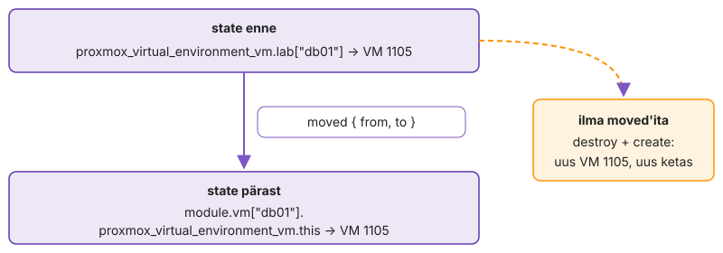

---
tags:
  - OpenTofu
  - Terraform
  - IaC
  - Loeng
---

# Loeng: OpenTofu lähemalt

Loeng jätkab IS1 [taristu koodina loengut](https://hkhk-tk.github.io/is1-automatiseerimine/k04/loeng/): provider'i protsess ja paralleelsus, state'i jagamine ja lukk, `moved`, pooleli jäänud `apply`, poliitika koodina, drift, golden image, osaline õnnestumine ning OpenTofu võrdlus teiste tööriistadega.

## Provider ja lukufail lähemalt

Jätkab IS1 loengu lõiku [Provider ja lukufail](https://hkhk-tk.github.io/is1-automatiseerimine/k04/loeng/#provider-ja-lukufail).

Kui provider'i uus versioon muudab mõne argumendi vaikeväärtust või skeemi, ilmub järgmisse plaani muudatus, mida keegi koodis ei teinud. Provider'i protsess töötab ainult ühe käsu ajal. Tofu käivitab selle alamprotsessina, provider teatab käivitusel standardväljundis protokolli versiooni ja socket'i aadressi ning edasi käivad kõik kutsed gRPC kaudu. Provider'i viga või paanika katkestab seepärast kogu käsu, mitte ühte ressurssi.

Paralleelsus on omaette rikkekoht. Kümme samaaegset kloonimist samast mallist tähendab kümmet ketta kopeerimist samale salvestusele ning Proxmox lukustab kloonimise ajal VM-ide konfiguratsioonifaile. Veateate `can't lock file ... got timeout` korral vähendatakse `-parallelism` väärtust või luuakse masinad mitmes osas. Pilve API-del on päringulimiidid ja provider kordab throttling'u vastuseid ise, nii et suur plaan venib ja pipeline'i timeout peab sellega arvestama.

## State lähemalt

Jätkab IS1 loengu osa [State kui tõe allikas](https://hkhk-tk.github.io/is1-automatiseerimine/k04/loeng/#2-state-kui-toe-allikas).

OpenTofu 1.10+ S3 backend lukustab tingimusliku kirjutusega: objekt `<key>.tflock` luuakse päisega `If-None-Match: *`. Vanemad juhendid kasutavad selleks DynamoDB tabelit. Lukk ei tea, kas selle omanik veel töötab, nii et `force-unlock` on alati inimese otsus.

Suures keskkonnas tuleb otsustada, kui suur võib olla üks state. Iga plaan värskendab kõik oma objektid API-st. 50 hosti ja paarsada ressurssi tähendavad iga plaani juures sadu API kutseid ja üht [lukku](https://opentofu.org/docs/language/settings/backends/s3/) kõigile, kes seda koodi puudutavad. Seepärast jagatakse state keskkonna ja komponendi kaupa (võrk, andmebaasid, rakenduse VM-id): väiksem plaan, väiksem blast radius, eraldi õigused. Hind on see, et komponendid loevad teineteise väljundeid ja muudatus üle mitme state'i ei ole enam üks `apply`.

Keskkondade eraldamiseks on kaks tavalist teed. `tofu workspace` annab samale koodile mitu state'i samas backendis: kood on üks, keskkondade erinevus peab olema muutujates ja vale aktiivse workspace'iga `apply` läheb teise keskkonda. Eraldi kaustad keskkonna kaupa, mis kutsuvad sama moodulit kindla tag'iga, tähendavad rohkem faile, aga tootmise backend, token ja mooduli versioon on eraldi ning PR näitab, millist keskkonda muudatus puudutab. Kui tootmisele on eraldi õigused ja eraldi muudatuste kord, sobib teine tee paremini.

Kui tõstad VM-ide koodi moodulisse, muutub aadress ja plaan on "5 kustutada, 5 luua".

<figure markdown="span">
  
  <figcaption>Joonis 4.1. Sama VM, uus aadress. <code>moved</code> plokk muudab ainult kirjet state'is. Ilma selleta kustutab tööriist VM-i ja teeb uue.</figcaption>
</figure>

`moved` plokk ütleb, et see on sama objekt uue aadressiga. Kuna plokk on koodis, kehtib see igas state'is, kus vana aadress veel on, erinevalt käsust `tofu state mv`, mis muudab ühte state'i ja ei jäta Giti jälge.

## Pooleli jäänud apply

`apply` uuendab state'i iga lõpetatud ressursi järel ja salvestab selle backendi käivituse ajal korduvalt, mitte ainult lõpus. Kui backend pole salvestamise hetkel kättesaadav, kirjutab tööriist state'i kohalikku faili `errored.tfstate`. Selle peab `tofu state push`-iga tagasi viima enne, kui keegi uue plaani teeb, muidu arvutatakse plaan vananenud state'i peal. Kui ressursi loomine algas, aga ei lõppenud (VM tekkis, provisioner või loomisjärgne kontroll ebaõnnestus), märgitakse objekt state'is **tainted**: see on olemas, aga järgmine plaan asendab selle. Pipeline'is tähendab see, et katkenud käivituse logi ja `errored.tfstate` peavad alles jääma ning lukk vabastatakse alles pärast seda, kui keegi on kontrollinud, et state ja API klapivad.

## Kuidas provider plaani arvutab

Jätkab IS1 loengu osa [Plaan enne muudatust](https://hkhk-tk.github.io/is1-automatiseerimine/k04/loeng/#3-plaan-enne-muudatust).

Plaani ajal saadab Tofu provider'ile iga ressursi eelmise oleku ja koodis kirjeldatud oleku (`PlanResourceChange`) ning provider vastab, milline tuleb uus olek ja millised atribuudid nõuavad asendust. Plaan on seega provider'i arvutus ja provider'i viga jõuab plaani samamoodi nagu sinu enda muudatus.

Salvestatud plaanifail (`plan -out`) tagab, et `apply` teeb täpselt selle, mis üle vaadati; kui state on vahepeal muutunud, keeldub `apply` vananenud plaanist. Pipeline'id teevad plaani PR-is ja pärast heakskiitu sama failiga `apply`. `-refresh=false` jätab drift'i nägemata ja `-target` jätab ülejäänu koodist lahku; dokumentatsioon nimetab viimast erandolukordade tööriistaks. `prevent_destroy` nurjab plaani, mis objekti kustutaks, aga ainult koodi kaudu. Proxmoxi `protection` lipp keelab kustutamise igast kanalist, ka UI-st, nii et andmebaasi masinale pannakse mõlemad.

## Poliitika koodina

Jätkab IS1 loengu osa [Plaan enne muudatust](https://hkhk-tk.github.io/is1-automatiseerimine/k04/loeng/#3-plaan-enne-muudatust).

Kahe rea koodimuudatus võib anda plaani, mis asendab viis masinat, ja 40. PR-i ülevaataja ei loe enam iga rida. **Poliitika koodina** (policy as code) tähendab, et reeglid on masinloetavad, Gitis ja testitud ning neid hinnatakse automaatselt enne `apply`-d. Tofu sees on kolm taset: `validation` kontrollib üht muutujat, [`precondition`](https://opentofu.org/docs/language/expressions/custom-conditions/) peatab ressursi muutmise, [`check`](https://opentofu.org/docs/language/checks/) ainult hoiatab. Need on mooduli autori reeglid. Organisatsiooni reeglid, mis kehtivad kõigile moodulitele ja meeskondadele, kirjutatakse eraldi: [Open Policy Agent](https://www.openpolicyagent.org/docs/latest/) hindab Rego keeles reegleid suvalise JSON-i peal ja [Conftest](https://www.conftest.dev/) käivitab need failide vastu, ka `tofu show -json` plaani vastu.

```rego
package main
import rego.v1
deny contains msg if {
  some rc in input.resource_changes
  "delete" in rc.change.actions; "db" in rc.change.before.tags
  msg := sprintf("%s: andmebaasi VM-i plaan ei kustuta", [rc.address])
}
```

Reegel näeb ainult seda, mida plaan teab. Väärtus, mis selgub alles `apply`-s, on JSON-is `after_unknown` all ja reegel, mis seda ei arvesta, laseb muudatuse vaikselt läbi. Seepärast annab teadmata väärtus keelu. Poliitikate repositoorium vajab ülevaatust ja erandite korda, muidu lülitatakse samm pipeline'ist välja. Sama mõte laieneb automaatikale endale (automation as code): moodulid, playbook'id, pipeline'i definitsioon ja AWX-i job template'id koos õigustega on Gitis. 1. kohtumisel nimetatud testitud tegevuste raamatukogu on IaC-s versioonitud moodulite kogu, mida meeskonnad kasutavad tag'i järgi (`?ref=v1.4.0`), mitte koodi kopeerides.

### Kui kontroll ise eksib

4. oktoobril 2021 anti Facebooki magistraalvõrgus tavahoolduse käigus käsk, mis pidi hindama magistraalvõrgu vaba võimsust, aga katkestas kõik ühendused andmekeskuste vahel. Facebooki [kokkuvõtte](https://engineering.fb.com/2021/10/05/networking-traffic/outage-details/) järgi pidi just sellised käsud peatama auditivahend, aga selle viga laskis käsu läbi. Teenused olid maas umbes kuus tundi ja taastamist aeglustas see, et ka sisemised tööriistad sõltusid samast võrgust.

Poliitika koodina on samasugune auditivahend ja sellel on samad rikked. Pärast tööriista uuendust ei vasta reegel enam plaani JSON-i kujule, väli on teise nimega või uut ressursitüüpi reeglis pole, ja reegel ei leia midagi keelata. Seepärast on poliitikal oma testid (`opa test`, `conftest verify`), mis käivitavad reegli teadaoleva hea ja halva plaani vastu, ning pipeline ebaõnnestub ka siis, kui poliitika samm ise ei käivitunud. Vaikimisi keelav seadistus (fail closed) tekitab rohkem erandipäringuid, aga vaikne läbilaskmine on just see rike, mille vastu auditivahend on.

Iseseisvaks lugemiseks: [Taristu koodina ja poliitika koodina](https://hkhk-tk.github.io/is1-automatiseerimine/teemad/iac/).

## Drift: kui tegelikkus läheb koodist lahku

Jätkab IS1 loengu osa [State kui tõe allikas](https://hkhk-tk.github.io/is1-automatiseerimine/k04/loeng/#2-state-kui-toe-allikas).

Öösel jääb andmebaas aeglaseks ja valves olev admin tõstab UI-s db01 RAM-i 1024-lt 2048-le. Koodis on endiselt 1024. Nädal hiljem teeb kolleeg väikese muudatusega `apply`, plaanis on muu hulgas rida `~ dedicated = 2048 -> 1024`, keegi ei loe seda ja RAM läheb tööpäeva keskel tagasi.

**Drift** tekib igast muudatusest koodist mööda: UI, käsitsi API kutse, teine tööriist, pilveteenuse enda automaatika. Tavaline plaan näitab seda kujul "mida ma teen, et kood jälle kehtiks", segamini sinu enda muudatustega. `plan -refresh-only` näitab ainult väljaspool tehtud muudatusi ega paku midagi tagasi panna.

State ja tegelikkus lahknevad kolmel viisil. Objekt on state'is, aga kustutati: refresh eemaldab selle ja plaan tahab selle uuesti luua. Objekt on state'is, aga atribuut muutus: plaan tahab selle tagasi panna. Objekt on olemas, aga state ei tea sellest: plaan on tühi, sest tööriist küsib API-lt ainult oma objekte. Kolmanda leiab ainult pool'i võrdlus state'iga.

Leitud drift'iga on kaks otsust: muudatus läheb koodi või kood võtab selle tagasi. "Jätame nii" tähendab, et järgmine `apply` otsustab sinu eest. Öine RAM-i tõstmine on erakorraline muudatus (emergency change), mis registreeritakse tagantjärele, ja IaC-s on see registreerimine commit. Drift'i leidmiseks käivitatakse plaan ajastatult: `-detailed-exitcode` annab erinevuse korral koodi 2 ja selle peale tuleb teavitus.

Enne koodi tehtud objektid tuuakse koodi alla **[import](https://opentofu.org/docs/language/import/)**-iga. `import` plokk läbib plaani nagu iga teine muudatus ja muudab ainult state'i. `-generate-config-out` kirjutab koodi mustandi, aga selles on kõik vaikeväärtused ja puudub see, mida API-st lugeda ei saa, näiteks millisest mallist VM kunagi kloonitud oli. Pakett VM-i sees ei ole OpenTofu jaoks drift, sest API seda ei näita; see on Ansible'i ala.

### Pidev jõustamine või ajastatud plaan

Puppeti agent käivitub vaikimisi iga 30 minuti järel (seadistus `runinterval`) ja paneb masina sisu koodi järgi tagasi. Seal püsib drift kuni pool tundi ja öine käsitsi parandus kaob ilma, et keegi otsustaks. OpenTofu ja Ansible jõustavad soovitud olekut ainult siis, kui keegi need käivitab. Valik on teavituse ja automaatse parandamise vahel. Automaatne `apply` ajakava järgi hoiab tegeliku oleku koodiga kooskõlas, aga kustutab ka õigustatud hädaparanduse ja teeb `apply` koodiga, mille plaani keegi ei lugenud. Tavaline kompromiss on ajastatud plaan koos teavitusega taristu tasemel ning automaatne jõustamine ainult masina sisus, kus muudatus on kohapealne ja kergemini tagasi võetav.

Ühe hosti drift on nähtav siis, kui keegi seda otsib. 2012. aasta juuli lõpus paigaldas Knight Capitali tehnik uue kauplemistarkvara käsitsi kaheksast serverist seitsmele. Kaheksandas jäi alles vana kood ja 1. augustil käivitas uue koodi jaoks ümber kasutatud lipp seal ammu kasutusest maas oleva funktsiooni. [SEC-i otsuse](https://www.sec.gov/litigation/admin/2013/34-70694.pdf) järgi tegi süsteem umbes 45 minutiga üle 4 miljoni tehingu ja firma kaotas üle 460 miljoni dollari. Otsuses on puudusena nimetatud, et paigaldust ei vaadanud üle teine inimene ja puudus kord, mis kontrolliks, kas kõik serverid said sama versiooni. Kood ja võrdlus koodi vastu on see kontroll.

Iseseisvaks lugemiseks: [IT-migratsioon ja pilve migratsioon](https://hkhk-tk.github.io/is1-automatiseerimine/teemad/migratsioon/).

## Golden image ja malli elutsükkel

Jätkab IS1 loengu osa [Süsteemi elutsükkel](https://hkhk-tk.github.io/is1-automatiseerimine/k04/loeng/#4-susteemi-elutsukkel-loomine-muutmine-mahavotmine).

Paketi uuendamise teine tee on ehitada uus mall ja masin asendada (immutable infrastructure). VMware'i maailmas on teine tee tuttav template'i ja customization spec'i kujul. **Golden image'i** ehitab [Packer](https://developer.hashicorp.com/packer/docs): kloonib baasmalli, käivitab ajutise VM-i, paigaldab tarkvara, koristab masina identiteedi ja salvestab tulemuse uue mallina. Ilma koristuseta (machine-id, SSH host key'd, cloud-init'i olek) on kõigil kloonidel sama host key ja machine-id, systemd-networkd tuletab sellest DHCP DUID-i ja kloonid võivad saada sama aadressi.

| | Golden image ja asendus | Seadistus käivitusel |
|---|---|---|
| Uue masina käivitus | kiire, tarkvara on kettal | aeglasem, paigaldus igal loomisel |
| Kõik masinad samad | jah, sama mall | sõltub paketihoidla sisust sel hetkel |
| Paketihoidla rikke ajal | taastamine töötab | uus masin ei saa valmis |
| Turvapaik | uus ehitus ja kõigi masinate asendus | `apt upgrade` kohapeal |
| Rollback | eelmine mall, üks rida koodis | paketi vana versioon, kui see on alles |

*Tabel 4.1. Golden image ja seadistus cloud-init'i või Ansible'iga. Enamik meeskondi kasutab mõlemat: harva muutuv osa on mallis, rakenduse seadistus tuleb käivitusel.*

Uus mall jõuab VM-ile ainult uuesti kloonides, nii et iga malli vahetus on plaanis `-/+`. Pilves on tavaline `create_before_destroy`: uus masin luuakse enne vana kustutamist ja koormusjaotur vahetab liikluse. Kui igal VM-il on fikseeritud ID, nimi ja IP, nagu on-prem keskkonnas sageli, ei saa uus tekkida enne, kui vana on läinud, ja asendus tähendab katkestust. Seepärast viiakse uus mall esmalt ühele masinale ja päeva pärast ülejäänutele. Mall vananeb ka ise, nii et selle ehituse käivitab ajakava või turvauuendus, mitte kellegi mälu.

Mallil on oma elutsükkel. Iga ehitus annab uue malli, mille nimes on kuupäev või versioon, ja kood viitab mallile data source'i kaudu tag'i järgi, mitte ID-ga. Vana malli kustutamine on ohutu alles siis, kui ükski kood ega VM sellele ei viita. Proxmoxi linked clone kasutab malli ketast baasina, nii et malli ei saa kustutada enne, kui sellest tehtud kloonid on läinud. Malli sisu on turvaküsimus: selles olev haavatav pakett või unustatud võti jõuab igale masinale, mis sellest tehakse. Seepärast ehitatakse mall pipeline'is, mitte kellegi tööjaamas, ja ehituse logi ning paketiloend jäävad malli versiooni juurde.

## Osaline õnnestumine

Jätkab IS1 loengu osa [Orkestreerimine: Ansible ja OpenTofu koos](https://hkhk-tk.github.io/is1-automatiseerimine/k04/loeng/#5-orkestreerimine-ansible-ja-opentofu-koos).

Tööriistade vahel ei ole tehingut. Kui Tofu lõi kolm VM-i ja Ansible ebaõnnestus teise peal, on tulemus kolm olemasolevat masinat: üks seadistatud, üks pooleli ja üks puutumata. Töövoog peab seepärast olema korratav algusest. Tofu teine `apply` annab tühja plaani ja Ansible'i teine käivitus teeb ainult puuduva, nii et parandus on veakoha kõrvaldamine ja sama töövoo uus käivitus. Kompenseerivat sammu, näiteks masina kustutamist, kasutatakse harva, sest pooleli masinat on veaotsingul vaja.

Teine rikkekoht on ajastus. VM on API jaoks valmis enne, kui cloud-init on võtmed, kasutajad ja võrgu paika pannud. Siis esimene SSH-ühendus ebaõnnestub või jõuab kohale enne cloud-init'i lõppu ja kaks tööriista muudavad samal ajal samu faile. Töövoog ootab seepärast selget valmisoleku märki (`cloud-init status --wait`, Ansible'i `wait_for_connection`), mitte fikseeritud `sleep`-i. AWX-i workflow'is on igal node'il eraldi järgmine samm õnnestumise ja ebaõnnestumise korral, nii et ebaõnnestunud seadistus saab avada tiketi ja jätta hosti koormusjaoturi pool'ist välja.

## OpenTofu, Terraform ja teised tööriistad

Jätkab IS1 loengu osa [OpenTofu ja Terraform](https://hkhk-tk.github.io/is1-automatiseerimine/k04/loeng/#6-opentofu-ja-terraform).

| | OpenTofu | Terraform |
|---|---|---|
| Litsents | MPL 2.0, Linux Foundation | BSL 1.1 alates versioonist 1.6, HashiCorp (IBM) |
| Provider'ite registry | `registry.opentofu.org` | `registry.terraform.io` |
| State'i krüpteerimine | tööriistas endas (1.7+) | ainult backendi poolt, näiteks S3 krüpteerimine |
| Ainult ühes tööriistas | `-exclude`, provider'ite `for_each` (1.9) | HCP Terraformi teenused |
| State'i ühilduvus | loeb Terraform 1.5 state'i otse | ei loe OpenTofu krüpteeritud state'i |

*Tabel 4.3. OpenTofu ja Terraform. Sama kood annab mõlemast sama plaani, kuni kasutad ainult ühele omaseid võimalusi.*

Töökuulutustes on enamasti kirjas "Terraform". Oskus on sama: HCL, state, plaani lugemine, moodulid. BSL piirab Terraformi kasutamist HashiCorpiga konkureerivates toodetes, oma taristu haldamist see ei puuduta. Kursus kasutab OpenTofut, sest MPL ei vaja litsentsi ülevaatust ühelgi juhul. Kolimine ühelt tööriistalt teisele on üks commit, millele eelneb state'i varukoopia ([migreerimine](https://opentofu.org/docs/intro/migration/)).

Vendor lock-in tuleb sellest, mis on tööriista ümber. HCP Terraformi poliitikad võivad olla [Sentinelis](https://developer.hashicorp.com/sentinel/docs), mida väljaspool HashiCorpi tooteid ei käivitata, OPA reeglid aga töötavad mõlema tööriista plaani JSON-i peal. Kui hindad tööriista, vaata seepärast ka seda, kus asuvad state, poliitika, saladused ja käivitus, sest need on kolimisel suurem töö kui HCL.

Võõrast IaC koodi lugedes otsi kolme asja: kus on soovitud olek, kus on state ja mis näitab plaani enne muudatust.

| Tööriist | Soovitud olek | State | Plaan enne muudatust |
|---|---|---|---|
| Ansible | YAML, masina sisu | puudub, küsib igal käivitusel masinalt | `--check --diff`, mitte kõigi moodulitega |
| OpenTofu / Terraform | HCL, taristu objektid | fail backendis | `plan` |
| [Pulumi](https://www.pulumi.com/docs/) | Python, TypeScript, Go | Pulumi Cloud või oma backend | `pulumi preview` |
| [CloudFormation](https://docs.aws.amazon.com/cloudformation/) | YAML või JSON, ainult AWS | AWS hoiab ise | change set |

*Tabel 4.4. Tööriistad kõrvuti.*

Pulumi annab programmeerimiskeele tsüklid ja testid, aga lõppolekut on koodist raskem välja lugeda.

## Kokkuvõte

<div class="grid cards kokkuvote" markdown>

-   **Aadress on identiteet**

    Lisa ümbernimetamisel või moodulisse tõstmisel `moved` plokk. Ilma selleta plaanib Tofu kustutamise ja uue loomise.

-   **Drift**

    Leia drift ajastatud `plan -refresh-only`-ga ja otsusta iga leiu üle: muudatus läheb koodi või võetakse tagasi. Pane otsus commit'i, muidu otsustab järgmine `apply`.

-   **Plaan ja poliitika**

    Hinda organisatsiooni reegleid plaani JSON-i peal, testi neid ja keela teadmata väärtusega muudatus.

-   **OpenTofu ja Terraform**

    Arvesta, et ühe tööriista lisavõimalus, näiteks OpenTofu state'i krüpteerimine, seob sind selle tööriistaga.

</div>

<div class="kontrollkysimus" markdown>
**Kontrollküsimus:** Miks plaanib Tofu ressursi kustutamise ja uuesti loomise, kui nimetasid selle koodis ümber, ja kuidas seda vältida?
</div>

## Kontrolli ennast

??? question "Kolleeg tõstis öösel UI-s db01 RAM-i 2048-le. Mida näitab `plan -refresh-only`, mida tavaline `plan` ja mida sa teed?"
    `-refresh-only` näitab muutust 1024 → 2048 väljaspool Tofut, tavaline `plan` tahab selle 1024-le tagasi panna. Kui muudatus oli õige, läheb 2048 koodi; kui ei, teed koodiga `apply`. Otsus läheb koos põhjusega commit'i.

??? question "Poliitika keelab andmebaasi VM-i kustutamise, kui `tags` sisaldab `db`. Millal laseb see kustutamise siiski läbi?"
    Kui tag'i väärtus pole plaani ajal teada (`after_unknown`), kui VM on märgistatud teisiti või kui kustutamine käib Tofust mööda, näiteks UI-st. Esimese vastu aitab reegel, mis keelab teadmata tag'iga muudatuse, viimase vastu ainult Proxmoxi `protection`.
