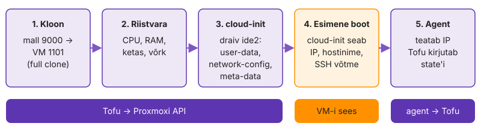
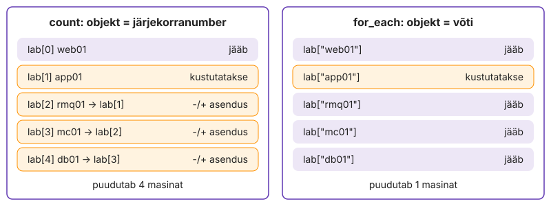
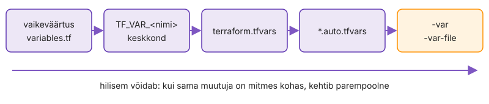

---
tags:
  - OpenTofu
  - Proxmox
  - Ansible
  - Praktikum
---

# Süvenemine: OpenTofu Proxmoxis

Need osad jätkavad IS1 praktikumi [OpenTofu (Terraform) Proxmoxis](https://hkhk-tk.github.io/is1-automatiseerimine/k04/lab/) koodi. Käsud käivitad control'is kaustas `~/kursus/k04-tofu`, kui sammu juures pole kirjas teist kausta. Proxmoxi token kehtib 5. kohtumise eelõhtuni, nii et VM-e loovad osad tee enne seda. Need võid teha ka pärast kohtumist VPN-i kaudu.

Mitu sammu on katsed, mille plaani ainult loed: need näitavad, mida Tofu teeks, ilma et midagi katki läheks. Otsused (drift, intsident) kirjutad faili `k04-tofu/NOTES.md`, sest koolitaja küsib nende põhjuseid.

Tee osad selles järjekorras: osa 1, osa 2, leht [Moodul, moved ja state](lab-3-moodul-state.md), osa 3, lehed [Elutsükkel ja kaitsed](lab-5-elutsukkel.md), [Import, drift ja keskkonnad](lab-6-import-drift.md), [Golden image Packeriga](lab-7-kuldne-mall.md) ja [Intsident: state ja tegelikkus](lab-8-intsident.md) ning enne esitamist osa 4. Veaotsing on lehel [Abi](abi.md).

## Osa 1 · Üks VM lähemalt

Osa 1 sammud tehakse VM-i `test01` peal, enne kui IS1 sammus [Koristus ja commit](https://hkhk-tk.github.io/is1-automatiseerimine/k04/lab-1-uks-vm/#koristus-ja-commit) selle kustutad.

### 1.1 Leia Tofu töö Proxmoxi logist

Tee see samm pärast IS1 sammu [Loo test01](https://hkhk-tk.github.io/is1-automatiseerimine/k04/lab-1-uks-vm/#loo-test01).

Tofu ütleb, et lõi VM-i. Proxmox peab sama asja oma logis näitama, sest audit käib serveri poolel, mitte sinu terminalis.

Kui VM kaob või muutub öösel, otsitakse süüdlast kõigepealt Proxmoxi task-logist. Seepärast peaks igal tööriistal olema oma token: logis on siis kohe näha, kas muudatuse tegi inimene või automaatika.

1. UI-s: `test01` → **Task History**. Leia kloonimise ja käivitamise read ning vaata **User** veergu.
2. Ava kloonimise rida topeltklõpsuga ja vaata, kui kaua kloonimine võttis.
3. Vaata, milline kasutaja koos tokeni nimega on logis ja mitu ülesannet üks `apply` tekitas.

Üks `apply` tekitab mitu ülesannet (kloon, seaded, käivitus), sest provider teeb API-s sama, mida sina teeksid UI-s mitme klõpsuga.

**Edasi saad minna, kui** Task History's on näha kasutaja koos tokeni nimega ja kloonimise kestus.

### 1.2 Vaata VM-i seest

Tee see samm pärast IS1 sammu [Tee VM uuesti](https://hkhk-tk.github.io/is1-automatiseerimine/k04/lab-1-uks-vm/#tee-vm-uuesti), kui `ssh` töötab.

Tofu näeb VM-i ainult väljast, API kaudu. Kui Ansible ei saa hiljem uue masinaga ühendust, otsid viga just neist failidest.

Kui uus masin ei vasta, on küsimus alati sama: kas viga on draivis (Tofu pool) või masinas (cloud-init pool). Need failid annavad vastuse minutiga, ilma VM-i uuesti tegemata.

Leia vastused tabeli käskudega ([cloud-init dokumentatsioon](https://cloudinit.readthedocs.io/)).

| Küsimus | Kust vaatad |
|---|---|
| Kas cloud-init lõpetas ja kui kaua see võttis? | `cloud-init status --long`, `cloud-init analyze show` |
| Kust tuli IP? | `/etc/netplan/50-cloud-init.yaml` |
| Kes pani su võtme? | `~kasutaja/.ssh/authorized_keys`, `grep -i ssh /var/log/cloud-init.log` |
| Kust tuli hostinimi? | `hostnamectl`, `cloud-init query ds.meta_data` |
| Kas agent töötab? | `systemctl status qemu-guest-agent` |
| Kas `/etc/hosts`-i haldab cloud-init? | `cat /etc/cloud/cloud.cfg.d/99-labori-seis.cfg` |

*Tabel L4.2. Kust VM-i sees näed, mida cloud-init tegi.*

1. Ühendu `test01`-ga ja täida tabel.
2. Control node'il võrdle oma argumenti agendi atribuudiga.

    ```bash
    tofu state show proxmox_virtual_environment_vm.test01 | grep -A3 ipv4_addresses
    ```

`ip_config` aadress on see, mida sina soovisid. `ipv4_addresses` on see, mida agent VM-i seest teatas. Kui need klapivad, on ahel mall → draiv → cloud-init → netplan terve. Kui agent teatab teise aadressi või ei teata midagi, on viga masina sees, mitte koodis.

**Edasi saad minna, kui** `cloud-init status --long` näitab `status: done`, IP on netplan'is, hostinimi on `test01` ja agent on `active`.

### 1.3 Miks see nii töötab

Need lõigud seletavad IS1 praktikumi osa „Üks VM koodist“ samme.

**Data source.** Data source ainult loeb olemasolevaid objekte ega muuda midagi; seda loetakse igal plaanil uuesti. AWS-is otsitakse samamoodi AMI ID-d nime või tag'i järgi, nii et ID-d koodi ei kirjutata.

**Sõltuvusgraaf.** Viide `clone.vm_id` data source'ile tekitab sõltuvuse, nii et Tofu loeb malli enne VM-i loomist. Sõltuvusgraaf on Tofu tööpõhimõte: Tofu ehitab viidetest graafi ja teeb omavahel sõltumatud toimingud paralleelselt, failide järjekord ei loe.

**Muutmine või asendus.** RAM-i saab olemasoleval VM-il muuta, malli mitte, sest teisest mallist kloonides tekib teine ketas. Provider märgib skeemis iga argumendi kohta, kas selle muutmine nõuab objekti asendamist (SDKv2 provider'is `ForceNew`, plugin framework'is `RequiresReplace`). Plaanis on see märge kujul `# forces replacement`.

**Full clone.** Full clone kopeerib malli ketta ja VM ei sõltu pärast loomist mallist. Linked clone oleks kiirem ja võtaks vähem ruumi, aga seob VM-i malliga: malli ei saa kustutada, kuni sellest tehtud VM-id on alles.

**Cloud-init ja `-replace`.** cloud-init saab seadistuse väikeselt virtuaalselt CD-lt, millel on `user-data`, `network-config` ja `meta-data` koos `instance-id`-ga. Kui `instance-id` on sama mis eelmisel käivitusel, peab cloud-init masinat juba seadistatuks ega seadista võrku ja kasutajaid uuesti. Seepärast jõuab cloud-init'i draivi muudatus VM-i alles pärast `-replace`-i, mis loob VM-i uuesti. Iga `-replace` annab VM-ile uue host key, nii et `known_hosts`-ist tuleb vana rida eemaldada.

**QEMU agent.** `qemu-guest-agent` suhtleb hüperviisoriga virtio-serial kanali kaudu (VM-is seade `/dev/virtio-ports/org.qemu.guest_agent.0`) ja annab Proxmoxile VM-i IP. Provider ootab agenti vaikimisi 15 minutit. Meil on timeout 3 minutit, et katkine boot annaks vea kiiresti.

<figure markdown="span">
  
  <figcaption>Joonis L4.4. Mis juhtub ühe VM-iga <code>tofu apply</code> ajal. Sammud 1–3 teeb Tofu API kaudu, samm 4 toimub VM-i sees, sammus 5 jõuab IP agendi kaudu state'i.</figcaption>
</figure>

**Provider kui protsess.** `tofu init` laeb provider'i kausta `.terraform/providers/…`. See on Go binaar, mille Tofu käivitab alamprotsessina ja millega ta suhtleb gRPC kaudu. Tofu ise ei tea Proxmoxist midagi, kogu API tundmine on provider'is.

**`.terraform/` ja lukufail.** Kaust `.terraform/` on uuesti allalaaditav ja provider'ite binaarfailide tõttu suur (`bpg/proxmox`-iga kümneid megabaite). `.terraform.lock.hcl` on mõne kilobaidi suurune ja määrab, millised täpsed provider'i versioonid ja kontrollsummad projekti kuuluvad. Seepärast läheb Giti ainult lukufail.

**Token keskkonnamuutujas.** `TF_VAR_proxmox_api_token` on tavaline keskkonnamuutuja. `cat /proc/$$/environ | tr '\0' '\n' | grep TF_VAR` näitab, et seda saavad lugeda kõik sinu kasutaja protsessid ja root. Seepärast on `proxmox.env` õigustega 600 ja control node'il pole teisi kasutajaid.

**`sensitive` ja state.** `sensitive` peidab väärtuse plaanist ja väljundist. State'i kirjutatakse aga lihttekstina kõik, mida ressurss või output sisaldab, kui state'i krüpteerimine pole sisse lülitatud (vt [krüpteeritud state](lisa.md#lisaprojekt-krupteeritud-state)). Saladuse kaitse algab seega sellest, et saladus ei jõua ühtegi ressurssi ega output'i.

**Plaan on ennustus.** `validate` ei pöördu Proxmoxi poole ja `plan` ei küsi, kas node on olemas: olematu `node_name` läbib mõlemad ja ebaõnnestub alles `apply`-s. Pipeline, mis kontrollib ainult `validate`-i ja `plan`-i, sellist viga ei leia. Seepärast on tootmise kõrval vaja dev-keskkonda, kus sama koodiga `apply` tehakse.

**`serial` ja `lineage`.** `serial` on state'i versiooninumber ja kasvab iga muutva `apply`-ga. `lineage` on state'i loomisel määratud püsiv unikaalne ID. Kaks faili sama `lineage`-iga on sama state'i eri versioonid, eri `lineage`-iga failid on eri state'id. State on ainus koht, kus on kirjas, et koodi `test01` on Proxmoxis kindel VM ID. Avaliku võtme hoidmine state'is on ohutu, aga samasse kohta jõuaks ka parool, kui see oleks ressursi argument.

**Provisioner.** Provisioner käivitub ainult ressursi loomisel ja Tofu ei salvesta selle tulemust state'i. Tofu ei tea, mida skript tegi, ega märka, et skript muutus: plaan ütleb "No changes". Masina sisu jääb Tofule nähtamatuks ja ainus viis seda uuendada on masin uuesti teha. Ansible kontrollib sama faili igal käivitusel ja näitab erinevust `changed`-ina. OpenTofu dokumentatsioon nimetab provisioner'eid viimaseks abinõuks ([provisioner'id](https://opentofu.org/docs/language/resources/provisioners/syntax/)): mis peab olema igas masinas, kuulub malli, esimese käivituse töö cloud-init'ile ja seadistus Ansible'ile.

Kui jõudsid kiiremini: [Lisaülesanded → 1. Validate'i ja plaani piirid](lisa.md#1-validatei-ja-plaani-piirid), tekitad igale kontrolli etapile vea, mida ainult see etapp leiab.

## Osa 2 · Viis VM-i lähemalt

Osa 2 tee pärast IS1 sammu [Tee kõik viis](https://hkhk-tk.github.io/is1-automatiseerimine/k04/lab-2-viis-vmi/#tee-koik-viis), kui viis VM-i töötavad ja `tofu plan` ütleb "No changes".

**Kui teed seda tööl iga päev:** `tofu state list` näitab viit `proxmox_virtual_environment_vm.lab[...]` aadressi, mille lõid `for_each`-i, `validation`-i ja salvestatud plaaniga. Kui see on sul juba korras, mine otse sammu „[2.6 Kirjuta tofu test](#26-kirjuta-tofu-test)“.

### 2.1 Püüa vead kinni plaanis

Paned muutujale reeglid, mis lükkavad vigase sisendi tagasi enne, kui Proxmoxi poole midagi läheb. Ilma `validation`-ita tuleb vale IP välja alles siis, kui masin on ilma võrguta käivitunud.

`validation` hinnatakse siis, kui muutuja väärtus on teada, enne ühtki provider'i kutset. Sama reegel kehtib igale väärtuse allikale: `tfvars`, `-var` ja `TF_VAR_`.

Lisa `vms`-ile `validation` plokid:

- `distro` on `ubuntu` või `alma`
- `ip` on maskiga: `can(cidrnetmask(v.ip))`
- IP-d ja `vm_id`-d on unikaalsed (`distinct` ja `length`)
- igal plokil on oma `error_message`, mis ütleb, mida parandada

1. Pane web01-le `ip = "10.10.<nr>.11"` (ilma maskita) ja käivita `tofu plan`.
2. Pane `distro = "debian"` ja käivita `tofu plan`.
3. Pane õiged väärtused tagasi.

Veateade nimetab sinu `error_message`-i, mitte provider'i või Proxmoxi viga. See tõestab, et kontroll toimus Tofu sees ja API-sse ei läinud ühtki päringut. Kui sinu teade ütleb, mida parandada, ei pea järgmine inimene koodi lugema.

**Edasi saad minna, kui** sammudes 1 ja 2 tuli sinu enda veateade enne, kui Proxmoxi poole midagi läks, ja pärast parandust on plaan jälle "No changes".

### 2.2 Salvestatud plaan

Tavaline `apply` arvutab plaani uuesti. Kui vahepeal muutis keegi midagi, teeb `apply` midagi muud kui see, mille üle sa otsustasid. Salvestatud plaan sulgeb selle akna ja hiljem ehitab `up.sh` sellele oma kaitse.

1. Muuda `terraform.tfvars`-is web01 RAM 512 pealt 768 peale, salvesta plaan faili ja loe see läbi.

    ```bash
    tofu plan -out=web01.tfplan
    tofu show web01.tfplan | grep -E 'dedicated|Plan:'
    tofu apply web01.tfplan
    git status --short
    ```

2. Pane RAM tagasi 512 peale, tee uus plaanifail ja `apply` sellest.

`apply` plaanifailist ei küsi kinnitust, sest otsus tehti plaani lugemisel. Kui state on vahepeal muutunud, keeldub `apply` vananenud plaanist. Plaanifail ei lähe Giti: starteri `.gitignore`-is on `*.tfplan`.

**Edasi saad minna, kui** `apply` tegi plaanifailist `1 changed`, pärast tagasivõtmist on `tofu plan` "No changes" ja `git status` ei näita plaanifaili.

### 2.3 Vaata, mis on VM-i identiteet

See etapp on katse, mida tootmises teha ei tahaks. Muudad ainult võtme nime ja vaatad, mida plaan selle peale näitab. `apply`-d ei tee.

Hostinime muutmine tundub kosmeetiline. Tofu jaoks on võti aga objekti aadress ja uus aadress tähendab uut objekti. Kes seda ei tea, kustutab ümbernimetamisel töötava masina.

1. Nimeta `terraform.tfvars`-is `web01` ümber `www01`-ks ja vaata plaani.

    ```bash
    tofu plan | grep -E '^\s+#|Plan:'
    ```

2. Vaata, mida plaan tahab teha ja milliseid kahte aadressi see nimetab.
3. Pane nimi tagasi `web01`-ks ja kontrolli, et plaan on "No changes".

Plaan tahab `lab["www01"]` luua ja `lab["web01"]` kustutada, kuigi IP, `vm_id` ja kõik muu on samad. Tofu võrdleb objekte aadressi, mitte sisu järgi. Kui VM-i kirjeldus läheb moodulisse, näed, kuidas `moved` plokk ütleb, et uus aadress on sama objekt.

**Edasi saad minna, kui** plaan näitas `1 to add, 1 to destroy` vana ja uue aadressiga ja pärast tagasivõtmist on plaan "No changes".

### 2.4 Võrdle count'iga

Eelmine katse näitas, et `for_each` seob objekti võtmega. Siin teed sama katse `count`-iga, mis seob objekti järjekorranumbriga, ja vaatad, mida see listi keskelt kustutamisel teeb. Katse käib failidega ajutises kaustas, nii et ükski VM ei saa viga.

Vanemas koodis on `count` VM-ide jaoks tavaline. Kes selle koodi üle võtab ja listist ühe hosti eemaldab, asendab vaikides kõik järgmised masinad. VM-i asendus tähendab uut ketast ja kadunud andmeid.

1. Tee kaust `/tmp/count-proov/` ja sinna `main.tf`: `variable "nimed"` vaikeväärtusega `["a", "b", "c"]` ja `resource "local_file" "f"` `count = length(var.nimed)`-iga, `filename = "${path.module}/${var.nimed[count.index]}.txt"`, `content = var.nimed[count.index]`.
2. Loo failid, siis kustuta listi keskelt üks nimi.

    ```bash
    cd /tmp/count-proov && tofu init -input=false > /dev/null && tofu apply -auto-approve
    tofu plan -var 'nimed=["a","c"]' | grep -E '^\s+#|Plan:'
    ```

3. Vaheta ressursil `count` välja `for_each = toset(var.nimed)` (`each.key` kahes kohas), tee `tofu apply` ja korda sama plaani.
4. Võrdle kahe plaani aadresse, siis `cd ~/kursus/k04-tofu && rm -rf /tmp/count-proov`.

`count`-iga tahab plaan asendada `f[1]`-e (`b.txt` → `c.txt`) ja kustutada `f[2]`, kuigi sina kustutasid ainult `b`. `for_each`-iga on plaanis ainult `f["b"]` kustutamine. Failide puhul on vahe kosmeetiline, VM-ide puhul tähendaks `count` app01 eemaldamisel rmq01, mc01 ja db01 asendust. `count` sobib ainult küsimusele "kas see üks asi on olemas", näiteks `count = var.enabled ? 1 : 0`.

**Edasi saad minna, kui** `count`-i plaan asendas `f[1]`-e ja kustutas `f[2]`, `for_each`-i plaan kustutas ainult `f["b"]`.

### 2.5 Uuri avaldisi konsoolis

Tee see samm pärast IS1 sammu [Anna tulemus output'iga välja](https://hkhk-tk.github.io/is1-automatiseerimine/k04/lab-2-viis-vmi/#anna-tulemus-outputiga-valja).

Enne testide kirjutamist proovid `tofu console`-is avaldisi, millest selle korra kood koosneb. Konsool loeb sinu muutujad, locals'id ja state'i, aga ei muuda midagi.

Vale avaldis `locals`-is ei ebaõnnestu alati. Sageli annab see lihtsalt vale tulemuse: tühja grupi, vale IP või puuduva hosti, ja viga tuleb välja alles Ansible'is.

Käivita `tofu console` ja proovi ridu ükshaaval. Ennusta iga rea tulemust enne, kui vajutad Enter ([funktsioonid](https://opentofu.org/docs/language/functions/)).

1. `for` avaldised: list ja map, filtriga ja ilma.

    ```hcl
    [for k, v in var.vms : k if v.distro == "alma"]
    { for k, v in var.vms : k => v.memory }
    sum([for v in var.vms : v.memory])
    ```

2. Tingimus, `lookup`, `merge` ja `try`.

    ```hcl
    var.vms["db01"].memory >= 1024 ? "suur" : "väike"
    lookup(var.vms["web01"], "protection", false)
    merge({ a = 1, b = 2 }, { b = 3 })
    try(var.vms["www01"].ip, "pole sellist hosti")
    ```

3. Võrguavaldised, mida `validation` ja hiljem `precondition` kasutavad.

    ```hcl
    split("/", var.vms["web01"].ip)[0]
    cidrhost(var.vms["web01"].ip, 0)
    cidrhost(var.vms["web01"].ip, 1)
    cidrnetmask(var.vms["web01"].ip)
    ```

4. Agregaadid ja nimede normaliseerimine. Teine rida ebaõnnestub meelega: loe veateadet.

    ```hcl
    max([for v in var.vms : v.memory]...)
    max([for v in var.vms : v.memory])
    min([for v in var.vms : v.memory]...)
    lower(var.pool)
    upper(var.vms["db01"].group)
    ```

5. Genereeritud saladus. Ajutises kaustas `/tmp/k04-saladus` (mitte repositooriumis) tee `hashicorp/random` provider'iga `random_password`, mis annab rakenduse andmebaasi kasutajale parooli. Nõuded: 24 märki, vähemalt 2 suurtähte ja 2 numbrit, erimärgid ainult `_-.` (shellis ja URL-is ohutud), uus parool tuleb ainult muutuja `rotation` muutusest (`keepers`), output on `sensitive`. Kontroll:

    ```bash
    cd /tmp/k04-saladus && tofu init -input=false > /dev/null && tofu apply
    tofu output -raw db_app_password | wc -c                                  # 24
    jq -r '.resources[].instances[].attributes.result' terraform.tfstate      # parool lihttekstina
    tofu plan -var rotation=2026-11 | grep -E 'forces replacement|Plan:'
    tofu output -raw db_app_password | ansible-vault encrypt_string --stdin-name db_app_password
    cd ~/kursus/k04-tofu && rm -rf /tmp/k04-saladus
    ```

`merge` võtab sama võtme korral viimase väärtuse, nii et `b = 3`. `lookup` vaikeväärtusega ja `try` ei ebaõnnestu puuduva võtme või atribuudi peale: `protection` tuleb objekti alles db01 kaitsmisel ja `var.vms["www01"].ip` ilma `try`-ta ebaõnnestuks. `cidrhost(ip, 0)` annab võrgu aadressi ja `cidrhost(ip, 1)` võrgu esimese hosti, klassi võrgus tavaliselt lüüsi. Kui võrgu aadress on web01-l ja lüüsil sama, on need samas võrgus; just seda kontrollib hiljem `precondition`. Sama `sum`-avaldis on RAM-i kvoodi kontrolli alus, mille lisad koos kaitsetega.

`min` ja `max` võtavad arvud eraldi argumentidena, mitte listina: `...` laiendab listi argumentideks, ilma selleta tuleb `number required, but have tuple`. `lower` teeb segatähtedega GitHubi kasutajanimest pool'i nimes väiketähtedega kuju, mida nõuavad näiteks S3 bucketi nimed ja DNS-kirjed.

`random_password` ei vaja ühtki parooli käsitsi, aga tulemus on state'is lihttekstina. Seepärast läheb saladus Ansible'ile Vault'i krüpteerituna ja state'i tuleb kaitsta nagu paroolifaili ([krüpteeritud state](lisa.md#lisaprojekt-krupteeritud-state)). `keepers` teeb rotatsiooni koodis nähtavaks: plaan näitab `forces replacement`, mitte vaikset muutust. OpenTofu 1.11+ `ephemeral` ressurss hoiab sellise väärtuse state'ist üldse väljas, aga siis peab väärtust kasutav ressurss või provider selle samas käivituses kätte saama.

**Edasi saad minna, kui** kõik viis sammu andsid oodatud tulemuse ja oskad selgitada, miks `try` ja `lookup` ei ebaõnnestunud.

### 2.6 Kirjuta tofu test

[`tofu test`](https://opentofu.org/docs/cli/commands/test/) võltsib `mock_provider`-iga provider'i vastused, plaani loogika jääb samaks. Nii kontrollid oma reegleid ja väljundeid sekunditega, ilma Proxmoxi ja ühegi VM-ita.

Ilma testita leiad vigase `validation`-i alles siis, kui see laseb vea läbi. Automaatne hindaja ja hilisem pipeline saavad sama testi käivitada ilma ligipääsuta sinu klassi Proxmoxile.

Kirjuta `tests/vms.tftest.hcl`:

- `mock_provider "proxmox"` ja selles `mock_data "proxmox_virtual_environment_vms"`, mille `defaults` annab ühe malli (`vms = [{ name, node_name, status, tags, template, vm_id = 9000 }]`)
- faili tasemel `variables` plokk kõigi kohustuslike muutujatega peale tokeni (see tuleb keskkonnast) ja kahe VM-iga; `ssh_public_key` osutab testi võtmefailile `tests/id_test.pub` (ainult avalik võti)
- `run "hosts"`: `command = plan`, `assert`, et `output.hosts["web01"]` on IP ilma maskita
- `run "ip_ilma_maskita"` ja `run "sama_vm_id"`: oma `variables` vigase `vms`-iga ja `expect_failures = [var.vms]`

```bash
tofu test
tofu validate
```

`pass` vigase sisendiga testis tähendab, et reegel keeldus nii, nagu pidi. Kui eemaldad ajutiselt ühe `validation` ploki ja käivitad `tofu test` uuesti, peab vastav test ebaõnnestuma. Test, mis ei ebaõnnestu kunagi, ei kontrolli midagi.

> `tofu validate` kontrollib ka testifaile. Vigane test nurjab automaatse hindaja `validate` kontrolli, nii et käivita mõlemad.

**Edasi saad minna, kui** `tofu test` näitab kõiki `run` plokke `pass` ja `Success!`.

### 2.7 Commit

Testid lähevad samasse harusse nagu IS1 kood. Automaatse hindaja `validate` kontrollib ka testifaile.

```bash
tofu fmt -recursive
cd ~/kursus
git add k04-tofu
git commit -m "k04: validation ja tofu test"
git push
```

**Edasi saad minna, kui** `bash autograde/check.sh k04 validate` annab `OK`.

### 2.8 Miks see nii töötab

Need lõigud seletavad IS1 praktikumi osa „Viis VM-i muutujatega“ ja selle osa samme.

**`for_each`-i võti.** `for_each`-i võti on objekti identiteet. Kui võti muutub, on see Tofu jaoks teine objekt ja vana objekt kustutatakse. Seepärast vali võtmeks väärtus, mis ei muutu: hostinimi, mitte järjekorranumber või IP.

**`count` ja `for_each`.** `count` seob objekti järjekorranumbriga. Kui kustutad listi keskelt app01, nihkuvad järgmised indeksid ja Tofu tahab need asendada. `for_each` seob võtmega ja puudutab ainult app01-te.

<figure markdown="span">
  
  <figcaption>Joonis L4.7. app01 kustutamine: <code>count</code>-iga nihkuvad indeksid, <code>for_each</code>-iga kustub ainult app01.</figcaption>
</figure>

**Argument ja atribuut.** Argument on see, mille sina kirjutasid (`ip_config` aadress), atribuut see, mille ressurss tagasi andis (`ipv4_addresses` agendilt, `vm_id`). Muutujast tulev output on teada ka siis, kui VM-i veel pole. Ressursist tulev output tekitab sõltuvuse ja on teada alles pärast loomist; inventory jaoks tahame just seda, sest siis kirjutatakse fail alles pärast VM-ide loomist.

**`tofu console`.** `tofu console` hindab avaldisi samas kontekstis nagu plaan (muutujad, locals, state), aga ei arvuta muudatusi: `var.vms["db01"].ip`, `[for k, v in var.vms : k if v.distro == "alma"]`, `local.groups`. See hoiab state'i lukku kogu sessiooni ajal.

**`mock_provider`.** `mock_provider` annab ressursside arvutatud atribuutidele juhuslikud väärtused. Seepärast testi argumente (näiteks IP, mille andsid sina), mitte arvutatud atribuute (näiteks QEMU agendi teatatud IP). `command = apply` testis teeks VM-i ja kustutaks selle lõpus; see on aeglasem ja sobib öiseks pipeline'iks.

**Muutujate järjekord.** Sama muutuja väärtus võib tulla mitmest kohast. Järjekord on vaikeväärtus → `TF_VAR_<nimi>` → `terraform.tfvars` → `*.auto.tfvars` → `-var`/`-var-file`, hilisem võidab ([muutujad](https://opentofu.org/docs/language/values/variables/)). Token tuleb ainult keskkonnast. `locals` on mooduli sisemine avaldis, mida väljast üle kirjutada ei saa: ühised tag'id, malli ID-de kaart, Ansible'i gruppide arvutus.

<figure markdown="span">
  
  <figcaption>Joonis L4.8. Kui sama muutuja on mitmes kohas, kehtib parempoolne. Vasakul on see, mis on koodis kõigile sama, paremal see, mis on ühe käsu jaoks.</figcaption>
</figure>

**`*.auto.tfvars`.** `*.auto.tfvars` loetakse automaatselt ja see on eelistatud `terraform.tfvars`-i ees. Kausta unustatud fail kirjutab sinu väärtused hoiatuseta üle ja plaan muutub, ilma et ükski Gitis olev fail oleks muutunud. Seepärast on `*.auto.tfvars` `.gitignore`-is.

Kui jõudsid kiiremini: [Lisaülesanded → 3. Kust muutuja väärtuse saab](lisa.md#3-kust-muutuja-vaartuse-saab), proovid muutuja kõiki viit allikat ja leiad, milline neist võidab.

## Osa 3 · Üks käsk: inventory, Ansible ja up.sh

Osa 3 tee pärast IS1 osa [Inventory Tofu väljundist](https://hkhk-tk.github.io/is1-automatiseerimine/k04/lab-4-uks-kask/) ja lehte [Moodul, moved ja state](lab-3-moodul-state.md). Enne alustamist peab `jq -r .backend.type .terraform/terraform.tfstate` andma `s3`. Osa vajab 2. kohtumise Ansible'i koodi kaustas `k02-ansible/` (`site.yml`, `ansible.cfg`, rollid, roll `common` ootab cloud-init'i) ja Vault'i parooli.

Tofu teab, millised masinad on olemas, Ansible teab, mis on nende sees, ja nende vahel oled praegu sina: ootad, kuni masin käivitub, sisestad Vault'i parooli. Lõpuks loob skript `up.sh` Labori seisu tühjast pool'ist ilma ühegi käsitsi sammuta ja kogu Labori seis on koodis.

**Kui teed seda tööl iga päev:** kaustas `k02-ansible` vastab `ansible all -m ansible.builtin.ping -o` viiest hostist Tofu genereeritud `inventory.ini`-ga, `tofu test` sisaldab inventory kontrolli ja `ansible-vault view` ei küsi parooli. Kui see on sul juba korras, mine otse sammu „[3.4 Kirjuta up.sh](#34-kirjuta-upsh)“.

### 3.1 Muuda inventory't käsitsi ja vaata, mis juhtub

Faili esimene rida ütleb, et seda ei muudeta käsitsi. Siin teed seda ikkagi ja vaatad, kas Tofu märkab. Nii tead, mis juhtub, kui kolleeg "kiiresti parandab" ühe IP.

Käsitsi parandus genereeritud failis püsib ainult järgmise `apply`-ni. Kui keegi seda ei tea, tuleb viga tagasi täpselt siis, kui keegi midagi muud muudab.

1. Lisa `../k02-ansible/inventory.ini` lõppu rida `[proov]` ja `proov01 ansible_host=10.10.<nr>.99`, siis vaata plaani.

    ```bash
    tofu plan | grep -E '^\s+#|Plan:'
    ```

2. Vaata, mida plaan tahab teha, siis käivita `tofu apply` ja `tail -3 ../k02-ansible/inventory.ini`.

Provider võrdleb faili sisu state'is oleva kontrollsummaga. Kui need ei klapi, peab ta faili kadunuks ja plaanib selle uuesti luua. Pärast `apply`-d on sinu rida läinud. See on õige käitumine: source of truth on `terraform.tfvars`, mitte fail.

**Edasi saad minna, kui** plaan tahtis `local_file.inventory` uuesti luua, pärast `apply`-d pole failis `proov01` rida.

### 3.2 Lisa testi inventory kontroll

Samm eeldab osa 2 sammu 2.6 testifaili.

`tofu test` kontrollib nüüd ka inventory't. Siin lisad testi, mis kontrollib template'i väljundit ilma ühtki faili kirjutamata.

Template'is on kõige lihtsam teha viga, mida keegi ei näe: puuduv reavahetus, vale grupi nimi või tühi grupp. Ansible jätab sellised hostid vaikselt vahele.

Lisa `tests/vms.tftest.hcl`-i:

- faili tasemel `variables`-isse `inventory_path = "build/inventory-test.ini"`, et test ei puutuks Ansible'i inventory't
- `run "inventory_grupid"` (`command = plan`): `assert`, et `local_file.inventory.content` sisaldab `"[db]\ndb01 ansible_host=…"` ja sama `[alma]` grupi all

```bash
cd ~/kursus/k04-tofu
tofu test
```

Test kontrollib täpset teksti koos reavahetusega, mitte ainult seda, et kuskil on sõna `db01`. Nii ebaõnnestub test ka siis, kui host on vale grupi all. `command = plan` tähendab, et `local_file` ei kirjutanud midagi kettale: sisu arvutati, aga faili ei tekkinud.

**Edasi saad minna, kui** `tofu test` näitab ka `inventory_grupid… pass`.

### 3.3 Valmista Ansible ette käivitamiseks ilma inimeseta

Skript ei saa vastata küsimustele ega oodata, kuni sa näed, et masin on üleval. Kontrollid, et Ansible ootab cloud-init'i ise ja et Vault avaneb ilma parooli küsimata.

Värske VM, kus cloud-init veel paigaldab pakette, hoiab apt-i lukku. Ansible'i esimene `apt` ebaõnnestub siis lukuvea peale ja jätab poolikult seadistatud masina.

1. Leia, kus Ansible'i kood ootab cloud-init'i ja SSH-d.

    ```bash
    grep -n 'cloud-init status' ../k02-ansible/roles/common/tasks/main.yml
    grep -n 'wait_for_connection' ../k02-ansible/site.yml
    ```

2. Pane Vault'i parool faili `~/.vault_pass` (õigused 600, väljaspool repositooriumi) ja lisa `ansible.cfg`-i `[defaults]` alla `vault_password_file = ~/.vault_pass`.
3. Proovi, et Vault avaneb küsimata: `ansible-vault view ../k02-ansible/group_vars/all/vault.yml | head -2`

`wait_for_connection` ootab, kuni SSH vastab. `cloud-init status --wait` ootab, kuni masin on ise valmis. Need on kaks eri asja: SSH võib vastata minuteid enne, kui cloud-init on lõpetanud. Paroolifail väljaspool repositooriumi tähendab, et Gitis on ainult krüpteeritud Vault ja võtit seal pole.

> Kui `site.yml`-is pole `wait_for_connection`-i, lisa esimesele play'le `gather_facts: false`, `pre_tasks`-i `ansible.builtin.wait_for_connection` ja siis `ansible.builtin.setup`.

**Edasi saad minna, kui** mõlemad `grep`-id leiavad rea ja `ansible-vault view` ei küsi parooli.

### 3.4 Kirjuta up.sh

Nüüd kirjutad skripti, mis ühendab Tofu, Ansible'i ja `/health` health check'i üheks käsuks. Skripti sisuline osa on see, millal skript keeldub. `tofu apply -auto-approve && ansible-playbook site.yml` töötab, kuni keegi muudab `terraform.tfvars`-is malli ja skript kustutab kõik viis VM-i küsimata.

Kontroll plaanifailis on sama, mida sina teed silmaga: loed enne `destroy` read.

Kirjuta `k04-tofu/up.sh`, mis:

- töötab `set -euo pipefail`-iga, läheb ise oma kausta ja keeldub, kui `tofu workspace show` pole `default`
- teeb plaani faili (`-out`, `-detailed-exitcode`: 0 muudatusi pole, 2 on muudatusi, 1 viga) ja kustutab selle `trap`-iga
- loeb `tofu show -json <plaan>`-ist `jq`-ga, mitu Proxmoxi ressurssi (`type` algab `proxmox_`) kustutatakse, ja lõpetab koodiga 1, kui neid on üle nulli ja `ALLOW_DESTROY=1` pole antud; `local_file` jääb loendist välja, sest inventory asendub iga sisu muutusega
- teeb `apply` **samast** plaanifailist, käivitab `ansible-playbook site.yml` kaustas `k02-ansible` ja ootab, kuni `http://<web01>/health` vastab (IP `tofu output -json hosts`-ist)
- läbib `shellcheck -S warning`

```bash
chmod +x up.sh && shellcheck -S warning up.sh
./up.sh; echo "kood $?"
```

Teine käivitus peab ütlema, et taristu klapib, ja Ansible peab andma `changed=0`.

Teine käivitus kontrollib kahel tasemel korraga, kas kõik on idempotentne. Tofu ütleb, et masinad klapivad koodiga, Ansible ütleb, et masinate sisu klapib rollidega. Kui üks neist annab muudatuse, on kuskil samm, mis teeb midagi iga kord, ja see tuleb leida enne, kui skript läheb pipeline'i.

**Edasi saad minna, kui** ShellCheck vaikib, `./up.sh` lõpeb koodiga 0 ja väljastab `/health` JSON-i.

### 3.5 Proovi up.sh kaitset

Siin teed muudatuse, mis asendaks ühe VM-i, ja vaatad, kas `up.sh` keeldub. `ALLOW_DESTROY`-d ei anna.

Kõige tavalisem põhjus ootamatuks asenduseks on muudatus, mis näeb välja süütu: teine mall, teine ketta liides, teine `vm_id`. Kui skript keeldub, saab inimene enne otsustada.

1. Pane `terraform.tfvars`-is mc01-le `distro = "ubuntu"` ja käivita skript.

    ```bash
    ./up.sh; echo "kood $?"
    tofu plan | grep -E 'forces replacement|Plan:'
    ```

2. Pane `distro = "alma"` tagasi ja kontrolli, et `./up.sh` ütleb jälle, et taristu klapib.

Skript väljastas, et plaanis on üks kustutamine, ja lõpetas koodiga 1, enne kui `apply` või Ansible käivitus. Teine käsk näitab põhjust: mall on `clone` plokis ja selle muutus nõuab asendust. Proxmoxis ei muutunud midagi, plaanifail kustutati `trap`-iga.

**Edasi saad minna, kui** `up.sh` lõpetas koodiga 1 ja teatega kustutamisest, Proxmoxis jäi mc01 samaks ja pärast tagasivõtmist lõpeb `./up.sh` koodiga 0.

### 3.6 Loo stack nullist uuesti

Kustutad kõik ja lased skriptil stacki uuesti luua.

Siin mõõdad ka aega: see on selle stacki taastamisaja alampiir, andmete taastamine tuleb sellele lisaks.

1. Kustuta kõik viis VM-i. `destroy` küsib kinnitust, loe enne plaani. Koos VM-idega kaob db01 andmebaas; laboris on see tühi ja Ansible loob selle uuesti.

    ```bash
    tofu destroy
    ```

2. Mõõda kogu tee nullist töötava stackini.

    ```bash
    time ./up.sh
    curl -s http://<web01 IP>/health; echo
    ```

`/health` UP tähendab, et kõik kolm sammu töötasid järjest: Tofu lõi masinad, cloud-init andis võrgu ja võtme, Ansible seadistas teenused. `time` tulemusest näed, kui suur osa ajast läks kloonimisele ja käivitumisele ning kui suur Ansible'ile. See jaotus ütleb, kust taastamist kiirendada.

**Edasi saad minna, kui** `/health` vastab `"status":"UP"`.

### 3.7 Commit

Commit'i läheb nüüd ka `k02-ansible/` kausta muudatus: genereeritud inventory ja `ansible.cfg`. Nii on Gitis näha, et inventory on Tofu toode.

Genereeritud fail Gitis tundub üleliigne, aga see näitab PR-is täpselt, milline IP muutus. Kui fail on Gitist väljas, näeb ülevaataja ainult `tfvars`-i muutust, mida ta ei saa kontrollida.

```bash
cd ~/kursus
git add k04-tofu k02-ansible/inventory.ini k02-ansible/ansible.cfg
git commit -m "k04: inventory Tofu väljundist, up.sh"
git push
```

`resources` kontroll otsib muu hulgas `local_file`-i, `templatefile()`-i ja teed `k02-ansible/inventory.ini`. `files` kontroll vaatab, et `inventory.tftpl` ja lukufail on olemas ning state ja `tfvars` on Gitist väljas.

**Edasi saad minna, kui** `bash autograde/check.sh k04 resources` ja `bash autograde/check.sh k04 files` annavad `OK`.

### 3.8 Miks see nii töötab

**Cloud-init'i ootamine.** `cloud-init status --wait` ootab, kuni cloud-init on töö lõpetanud ja kirjutanud faili `/run/cloud-init/result.json`.

**Apt-i lukud.** apt-i lukufailid on `/var/lib/dpkg/lock-frontend` ja `/var/lib/apt/lists/lock`. `sudo fuser -v /var/lib/dpkg/lock-frontend` näitab, milline protsess lukku hoiab.

**Lukk pärast cloud-init'i.** Ubuntu 24.04 pilvemallis on `unattended-upgrades` vaikimisi sees ja võib esimesel käivitusel tööle hakata. Seega on lukuootus vajalik ka siis, kui cloud-init ise enam pakette ei uuenda. Teade „cloud-init on valmis" ei tähenda, et masinas ei tööta ühtki taustatööd, mis sama ressurssi kasutab.

**`tofu graph`.** `tofu graph | dot -Tsvg > graph.svg` joonistab sõltuvusgraafi: `local_file.inventory` on ühendatud kõigi viie VM-iga.

**Salvestatud plaan.** `up.sh` teeb `apply` salvestatud plaanist, mitte ei koosta uut. Nii läheb käiku täpselt see plaan, mille skript üle kontrollis.

**`local_file`-i asendus.** `local_file` asendatakse iga sisumuudatuse korral, sest provider ei muuda faili kohapeal. Seepärast arvestab `up.sh` kustutamisena ainult Proxmoxi objektide kustutamist: inventory faili asendus on ohutu, VM-i asendus mitte.

Kui jõudsid kiiremini: [Lisaülesanded → 10. Plaani kokkuvõte pipeline'i jaoks](lisa.md#10-plaani-kokkuvote-pipelinei-jaoks), kirjutad `up.sh` plaanikontrollist skripti, mis näitab ülevaatajale ühe vaatega, mida kustutatakse.

## Osa 4 · Värske kloon enne esitamist

Osa 4 tee enne IS1 sammu [PR, merge ja tag](https://hkhk-tk.github.io/is1-automatiseerimine/k04/lab-9-esitamine/#pr-merge-ja-tag).

**Kui teed seda tööl iga päev:** sinu meeskonna pipeline käivitab `tofu validate` ja `tofu test` värskes kloonis ning `git ls-files` ei näita ühtki state'i, `tfvars`-i ega `backend.hcl`-i. Kui see on sul juba korras, mine otse sammu „[4.1 Proovi värskest kloonist](#41-proovi-varskest-kloonist)“.

Kui tegid osa 2 sammu 2.6, käivita IS1 sammu „Enne esitamist“ kontrollide kõrval ka `tofu test`. Kui tegid lehe [Moodul, moved ja state](lab-3-moodul-state.md), käivita ka `bash autograde/check.sh k04 module`. IS1 käsu `git ls-files | grep` mustris on `\.tfvars$`, aga `env/dev.tfvars` peab Gitis olema. Kui see rida ilmub, kontrolli, et failis pole saladusi.

### 4.1 Proovi värskest kloonist

Sinu töökaustas on faile, mida Gitis pole: `terraform.tfvars`, `.terraform/`, `backend.hcl`. Siin kloonid haru tühja kausta ja käivitad `validate` ja `test` nii, nagu automaatne hindaja seda teeb. Nii näed, kas kood töötab ka ilma sinu masina failideta.

1. Lükka haru üles, klooni see ja käivita kontrollid.

    ```bash
    git push
    rm -rf /tmp/k04-kloon && git clone -q -b k04-tofu "$(git remote get-url origin)" /tmp/k04-kloon
    cd /tmp/k04-kloon/k04-tofu && tofu init -backend=false -lockfile=readonly > /dev/null
    tofu validate && tofu test
    cd ~/kursus && rm -rf /tmp/k04-kloon
    ```

`-lockfile=readonly` keelab `init`-il lukufaili muuta. Kui kood vajab provider'it, mida lukufailis pole, ebaõnnestub `init` siin, mitte automaatses hindajas. `tofu test` värskes kloonis tõestab, et testid kasutavad ainult Gitis olevaid faile, näiteks `tests/id_test.pub`, mitte sinu `~/.ssh` võtit.

**Edasi saad minna, kui** värskes kloonis annavad `init`, `validate` ja `tofu test` `Success!` ja ajutine kaust on kustutatud.
