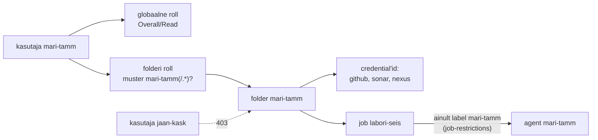

---
tags:
  - Jenkins
  - SonarQube
  - Nexus
  - Loeng
---

# Loeng: Jenkins lähemalt

Loeng jätkab IS1 [Jenkinsi, SonarQube'i ja Nexuse loengut](https://hkhk-tk.github.io/is1-automatiseerimine/k06/loeng/): pipeline'i olek controlleris, püsiv ja ajutine agent, shared library ja multibranch, rünnatud build-masin, artefaktide säilitamine, CI serveri turve ja haldus ning deploy kinnitus ja auditi jälg.

??? abstract "Õpiväljundid"

    - hinnata CI serveri turvariske: saladused, käivitatav kood, pluginad ja Dockeri socket;
    - kirjeldada, mis teeb Jenkinsi taastatavaks;
    - kavandada deploy kinnituse ja auditi jälje: change ticket, nelja silma kontroll, õiguste piir ja logi väljaspool Jenkinsit, ning põhjendada, miks RPA ei ole infra automatiseerimise vahend.

## Controller ja agent lähemalt

See osa jätkab IS1 loengu jaotist „Controller ja agent“.

Pipeline'i Groovy loogika töötab controlleris CPS-interpretaatoris, mis salvestab programmi oleku pärast iga sammu buildi kausta. Agendile lähevad ainult sammud nagu `sh`, `junit` või `archiveArtifacts`. Vaikimisi [durability-seadega](https://www.jenkins.io/doc/book/pipeline/scaling-pipeline/) jätkab pipeline pärast controlleri taaskäivitust salvestatud kohast. Lisaks koormab Groovy tsükkel controllerit, mitte agenti, seepärast kuulub arvutus `sh`-sammu.

### Püsiv ja ajutine agent

Püsiv agent on VM, mis töötab kuude kaupa. Selle kettale kogunevad workspace'id, Maveni `~/.m2` cache ja Dockeri image'id ning iga build pärib eelmise jäägid. Kui test läheb roheliseks ainult sellepärast, et eelmise buildi fail jäi workspace'i, ei õnnestu sama build puhtal masinal. See on sama triiv (drift), mida tunned käsitsi hallatud serveritest: masina tegelik olek ja selle kirjeldus lähevad lahku.

Ajutine agent tekib buildi jaoks ja kaob pärast seda. [Kubernetese plugin](https://plugins.jenkins.io/kubernetes/) loob iga agendi jaoks pod'i, mille konteineris `jnlp` töötab agendi protsess, ja peatab pod'i pärast buildi. Teised konteinerid samas pod'is, näiteks Maven ja Docker CLI, jagavad sama workspace'i. Nii saab iga build puhta keskkonna nagu GitHubi hostitud runner'il, aga sinu klastris. Hind on aeg ja cache: pod'i käivitus ja sõltuvuste allalaadimine lisavad igale buildile sekundeid kuni minuteid, kui Nexuse proxy-repositoorium ei ole lähedal. Valik `idleMinutes` hoiab pod'i korduvkasutuseks alles, aga toob tagasi osa püsiva agendi probleemist.

Suures mahus muutub kitsaskohaks controller. Iga agent hoiab Remoting-kanalit, iga töötav pipeline hoiab controlleris oma CPS-olekut ja iga build kirjutab logi kausta `$JENKINS_HOME`. Kui sajad buildid töötavad korraga, ei aita agentide lisamine, sest kitsaskoht on ühe controlleri JVM ja ketas. Siis jagatakse töö meeskondade või toodete kaupa mitme controlleri vahel, mitte ei ehitata üht suuremat.

## Pipeline kui kood lähemalt

See osa jätkab IS1 loengu jaotist „Pipeline kui kood“.

### Shared library

Korduv loogika viiakse **shared library**'sse: Giti repositoorium, mille `vars/*.groovy` failid muutuvad pipeline'i sammudeks. Globaalne teek töötab väljaspool Groovy sandboxi, nii et selle repositooriumi kirjutusõigus võrdub controlleri administraatori õigusega, ja `@main` muudab ühe commit'iga kõigi meeskondade pipeline'e. Tootmises kinnitatakse teek tag'iga.

### Multibranch ja haru avastamine

Ühe haru job ei sobi PR-idega tööks. **Multibranch pipeline** skannib repositooriumi, loob igale harule ja PR-ile, milles on Jenkinsfile, oma alamjob'i ja kustutab selle, kui haru kaob. Organization folder teeb sama tervele GitHubi organisatsioonile. Skannimine käib GitHubi REST API kaudu ja sellel on piir: kasutaja token saab [5000 päringut tunnis](https://docs.github.com/en/rest/using-the-rest-api/rate-limits-for-the-rest-api) sõltumata repositooriumide arvust. Kui sadu repositooriume ja tuhandeid harusid skannitakse sama tokeniga, jõuab Jenkins piirini, jääb ootama limiidi taastumist ja webhooki järel algav build hilineb. GitHub App'i limiit kasvab organisatsiooni suurusega kuni 12 500 päringuni tunnis, seepärast [soovitab Jenkins](https://jenkins.io/blog/2020/04/16/github-app-authentication/) multibranch'i jaoks GitHub App'i. Teine eelis on see, et App ei ole seotud inimese kontoga, mis suletakse, kui inimene lahkub.

Multibranch muudab ka turvapiiri. PR-i Jenkinsfile on kood, mida keegi pole veel üle vaadanud. Kui forkist tulnud PR-i *Trust* seade on *From users with Admin or Write permission* ja PR-i autoril kirjutusõigust pole, laadib Jenkins Jenkinsfile'i sihtharust, mitte PR-ist. Nii ei saa võõras PR muuta seda, mida pipeline teeb ja milliseid credential'e see loeb. Sama küsimus oli eelmisel korral Actionsis `pull_request_target`-i juures.

## Artefakt ja versioon lähemalt

See osa jätkab IS1 loengu jaotist „Artefakt ja versioon“.

### Kui build-masin on rünnatud

2020. aasta detsembris selgus, et SolarWinds Orioni allkirjastatud uuendustes oli tagauks. CrowdStrike'i [analüüsi](https://crowdstrike.com/blog/sunspot-malware-technical-analysis/) järgi kontrollis build-serveris töötanud SUNSPOT iga sekund, kas käivitub `MsBuild.exe`, vahetas kompileerimise ajaks ühe lähtefaili tagauksega versiooni vastu ja taastas pärast buildi originaali. Repos oli kood puhas, review ei näinud midagi ja pakk oli õige võtmega allkirjastatud.

Build once ei kaitse selle eest. See tagab, et testitud fail ja tootmises olev fail on samad, aga mitte seda, et fail vastab commit'ile. Seepärast käsitletakse build-masinat tootmise osana. Ajutine agent piirab ründaja püsivust, sest igal buildil on uus masin. Reprodutseeritav build lubab teisel, sõltumatul masinal sama commit'i ehitada ja kontrollsummasid võrrelda. Build provenance ([SLSA](https://slsa.dev/spec/v1.0/levels)) lisab artefaktile allkirjastatud kirje, mis ütleb, millisest commit'ist, millisel platvormil ja milliste buildi sammudega pakk tehti.

### Säilitamise hind

Muutumatuse hind on kettaruum. Kui iga commit annab release-versiooni, kogub Nexus aastaga kümneid tuhandeid WAR-e ja image'eid. [Cleanup policy](https://help.sonatype.com/en/cleanup-policies.html) kustutab komponente vanuse või viimase allalaadimise järgi, aga failipõhises blob store'is märgib kustutamine faili ainult kustutatuks ja ketas vabaneb alles ülesande *Compact blob store* järel. Reegel peab arvestama rollback'iga: tootmises töötav versioon ja vähemalt eelmine peavad alles jääma, olenemata sellest, millal neid viimati alla laaditi. Sama otsuse teed varunduse säilitusaja puhul.

## CI serveri turve ja haldus

Loe see osa pärast IS1 loengut. Praktikumis on samad teemad lehtedel [Õigused, varundus ja taaste](lab-6-haldus.md) ja [süvenemise osa 4](syvenemine.md#osa-4-image-paralleel-ja-deploy).

2021. aasta aprillis teatas Codecov, et ründaja oli muutnud nende Bashi üleslaadimisskripti, mida paljud CI pipeline'id käivitasid. Muudetud skript saatis pipeline'i keskkonnamuutujad, sh tokenid ja võtmed, ründaja serverisse ([Codecovi teade](https://about.codecov.io/security-update/)). CI serveris on saladused ja seal töötab kood, mida keegi rida-realt ei loe.

Esimene teema on õigused. Jenkinsis on need kaks eraldi seadet: *security realm* ütleb, kust kasutajad tulevad (oma andmebaas, LDAP, SSO), ja *authorization strategy* seda, mida nad tohivad. Valik "Logged-in users can do anything" teeb igast sisselogijast administraatori. Administraator saab *Script Console*'is käivitada controlleris suvalist Groovyt ja sealt kõik credential'id lahti dekrüpteerida. Mitme meeskonnaga Jenkinsis antakse õigused rollide ja folderite kaupa ([Role-based Authorization Strategy](https://plugins.jenkins.io/role-strategy/)) ja job'id piiratakse oma agentidele.

<figure markdown="span">

  <figcaption>Joonis 6.5. Iga õppija näeb ainult oma folderit ja tema job käivitub ainult tema agendil (<a href="https://plugins.jenkins.io/job-restrictions/">Job Restrictions</a>).</figcaption>
</figure>

Credential'idel on sama loogika: folderi credential'it näevad ainult selle folderi job'id ja süsteemi credential'it (näiteks Sonari webhooki saladust) ainult Jenkins ise. Jenkinsfile'i Groovy töötab controlleris **Groovy sandboxis**: lubatud on ainult Script Security plugina valge nimekirja meetodid ja kõik muu läheb administraatori [kinnitusjärjekorda](https://www.jenkins.io/doc/book/managing/script-approval/). Üks kinnitatud meetod on lubatud kõigile pipeline'idele, mitte ainult sellele, mis seda küsis. Eraldi risk on Docker agendil: `/var/run/docker.sock`-i kirjutusõigus on [sisuliselt root](https://docs.docker.com/engine/security/#docker-daemon-attack-surface). Agendil on see teadlik otsus, controlleris kõigi kasutajate ühine root.

Teine teema on pluginad. Igal pluginal on oma sõltuvused, minimaalne Jenkinsi versioon ja turvateated. 2024. aasta jaanuaris avaldas Jenkins haavatavuse [CVE-2024-23897](https://www.jenkins.io/security/advisory/2024-01-24/). CLI parser asendas argumendi `@failinimi` faili sisuga, nii et autentimata kasutaja sai lugeda controlleri failide esimesi ridu ja *Overall/Read* õigusega kasutaja terveid faile, sh võtmeid, mille kaudu jõudis koodi käivitamiseni. Parandus tuli versioonidega 2.442 ja LTS 2.426.3. Sama aasta augustis oli see CISA [aktiivselt ära kasutatavate haavatavuste](https://www.cisa.gov/known-exploited-vulnerabilities-catalog) nimekirjas.

Pluginate arv on omaette risk. Iga plugin töötab controlleri JVM-is samade õigustega kui Jenkins ja uuendus toob kaasa oma sõltuvused, mis võivad nõuda uuemat Jenkinsit. Kui sõltuvus jääb rahuldamata, jätab Jenkins plugina laadimata ja iga job, mis selle samme kasutab, ebaõnnestub käivitamisel. Pluginale, mida keegi ei hoolda, ei tule ka turvaparandust, ja [pluginate kataloog](https://plugins.jenkins.io/) märgib sellise plugina hoiatusega *up for adoption*. Seepärast hoitakse nimekiri lühike: iga plugina kohta on teada, milline job seda vajab, ja kasutamata plugin eemaldatakse samamoodi nagu serverist pakk, mida keegi ei kasuta.

Kolmas teema on taastatavus. [Configuration as Code](https://www.jenkins.io/projects/jcasc/) (JCasC) kirjeldab süsteemi seadistuse YAML-failis: turvamudel, tööriistad, ühendused teiste teenustega. Saladused tulevad käivitamisel keskkonnast. Pluginate nimekiri on samuti fail, kus on üks plugin koos versiooniga rea kohta, ja [`jenkins-plugin-cli`](https://github.com/jenkinsci/plugin-installation-manager-tool) paigaldab ja kontrollib selle järgi. Veebiliideses tehtud muudatuse kirjutab järgmine reload üle, nagu Ansible'i korduv käivitus parandab triivi.

Kõike koodist taastada ei saa. Buildide ajalugu ja credential'id jäävad kausta `$JENKINS_HOME` ja need vajavad [varukoopiat](https://www.jenkins.io/doc/book/system-administration/backing-up/). Kaustas `secrets/` olev `master.key` krüpteerib võtme `hudson.util.Secret`, mis omakorda krüpteerib credential'id. Ilma selleta on taastatud Jenkinsis kõik saladused loetamatud ja seepärast on varukoopia ise saladus. [LTS-liinis](https://www.jenkins.io/download/lts/) valitakse uus baasversioon iga 12 nädala järel ja Java nõue on viimastel aastatel kolm korda tõusnud: Java 11 versioonist 2.361.1, Java 17 versioonist 2.479.1 ja Java 21 versioonist 2.555.1 ([Java tugi](https://www.jenkins.io/doc/book/platform-information/support-policy-java/)). Uuendus käib seepärast samas järjekorras: varukoopia, pluginate ühilduvuse kontroll, uuendus, proovibuild. Varukoopia kehtib alles siis, kui uus Jenkins sellest käivitub ja credential on loetav.

Iseseisvaks lugemiseks: [RBAC ja ligipääsu kontroll](https://hkhk-tk.github.io/is1-automatiseerimine/teemad/rbac/).

## Juhtimine: kes kinnitab ja kus on logi

Loe see osa pärast IS1 loengut ja enne [süvenemise osa 4](syvenemine.md#osa-4-image-paralleel-ja-deploy) deploy kinnitust.

Pärast öist katkestust küsib turvajuht kolme asja: kes lubas versiooni `1.1.0-42-a3f9c1e` tootmisse panna, kes deploy käivitas ja kas need olid eri inimesed. Jenkinsis oli vastus buildi lehel, aga seda buildi enam ei ole, sest `buildDiscarder` hoiab kümmet viimast.

Muudatuse kirje on ITSM-süsteemis (ServiceNow, Jira Service Management): change ticket ütleb, mis muutub, mis on risk, kes kinnitas ja mis aknas see tehakse. Kui deploy käib Jenkinsist, avab pipeline ticket'i ise ITSM-i REST API kaudu, paneb sinna versiooni, commit'i ja buildi URL-i ning ootab kinnitust, kui tegu pole standardmuudatusega. Pärast deploy'd sulgeb pipeline ticket'i tulemusega. Hind on sõltuvus: kui ITSM-i API ei vasta, ei liigu ka parandus. Seepärast on kirjas, kuidas erakorraline muudatus läheb ilma ticket'ita ja registreeritakse tagantjärele.

Jenkinsis teeb kinnituse samm [`input`](https://www.jenkins.io/doc/pipeline/steps/pipeline-input-step/). `submitter` piirab kinnitajad kasutajate või gruppidega ja `submitterParameter` salvestab kinnitaja ID muutujasse. Kaks asja jäävad sinu teha. *Overall/Administer* õigusega kasutaja saab kinnitada sõltumata `submitter`-ist, ja Jenkins ei kontrolli, kas kinnitaja on sama inimene, kes buildi käivitas. Nelja silma põhimõte tuleb seega kirjutada pipeline'i: kinnitaja ID-d võrreldakse buildi põhjuse `UserIdCause` kasutajaga ja kokkulangevuse korral build peatub.

Õiguste piir on CI serveris laiem kui Jenkinsi maatriks. *Job/Build* ja *Job/Configure* on eri õigused, aga pipeline job'i tegelik seadistus on repositooriumis olev Jenkinsfile. Kes saab haru push'ida, see muudab ka seda, mida job teeb ja milliseid credential'e see loeb. Tootmise deploy piir koosneb seega kolmest osast: tootmise folder koos oma credential'itega, job, mis ehitab ainult kaitstud harust, ja haru kaitse, mis nõuab teise inimese review'd.

Buildi logi ei ole auditilogi. See asub controlleri kettal, kustub koos buildiga ja administraator saab seda muuta. Jenkinsi enda sündmused (sisselogimine, seadistuse muudatus, job'i loomine ja kustutamine) kirjutab [Audit Trail](https://plugins.jenkins.io/audit-trail/) plugin faili või syslogi ja Job Config History hoiab `config.xml` versioone. Auditi jaoks saadetakse need Jenkinsist välja, näiteks SIEM-i, kus Jenkinsi administraator neid kustutada ei saa. Finantssektoris nõuab [DORA](https://eur-lex.europa.eu/eli/reg/2022/2554/oj) alates 2025. aasta jaanuarist dokumenteeritud IKT muudatuste halduse protseduuri ja kontrolle. Audiitor küsib seal tõendit, et kontrolli ei saanud vahele jätta.

Kokku vastab see automatiseerimise juhtimise kolmele põhinõudele: tegevus on testitud ja kinnitatud (Jenkinsfile kaitstud harus), piirid on paigas enne käivitamist (folder, credential, agendi label, `submitter`) ja tegevusest jääb jälg (logi väljaspool Jenkinsit). Kompromiss on kiirus. Kui ainus kinnitaja on puhkusel, kinnitab administraator ise. Kinnitajaks pannakse seepärast grupp ja inimese kinnitust nõutakse ainult riskantsele muudatusele.

Iseseisvaks lugemiseks: [IT-teenuste haldus (ITSM)](https://hkhk-tk.github.io/is1-automatiseerimine/teemad/itsm/).

## Jenkins või GitHub Actions lähemalt

See osa jätkab IS1 loengu võrdlustabelit.

Self-hosted runner tundub kompromiss: GitHub haldab serverit, sina masinat sisevõrgus. Siis tulevad sisevõrku ka riskid, mida Jenkinsis piirasid folderi ja agendi label'iga. GitHub [soovitab](https://docs.github.com/en/actions/how-tos/manage-runners/self-hosted-runners/add-runners) self-hosted runner'it kasutada ainult privaatsete repositooriumidega, sest avaliku repositooriumi forkist tulnud PR võib käivitada runner'il suvalist koodi. Püsiv runner jätab töö jäägid ka järgmisele job'ile, nii et püsiva ja ajutise masina valik tuleb tagasi ka Actionsis.

Vahel pakutakse kolmandaks valikuks RPA-d (*robotic process automation*). RPA robot klikib graafilises liideses kasutaja kontoga (UiPath, avatud lähtekoodiga Robot Framework). Infra jaoks on see vale tööriist. Robot ei tea soovitud olekut, ta kordab klikke ja liidese muudatus pärast uuendust lõhub töö vaikselt. Dry-run'i ega idempotentsust ei ole ja auditilogis on inimese nimi, mitte automaatika oma. Serveritel, võrguseadmetel ja pilvel on SSH, API või NETCONF, ja seal töötavad Ansible, OpenTofu ja pipeline. RPA-l on koht seal, kus vanal rakendusel API puudub, ja ka siis ainult ajutise sillana.

Iseseisvaks lugemiseks: [RPA, äriprotsessid ja IT-automatiseerimine](https://hkhk-tk.github.io/is1-automatiseerimine/teemad/rpa-ja-aeriprotsessid/).

## Kokkuvõte

-   **CI server on ründepind**

    Jaga õigused folderite kaupa, kinnita Groovy meetodeid kitsalt ja uuenda pluginaid kohe pärast turvateadet.

-   **Taastatav Jenkins**

    Hoia JCasC ja `plugins.txt` Gitis. Varunda `$JENKINS_HOME` koos `master.key`-ga ja proovi taastet, sest ilma võtmeta credential'id ei dekrüpteeru.

-   **Kinnitus ja jälg**

    Lase pipeline'il change ticket avada ja sulgeda. Kontrolli nelja silma põhimõtet pipeline'i koodis, sest administraator möödub `submitter`-ist, ja saada auditilogi Jenkinsist välja.

## Kontrolli ennast

??? question "Controller taaskäivitati öösel uuenduse pärast. Pipeline'i build jätkus, Freestyle'i build mitte. Miks?"
    Pipeline'i Groovy olek salvestatakse pärast iga sammu buildi kausta ja agendil töötav `sh` ei sõltu controlleri protsessist. Freestyle'i samm on ühe protsessi osa ja sellel pole salvestatud olekut, millest jätkata.

??? question "Audiitor leiab, et tootmise deploy käivitas ja kinnitas sama administraator, kuigi `input`-il oli `submitter 'release-kinnitajad'`. Kuidas see juhtus ja mida muudad?"
    Administraator saab `input`-i kinnitada sõltumata `submitter`-ist ja Jenkins ei võrdle kinnitajat käivitajaga. Pipeline peab ise võrdlema `submitterParameter`-i väärtust buildi `UserIdCause` kasutajaga ja kokkulangevuse korral peatuma. Igapäevane deploy ei käi administraatori kontoga.

??? question "Taastasid Jenkinsi varukoopiast, job'id on alles, aga iga build ebaõnnestub, sest credential'id ei dekrüpteeru. Mis jäi varukoopiast välja ja mida see ütleb varukoopia hoidmise kohta?"
    Kaust `secrets/` koos `master.key`-ga. Sama fail teeb varukoopia saladuseks, nii et seda hoitakse krüpteeritult või võtit eraldi.
