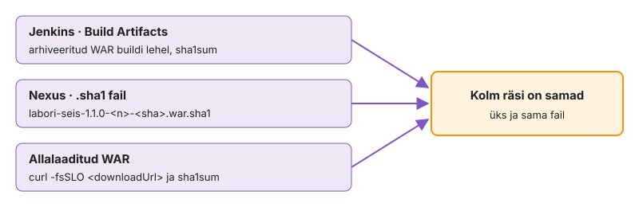
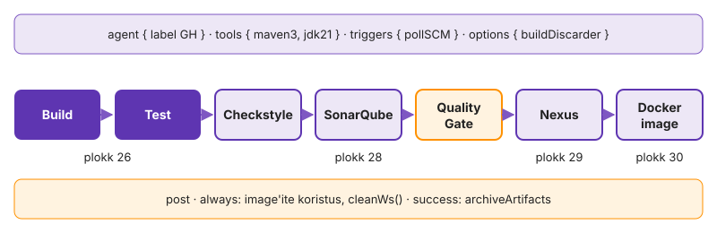

---
tags:
  - Jenkins
  - SonarQube
  - Nexus
  - Praktikum
---

# Süvenemine: Jenkins, SonarQube ja Nexus

Need osad jätkavad IS1 praktikumi [Jenkins, SonarQube ja Nexus](https://hkhk-tk.github.io/is1-automatiseerimine/k06/lab/) pipeline'i. Käsud käivitad control node'il kursuse repositooriumi juurkaustas harul `k06-jenkins`, kui sammu juures pole kirjas teisiti. Terved teemad sandbox-Jenkinsist, haldusest ja intsidendist on eraldi lehtedel [Jenkins koodina](lab-5-jenkins-koodina.md), [Õigused, varundus ja taaste](lab-6-haldus.md) ja [Neli punast buildi](lab-7-neli-punast.md).

## Osa 1 · Agent lähemalt

Tee need sammud pärast IS1 mooduli [Agent ja esimene pipeline](https://hkhk-tk.github.io/is1-automatiseerimine/k06/lab-1-agent/) sammu „Vaata, kes ja kus ehitab“, kui job `kes-olen` on olemas.

### 1.1 Executorite järjekord

Job `kes-olen` näitas, mis kasutajana ja kus build töötab. Nüüd vaatad, mitu buildi korraga mahub. Lisa jobi sammu lõppu `sleep 30`, et build kestaks piisavalt kaua.

**Ennusta:** agendil on kaks executorit. Mis juhtub kolmanda buildiga? Vajuta **Build Now** kolm korda järjest ja vaata vasakult *Build Executor Status*'t. Kirjuta PR-i, mitu buildi töötas korraga.

<!-- EKRAANIPILT: folderi mari-tamm vaade, vasakul Build Executor Status ja Build Queue ajal, kui kes-olen kolm buildi on käivitatud (sleep 30): kaks töötamas, üks "Waiting for next available executor". Sammu 26.3 keskel.
<figure markdown="span">
  
  <figcaption>Joonis L6.3. Kaks executorit on hõivatud, kolmas build ootab.</figcaption>
</figure>
-->

Executorite arv on node'i mahupiir: kolmas build ei saa kohta ja ootab, isegi kui masinal oleks CPU-d üle. Executorite arvu seab koolitaja node'i seadistuses. Kui see oleks suurem, töötaksid kõik kolm korraga ja lehel [Jenkins koodina](lab-5-jenkins-koodina.md), kui kõrval töötab sandbox-Jenkins, saaks 4 GB mälu kiiresti otsa.

**Edasi saad minna, kui** kaks buildi töötasid korraga ja kolmas ootas ("Waiting for next available executor").

### 1.2 Katkesta agent ja vaata, kuidas see taastub

Nüüd katkestad agendi keset buildi, nagu teeks uuenduse järel taaskäivitus või OOM killer, ja vaatad, mis juhtub buildiga ja kas teenus tuleb ise tagasi.

**Ennusta:** kas pooleli olev Freestyle build jätkub pärast agendi tagasitulekut ja kas systemd taaskäivitab agendi pärast `kill -9`?

1. Vaata, millise käsuga agent töötab ja kas saladus paistab protsessiloendis.

    ```bash
    ps -o user,pid,rss,args -u jenkins | cut -c1-160
    ```

2. Vajuta jobis `kes-olen` **Build Now** ja peata agent selle ajal, kui `sleep 30` käib. Kui jätsid eelmise etapi vahele, tee job enne: Freestyle, label `<gh>`, samm `sleep 30`.

    ```bash
    sudo systemctl stop jenkins-agent
    ```

3. Vaata buildi konsooli lõppu ja Nodes lehte. Siis käivita agent uuesti: `sudo systemctl start jenkins-agent`.
4. Tapa agendi protsess nii, nagu OOM killer seda teeks, ja vaata, kas systemd toob selle tagasi.

    ```bash
    sudo pkill -9 -u jenkins -f agent.jar
    sleep 15; systemctl status jenkins-agent --no-pager | head -5
    journalctl -u jenkins-agent --since "-1min" --no-pager | grep -E 'Connected|Main process'
    ```

`ps` väljundis on `-secret @/opt/jenkins/secret`: Remoting loeb väärtuse failist. Freestyle'i samm on agendi protsessi alamprotsess ja katkeb koos sellega. Pipeline'i `sh` käivitub durable-task wrapperiga, mis kirjutab väljundi ja väljumiskoodi faili, ning pipeline ootab agendi tagasitulekut. Kas skript jätkab töötamist, sõltub sellest, kas systemd tapab peatamisel kogu cgroup'i (`KillMode`). `kill -9` järel tõi agendi tagasi `Restart=on-failure`.

**Edasi saad minna, kui** katkestatud build lõppes punasena (FAILURE või ABORTED) ja konsoolis on teade ühenduse kadumise kohta, pärast `pkill -9` oli agent 15 sekundi pärast uuesti `active` ja Nodes all roheline ning PR-i kirjelduses on kaks lauset: mis juhtus buildiga ja miks systemd agendi tagasi tõi.

### 1.3 Miks see nii töötab

**Agent ühendub ise.** WebSocketi režiimis piisab tulemüüris väljuvast ühendusest controlleri HTTP-pordile (klassis 8080).

**WebSocket.** WebSocketi režiim (`-webSocket`, Jenkinsis alates 2.217) kasutab sama HTTP-porti nagu veebiliides, nii et eraldi TCP agendiporti (vaikimisi 50000) ei ole vaja avada. Proksi peab laskma läbi HTTP `Upgrade`-päringu ja hoidma pikaajalist ühendust.

**Jenkins teenusena.** Ubuntu paketis on `JENKINS_HOME` kaust `/var/lib/jenkins`, ametlikus konteineris volume `/var/jenkins_home`. Paketi versioonist 2.335 alates seadistab Jenkinsit systemd unit ja `/etc/default/jenkins` enam ei loeta: `JAVA_OPTS` ja port lähevad `systemctl edit jenkins` abil override'i. Ilma `-Xmx`-ita võtab JVM heap'iks veerandi masina või cgroup'i mälust.

**Viisard ja Jenkinsi URL.** Esimesel käivitusel küsib seadistusviisard algparooli failist `secrets/initialAdminPassword`, pakub pluginaid ja küsib Jenkinsi URL-i. URL läheb muutujasse `BUILD_URL`, e-kirjadesse, agentide ühenduslinkidesse ja GitHubi commit-staatuste linkidesse ning on salvestatud failis `jenkins.model.JenkinsLocationConfiguration.xml`.

**Pipeline script job'is.** Pipeline'i skripti võib kirjutada ka otse job'i seadistusse (*Pipeline script*). Siis on see job'i `config.xml`-is, mitte repositooriumis, ja haru ehitab selle hetke skriptiga, mitte sellega, mis oli harul.

Lisaülesanne [4. Jenkinsfile'i kontroll enne push'i](lisa.md#4-jenkinsfilei-kontroll-enne-pushi): kontrollid Jenkinsfile'i süntaksit API kaudu.

## Osa 2 · Triggerid, piirid ja post

Tee need sammud pärast IS1 mooduli [Triggerid](https://hkhk-tk.github.io/is1-automatiseerimine/k06/lab-2-triggerid/) lõppu, kui `pollSCM` käivitab buildi.

Build, mille keegi peab nupust käivitama, jääb tegemata just siis, kui seda kõige rohkem vaja on, ja build ilma piirideta hõivab agendi ning ketta seni, kuni keegi seda märkab. Praegu on sinu pipeline'iga just nii. Lõpuks käivitub build commit'i peale ise ja väljast saab selle käivitada API tokeniga. Jenkinsfile ütleb, kui kaua build tohib kesta, mitu buildi korraga on lubatud ja mis pärast buildi alles jääb.

### 2.1 Vaata, miks webhook ei jõua

Webhook vajab, et GitHubi server jõuaks Jenkinsi aadressile `/github-webhook/`. Enne pollimise valimist kontrollid, miks see siin ei tööta. Tootmises on alternatiivid avada tulemüüris ainult GitHubi `hooks` aadressivahemikud (`https://api.github.com/meta`) või panna vahele vahendav server, mis võtab webhooki DMZ-s vastu ja edastab sisevõrku.

1. Küsi webhooki aadressi control node'ist.

    ```bash
    curl -sI http://jenkins.lab.hkhk.ee:8080/github-webhook/ | head -1
    getent hosts jenkins.lab.hkhk.ee
    ```

2. Kirjuta PR-i kirjeldusse üks lause: kust GitHubi server selle päringu teeks ja miks see meie Jenkinsini ei jõua.

Päring vastab sinu masinast, sest sina oled VPN-i sees ja `getent` annab sisevõrgu aadressi. GitHubi serveritel seda nime ega aadressi pole.

**Edasi saad minna, kui** päring vastab sinu masinast ja PR-i kirjelduses on lause selle kohta, miks GitHub VPN-i taha ei näe.

### 2.2 Käivita build väljast

Kolmas viis buildi alustada on `POST` Jenkinsi API-le, näiteks GitHub Actionsi self-hosted runner'ist või cron'ist. Alates Jenkins 2.129-st võib kasutajal olla mitu nimega tokenit, Jenkins hoiab neist ainult räsi ja näitab iga tokeni viimast kasutust, nii et lekkinud tokeni saab eraldi tühistada.

1. Jenkinsis sinu nimi (paremal üleval) → **Security → API Token → Add new Token** ([Remote access API](https://www.jenkins.io/doc/book/using/remote-access-api/)).
2. Hoia token ainult keskkonnamuutujas ja käivita build.

    ```bash
    read -rs JENKINS_TOKEN && export JENKINS_TOKEN JENKINS_USER=<gh>
    k06-jenkins/trigger-jenkins.sh --wait
    ```

3. Vaata buildi lehelt, kes selle käivitas.

> Vastus 403 tähendab, et kasutasid parooli või token on kustutatud. Vastus 404 tähendab, et jobi tee on vale (`<gh>/labori-seis`).

Skript sai vastuseks `201` ja järjekorra aadressi, ootas, kuni järjekorrast tuli build, ja seejärel buildi tulemust.

**Edasi saad minna, kui** väljund on `OK: build järjekorras`, buildi URL ja `Tulemus: SUCCESS` ning buildi lehel on "Started by user `<gh>`".

### 2.3 Loe buildi põhjust API-st

Buildi lehel on inimloetaval kujul kirjas, mis buildi käivitas. Sama info on JSON-ina API-s ja seda kasutavad skriptid ja monitooring. Deploy etapis otsustab pipeline just selle põhjuse järgi, kas küsida kinnitust.

Tingimus "ainult inimese käivitatud build" kirjutatakse nende klassinimede järgi. Vale klassinime korral jääb kas iga pollSCM-i build kinnitust ootama või ei küsi keegi kunagi.

1. Küsi kahe viimase buildi number, tulemus ja põhjus. Token läheb `curl`-ile standardsisendist, mitte käsureale.

    ```bash
    j=http://jenkins.lab.hkhk.ee:8080/job/$JENKINS_USER/job/labori-seis
    for b in lastBuild lastBuild/previousBuild; do
        printf 'user = "%s:%s"\n' "$JENKINS_USER" "$JENKINS_TOKEN" | curl -gfsS -K- \
            "$j/$b/api/json?tree=number,result,actions[causes[_class,shortDescription]]" \
            | jq -c '{number, result, causes: [.actions[].causes? // empty | .[]._class]}'
    done
    ```

2. Kui mõlemal real on sama põhjus, tee üks commit, oota pollSCM-i buildi lõppu ja korda päringut.

Väljundis on kaks erinevat klassi: `hudson.model.Cause$UserIdCause` sinu skripti buildil ja `hudson.triggers.SCMTrigger$SCMTriggerCause` pollimise buildil. Need on nimed, mida Deploy etapi `triggeredBy` tingimus kasutab. Kui mõlemal on `UserIdCause`, käivitasid mõlemad ise ja pollimine pole veel tööle läinud.

**Edasi saad minna, kui** väljundis on kaks rida eri põhjusega ja PR-i kirjelduses on need kaks klassinime.

### 2.4 Pane buildile piirid

Vaikimisi pole Jenkinsis job'il ajapiiri ega ajaloo piiri ja samaaegsete buildide arv on piiramata: teine build saab kausta `workspace@2`, aga jagab sama testkonteinerit, Nexuse versiooni ja agendi ketast. Lisa Jenkinsfile'i plokk `options` ([direktiivid](https://www.jenkins.io/doc/book/pipeline/syntax/#options)). Nõuded:

- kogu buildi aeg on piiratud 30 minutiga (`timeout`)
- alles jääb 10 viimast buildi ja 5 viimase artefaktid (`buildDiscarder`, `logRotator` koos `artifactNumToKeepStr`-iga)
- sama jobi kaks buildi ei tööta korraga (`disableConcurrentBuilds`)
- konsooli igal real on kellaaeg (`timestamps`)

Salvesta muudatus ja saada see GitHubi:

```bash
git commit -am "k06: options" && git push
```

**Ennusta:** agendil on teine executor vaba. Kas teine build käivitub kohe? Vajuta pärast buildi algust kohe uuesti **Build Now** ja vaata järjekorda.

Teine build seisis järjekorras, kuigi agendil oli teine executor vaba. See tähendab, et piirang on jobi tasemel, mitte node'i tasemel: teised jobid saavad vaba executorit kasutada. Kellaajad konsoolis lubavad hiljem öelda, kas aeglane oli Maven, võrk või Sonari ootamine.

**Edasi saad minna, kui** teine build ootab, kuni esimene lõpetab (järjekorras on teade, et build on juba käimas), ja konsooli read algavad kellaajaga.

### 2.5 Arhiveeri WAR ja korista õiges järjekorras

WAR tuleb arhiveerida buildi juurde enne, kui workspace tühjendatakse. `post` tingimustel on kindel järjekord ja see etapp näitab, miks koristus ei kuulu plokki `always`. Arhiveeritud fail kopeeritakse controllerisse `jobs/<job>/builds/<n>/archive/` alla, nii et artefaktide arvu piir `buildDiscarder`-is kaitseb controlleri ketast.

IS1 praktikumis on `cleanWs()` juba plokis `cleanup`. Katse ajaks asenda kogu `post` plokk allpool oleva ajutise variandiga.

**Ennusta:** kas WAR jõuab arhiivi, kui `cleanWs()` on plokis `always`?

1. Lisa `pipeline {}` lõppu ajutiselt see plokk, push ja oota buildi.

    ```groovy
        post {
            always { cleanWs() }
            success { archiveArtifacts artifacts: 'target/labori-seis.war', fingerprint: true }
        }
    ```

2. Vaata konsooli lõppu: millises järjekorras käivitusid `always` ja `success` ning mida ütleb `archiveArtifacts`.
3. Paranda: `cleanWs()` läheb plokki `cleanup`, mis käivitub pärast kõiki teisi. Push ja oota buildi.
4. Mõõda control node'il kettaruumi enne ja pärast parandatud buildi.

    ```bash
    df -h /opt/jenkins
    sudo du -sh /opt/jenkins/workspace/* /opt/jenkins/tools 2> /dev/null | sort -h
    ```

> Teade `ERROR: No artifacts found that match the file pattern` tähendab, et workspace tühjendati enne arhiveerimist.

Ajutine variant ebaõnnestus, sest `always` käivitub enne `success`-i ja WAR oli selleks ajaks kustutatud. Parandatud variant näitab vahet: workspace on tühi, aga WAR on buildi juures alles ja selle fingerprint seob faili konkreetse buildiga. `tools` jääb alles, sest see pole workspace'i osa: Maven laaditakse üks kord node'i kohta, mitte iga buildi jaoks.

**Edasi saad minna, kui** ajutine variant ebaõnnestus arhiveerimisel, parandatud build on roheline, buildi lehel on *Build Artifacts* all `labori-seis.war` ja `labori-seis` workspace on pärast buildi tühi, `tools` (Maven) jääb alles.

**Selle mooduli tõend:** commit'id `k06: options` ja `post`-i parandus; PR-i kirjelduses lause webhooki kohta, polling logi ekraanipilt, `trigger-jenkins.sh` väljund ilma tokenita, kahe buildi põhjuse klassid API-st, `archiveArtifacts` veateade, mõlemad `du` väljundid, `triggers` `OK`.

### 2.6 Miks see nii töötab

**`H` cron'is.** Sama job'i päring toimub alati samal minutil, sest `H` on räsi job'i nimest.

**Remote trigger.** Remote trigger'iga saab GitHub Actionsi ühendada Jenkinsiga. Self-hosted runner töötab control node'il VPN-i sees ja saab Jenkinsi buildi käivitada kujul `curl -X POST -u kasutaja:API_TOKEN …/build`.

**API token ja crumb.** Paljudes juhendites küsitakse selleks crumb'i (Jenkinsi CSRF-token, mis on seotud veebisessiooniga) ja parooli. API tokeniga ei ole kumbagi vaja (Jenkins 2.96-st alates; vanemates versioonides nõuti crumb'i ka tokeniga), sest token ei ole brauseri sessioon ja CSRF-rünnak seda ei kasuta.

**`post`-tingimused.** `post`-tingimused täidetakse järjekorras `always`, `changed`, `fixed`, `regression`, `aborted`, `failure`, `success`, `unstable`, `unsuccessful`, `cleanup`.

**`abortPrevious`.** `disableConcurrentBuilds(abortPrevious: true)` katkestab vanema buildi, kui käivitatakse uus. See sobib harule, kus on oluline ainult viimane commit. Deploy'le see ei sobi, sest pooleli jäänud paigaldus võib jätta testkeskkonna vahepealsesse olekusse.

**Kettaruum.** Controlleril kasvavad `jobs/*/builds/` (logid ja arhiveeritud artefaktid) ning `fingerprints/`, agendil workspace'id, `tools/` ja Docker image'id. Jenkinsi node monitor viib node'i offline'i, kui `JENKINS_HOME`-i, workspace'i või temp-kausta vaba ruum langeb alla läve (vaikimisi 1 GiB), ja build jääb siis järjekorda nagu agendi kadumisel. Ennetus on Jenkinsfile'is: `buildDiscarder`, `cleanWs()` ja image'ite koristus plokis `cleanup`.

**Buildi põhjus.** Buildi põhjuse klassid (`UserIdCause`, `SCMTriggerCause`, `UpstreamCause`, `TimerTriggerCause`) on samad, mida kasutavad tingimus `triggeredBy` ja API.

Lisaülesanne [5. Actions käivitab Jenkinsi](lisa.md#5-actions-kaivitab-jenkinsi): asendad pollimise Actionsi workflow'ga, mis käivitab Jenkinsi kohe pärast push'i.

## Osa 3 · Sonar ja Nexus lähemalt

Tee need sammud pärast IS1 mooduli [Quality gate ja Nexus](https://hkhk-tk.github.io/is1-automatiseerimine/k06/lab-3-sonar-nexus/) lõppu, kui WAR on Nexuses. Samm 3.2 vajab Jenkinsi arhiveeritud WAR-i, nii et tee enne osa 2 samm 2.5.

### 3.1 Checkstyle'i raport Sonarisse

IS1 praktikumis analüüsis Sonar ainult oma reeglitega. Checkstyle teeb stiiliraporti ja Sonar loeb selle koos testide katvuse ning oma reeglitega. `checkstyle:checkstyle` teeb raporti buildi nurjamata.

1. Lisa pärast Test'i etapp Checkstyle.

    ```groovy
            stage('Checkstyle') { steps { sh '$MVN checkstyle:checkstyle' } }
    ```

2. Lisa SonarQube'i etapi Maveni käsu lõppu `-Dsonar.java.checkstyle.reportPaths=target/checkstyle-result.xml`.
3. Push ja oota buildi.

**Edasi saad minna, kui** build on roheline ja Checkstyle'i leiud on Sonaris välise raportina näha.

### 3.2 Tõesta, et fail on sama

Võrdled kolme koopiat: Jenkinsi arhiveeritud WAR, Nexuse vastuvõtul arvutatud `.sha1` ja eraldi alla laaditud fail (joonis L6.8). Nexus arvutab `.sha1` ise, nii et see ei tõenda midagi, kui fail muudeti enne üleslaadimist: seepärast on vaja ka Jenkinsi poolt arhiveeritud koopiat.

1. Ava Nexuse UI-s **Browse** ja kirjuta üles, mis tüüpi on `maven-central`, `maven-public` ja `labori-seis`.
2. Küsi [REST API-lt](https://help.sonatype.com/en/rest-apis.html) oma versioonid.

    ```bash
    curl -s "http://nexus.lab.hkhk.ee:8081/service/rest/v1/search?repository=labori-seis&group=ee.hkhk.<gh>" | grep '"version"'
    ```

3. Laadi viimane WAR alla (`curl -fsSLO <downloadUrl>`) ja võrdle `sha1sum`-i kolmest allikast: Jenkinsi arhiveeritud WAR (buildi lehel *Build Artifacts*, fingerprint), Nexuse `.sha1` fail ja allalaaditud WAR.

<figure markdown="span">
  
  <figcaption>Joonis L6.8. Kolm allikat, üks räsi.</figcaption>
</figure>

<!-- EKRAANIPILT: nexus.lab.hkhk.ee:8081 → Browse → labori-seis, avatud puu ee/hkhk/mari-tamm/labori-seis/1.1.0-<n>-<sha>/ ning valitud .war (paremal paneelis Path ja sha1). Pärast sammu 29.2.
<figure markdown="span">
  
  <figcaption>Joonis L6.9. Sinu WAR Nexuses: tee tuleb groupId-st, artifactId-st ja versioonist.</figcaption>
</figure>
-->

```bash
git add k06-jenkins/ && git commit -m "k06: sonar + quality gate + nexus" && git push
```

Kolm võrdset räsi tõestavad, et Nexuses on täpselt see WAR, mis läbis quality gate'i. Kui räsi erineb, võrdled tavaliselt eri buildi faile: vaata buildi numbrit ja versiooni. Kui need klapivad ja räsi ikka erineb, on fail teel muutunud ja seda ei tohi paigaldada.

**Edasi saad minna, kui** REST API näitab sinu versioone, kolm räsi on samad ja commit on GitHubis.

### 3.3 Proovi sama versiooni üle kirjutada

Viimaseks kontrollid ise reeglit, millele kogu versioonimine toetub: Nexus ei luba sama versiooni teist korda. Laed allalaaditud WAR-i käsitsi sama versiooni alla tagasi.

Kui hosted repositoorium lubaks redeploy'd, saaks iga credential'i omanik vaikselt asendada tootmises oleva faili ja konteineri räsi kontroll näitaks juba uut, võltsitud faili.

**Ennusta:** mis vastuse annab Nexus, kui sama versioon laaditakse üles teist korda?

1. Võta versioon buildi nimest ja proovi sama faili sama teele üles laadida. Parool läheb `curl`-ile standardsisendist.

    ```bash
    read -rs NEXUS_PASS; v=<versioon>
    u=http://nexus.lab.hkhk.ee:8081/repository/labori-seis/ee/hkhk/<gh>/labori-seis/$v/labori-seis-$v.war
    printf 'user = "<gh>:%s"\n' "$NEXUS_PASS" | curl -sS -K- -o /dev/null -w '%{http_code}\n' \
        --upload-file "labori-seis-$v.war" "$u"
    unset NEXUS_PASS
    ```

2. Kirjuta PR-i kirjeldusse vastuse kood ja üks lause: mida see tähendab buildile, mis kogemata sama versiooni teist korda arvutab.

Vastus `400` ilma ühegi muutuseta Nexuses tõestab, et repositooriumi poliitika on *Disable redeploy*. Sama koodi annab ka pipeline, kui versiooni arvutus kaotab `BUILD_NUMBER`-i või räsi: intsidendiülesandes tuleb see vastu.

**Edasi saad minna, kui** käsk andis `400`, Nexuse Browse näitab sama faili muutmata kuupäevaga ja PR-i kirjelduses on lause vastuse tähenduse kohta.

**Selle mooduli tõend:** commit `k06: sonar + quality gate + nexus`; PR-i kirjelduses Credentials leht (`sonar`, `nexus`), Sonari projekti ekraanipilt, quality gate'i tingimused ja `Quality gate is OK`, ebaõnnestunud tingimus halva koodiga, Nexuse logirida ja kahe buildi Build etapi aeg, kolm `sha1sum` rida, Nexus Browse ekraanipilt, redeploy katse vastuse kood; `quality`, `nexus`, `secrets` `OK`.

### 3.4 Miks see nii töötab

**Sonari tokenid ja harud.** Projektitoken lubab analüüsida ainult ühte projekti, kasutaja token kõiki selle kasutaja projekte. SonarQube Community Build (selles praktikumis versioon 26.9) ei toeta ilma kolmanda osapoole pluginata haruanalüüsi: proovi-haru build kirjutab sama projekti analüüsi üle.

**Sonar ja `vm.max_map_count`.** SonarQube'i sisemine Elasticsearch hoiab indekseid `mmap`-iga ja nõuab vähemalt `vm.max_map_count=524288`, `fs.file-max=131072` ning protsessile vähemalt 131072 avatud faili ja 8192 lõime. Linuxi vaikeväärtusega 65530 Sonar ei käivitu. Koolitaja masinas on failis `/etc/sysctl.d/99-sonarqube.conf` väärtus 524288, laaditud käsuga `sysctl --system`. Vastus **502 Bad Gateway** tähendab, et Sonari ees olev Nginx on üleval, aga Sonar veel mitte: `curl -s localhost:9000/api/system/status` näitab `STARTING` või `UP`.

**Checkstyle: raport, mitte nurjamine.** GitHub Actionsis nurjas `checkstyle:check` esimese hoiatuse peale kogu workflow'. Siin teeb `checkstyle:checkstyle` ainult raporti ja annab selle Sonarile, otsuse teeb quality gate. Mõlemad mustrid on õiged: ühes on stiil reegel, teises üks sisend otsusele.

**Uus kood quality gate'is.** Quality gate'i tingimused kehtivad tavaliselt uue koodi kohta, mitte kogu koodi kohta. Nii saab ka tehnilise võlaga projekt quality gate'i kasutusele võtta: uus kood peab vastama nõuetele, vana koodi parandatakse järk-järgult.

**Sonari webhook.** Sonari webhook saadab Jenkinsile analüüsi tulemuse ja allkirjastab selle saladusega (HMAC). Jenkins kontrollib allkirja credential'i `sonar-webhook` abil, nii et ilma saladuseta ei saa keegi saata võltsitud teadet „quality gate OK“.

**Webhooki saladus ja ajapiir.** Seetõttu on see saladus `SYSTEM`-tasemel: job'id ei vaja seda ega tohi seda näha. Kui webhook ei jõua kohale ja analüüs ei olnud sammu alguses veel valmis, ei saa Jenkins tulemust teada ja `waitForQualityGate` ootab kuni `timeout`-väärtuseni.

**Üleslaadimine HTTP PUT-iga.** `nexusArtifactUploader` saadab faili HTTP PUT-päringuga õigele teele. Sama tulemuse annab `curl -u kasutaja:parool --upload-file labori-seis.war <url>`.

**Nexuse otsing.** REST API `search` tagastab vastuse lehekülgede kaupa (`continuationToken`), nii et skript, mis loeb ainult esimest lehte, näeb suures repositooriumis ainult osa versioonidest.

**Blob store.** Nexus hoiab faile blob store'is (`/nexus-data/blobs`) ja metaandmeid andmebaasis. Kustutamine märgib bloobi ainult kustutatuks: kettaruum vabaneb alles ülesandega „Compact blob store“.

**Jenkinsi muutujad.** Jenkins annab igale buildile muutujad `BUILD_NUMBER`, `JOB_NAME`, `WORKSPACE` ning Git'i pluginast `GIT_COMMIT` ja `GIT_BRANCH`. Shellis loed neid kujul `$BUILD_NUMBER`, Groovys `env.BUILD_NUMBER`. `sh "...${SALADUS}"` topeltjutumärkides asendab Groovy väärtuse enne shelli ja see jõuab protsessiloendisse; Jenkins hoiatab siis logis `A secret was passed to "sh" using Groovy String interpolation`. Ühekordsed jutumärgid jätavad asendamise shellile. Täielik loend on job'i menüüs *Pipeline Syntax → Global Variables Reference*. Kellaaeg või käsitsi antud number teeb versiooni unikaalseks, aga ei ütle, mis kood pakis on. Commit'i räsi ütleb.

**Disable redeploy.** Nexus CE 3.96.4-s annab hosted-repositooriumi poliitika *Disable redeploy* sama versiooni uuesti üleslaadimise katsel vastuse koodiga `400`.

Lisaülesanne [6. `mvn deploy` ilma pluginata](lisa.md#6-mvn-deploy-ilma-pluginata): laed WAR-i Nexusesse Maveni enda vahenditega, ilma Jenkinsi pluginata.

## Osa 4 · Image, paralleel ja deploy

Tee need sammud pärast IS1 mooduli [Image samast WAR-ist](https://hkhk-tk.github.io/is1-automatiseerimine/k06/lab-4-image-deploy/) lõppu, kui etapp Docker image on roheline. Osa 2 sammud 2.3 (buildi põhjus API-st) ja 2.5 (`post`-i järjekord) peavad olema tehtud, sest deploy kasutab neid.

Kui testkeskkonda läheb teine fail kui see, mis läbis kontrollid, või paigaldus käivitub iga commit'i peale, ei saa testkeskkonna tulemusi usaldada. Pipeline kontrollib nüüd koodi, kuid ei paigalda seda kuhugi. Sama WAR, mis läbis quality gate'i ja on Nexuses, läheb Docker image'isse ning Nexuse upload ja image'i build käivituvad korraga. Avaldamine käib ainult põhiharult ja testkeskkonda paigaldab pipeline alles siis, kui inimene selle kinnitab. Iga otsus on Jenkinsfile'is kirjas, nii et seda saab üle vaadata nagu iga teist koodi.

<figure markdown="span">
  
  <figcaption>Joonis S6.1. Jenkinsfile'i etapid koos süvenemise osadega. Osas 4 lähevad Nexus ja Docker image paralleelseks etapi Avaldamine alla (Talvik, 2026).</figcaption>
</figure>

### 4.1 Hoia agendil kuni kolm image'it

IS1 praktikumis tühjendas `cleanup` workspace'i ja `docker image prune` eemaldas nimeta image'id. Iga build lisab ühe WAR-i suuruse kihiga image'i, nii et sildiga image'id kogunevad.

IS1 praktikumis said `docker` grupi õigused ühe õppija agendil. Mitme meeskonnaga agentidel kasutatakse selle asemel rootless-Dockerit, Podmani või ajutisi agente, mis pärast buildi kustutatakse.

IS1 Dockerfile ei kompileeri midagi. Võrdle seda 3. kohtumise mitmeastmelise Dockerfile'iga:

```bash
diff <(grep -E '^(FROM|RUN|COPY)' k03-docker/app/Dockerfile) <(grep -E '^(FROM|RUN|COPY)' k06-jenkins/Dockerfile)
```

`diff` näitab, et 3. kohtumise failist kadus Maveni etapp ja `COPY --from=...` asendus tavalise `COPY`-ga.

1. Asenda plokis `post { cleanup { } }` käsk `docker image prune -f` koristusega, mis jätab agendile alles kuni 3 `labori-seis` image'it. Läheb vaja: `docker image ls labori-seis --format …`, `tail -n +4`, `xargs -r docker rmi`. Koristus ei tohi buildi nurjata.
2. Push ja oota mitu buildi.

```bash
docker image ls labori-seis
docker inspect --format '{{.Config.Env}}' labori-seis:<tag> | tr ' ' '\n' | grep GIT_SHA
```

Image'i tag ja Nexuse versioon on sama string, nii et ühest leiad alati teise. `GIT_SHA` image'i keskkonnas on kolmas sõltumatu viide samale commit'ile. Koristus `cleanup` plokis hoiab agendi ketta stabiilsena.

**Edasi saad minna, kui** `docker image ls labori-seis` näitab kuni kolme image'it, uusim tag on sama mis Nexuses ja `GIT_SHA` on sama commit.

### 4.2 Avalda Nexusesse ja image'isse korraga

Nexuse upload ja `docker build` ainult loevad valmis WAR-i ega kirjuta `target/`-i, seega võivad need töötada korraga samas workspace'is. Mõõdad aega enne ja pärast.

Ilma etapipõhise `agent`-ita töötavad paralleelsed harud sama executori ja sama workspace'i peal: Jenkins ei anna neile eraldi kausta ega lisa-executorit. Kaks haru, mis kirjutavad `target/`-i, annavad siis tulemuse, mis sõltub ajastusest.

1. Vaata Pipeline Graph View's viimase buildi Nexuse ja Docker image'i etapi aega.
2. Pane mõlemad etapid ühe etapi `Avaldamine` alla `parallel` plokki. Etappide sisu jääb samaks.

    ```groovy
            stage('Avaldamine') {
                parallel {
                    stage('Nexus') { steps { /* senine nexusArtifactUploader */ } }
                    stage('Docker image') { steps { /* senine docker build */ } }
                }
            }
    ```

3. **Ennusta:** kui kaua kestab `Avaldamine` võrreldes kahe etapi ajaga eraldi? Push ja oota buildi. Vaata Graph View's, kas harud töötasid kõrvuti, ja võrdle aega.

> Test ja Checkstyle kirjutavad mõlemad `target/`-i. Neid paralleelseks panna ei ole ohutu (vt [Lisaülesanded → 7. Paralleelsed testid ja jagatud workspace](lisa.md#7-paralleelsed-testid-ja-jagatud-workspace)).

`Avaldamine` kestab nüüd umbes nii kaua kui pikem kahest harust, mitte nende summa. Kui aeg peaaegu ei muutunud, oli üks haru teisest palju pikem või piiras mõlemat sama ressurss, näiteks võrk. Paralleel aitab ainult siis, kui harud ootavad eri ressursse.

**Edasi saad minna, kui** Graph View näitab `Avaldamine` all kahte kõrvuti haru, mõlemad on rohelised ja PR-i kirjelduses on etappide ajad enne ja pärast.

### 4.3 Avalda ainult põhiharult

Igal harul peavad käima build, testid ja quality gate, aga artefakt avaldatakse ainult põhiharult. Muidu tekib Nexusesse versioone igast katsetusest ja keegi ei tea, milline neist on põhiharust.

Job on tavaline Pipeline job, mitte multibranch, seega pole `when { branch 'main' }` siin kasutatav: haru on muutujas `GIT_BRANCH` kujul `origin/k06-jenkins`. Kui kirjutad tingimuse, mis kunagi ei kehti, jääb avaldamine vaikselt vahele ja keegi ei märka, et Nexusesse ei tule enam midagi.

1. Lisa etapile `Avaldamine` tingimus `when { expression { … } }`. Nõuded:
    - tingimus kehtib `GIT_BRANCH` väärtustel `origin/main`, `main`, `origin/k06-jenkins` ja `k06-jenkins`;
    - tingimus ei kehti `origin/k06-proov` ega `origin/k06-jenkins-vana` peal, seega mustrit tuleb võrrelda tervikuna (`==~`), mitte `contains`-iga;
    - Groovy regulaaravaldises on kaldkriips `/…/` vahel, nii et `/` mustri sees vajab paomärki.

2. Push ja oota buildi. Haru `k06-jenkins` peab avaldama nagu enne.
3. Loo proovi-haru ja temale eraldi job.

    ```bash
    git switch -c k06-proov && git push -u origin k06-proov && git switch k06-jenkins
    ```

4. Jenkinsis folderis `<gh>`: **New Item → `labori-seis-proov` → Copy from `labori-seis`**. Configure → *Branch Specifier* `*/k06-proov`. **Build Now**.
5. Kui build on läbi, kustuta job `labori-seis-proov` ja haru: `git push origin --delete k06-proov && git branch -D k06-proov`.

Proovi-job tegi kõik kontrollid, aga `Avaldamine` oli hall. See tõestab tingimuse mõlemat poolt: põhiharu avaldab, muu haru mitte. Proovi-job kustutatakse, sest see analüüsis sama Sonari projekti ja Community Build ei erista harusid: selle analüüs kirjutas sinu põhiharu oma üle.

**Edasi saad minna, kui** `labori-seis-proov` töötas Buildist Quality Gate'ini ja `Avaldamine` oli Graph View's vahele jäetud (hall), Nexusesse uut versiooni ei tulnud ja proovi-job ning haru on kustutatud.

### 4.4 Paigalda testkeskkonda kinnitusega

Viimane etapp viib image'i käima. Pipeline paigaldab image'i agendile konteinerisse `labseis-ci` (port 8085). Commit'i peale käivitunud build ei tohi seda teha ega jääda kinnitust ootama, inimese käivitatud build küsib enne kinnitust. Siin kasutad põhjuste klasse (`UserIdCause`, `SCMTriggerCause`), mida triggereid proovides API-st lugesid.

Automaatne paigaldus igal commit'il katkestab testkeskkonna ka siis, kui keegi seal parasjagu midagi testib. Kinnitus ilma ajapiiranguta hoiab aga executorit kinni ja peatab kõik järgmised buildid.

Kirjuta etapp `Deploy` pärast `Avaldamine`-t. Nõuded:

- `when`: sama haru tingimus mis `Avaldamine`-l ja `triggeredBy 'UserIdCause'`; `beforeOptions true` ja `beforeInput true`, et tingimust kontrollitakse enne ootamist
- `options { timeout(time: 10, unit: 'MINUTES') }` ja `input` direktiiv sõnumi ning nupuga `Paigalda`
- samm eemaldab vana konteineri (`docker rm -f labseis-ci`, viga ignoreeritakse), käivitab uue image'iga `labori-seis:$ART_VERSION` (`--memory 768m`, `-p 8085:8080`)
- samm ootab, kuni `curl -fsS http://localhost:8085/version` sisaldab commit'i 7 esimest märki, ja ebaõnnestub, kui seda ei juhtu; ebaõnnestumisel näitab `docker logs --tail 30 labseis-ci`
- direktiivide süntaksi annab **Pipeline Syntax → Declarative Directive Generator** (`when`, `input`, `options`)

**Ennusta:** mis juhtub etapiga `Deploy` pollSCM-i buildis, käsitsi käivitatud buildis ja Abort'iga katkestatud buildis?

1. Tee väike commit ja oota pollSCM-i buildi. `Deploy` peab olema vahele jäetud ja build lõpeb ilma ootamata.
2. Vajuta **Build Now**. Build peatub etapis `Deploy`: vajuta konsoolis või Graph View's **Paigalda**.
3. Vajuta veel kord **Build Now** ja seekord **Abort**. Vaata buildi tulemust.

Kontrolli konteinerit ja salvesta Jenkinsfile repositooriumi:

```bash
docker ps --filter name=labseis-ci --format '{{.Image}} {{.Status}}'
curl -s http://localhost:8085/version; echo
git commit -am "k06: parallel, when, input + deploy" && git push
```

Kolm buildi andsid kolm eri tulemust sama Jenkinsfile'iga: pollSCM jättis etapi vahele, kinnitus paigaldas, Abort katkestas. `/version` vastus sama räsiga tõestab, et käima läks just see build, mitte vana image. Abort'iga build jättis vana konteineri tööle, sest `docker rm` käivitub alles pärast kinnitust.

**Edasi saad minna, kui** pollSCM-i build jättis `Deploy` vahele, kinnitatud build töötas lõpuni ja `/version` näitab sama commit'i mis buildi nimi, Abort'iga build on ABORTED ja konteiner `labseis-ci` töötab edasi viimati kinnitatud versiooniga.

### 4.5 Tõesta, et konteineris on sama WAR

`sha1sum` tõestas, et Jenkinsi ja Nexuse WAR on sama. Nüüd lõpetad ahela: töötavas konteineris olev fail peab andma sama räsi. Vaatad ka, mida ütleb Dockeri healthcheck.

Ilma selle kontrollita on "build once" ainult lubadus Dockerfile'is. Auditis küsitakse, kas tootmises töötav fail on sama, mis testiti, ja vastus peab olema käsk, mitte arvamus.

1. Arvuta räsi otse image'ist ja võrdle seda Nexuse `.sha1` failiga.

    ```bash
    v=$(docker inspect --format '{{.Config.Image}}' labseis-ci | cut -d: -f2)
    docker run --rm --entrypoint sha1sum "labori-seis:$v" /usr/local/tomcat/webapps/ROOT.war
    curl -fsS "http://nexus.lab.hkhk.ee:8081/repository/labori-seis/ee/hkhk/<gh>/labori-seis/$v/labori-seis-$v.war.sha1"; echo
    ```

2. Vaata HEALTHCHECK'i olekut ja viimaseid kontrolle.

    ```bash
    docker inspect --format '{{.State.Health.Status}}' labseis-ci
    docker inspect --format '{{range .State.Health.Log}}{{.ExitCode}} {{end}}' labseis-ci; echo
    ```

Sama räsi image'is ja Nexuses lõpetab tõendi ahela: Jenkins, Nexus ja konteiner kasutavad üht faili. `healthy` ja rida nulle tähendavad, et `/health` vastab. Kui räsi erineb, on Dockerfile'is midagi, mis WAR-i muudab, või käivitasid käsitsi vana image'i.

**Edasi saad minna, kui** kaks räsi on samad, konteiner on `healthy` ja PR-i kirjelduses on mõlemad read.

**Selle mooduli tõend:** commit `k06: parallel, when, input + deploy`; PR-i kirjelduses `docker image ls` ja `docker inspect` väljund, `Avaldamine` etappide ajad enne ja pärast `parallel`-it, proovi-jobi Graph View ekraanipilt, `/version` väljund, kolme buildi põhjus ja tulemus (SCM change, Paigalda, Abort), konteineri ja Nexuse räsi ning healthcheck'i olek; `files` ja `docker` `OK`.

### 4.6 Miks see nii töötab

**Docker socket ja grupp.** Ubuntu Dockeri paketis kuulub `/var/run/docker.sock` grupile `docker` õigustega `srw-rw----`. Rootless-Dockeris on socket `$XDG_RUNTIME_DIR/docker.sock` ja daemon töötab kasutaja õigustes, nii et `-v /:/host` annab ainult selle kasutaja failid.

**Grupi muutus jõustub uues protsessis.** Seetõttu käivitab `jenkins-agent.sh` lõpus käsu `systemctl restart jenkins-agent`.

**Image'ite koristus.** `docker image ls` järjestab uusimad ette. Töötava konteineri image'it `docker rmi` ilma `-f`-ita ei kustuta, nii et koristus ei saa testkonteinerit alt ära võtta.

**Tingimus `branch`.** Tingimus `branch` loeb muutujat `BRANCH_NAME`, mille Jenkins määrab multibranch-job'is, seega tavalises Pipeline job'is see tingimus ei rakendu.

**`input` ja executor.** Kui pipeline'i ülaosas on `agent none` ja agent on määratud ainult ehitavatele etappidele, ootab kinnitus ilma executorita ([Lisaülesanded → 8. Kinnitus ilma executorita](lisa.md#8-kinnitus-ilma-executorita)).

**HEALTHCHECK'i olek.** HEALTHCHECK'i olekut jälgib Docker, kuid tavaline `docker run` ei tee `unhealthy`-olekuga midagi. Olek on signaal monitooringule ja Docker Swarmile, mis asendab `unhealthy`-olekus konteineri; Docker ise konteinerit ei paranda. Kubernetes Dockerfile'i HEALTHCHECK'i ei kasuta: seal kirjeldatakse liveness- ja readiness-probe'id manifestis, seda näed 7. kohtumisel.

Lisaülesanne [14. WAR Nexusest app01-le koos rollback'iga](lisa.md#14-war-nexusest-app01-le-koos-rollbackiga): paigaldad sama WAR-i Ansible'iga app01 Tomcatisse ja tõestad, et vigane versioon jätab tööle eelmise.

## Osa 5 · Esitamise kontrollid

Tee need sammud enne IS1 mooduli [Esitamine](https://hkhk-tk.github.io/is1-automatiseerimine/k06/lab-5-esitamine/) PR-i ja tag'i, kui oled teinud ka süvenemise osad.

### 5.1 Vaata, mida automaatne hindaja näeb

Automaatne hindaja ei näe sinu masinat, Jenkinsit ega Nexust. See näeb ainult seda, mis on Gitis commit'itud. Enne kontrollide käivitamist veendud, et kohalik kaust ja repositoorium on samad.

Fail, mis on kettal, aga mitte Gitis, annab kohalikult `OK` ja automaatses hindajas `FAIL`. Vastupidi juhtub siis, kui fail on Gitis vana kujuga ja parandus on ainult töökaustas.

1. Võrdle, mis on kaustas ja mis on Gitis.

    ```bash
    git switch k06-jenkins && git pull
    diff <(git ls-files k06-jenkins | sort) <(find k06-jenkins -type f | sort)
    git status --short k06-jenkins
    ```

2. Kui `diff` näitab faili, mis peab olema esitatud, lisa see; kui see on ajutine, kustuta.

Tühi `diff` ja tühi `git status` tähendavad, et automaatne hindaja näeb täpselt sama, mida sina. Kui `diff` näitab näiteks `k06-jenkins/casc/plugins.txt` ainult paremal pool, siis see fail on olemas, aga commit'imata, ja sandbox-Jenkinsi pluginate nimekiri jääks hindamisel nägemata.

**Edasi saad minna, kui** `diff` ja `git status --short k06-jenkins` on mõlemad tühjad.

### 5.2 Kaks rohelist buildi järjest

Automaatne hindaja kontrollib tag'i peal failid, Jenkinsfile'i etapid ja saladused ise. Pipeline'i tulemust (roheline build, quality gate, WAR Nexuses) ta VPN-i tõttu ei näe, seepärast tõestad selle enne esitamist viimase commit'i peal.

**Ennusta:** kas teine järjestikune build õnnestub, kui versioon arvutatakse buildi numbrist ja commit'ist?

Vajuta **Build Now** ja kinnita deploy. Kui build on roheline, käivita veel üks build. Teine build peab samuti olema roheline: sellel on uus versioon ja Nexus ei vasta `400`.

Etappide järjekord Jenkinsfile'is on Build → Test → Checkstyle → SonarQube → Quality Gate → Avaldamine (Nexus ‖ Docker image) → Deploy ja failis on ainult credential'ite ID-d, mitte saladused.

**Edasi saad minna, kui** kaks järjestikust buildi on rohelised, agendil on kuni 3 `labori-seis` image'it ja uusim on sama mis Nexuses ning `git status` on puhas.

### 5.3 Tõendid moodulite kaupa

Märgi iga rida alles siis, kui tõend on PR-i kirjelduses, mitte siis, kui töö on tehtud: koolitaja näeb ainult PR-i.

- [ ] 1. Agent ja esimene pipeline: avaleht, agendi `systemctl`/`journalctl`, kolm vastust skripti kohta, neli vastust `kes-olen` jobist, agendi katkestuse kaks lauset, Credentials leht, Graph View, `stages` + `agent` `OK`
- [ ] 2. Triggerid, options ja post: lause webhooki kohta, polling logi, `trigger-jenkins.sh` väljund, kahe buildi põhjuse klassid, `archiveArtifacts` viga ja parandus, kaks `du`, `triggers` `OK`
- [ ] 3. Quality gate ja Nexus: Sonari projekt, quality gate'i tingimused, ebaõnnestunud tingimus, Nexuse logirida ja ajad, kolm `sha1sum` rida, Nexus Browse, redeploy katse `400`, `quality` + `nexus` + `secrets` `OK`
- [ ] 4. Image, paralleel ja deploy: `docker image ls` + `docker inspect`, `parallel` ajad, proovi-jobi Graph View, `/version`, kolm buildi (SCM, Paigalda, Abort), konteineri räsi ja healthcheck, `files` + `docker` `OK`
- [ ] 5. Jenkins koodina: `casc/plugins.txt`, `casc/jenkins.yaml`, `Cannot run program "mvn"`, Maveni logiread, `Git client` sõltuvused, uuendatavad pluginad, viis vastust `klass-jenkins.yaml` kohta, triivi lause, vigase faili logirida
- [ ] 6. Õigused, varundus ja taaste: naabri 403, `vaatleja` vaade, `du` + `ls -l` enne ja pärast `chmod`-i, `plugins.txt` diff, taastatud Jenkinsi `credential loetav`, võtmeta taaste tulemus, sandbox ja arhiiv kustutatud
- [ ] 7. Neli punast buildi: `fix(...)` commit'id, logiread, agendi restart'i kontroll, kaks Nexuse versiooni, intsidendi tabel
- [ ] 8. Esitamine: tühi `diff`, tag `k06`, Releases tulemus

**Edasi saad minna, kui** kõik linnukesed on tehtud ja PR-i kirjelduses on iga mooduli tõend.

**Selle mooduli tõend:** tag `k06` `main`-i peal, PR tõenditega ja automaatse hindaja tulemus GitHubi Releases all.

### 5.4 PR tõenditega

Automaatne hindaja otsib tag'i `k06` `main`-i commit'il pärast merge'i, mitte haru commit'il.

```bash
git push
gh pr create --base main --head k06-jenkins --title "K6 Jenkins" --body-file ~/pr-k06.md
gh pr merge --merge
git switch main && git pull
git tag k06 && git push origin k06
```

`~/pr-k06.md` on sinu PR-i kirjeldus moodulite tõenditega (vastused, logiread, `du` ja `sha1sum` väljund, sandboxi read, intsidendi tabel). See on repositooriumist väljas, ekraanipildid lisad PR-i GitHubis.

> Job ehitab ainult haru `k06-jenkins`. Kui tahad pärast merge'i ehitada ka `main`-i, muuda jobi *Branch Specifier*: sul on folderis Job/Configure õigus ja `when` tingimused lasevad `main`-il avaldada.

Automaatne hindaja käivitub tag'i push'i peale, nii et ainult kohalik tag ei käivita midagi.

**Edasi saad minna, kui** `git ls-remote --tags origin` näitab `k06`.

### 5.5 Pärast esitamist: agent ja testkonteiner maha

7. kohtumine Jenkinsit ei kasuta ja koolitaja lülitab Jenkinsi, Sonari ja Nexuse pärast 6. kohtumise järeltööde tähtaega välja. Agent ja testkonteiner võtavad seni control node'i mälu, mida 7. kohtumisel vajad.

Kui Releases on roheline ja PR on koolitajale näha, eemalda testkonteiner ja peata agent. Kontrolli ka, et sandbox-Jenkins on kustutatud (moodul Õigused, varundus ja taaste).

```bash
docker rm -f labseis-ci
sudo systemctl disable --now jenkins-agent
docker ps --format '{{.Names}}'
```

**Edasi saad minna, kui** `docker ps` on tühi ja `systemctl is-active jenkins-agent` vastab `inactive`.

### 5.6 Miks see nii töötab

**Automaatse hindaja piir.** Automaatne hindaja töötab GitHubis ja näeb ainult repositooriumi, sest Jenkins, Sonar ja Nexus on VPN-i taga. See piir on teadlik: automaatne hindaja kontrollib, kas fail on õige kujuga, koolitaja kontrollib PR-i tõendite põhjal, kas lahendus ka töötas.

**Staatiline ja käitumise kontroll.** Staatiline kontroll (lint, saladuste otsing) käivitatakse igal PR-il, käitumise kontroll (integratsioonitest, smoke test) eraldi keskkonnas.

**Tag ja väljalase.** Tavapraktikas väljalaske tag'i ümber ei tõsteta. Sellel kursusel on erand esitamise parandus: uus commit `main`-i ja seejärel `git tag -f k06 && git push -f origin k06`, nagu teiste päevade esitamisel.

**Olek failides.** Jenkins on tavaline Linuxi teenus, mille olek on failides. Kui tead, millised failid on asendamatud ja kellel on õigus neid lugeda, saad Jenkinsit hallata nagu iga teist serverit.
