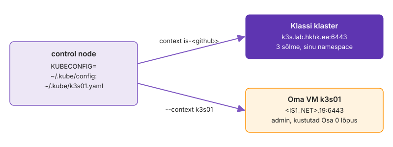
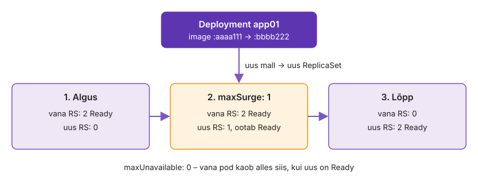

---
tags:
  - Kubernetes
  - k3s
  - Argo CD
  - GitOps
  - Praktikum
---

# Süvenemine: Kubernetes ja GitOps

Need osad jätkavad IS1 praktikumi [Labori seis Kubernetese klastris](https://hkhk-tk.github.io/is1-automatiseerimine/k07/lab/). Käsud käivitad control'is repositooriumi juurkaustas, katsefailid on kaustas `~/k07-katse`. Terviklikud lisapraktikumid on eraldi lehtedel: [Ressursid ja rikkeotsing](lab-3-ressursid.md), [Neli riket](lab-5-neli-riket.md) ja [Helm alused](lab-6-helm.md).

## Osa 1 · Oma k3s klaster

Tee see osa pärast IS1 praktikumi [1. osa](https://hkhk-tk.github.io/is1-automatiseerimine/k07/lab/#osa-1-klaster-ja-esimene-deployment), kui kubectl ühendub koolitaja klastriga.

Kui klastris läheb midagi katki ja sul on ainult API vastus, otsid viga pimesi: `Running` ei ütle, mis node'il tegelikult juhtub, ja klassi klastris oled ühe namespace'i kasutaja. Oma VM-il oled admin: paigaldad ühe node'iga k3s-i, ühendad mõlemad klastrid sama kubectl'iga ja vaatad Linuxi tööriistadega, millest pod, Service ja PVC node'il koosnevad. Lõpuks on control node'il kaks context'i, oled näinud pod'e töötamas ka peatatud k3s-iga ja VM on välja lülitatud.

Joonisel on vasakul control node, kus töötab üks kubectl. Paremal on kaks klastrit. Kumma klastriga kubectl parajasti suhtleb, otsustab kubeconfig'i context, mitte käsk ise.

<figure markdown="span">
  
  <figcaption>Joonis S7.1. Üks kubectl, kaks kubeconfig-faili ja kaks klastrit.</figcaption>
</figure>

kubeconfig'is on kliendisertifikaat või token, millega API server sind tuvastab. Kubernetes ei toeta kliendisertifikaatide tühistamist (CRL-i ega OCSP-d pole): lekkinud sertifikaat kehtib aegumiseni, kui koolitaja ei vaheta CA-d. ServiceAccount'i tokeni saab tühistada, kustutades ServiceAccount'i või token-Secret'i.

### 1.1 Käivita VM k3s01

Koolitaja on teinud sinu pool'i VM-i `k3s01`: Ubuntu 24.04, 2 tuuma, 2 GB mälu, IP `<IS1_NET>.23`. Seni on see välja lülitatud, sest klassi Proxmoxi mälu jagavad kõik õppijad. Käivitad selle ja kontrollid seestpoolt, et VM on nii suur, nagu k3s vajab.

k3s server vajab vähemalt 2 GB mälu. Liiga väikese mäluga VM käivitub, aga k3s jääb kinni või kernel hakkab protsesse tapma. Siis otsid viga Kubernetesest, kuigi põhjus on VM-i suuruses.

1. Vali Proxmoxi veebiliideses oma pool, seejärel `k3s01` ja vajuta **Start**.
2. Oota cloud-init'i lõppu ja vaata VM-i suurust:

    ```bash
    ssh -o StrictHostKeyChecking=accept-new kasutaja@<IS1_NET>.23 \
        'cloud-init status --wait; hostname; nproc; free -m | awk "/Mem/ {print \$2}"'
    ```

<!-- EKRAANIPILT: Proxmoxi veebiliides, vasakul puus sinu pool'i all VM k3s01 olekus running; paremal Summary vaade, kus on näha 2 GB mälu ja 2 tuuma; pärast Start'i
<figure markdown="span">
  
  <figcaption>Joonis S7.0. VM k3s01 Proxmoxis pärast käivitamist.</figcaption>
</figure>
-->

> Kui VM ei käivitu mälu tõttu, vaata Proxmoxis, kas mõni 4. kohtumise VM (web01…db01) töötab veel. Selle korra töö neid ei kasuta: lülita need välja (Shutdown).

`status: done` tähendab, et cloud-init lõpetas töö: kasutaja, võti ja võrk on paigas. `free` näitab veidi alla 2048 MB, sest osa mälust võtab kernel enne, kui see kasutajale näha on.

**Edasi saad minna, kui** ssh vastab `k3s01`, `nproc` annab `2` ja `free` üle 1800 MB.

### 1.2 k3s ja kaks klastrit ühes kubectl'is

Paigaldad k3s-i ja tood selle admin-faili control node'ile. Fail ei tööta kohe, sest k3s kirjutab selle enda jaoks: server on `127.0.0.1`, ja kubectl ühendub täpselt sellega, mis failis kirjas on. Parandad aadressi ja nimed ning liidad kaks faili üheks vaateks.

kubectl ei küsi kinnitust ega näita väljundis, millisesse klastrisse käsk läks. Valesse klastrisse läinud `apply` või `delete` vastu aitavad ainult selge context'i nimi, context promptis (näiteks kube-ps1) või eraldi `KUBECONFIG` iga terminali kohta.

1. Paigalda k3s [Quick-Start juhendi](https://docs.k3s.io/quick-start) järgi ja kopeeri admin-fail control node'ile:

    ```bash
    ssh kasutaja@<IS1_NET>.23 'curl -sfL https://get.k3s.io | INSTALL_K3S_VERSION=v1.35.9+k3s1 sh - && sudo k3s kubectl get nodes'
    ssh kasutaja@<IS1_NET>.23 sudo cat /etc/rancher/k3s/k3s.yaml > ~/.kube/k3s01.yaml && chmod 600 ~/.kube/k3s01.yaml
    kubectl --kubeconfig ~/.kube/k3s01.yaml get nodes
    ```

    VM-is on node `k3s01 Ready control-plane`, control node'ilt annab viimane käsk `connection refused … 127.0.0.1:6443`.

2. Paranda server ja nimed. k3s nimetab klastri, kasutaja ja context'i `default` ning need läheksid klassi failiga segamini. [`KUBECONFIG` liidab failid](https://kubernetes.io/docs/concepts/configuration/organize-cluster-access-kubeconfig/):

    ```bash
    sed -i -e 's/127\.0\.0\.1/<IS1_NET>.23/' -e 's/\bdefault$/k3s01/' ~/.kube/k3s01.yaml
    export KUBECONFIG=~/.kube/config:~/.kube/k3s01.yaml
    ```

3. Vaata mõlemat klastrit. Selles moodulis lisad igale käsule `--context k3s01`, et klassi klastrit kogemata ei muudaks:

    ```bash
    kubectl config get-contexts
    kubectl --context k3s01 get nodes -o wide
    ```

4. Võrdle kahe klastri volitusi. Oma klastris oled admin, klassis tavaline kasutaja:

    ```bash
    kubectl --context k3s01 auth whoami
    kubectl --context k3s01 auth can-i '*' '*'
    kubectl auth can-i '*' '*'
    ```

> Kui näed `x509: certificate is valid for … not …`, kasuta nime asemel IP-aadressi, sest k3s lisab sertifikaati node'i IP. Kui näed `i/o timeout`, blokeerib ühendust VM-i tulemüür: `sudo ufw allow 6443/tcp`.

Tärn `get-contexts` väljundis näitab context'i, mida kubectl kasutab, kui sa `--context`-i ei anna. See jääb klassi omaks, sest `KUBECONFIG`-i esimese faili `current-context` võidab. `can-i '*' '*'` annab oma klastris `yes` ja klassis `no`: sama kubectl, kaks väga erinevat volitust. Just seepärast paned oma klastri käskudele context'i alati kirja.

**Edasi saad minna, kui** `get-contexts` näitab kahte context'i (`*` klassi omal, `k3s01` teine), `get nodes -o wide` näitab VM-i IP-d ja `containerd://2.2` ning `can-i '*' '*'` vastab oma klastris `yes` ja klassis `no`.

### 1.3 Mis node'il tegelikult töötab

Lood oma klastrisse paar objekti ja vaatad neid node'i seest. Pod on protsessid ühises network namespace'is, Service on NAT-reegel ja PVC on node'il tavaline kaust. Klassi klastris sa seda ei näe, sest node'idele sul ligipääsu pole.

Kui tead, et Service on kerneli reegel, ei otsi sa rikke korral "Service'i protsessi", mida pole olemas. Kui tead, et PVC on node'i kaust, mõistad, miks local-path'i andmed kaovad koos node'iga ja miks see ei sobi andmebaasile, mis peab node'i rikke üle elama.

1. Loo oma klastris Deployment, Service, PVC ja seda kasutav pod:

    ```bash
    kubectl --context k3s01 create deployment web --image=nginx:1.30-alpine --replicas=2
    kubectl --context k3s01 expose deployment web --port=80
    kubectl --context k3s01 apply -f ~/<kursuse materjalid>/k07/starter/katse/kirjutaja.yaml
    kubectl --context k3s01 get pods,svc,pvc -o wide
    ```

2. Logi node'ile ja vaata pod'e, `pause`-protsesse ja network namespace'e:

    ```bash
    ssh kasutaja@<IS1_NET>.23
    sudo k3s crictl pods | head -5
    ps -eo pid,cmd | grep [p]ause | head -5
    sudo lsns -t net | head -5
    ```

    Iga pod on `crictl pods`-is üks rida ja igal pod'il on üks `pause`-protsess, mis on network namespace'i omanik.

3. Vaata samas node'il Service'i NAT-reeglit, PVC kausta ja k3s-i logi, siis välju:

    ```bash
    sudo iptables -t nat -S KUBE-SERVICES | grep default/web
    sudo find /var/lib/rancher/k3s/storage -name tere.txt -exec cat {} \;
    journalctl -u k3s --since '-10 min' --no-pager | tail -3
    exit
    ```

4. Vaata, kui palju node'ist on reserveeritud. Selle arvu järgi otsustab scheduler, kas uus pod node'ile mahub:

    ```bash
    kubectl --context k3s01 describe node | grep -A8 'Allocated resources'
    kubectl --context k3s01 get pods -A -o custom-columns=POD:.metadata.name,MEM:.spec.containers[*].resources.requests.memory
    ```

> Kui `iptables` väljund on tühi, võib kube-proxy uuemas k3s-is kasutada nftables'it. Sel juhul kasuta käsku `sudo nft list ruleset | grep -A3 default/web`.

Kaks `web`-pod'i on node'il kaks `pause`-protsessi ja kaks network namespace'i. ClusterIP ei ole ühegi võrguliidese aadress: see on olemas ainult NAT-tabelis, mis suunab paketi ühe pod'i IP-le. `tere.txt` kuupäev tõestab, et PVC on node'i kaust, kuhu konteiner kirjutas. `Allocated resources` näitab, mida pod'id küsisid, mitte seda, mida nad kasutavad: node võib olla "täis" ja samal ajal peaaegu jõude.

**Edasi saad minna, kui** iptables'is on rida `default/web` ClusterIP-ga, local-path kaustas `pvc-…_default_katse` on fail kuupäevaga ja `Allocated resources` näitab requests'ide summat protsendina node'i mahust.

### 1.4 Control plane seiskub, workload töötab edasi

Peatad k3s teenuse ajal, kui pod'id töötavad. API server, scheduler ja kontrollerid ehk control plane kaovad. Vaatad, kas nginx teenindab edasi ja mida näeb sel ajal kubectl.

Tootmisklastris juhtub see uuenduse, aegunud sertifikaadi või etcd rikke ajal. Kui tead, et workload töötab edasi, ei hakka sa paanikas pod'e taaskäivitama. Samas ei paranda sel ajal keegi ka ühtegi pod'i, mis ebaõnnestub.

**Ennusta:** kui k3s on peatatud, kas nginx vastab ClusterIP-l ja mida näitab `kubectl get pods`?

1. Jäta ClusterIP meelde ja peata node'il k3s:

    ```bash
    IP=$(kubectl --context k3s01 get svc web -o jsonpath='{.spec.clusterIP}'); echo $IP
    ssh kasutaja@<IS1_NET>.23 sudo systemctl stop k3s
    kubectl --context k3s01 get pods
    ```

2. Vaata node'il, kas nginx'i protsessid ja Service'i NAT-reegel töötavad:

    ```bash
    ssh kasutaja@<IS1_NET>.23 "ps -eo cmd | grep -c '[n]ginx: master'; curl -sI http://$IP | head -1"
    ```

3. Käivita k3s uuesti ja võrdle pod'e enne ja pärast:

    ```bash
    ssh kasutaja@<IS1_NET>.23 sudo systemctl start k3s && sleep 20
    kubectl --context k3s01 get pods -o wide
    ```

> `systemctl stop k3s` jätab konteinerid meelega käima. Kõik pod'id peatab skript `k3s-killall.sh`, mida kasutatakse enne node'i hooldust.

Kui k3s oli maas, sai kubectl `connection refused`, aga node'il oli kaks nginx'i master-protsessi ja ClusterIP vastas `HTTP/1.1 200 OK`. See tõestab, et data plane (konteinerid ja NAT-reeglid) ei vaja töötamiseks API serverit. Pärast taaskäivitust on pod'idel samad nimed ja RESTARTS on 0, seega neid ei loodud uuesti. Kui RESTARTS oleks kasvanud, oleks k3s peatamisel tapnud ka konteinerid.

**Edasi saad minna, kui** k3s peatatuna andis kubectl vea, curl ClusterIP-le andis `200` ja pärast taaskäivitust on pod'id samade nimedega ja RESTARTS 0.

### 1.5 Koristus

Klassi klastri töö VM-ist ei sõltu. Eemaldad tema kubeconfig'i, kontrollid, et kubectl vaatab jälle ainult klassi klastrit, ja lülitad VM-i välja. Välja lülitatud VM mälu ei võta ja k3s jääb sinna alles.

Unustatud `KUBECONFIG` jätab alles context'i, mis osutab välja lülitatud masinale, ja järgmisel päeval saad vea, mille põhjust enam ei mäleta.

1. Eemalda kubeconfig, vaata context'i ja lülita VM välja:

    ```bash
    rm ~/.kube/k3s01.yaml && unset KUBECONFIG
    kubectl config current-context
    ssh kasutaja@<IS1_NET>.23 sudo poweroff
    ```

> Admini vaade (teine namespace, NodePort, LoadBalancer, `cordon`, `kubectl debug node/…`) ja PodDisruptionBudget'i katse on lehel [Lisaülesanded → 11. Oma klastri admini vaade](lisa.md#11-oma-klastri-admini-vaade). Sama VM-i vajavad ka [21. Saladus Gitis: Sealed Secrets ja võtme taaste](lisa.md#21-saladus-gitis-sealed-secrets-ja-votme-taaste) ja võrguinseneri ülesanne [22. vorgukogu CronJob'ina](lisa.md#22-vorgukogu-cronjobina). Nende jaoks käivitad VM-i uuesti ja kopeerid admin-faili nagu etapis „k3s ja kaks klastrit ühes kubectl'is“. Kui oled valmis, lülita VM jälle välja.

`current-context` näitab nüüd klassi context'i, sest alles jäi ainult `~/.kube/config`. Kui see näitab `k3s01`, on `KUBECONFIG` mõnes teises terminalis või `.bashrc`-is alles.

**Edasi saad minna, kui** `kubectl config current-context` näitab klassi context'i ja `k3s01` on Proxmoxis olekus *stopped*.

**Selle osa tõend:** issue `K7.1` kommentaaris `kubectl config get-contexts` väljund, üks `pause` rida, iptables'i rida `default/web`, `Allocated resources` plokk ja katse "k3s maas" kolm rida: kubectl'i viga, curl'i `200` ja pod'id pärast taaskäivitust.

### 1.6 Miks see nii töötab

**`KUBECONFIG`-failide liitmine.** [`KUBECONFIG` liidab mitu faili](https://kubernetes.io/docs/concepts/configuration/organize-cluster-access-kubeconfig/) ja kehtima jääb esimese faili `current-context`, nii et `--context k3s01` jätab klassi klastri puutumata. Sama nimega kirjete puhul kehtib esimese faili kirje. Seetõttu tuli `default` ümber nimetada: muidu oleks k3s-i kasutaja kirje märkamatult välja jäänud ja kubectl oleks saatnud sinu VM-ile klassi klastri sertifikaadi.

**Pod node'il.** Node'il näitab `sudo k3s crictl pods` pod'e ja `crictl ps` nende konteinereid.

**`pause`-protsess.** Iga pod'i juures töötab `pause`-protsess, mis hoiab alles pod'i network namespace'i. Pod'i rakenduskonteinerid liituvad sellega. `sudo lsns -t net` näitab neid namespace'e koos protsessidega. Kui rakenduse konteiner lõpetab töö ja taaskäivitatakse, jääb `pause`-protsess alles ja koos sellega ka pod'i IP-aadress.

**k3s systemd teenusena.** k3s on üks systemd teenus ja selle logi näitab käsk `journalctl -u k3s -f`. Teenus käivitab containerd ja kõik control plane'i komponendid ühes protsessis.

**Miks pod'id jäid tööle.** Konteinerid töötavad oma shim-protsessides, mitte k3s-i protsessi sees. Selles praktikumis kasutatava k3s-i (v1.35.9+k3s1) paigaldusskripti loodud systemd unit'is on `KillMode=process`, nii et `systemctl stop k3s` lõpetas ainult põhiprotsessi. Teistsuguse unit'i seadistusega peatuksid ka konteinerid.

**DaemonSet.** DaemonSet hoiab igal node'il ühte pod'i (näiteks logikogujad, võrgu- ja salvestusagendid). Kui klastrisse lisatakse node, luuakse sellele automaatselt DaemonSet'i pod.

**Cordon.** `kubectl cordon` märgib node'i olekusse unschedulable (uusi pod'e sinna ei paigutata). Olemasolevad pod'id jäävad tööle ja uued pod'id jäävad olekusse `Pending`, kui klastris ei ole teist sobivat node'i.

**Taint ja toleration.** Tehniliselt on cordon taint `node.kubernetes.io/unschedulable:NoSchedule`. Taint hoiab pod'id node'ist eemal, pod'i spec'is olev toleration lubab pod'i sellele node'ile paigutada.

**Drain.** `kubectl drain` teeb cordon'i ja tõstab enne hooldust olemasolevad pod'id node'ilt ära, arvestades PodDisruptionBudget'it.

Kui jõudsid kiiremini: [Lisaülesanded → 6. Oma klaster edasi](lisa.md#6-oma-klaster-edasi), paned oma klastris DaemonSet'i käivituma igal node'il ja proovid taint'i ning toleration'it.

## Osa 2 · Õigused, label'id ja seadistus

Tee see osa pärast IS1 praktikumi [1. osa](https://hkhk-tk.github.io/is1-automatiseerimine/k07/lab/#osa-1-klaster-ja-esimene-deployment). Praktikumi sammu 1.4 lõpus kustutasid Deployment'i ja Service'i `web`, loo need uuesti käsuga `kubectl apply -f ~/k07-katse/web.yaml -f ~/k07-katse/web-svc.yaml`.

Katsefailid on kaustas `~/k07-katse`, mitte repos.

### 2.1 Kes sa klastris oled

Manifestides namespace'i ei ole, see tuleb context'ist. Õigused tulevad RoleBinding'ust, mille koolitaja sinu namespace'is ClusterRole'ile `edit` tegi. Sa ei näe RoleBinding'ut ise, aga saad API serverilt küsida, mida sa teha tohid.

Kui sa oma õigusi ei tea, tõlgendad `Forbidden`-it valesti: otsid viga manifestist, kuigi API server keeldus päringut täitmast. Teisalt peab admin teadma, mida kasutaja *saab* teha, sest see on ka see, mida ründaja tema kubeconfig'iga teha saaks.

1. Vaata context'i, kasutajat ja kahte põhiõigust:

    ```bash
    kubectl config get-contexts
    kubectl auth whoami
    kubectl auth can-i create deployments
    kubectl auth can-i create namespaces
    ```

2. Küsi veel viie tegevuse kohta:

    ```bash
    for r in 'get nodes' 'create networkpolicies' 'create rolebindings' 'create applications.argoproj.io' 'list secrets'; do
        printf '%-36s %s\n' "$r" "$(kubectl auth can-i $r)"
    done
    kubectl auth can-i patch pods --subresource=ephemeralcontainers
    ```

3. Vaata kvooti, vaikeväärtusi ja node'e:

    ```bash
    kubectl describe resourcequota
    kubectl describe limitrange
    kubectl get nodes -o wide
    ```

4. Salvesta oma õiguste nimekirja algus:

    ```bash
    kubectl auth can-i --list | head -20
    ```

5. Proovi sama küsimust teise namespace'i kohta. Nii näed, et õigus kehtib ainult sinu omas:

    ```bash
    kubectl auth can-i create deployments -n kube-system
    kubectl get pods -n kube-system
    ```

> Ajutise konteineri vastus sõltub koolitaja seadistusest. Vaikimisi `edit`-rollis seda pole, sest debug-konteiner läheb mööda pod'i loomise kontrollidest. Kui vastus on `no`, kasuta `kubectl debug --copy-to`-d, mida proovid [Ressursside ja rikkeotsingu](lab-3-ressursid.md) lehel.

Nende vastuste põhjal joonistub välja sinu piir. Workload'e ja Secret'eid tohid luua, aga Role'e, RoleBinding'uid, namespace'e ega kvooti mitte. Seega ei saa sa endale ise õigusi juurde anda ega naaberõppija tööd puutuda. `get nodes` võib vastata `yes`, sest node'ide lugemine on lisatud eraldi: näed, kus pod'id töötavad, aga node'e muuta ei saa. `kube-system` vastus `no` tõestab, et RoleBinding kehtib ainult sinu namespace'is.

**Edasi saad minna, kui** context'i NAMESPACE veerus on `is-<github>`, deployment'e `yes`, namespace'e `no`, `kube-system`-is `no`, ja tead oma [kvoodi](https://kubernetes.io/docs/concepts/policy/resource-quotas/) piire (requests 1 CPU / 2 Gi, 15 pod'i, 1 NodePort, 0 LoadBalancer'it) ning LimitRange'i vaikeväärtusi.

### 2.2 LoadBalancer ja kvoot

Proovi LoadBalancer-tüüpi Service'it. LoadBalancer võtaks pordi kõigil node'idel kogu klassi eest:

```bash
cd ~/k07-katse
kubectl expose deployment web --name=web-lb --port=8081 --target-port=80 --type=LoadBalancer
```

LoadBalancer'i viga ei tulnud võrgust, vaid kvoodist: API server keeldus objekti salvestamast, enne kui ükski kontroller seda nägi.

**Edasi saad minna, kui** LoadBalancer annab vea `exceeded quota: … services.loadbalancers=0`.

### 2.3 Pod karantiini label'iga

Seda võtet kasutavad adminid tootmises. Kui üks pod käitub imelikult, ei kustuta sa seda, vaid muudad tema label'it. Service ja ReplicaSet ei vali seda pod'i enam: liiklus lõpeb, kontroller loob asenduse, ja vigane pod jääb uurimiseks alles.

Pärast pod'i kustutamist näitab `kubectl logs` midagi ainult siis, kui logikoguja jõudis read ära saata, ja protsessi mälu ning ühenduste olekut ei näita enam miski. Label'i muutmine annab sulle aega põhjust otsida, ilma et kasutajad seda pod'i näeksid.

**Ennusta:** mitu pod'i on pärast label'i muutmist ja mitu IP-d jääb Service'i Endpoints'isse?

1. Vali üks pod ja vii see karantiini:

    ```bash
    P=$(kubectl get pod -l app=web -o jsonpath='{.items[0].metadata.name}')
    kubectl label pod "$P" app=karantiin --overwrite
    kubectl get pods -L app
    kubectl get endpoints web
    ```

2. Vaata, kellele pod nüüd kuulub:

    ```bash
    kubectl get pod "$P" -o jsonpath='{.metadata.ownerReferences}'; echo
    kubectl logs "$P" --tail=3
    ```

3. Kui oled valmis, kustuta karantiinis pod: `kubectl delete pod "$P"`

Pärast label'i muutmist on pod'e kolm: kaks `app=web` ja üks `app=karantiin`. Endpoints'is on ainult kaks IP-d ja karantiinis pod'i IP sealt kadus. `ownerReferences` on tühi, sest ReplicaSet vabastas pod'i, mis tema selector'iga enam ei sobi. Pod töötab edasi ja tema logid on alles, aga keegi ei saada talle liiklust.

**Edasi saad minna, kui** karantiinis pod'i IP kadus Endpoints'ist, ReplicaSet lõi asenduse, karantiinis pod'il polnud omanikku ja ta on nüüd kustutatud.

### 2.4 ConfigMap ja Secret testpodis

Annad konteinerile seadistust kahel viisil: keskkonnamuutujana ja failina. Konteiner ei tea, kust muutuja või fail tuli. Siis muudad mõlemat ja vaatad, kumb jõuab töötavasse pod'i.

See vahe on sage intsidentide põhjus. Keegi muudab ConfigMap'i, näeb, et objekt on uuendatud, ja eeldab, et rakendus kasutab uut väärtust. Kui rakendus loeb seda keskkonnamuutujast, töötab ta vana väärtusega seni, kuni pod uuesti käivitub.

1. Loo kaks ConfigMap'i ja Secret:

    ```bash
    kubectl create configmap katse --from-literal=DB_HOST=db01 --from-literal=LAB=lab-07
    kubectl create secret generic katse --from-literal=PAROOL=salajane
    printf 'tase=1\n' > app.conf && kubectl create configmap katse-fail --from-file=app.conf
    ```

2. Kirjuta `test-pod.yaml` ise:
    - Pod `test`, image `busybox:1.37`, `resources.requests` nagu `web`-il
    - `command: ["sh", "-c", "printenv | sort; sleep 3600"]`
    - `envFrom` mõlemast (`configMapRef` ja `secretRef`)
    - volume ConfigMap'ist `katse-fail` kausta `/etc/katse`

    Välju leiad käsuga `kubectl explain pod.spec.containers.envFrom` ja `kubectl explain pod.spec.volumes.configMap`.

3. Tee `kubectl apply` ja loe väärtused:

    ```bash
    kubectl apply -f test-pod.yaml
    kubectl logs test | grep -E 'DB_HOST|LAB|PAROOL'
    kubectl exec test -- cat /etc/katse/app.conf
    kubectl get secret katse -o jsonpath='{.data.PAROOL}' | base64 -d; echo
    ```

4. **Ennusta:** kumb muutub töötavas pod'is, fail või keskkonnamuutuja? Muuda mõlemat ja oota, kuni kubelet volume'i uuendab:

    ```bash
    printf 'tase=2\n' > app.conf
    kubectl create configmap katse-fail --from-file=app.conf --dry-run=client -o yaml | kubectl apply -f -
    kubectl patch configmap katse -p '{"data":{"LAB":"lab-99"}}'
    sleep 60; kubectl exec test -- cat /etc/katse/app.conf; kubectl exec test -- printenv LAB
    ```

5. Vaata, kus parool nähtav on ja kus mitte:

    ```bash
    kubectl describe secret katse | tail -3
    kubectl get pod test -o yaml | grep -c salajane
    kubectl exec test -- printenv PAROOL
    ```

> [kubelet uuendab ConfigMap'i volume'it](https://kubernetes.io/docs/concepts/configuration/configmap/), keskkonnamuutujad loetakse aga ainult konteineri käivitusel. Seepärast ei piisa keskkonnamuutujana loetud ConfigMap'i parandamisel `apply`-st, vaja on ka `rollout restart`-i.

Fail näitas pärast minutit `tase=2`, muutuja näitas ikka `lab-07`. Sama ConfigMap'i objekt, kaks eri tulemust, ja vahe on ainult selles, kuidas pod seda loeb. `describe secret` näitab ainult baitide arvu ja pod'i YAML-is parooli pole, aga `exec` näitab seda selgelt. Parooli kaitseb seega õigus `exec`-ile ja Secret'ite lugemisele, mitte base64.

**Edasi saad minna, kui** logis on kõik kolm muutujat, Secret dekodeeritult on `salajane`, failis on pärast muudatust `tase=2`, `printenv LAB` näitab ikka `lab-07` ja `grep -c salajane` pod'i YAML-is annab 0.

**Selle osa tõend:** issue `K7.2` kommentaaris `can-i` tabel viie tegevusega, `can-i --list` 20 rida, owner `ReplicaSet`, Endpoints = pod'ide IP-d, karantiini katse `get pods -L app` väljund, `kubectl logs test` kolm rida ja `printenv LAB` väljund.

### 2.5 Miks see nii töötab

**Namespace context'ist.** Kui context'i namespace on vale, luuakse objektid vales namespace'is või saad vea `Forbidden`.

**RBAC-i piirang.** RBAC-is kehtib põhimõte, et kasutaja saab teisele anda ainult neid õigusi, mis tal endal on, ja roll `edit` ei luba RoleBinding'uid luua.

**Service'i tüübid.** LoadBalancer-tüüpi Service hõivaks k3s-i vaikimisi koormusjaoturiga (ServiceLB) pordi kõigil node'idel. NodePort'i vaikevahemik on 30000–32767 ja port avatakse igal node'il. Tootmises kasutatakse NodePort'i harva.

**Label'id ja karantiin.** Ka ReplicaSet'i ja pod'i seos põhineb ainult label'il. Seetõttu töötas karantiini võte: üks `kubectl label` eemaldas pod'i mõlemast seosest, kuid protsess ise jäi muutmata.

**ConfigMap'i uuendus.** Volume'ina mount'itud ConfigMap uueneb töötavas pod'is kubeleti sünkroonimise järel, vaikeseadetega tavaliselt umbes minuti jooksul. Kubelet kirjutab volume'isse faili uue versiooni ja vahetab sümbollingi, nii et rakendus näeb kas vana või uut faili, mitte poolikut. Erand on `subPath`-iga mount'itud fail, mis ei uuene üldse.

**Secret.** Secret'i väärtus on base64-kodeeringus, nii et kasutaja, kellel on õigus Secret'it lugeda (ka `list`, mitte ainult `get`), näeb parooli. Koolitaja klastris on Secret'id etcd-s lisaks krüpteeritud, kuid see kaitseb andmeid kettal, mitte API kaudu lugemise eest.

Kui jõudsid kiiremini: [Lisaülesanded → 15. Oma klaster: namespace nagu klassis](lisa.md#15-oma-klaster-namespace-nagu-klassis), teed oma klastris sama namespace'i, kvoodi ja piiratud õigustega kasutaja, mille koolitaja tegi sinu jaoks.

## Osa 3 · Labori seis lähemalt

Tee see osa pärast IS1 praktikumi [2. osa](https://hkhk-tk.github.io/is1-automatiseerimine/k07/lab/#osa-2-labori-seis-klastris), kui Labori seis töötab Ingress'i kaudu ja enne kui annad selle Argo CD-le.

### 3.1 Andmed püsivad üle pod'i

Kontrollid, et andmed on PVC-l, mitte konteineris. Lisad tabelisse ühe rea, kustutad db01 pod'i ja vaatad, kas rida on uues pod'is alles.

Kui `mountPath` ei ole MariaDB andmekataloog `/var/lib/mysql`, kirjutab server konteineri kirjutatavasse kihti. Kõik töötab kuni esimese pod'i vahetuseni ja siis on andmebaas tühi. Seda on parem näha praegu kui pärast esimest node'i hooldust.

**Ennusta:** kas lisatud rida on alles, kui db01 pod asendatakse uuega?

1. Lisa rida ja kustuta pod:

    ```bash
    PW=$(kubectl get secret labori-seis -o jsonpath='{.data.DB_PASSWORD}' | base64 -d)
    SQL="kubectl exec deploy/db01 -- mariadb -ulabseis -p$PW labseis -e"
    $SQL "INSERT INTO lab (course_id, code, title, day) VALUES (1, 'lab-99', 'püsivuse katse', 7)"
    kubectl delete pod -l app=db01 && kubectl rollout status deploy/db01
    ```

2. Vaata, kas rida on alles, ja kustuta see:

    ```bash
    $SQL "SELECT code, title FROM lab WHERE code='lab-99'"
    $SQL "DELETE FROM lab WHERE code='lab-99'"
    kubectl get pv -o custom-columns=PV:.metadata.name,CLAIM:.spec.claimRef.name,NODE:.spec.nodeAffinity.required.nodeSelectorTerms[0].matchExpressions[0].values[0]
    ```

Uus pod luges sama kausta ja rida `lab-99` oli alles. PV veerg NODE näitab node'i, millega local-path ketta sidus: db01 saab käivituda ainult seal. Kui see node kaob, jääb db01 `Pending`-uks, sest teist koopiat andmetest pole. Pilves lahendab selle võrguketas, mis liigub node'ide vahel.

**Edasi saad minna, kui** rida `lab-99` oli pärast pod'i vahetust alles, see on nüüd kustutatud ja tead, millise node'iga sinu PV on seotud.

### 3.2 Ainult app01 tohib andmebaasi

Seni sai db01:3306-ga ühenduse iga pod sinu namespace'is. Nüüd piirad seda. [NetworkPolicy](https://kubernetes.io/docs/concepts/services-networking/network-policies/) valib pod'id label'i järgi nagu Service ja lubab sissetuleva liikluse ainult neilt, keda reegel nimetab. k3s jõustab seda sisseehitatud kontrolleriga.

Klastri võrk on vaikimisi lame: iga pod jõuab iga pod'ini, ka teisest namespace'ist. NetworkPolicy valib allika ja sihi label'i, mitte IP järgi, ja CNI tõlgib selle iga pod'i IP muutumisel uuesti node'i reegliteks.

1. Proovi enne poliitikat ajutisest pod'ist:

    ```bash
    kubectl run nc --rm -it --image=busybox:1.37 --restart=Never -- nc -zv -w 3 db01 3306
    ```

2. Kirjuta `k07-k8s/15-db-netpol.yaml` ise:
    - NetworkPolicy `db01`, `podSelector` valib pod'id label'iga `app: db01`
    - `policyTypes: [Ingress]`
    - lubatud ainult pod'id label'iga `app: app01`, port 3306/TCP
    - `namespace:` rida puudub
3. **Ennusta:** kumb jõuab pärast poliitikat andmebaasini, ajutine pod või app01? Tee `kubectl apply` ja proovi mõlemast:

    ```bash
    kubectl apply -f k07-k8s/15-db-netpol.yaml
    kubectl run nc --rm -it --image=busybox:1.37 --restart=Never -- nc -zv -w 3 db01 3306
    kubectl exec deploy/app01 -c labori-seis -- bash -c '</dev/tcp/db01/3306 && echo avatud'
    curl -s -H 'Host: labori-seis-<github>.lab.hkhk.ee' http://k3s.lab.hkhk.ee/health; echo
    ```

4. Proovi sama ajutisest pod'ist, millel on app01 label. Nii näed, et poliitika usaldab label'it, mitte pod'i päritolu:

    ```bash
    kubectl run nc2 --rm -it --image=busybox:1.37 --restart=Never --labels=app=app01 -- nc -zv -w 3 db01 3306
    ```

> Kui ajutine pod saab ka pärast poliitikat `open`, ei jõusta klaster NetworkPolicy'd. Kirjuta see issue'sse ja jäta fail alles.

Ajutine pod sai `timed out`, mitte `connection refused`: poliitika hülgab paketi vaikselt. app01 sai ühenduse ja `/health` jäi `UP`-iks. Pod label'iga `app=app01` sai samuti `open`. See tähendab, et iga kasutaja, kes tohib sinu namespace'is pod'e luua, saab poliitikast mööda. Label on piir ainult koos õigustega, kes pod'e luua tohib.

**Edasi saad minna, kui** ajutine pod saab pärast poliitikat `timed out`, app01 seest tuleb `avatud`, `/health` näitab `"db":"UP"` ja issue'sse on kirjas, mida näitas `nc2` katse.

### 3.3 Rolling update ja rollback

Vahetad app01 image'i ja vaatad, kuidas Kubernetes vana ja uue versiooni vahetab ilma katkestuseta. Siis teed rollback'i ja vaatad, mis juhtub failiga.

`maxUnavailable: 0` hoiab vana pod'i alles, kuni uus on Ready. `undo` ei kustuta ajalugu, vaid kopeerib vana template'i uueks revisjoniks, ja fail ei tea sellest midagi. Just see "fail ei tea" on probleem, mille GitOps lahendab.

Joonis näitab kahte ReplicaSet'i ajas. Uus kasvab ühe pod'i kaupa, vana kahaneb alles siis, kui uus pod on Ready. Kui uus pod Ready'ks ei saa, jääb pilt poolele teele: vana teenindab edasi ja rollout seisab.

<figure markdown="span">
  
  <figcaption>Joonis S7.2. Rolling update kahe ReplicaSet'i vahel.</figcaption>
</figure>

1. Vali oma GHCR-ist teine tag (eelmine commit). Muuda failis `image` ja `kubernetes.io/change-cause` ning pane ajutiselt `replicas: 2`.
2. Tootmises ei tohi kasutaja vahetust näha. Käivita teises terminalis kasutaja vaate logi ja jäta see tööle kuni 5. sammu lõpuni:

    ```bash
    H='Host: labori-seis-<github>.lab.hkhk.ee'
    while sleep 1; do echo "$(date +%T) $(curl -s -o /dev/null -m 3 -w '%{http_code}' -H "$H" http://k3s.lab.hkhk.ee/health)"; done | tee ~/k07-katse/rolling.log
    ```

3. **Ennusta:** kas kasutaja logisse tuleb uuenduse ajal vigu? Tee `kubectl apply` ja jälgi kolmandas aknas ReplicaSet'e:

    ```bash
    kubectl apply -f k07-k8s/40-app.yaml
    kubectl get rs -l app=app01 -w
    ```

4. Vaata tulemust:

    ```bash
    kubectl rollout status deploy/app01
    kubectl rollout history deploy/app01
    curl -s -H 'Host: labori-seis-<github>.lab.hkhk.ee' http://k3s.lab.hkhk.ee/version; echo
    ```

5. Tee rollback ja võrdle faili klastriga. `diff` näitab miinusega klastri vana tag'i ja plussiga faili uut:

    ```bash
    kubectl rollout undo deploy/app01
    kubectl rollout history deploy/app01
    kubectl diff -f k07-k8s/40-app.yaml
    ```

6. Mine tagasi uuele tag'ile: `kubectl rollout undo deploy/app01 --to-revision=<uue tagi revisjon>`, siis `kubectl diff -f k07-k8s/40-app.yaml` on image'i osas tühi. Peata logi ja loe, mitu vastust polnud `200`: `grep -vc ' 200$' ~/k07-katse/rolling.log`.
7. Pane failis tagasi `replicas: 1` ja õige tag ning käivita `kubectl apply -f k07-k8s/40-app.yaml`.

> CHANGE-CAUSE on `<none>`: annotatsioon peab olema Deployment'i `metadata.annotations`-is, mitte pod'i template'is.
>
> Logis on üksikud `502` või `000`: vana pod sai SIGTERM-i ajal, kui Traefik talle veel päringuid saatis. Endpoints'i uuendus jõuab Traefikuni hiljem kui SIGTERM pod'ini. Tavaline parandus on `lifecycle.preStop` lühikese `sleep`-iga ja `terminationGracePeriodSeconds` sellest pikem; kirjuta issue'sse, mida nägid ja kas parandus aitas.

`rollout history` revisjonide numbrid ainult kasvavad. Pärast `undo`-d ei läinud number tagasi, vaid tekkis uus, mille template on sama mis vanal. `kubectl diff` näitas, et klaster ja fail lahknesid kohe pärast `undo`-d. Kui keegi teine oleks samal ajal faili `apply`-ga saatnud, oleks sinu rollback kadunud ilma, et keegi märkaks.

**Edasi saad minna, kui** uus ReplicaSet kasvas 0 → 2 ja vana kahanes 2 → 0, `grep -vc ' 200$' ~/k07-katse/rolling.log` annab 0 (või issue's on põhjus ja parandus), `rollout history` näitab vähemalt kolme revisjoni koos CHANGE-CAUSE'iga ja pärast `undo`-d tekkis uus revisjoni number.

### 3.4 Lõikude kaupa ehitatud stack

IS1 praktikumis said db01, mc01, rmq01 ja app01 manifestid valmis kujul. Kui tahad neid ise kirjutada, kehtivad need nõuded:

- **db01:** PVC `db01-data` (ReadWriteOnce, 1Gi, `storageClassName` puudub), Deployment strateegiaga `Recreate`, paroolid Secret'ist, PVC kausta `/var/lib/mysql` ja ConfigMap `labori-seis-db` kausta `/docker-entrypoint-initdb.d`, readiness `healthcheck.sh --connect --innodb_initialized` koos `timeoutSeconds`-iga.
- **mc01 ja rmq01:** konteineripordil on nimi (`name: memcache`, `name: amqp`) ja Service'i `targetPort` viitab nimele, mitte numbrile; rmq01 parool tuleb Secret'ist `labori-seis` (võti `RABBITMQ_PASSWORD`); igal konteineril on `resources.requests`, `resources.limits.memory` ja readiness probe.
- **app01:** init-konteiner `wait-deps` (image `mariadb:11.4`, `envFrom` samast ConfigMap'ist) ootab TCP-ühendust `$DB_HOST:3306` ja `$RABBITMQ_HOST:5672`, kolm probe'i ja `resources`.

Kui sul on 5. kohtumise image GHCR-is, kasuta koolitaja image'i asemel enda oma:

```bash
gh api /orgs/hkhk-tk/packages/container/<sinu-repo>/versions --jq '.[0:3][].metadata.container.tags'
```

> Kui pod on olekus `ImagePullBackOff` ja Events näitab `unauthorized`, on pakett privaatne. Koolitaja on lisanud sinu default ServiceAccount'ile secret'i `ghcr-pull` (`kubectl get sa default -o yaml`). Kui seda pole, vt `k07-k8s/examples/secret.example.yaml`.

Paroolid võid võtta ka 3. kohtumise failist `k03-docker/.env`:

```bash
E=k03-docker/.env; v() { grep "^$1=" "$E" | cut -d= -f2-; }
kubectl create secret generic labori-seis \
  --from-literal=DB_PASSWORD="$(v DB_PASSWORD)" --from-literal=RABBITMQ_PASSWORD="$(v RABBITMQ_PASSWORD)" \
  --from-literal=TEACHER_TOKEN="$(v TEACHER_TOKEN)" --from-literal=MARIADB_ROOT_PASSWORD="$(openssl rand -hex 12)"
```

### 3.5 Miks see nii töötab

**`/dev/tcp`.** `bash -c '< /dev/tcp/db01/3306'` ei ava faili. `/dev/tcp/<host>/<port>` on tee, mida tõlgendab bash ise: ümbersuunamine avab TCP-ühenduse ja väljumiskood näitab, kas ühendus õnnestus.

**Miks `wait-deps` kasutab MariaDB image'it.** `/dev/tcp` töötab bashis, mitte `sh`-s. Seetõttu kasutab `wait-deps` image'it `mariadb:11.4`: see on db01 jaoks node'il juba olemas ja selles on bash.

**MariaDB esimene käivitus.** MariaDB ametliku image'i käivitusskript (entrypoint) käivitab esimesel korral serveri võtmega `--skip-networking`, käivitab kausta `/docker-entrypoint-initdb.d/` skriptid ja alles seejärel käivitab serveri võrguühendusega. Seetõttu tähendab avatud port ka seda, et skeem ja algandmed on loodud.

**`lost+found` pilvekettal.** Pilvekettal (EBS, Longhorn) on uues ext4-failisüsteemis kaust `lost+found`, mis võib andmebaasi algseadistamist häirida: MySQL keeldub mittetühjast andmekataloogist ja MariaDB võib kuvada kausta andmebaasina. local-path annab tavalise kausta ja seda probleemi ei teki. Tavaline lahendus on mount'ida andmed alamkausta (`subPath`).

**local-path ja node.** local-path'i PV on seotud ühe node'iga `nodeAffinity` kaudu, mida nägid `get pv` väljundis. Kui node kaob, jääb andmebaasi pod olekusse `Pending` ja andmed jäävad selle node'i kettale. Pilves oleks PVC taga EBS-ketas, mida saab ühendada uue pod'iga sama availability zone'i piires.

**Service ja kube-proxy.** Service'il ei ole oma protsessi: kube-proxy kirjutab igale node'ile NAT-reeglid (iptables- või nftables-režiimis; IPVS-režiimis on mehhanism teistsugune). Nimi `db01` lahendatakse, sest pod'i failis `/etc/resolv.conf` on otsingudomeen `search is-<github>.svc.cluster.local`.

**NetworkPolicy reeglid.** NetworkPolicy reeglid liituvad. Kui pod'i valib vähemalt üks Ingress-tüüpi poliitika, on lubatud ainult see liiklus, mida mõni poliitika lubab. Väljuvat liiklust (egress) me ei piira, sest muidu tuleks eraldi lubada ka DNS (UDP ja TCP port 53 namespace'is `kube-system`).

**PodSecurity hoiatus.** Hoiatus `PodSecurity "restricted:latest"` tähendab, et sinu namespace'i label'ite järgi jõustatakse taset `baseline` ja rangema taseme rikkumise kohta antakse hoiatus.

**Rollout'i ajalugu.** Annotatsioon `kubernetes.io/change-cause` kuvatakse käsu `kubectl rollout history` veerus.

**Rolling update'i vaikeväärtused.** Deployment'i strateegia on vaikimisi `RollingUpdate` väärtustega `maxSurge: 25%` ja `maxUnavailable: 25%`. Protsent ümardatakse lisapod'ide puhul üles ja puuduvate puhul alla, nii et ühe kuni kolme koopiaga tähendab see ühte lisapod'i (`maxSurge: 1`) ja mitte ühtegi puuduvat (`maxUnavailable: 0`). Seetõttu ei ole meie manifestis `strategy` plokki vaja.

**Failide järjekord.** Workload'ide puhul failide järjekord tavaliselt tähtis ei ole. `kubectl apply -f k07-k8s/` saadab failid tähestiku järjekorras üksteise järel, kontrollerid ei oota üksteist ja käivitusjärjekorra tagab `wait-deps`. Erand on objekt, mis peab enne olemas olema, näiteks namespace või CRD: kui see on hilisemas failis, ebaõnnestub esimene `apply` ja alles teine õnnestub.

**Puuduv sõltuvus.** Labori seis talub ka sõltuvuse puudumist: Hikari connection pool ei katkesta rakenduse käivitust, kui andmebaas ei vasta, ja readiness-probe hoiab pod'i liiklusest eemal. Compose'iga nägid siis lehte „Andmebaas ei vasta“. Klastris vastab Traefik koodiga 503, sest Service'il ei ole ühtegi Ready-olekus pod'i. See on teadlik valik.

**Probe'i ajapiir.** Probe'i vaikimisi `timeoutSeconds` on 1 sekund. `rabbitmq-diagnostics ping` käivitab Erlangi VM-i ja võtab sageli kauem, seetõttu on rmq01 probe tüübiga `tcpSocket` pordile 5672. app01 startup-probe lubab kuni 36 × 5 s, sest jagatud klastris teeb sama toimingu korraga 15 inimest.

**Ingress ja DNS.** Pilves loodaks Ingress-kontrolleri LoadBalancer-tüüpi Service'i jaoks pilveteenuse load balancer välise aadressiga ja DNS-is oleks selle aadressi jaoks CNAME-kirje. Klassis täidab sama ülesannet wildcard-kirje `*.lab.hkhk.ee`.

Kui jõudsid kiiremini: [Lisaülesanded → 12. Kogu namespace'i võrk kinni](lisa.md#12-kogu-namespacei-vork-kinni), keelad kogu sissetuleva liikluse ja lubad iga ühenduse eraldi NetworkPolicy'ga.

## Osa 4 · GitOps lähemalt

Tee see osa pärast IS1 praktikumi [3. osa](https://hkhk-tk.github.io/is1-automatiseerimine/k07/lab/#osa-3-argo-cd-hoiab-soovitud-olekut), kui Application `labori-seis` on `Synced Healthy`. Argo CD loeb haru `main` ja `gitops.yml` kirjutab harusse `main`, seega töötad main'il. Väikesed manifestide muudatused lähevad otse main'i, `gitops.yml` tuleb PR-iga, sest just merge käivitab ahela.

Kompromiteeritud CI saab kirjutada ainult Giti, kus muudatus jääb ajalukku ning branch protection ja CODEOWNERS saavad seda piirata. Klastri võtmega CI oleks otsetee tootmisse, millest Gitis jälgi ei jää.

### 4.1 Argo CD UI ja CLI

Vaatad sama Application'it kolmest kohast: kubectl, Argo CLI ja veebiliides. Application'i nimi on kujul `<namespace>/<nimi>`, sest Application elab sinu namespace'is. Refresh loeb Giti kohe uuesti, Sync viib muudatused klastrisse.

UI ja `argocd` CLI räägivad argocd-server'i API-ga (CLI gRPC kaudu), mitte Kubernetese API-ga, seepärast vajab CLI eraldi sisselogimist ja õigused tulevad Argo enda RBAC-ist, mitte sinu kubeconfig'ist. Info on sama, mis Application-objekti `status` all.

1. Võta koolitajalt konto (`<github>`) ja parool. Paigalda CLI ja logi sisse:

    ```bash
    command -v argocd || { curl -fsSLo argocd https://github.com/argoproj/argo-cd/releases/download/v3.5.2/argocd-linux-amd64 && sudo install argocd /usr/local/bin/; }
    argocd login argocd.lab.hkhk.ee --grpc-web --username <github>
    argocd app list
    ```

2. Vaata rakendust CLI-s ([`argocd app`](https://argo-cd.readthedocs.io/en/stable/user-guide/commands/argocd_app/)):

    ```bash
    argocd app get is-<github>/labori-seis | head -12
    argocd app resources is-<github>/labori-seis
    argocd app history is-<github>/labori-seis
    argocd proj get is-<github>
    ```

3. Ava UI-s `https://argocd.lab.hkhk.ee` rakendus `labori-seis`, vaata ressursside puud (Application → Deployment → ReplicaSet → Pod), ava app01 pod'i **Logs** ja leia nupud **Refresh** ja **Sync**.

<!-- EKRAANIPILT: Argo CD UI, rakendus is-<github>/labori-seis, app01 pod'i detailaken avatud vahekaardil Logs; logis on näha Spring Booti käivitusread
<figure markdown="span">
  
  <figcaption>Joonis S7.6. app01 pod'i logid Argo CD UI-s.</figcaption>
</figure>
-->

> Kui näed `permission denied`, on sinu kontol õigus ainult oma projektile, mille nimi on `is-<github>/labori-seis`. Kui sul Argo CD kontot pole, leiad sama info käsu `kubectl get application labori-seis -o yaml` väljundi plokist `status`.

`app resources` loetleb kõik objektid, mida Argo haldab. Secret'it `labori-seis` seal pole, sest seda pole Gitis, ja see on õige. `proj get` näitab piire, mille koolitaja sulle seadis: üks repo, üks namespace, klastritasandi objekte mitte. Isegi kui keegi kirjutaks sinu repo'sse ClusterRole'i, ei laseks Argo seda luua.

**Edasi saad minna, kui** `app get` näitab `Sync Status: Synced to main (<sha7>)` ja `Health Status: Healthy`, `history`-s on üks revisjon ja `proj get` lubab ainult sinu repot ja sinu namespace'i.

### 4.2 CI kirjutab tag'i, Argo viib klastrisse

Paned ahela kokku: kui `ci` on main'il roheline, kirjutab `gitops.yml` sama commit'i SHA `40-app.yaml`-i ja commit'ib. Argo näeb uut commit'i ja viib selle klastrisse. CI-l pole kubeconfig'i.

Kompromiteeritud CI saab kirjutada ainult Giti, kus muudatus jääb ajalukku ning branch protection ja CODEOWNERS saavad seda piirata. Klastri võtmega CI oleks otsetee tootmisse, millest Gitis jälgi ei jää.

1. Loo haru ja kopeeri starter:

    ```bash
    git switch -c k07-gitops
    cp ~/<kursuse materjalid>/k07/starter/.github/workflows/gitops.yml .github/workflows/gitops.yml
    ```

2. Täida TODO 1–5. Nõuded:
    - job käivitub ainult siis, kui `ci` lõppes edukalt ja selle käivitas `push`
    - job'il on õigus repo'sse kirjutada (`contents: write`)
    - `sed -i -E` asendab `ghcr.io/…` image'i rea ja `kubernetes.io/change-cause` väärtuse `"${SHA::7} (ci)"`
    - commit'i sõnum on `k07: app01 → <sha7> [skip ci]`, push `origin HEAD:main`, vahepealse push'i korral `git pull --rebase` ja uus katse
3. Kontrolli, siis PR, merge ja jälgi käivitu:

    ```bash
    actionlint .github/workflows/gitops.yml && bash autograde/check.sh k07 cibump
    git add .github/workflows/gitops.yml && git commit -m "K7.7 gitops: CI kirjutab image'i tagi (closes #<nr>)"
    git push -u origin k07-gitops && gh pr create --fill --base main && gh pr merge --merge
    gh run watch
    ```

4. Kui `gitops` on roheline, tõmba main ja vaata, kuidas Argo muudatuse klastrisse viib:

    ```bash
    git switch main && git pull && git log --oneline -3
    kubectl get application labori-seis -w
    kubectl rollout history deploy/app01
    argocd app history is-<github>/labori-seis
    ```

5. Võrdle kolme SHA-d: boti commit'i sõnumis, `/version`-is ja Argo revisjonis:

    ```bash
    curl -s -H 'Host: labori-seis-<github>.lab.hkhk.ee' http://k3s.lab.hkhk.ee/version; echo
    kubectl get application labori-seis -o jsonpath='{.status.sync.revision}'; echo
    git rev-parse HEAD
    ```

<!-- EKRAANIPILT: GitHubi repo Actions vaade pärast PR-i merge'i; järjest kaks rohelist jooksu: ci (push main) ja gitops (workflow_run), gitops on ci järel
<figure markdown="span">
  
  <figcaption>Joonis S7.7. <code>ci</code> lõpeb edukalt ja käivitab <code>gitops</code>-i.</figcaption>
</figure>
-->

<!-- EKRAANIPILT: GitHubi repo Commits vaade harul main pärast gitops jooksu; ülemine commit on github-actions[bot] sõnumiga "k07: app01 → <sha7> [skip ci]", selle all PR-i merge commit
<figure markdown="span">
  
  <figcaption>Joonis S7.8. Boti commit main'il: CI muutis ainult image'i tag'i.</figcaption>
</figure>
-->

> `gitops` ei käivitu: [`workflow_run`](https://docs.github.com/en/actions/writing-workflows/choosing-when-your-workflow-runs/events-that-trigger-workflows#workflow_run) töötab ainult siis, kui fail on main'il, ja `workflows: [ci]` peab vastama `ci.yml` workflow'i `name:` reale. `skipped`: `ci` ei olnud roheline või polnud tegu push'iga.

Kolm SHA-d tähendavad kolme eri asja. Boti commit'i sõnumis on rakenduse koodi commit, millest image ehitati. `/version` näitab, mis kood pod'is töötab. `status.sync.revision` on manifestide commit, mille Argo klastrisse viis, ehk boti commit ise. Kui `/version` ja boti sõnum klapivad ning Argo revisjon on `git rev-parse HEAD`, on ahel koodist klastrini katkematu. Kui `/version` näitaks vana SHA-d, oleks Argo sünkroonis, aga rollout jäänud pooleli.

**Edasi saad minna, kui** main'il on boti commit `k07: app01 → <sha7> [skip ci]`, selle peale uut `ci`-d ei käivitunud, `rollout history` viimases reas on `<sha7> (ci)` ning `/version` SHA ja `status.sync.revision` klapivad boti commit'iga.

### 4.3 Sync policy: drift ilma selfHeal'ita

Lülitad selfHeal'i välja ja teed sama muudatuse. Ilma `selfHeal`-ita näitab Argo drift'i `OutOfSync`-ina, aga ei paranda seda enne järgmist commit'i. Siis otsustad sina: kas Git võidab või läheb klastri muudatus Giti.

Mõnes meeskonnas on selfHeal tootmises teadlikult väljas, et intsidendi ajal saaks käsitsi sekkuda. Hind on see, et drift jääb alles, kuni keegi selle lahendab, ja `OutOfSync` muutub müraks, millele keegi enam ei reageeri.

1. Lülita selfHeal klastris välja ja tee sama muudatus:

    ```bash
    kubectl patch application labori-seis --type merge -p '{"spec":{"syncPolicy":{"automated":{"selfHeal":false}}}}'
    kubectl scale deploy/app01 --replicas=2
    kubectl get application labori-seis
    argocd app diff is-<github>/labori-seis
    ```

2. Las Git võita: `argocd app sync is-<github>/labori-seis`, siis `kubectl get deploy app01`.
3. Pane failis kirjas olev poliitika tagasi ja vaata, mis kehtib:

    ```bash
    kubectl apply -f k07-k8s/argocd/application.yaml
    kubectl get application labori-seis -o jsonpath='{.spec.syncPolicy.automated}'; echo
    ```

> Application'it ennast Argo ei halda. Kui muudad poliitikat käsitsi, kaob muudatus alles siis, kui teed failile uuesti `kubectl apply`.

`argocd app diff` näitas täpselt ühte erinevust, `replicas`, ja see on sama info, mille sa rikete juures `kubectl diff`-iga käsitsi leidsid. Sync rakendas Gitis kirjeldatud oleku klastris ja OutOfSync kadus. Kui oleksid tahtnud kahte koopiat alles jätta, oleks õige tee olnud muuta faili ja commit'ida, mitte jätta drift'i.

**Edasi saad minna, kui** `replicas: 2` püsis seni, kuni tegid sync'i, Application oli selle aja `OutOfSync`, pärast sync'i on 1 koopia ja `automated` näitab jälle `"prune":true,"selfHeal":true`.

### 4.4 Prune: Gitist kadunud objekt

Lisad Giti uue objekti, vaatad, kuidas see klastrisse tekib, ja kustutad selle Gitist. `prune: true` kustutab klastrist objekti, mis Gitist kadus. Ilma selleta jääks objekt klastrisse ja Application oleks `OutOfSync`.

Ilma prune'ita kogunevad klastrisse vanad ConfigMap'id, Service'id ja CronJob'id, mida keegi enam ei kasuta, aga mis võivad ikka töötada. Unustatud CronJob, mis töötab edasi vana parooliga, on tüüpiline leid turvaauditis.

Prune kustutab samamoodi ka PVC, kui selle fail Gitist kaob, ja koos PVC-ga kaovad andmed. Laboris on db01 andmed taastatavad algandmed. Tootmises märgitakse andmetega PVC annotatsiooniga `argocd.argoproj.io/sync-options: Prune=false`: Argo näitab objekti siis `OutOfSync`-ina, aga ei kustuta seda.

1. Kirjuta `k07-k8s/90-proov.yaml`: ConfigMap `proov`, üks võti `LAB: prune`, ilma `namespace:` reata. Lükka see main'i:

    ```bash
    git add k07-k8s/90-proov.yaml && git commit -m "proov: prune" && git push
    kubectl annotate application labori-seis argocd.argoproj.io/refresh=normal --overwrite
    kubectl get configmap proov -w
    ```

2. **Ennusta:** kas ConfigMap `proov` jääb klastrisse alles, kui fail Gitist kaob? Kustuta fail Gitist ja vaata:

    ```bash
    git rm k07-k8s/90-proov.yaml && git commit -m "proov: prune ära" && git push
    kubectl annotate application labori-seis argocd.argoproj.io/refresh=normal --overwrite
    kubectl get configmap proov
    ```

> Refresh-annotatsioon ütleb Argole, et ta loeks Giti kohe, mitte järgmisel 60-sekundilisel küsimisel.

ConfigMap tekkis ilma, et sa oleksid `kubectl apply` käivitanud, ja kadus ilma `kubectl delete`-ta. Klastri muutmiseks piisas commit'ist. `NotFound` teisel korral tõestab, et Argo jälgib ka seda, mida Gitis enam pole, mitte ainult seda, mis seal on.

**Edasi saad minna, kui** ConfigMap `proov` tekkis pärast esimest push'i ise ja kadus pärast teist (`NotFound`).

### 4.5 Katkine YAML Gitis

Lükkad Giti faili, mida ei saa YAML-ina lugeda. Vaatad, mis juhtub Application'iga ja kas töötav rakendus kannatab.

Süntaksiviga manifestis on tavaline ja ohutu küsimus on: kas GitOps'i tööriist viib klastrisse poole failist või mitte midagi? Argo CD ei muuda klastris midagi, kui ta ei suuda kogu kausta renderdada. See kaitseb klastrit, aga peatab ka kõik teised uuendused, kuni viga on parandatud.

1. Kirjuta fail vale taandega ja lükka see main'i:

    ```bash
    printf 'apiVersion: v1\nkind: ConfigMap\nmetadata:\n  name: katki\n data: {}\n' > k07-k8s/91-katki.yaml
    git add k07-k8s/91-katki.yaml && git commit -m "katki: yaml" && git push
    kubectl annotate application labori-seis argocd.argoproj.io/refresh=normal --overwrite
    ```

2. Vaata Application'i olekut ja rakendust:

    ```bash
    kubectl get application labori-seis
    kubectl get application labori-seis -o jsonpath='{.status.conditions[*].message}'; echo
    curl -s -H 'Host: labori-seis-<github>.lab.hkhk.ee' http://k3s.lab.hkhk.ee/health; echo
    ```

3. Eemalda fail ja vaata, et olek taastus:

    ```bash
    git rm k07-k8s/91-katki.yaml && git commit -m "katki: yaml ära" && git push
    kubectl annotate application labori-seis argocd.argoproj.io/refresh=normal --overwrite
    kubectl get application labori-seis -w
    ```

Sync status oli `Unknown` ja tingimuses oli `ComparisonError` koos YAML-i reanumbriga. `/health` vastas ikka `UP`: klastris ei muutunud midagi, sest Argo ei suutnud uut soovitud olekut üldse välja arvutada. Kui sel ajal oleks CI kirjutanud uue tag'i, poleks see klastrisse jõudnud. Seepärast käivitad `kubeconform`-i enne push'i, mitte pärast.

**Edasi saad minna, kui** katkise failiga oli olek `Unknown` ja `ComparisonError`, `/health` jäi `UP`-iks ja pärast faili eemaldamist on olek jälle `Synced Healthy`.

### 4.6 Halb commit ja git revert

Lükkad Giti korrektse YAML-i, mis on sisult vale: olematu image'i tag. Argo teeb täpselt seda, mis Gitis on. [Sync status vastab küsimusele "kas klaster = Git", health küsimusele "kas rakendus töötab"](https://argo-cd.readthedocs.io/en/stable/operator-manual/health/).

`git revert` teeb uue commit'i, nii et `argocd app history`-s on halb ja parandav revisjon kõrvuti ning sync'i ajad näitavad, kui kaua viga klastris oli.

1. Pane image'ile olematu tag ja push'i:

    ```bash
    sed -i 's|\(image: ghcr.io/.*\):.*|\1:olematu|' k07-k8s/40-app.yaml
    git commit -am "halb tag" && git push
    kubectl get application labori-seis -w
    kubectl get pods -l app=app01
    ```

2. Vaata `gitops` jooksu logi: commit muutis ainult `k07-k8s/`, seega jätab CI image'i rahule ega "paranda" sinu viga ise.
3. **Ennusta:** kas `kubectl rollout undo` parandab olukorra? Proovi `kubectl rollout undo deploy/app01` ja vaata `kubectl get pods -l app=app01 -w`.
4. Tühista halb commit:

    ```bash
    git revert --no-edit HEAD && git push
    kubectl get application labori-seis -w
    git log --oneline -3
    ```

<!-- EKRAANIPILT: Argo CD UI, rakendus is-<github>/labori-seis pärast "halb tag" push'i; Sync Status Synced, App Health Degraded; puus on uus app01 pod punase märgiga ImagePullBackOff ja vana pod rohelisena
<figure markdown="span">
  
  <figcaption>Joonis S7.9. Synced, aga Degraded: klaster vastab Gitile, rakendus mitte.</figcaption>
</figure>
-->

Halva tag'iga oli olek `Synced` ja `Degraded` korraga: Argo tegi oma töö õigesti, aga Gitis oli viga. Kasutaja seda ei märganud, sest `maxUnavailable: 0` hoidis vana pod'i teenindamas. `rollout undo` keerati sekunditega tagasi, sest Git ütles ikka `olematu`. Ainus püsiv parandus oli Gitis ja `git log` näitab nüüd nii viga kui ka revert'i.

**Edasi saad minna, kui** halva tag'iga oli olek Synced/Degraded ja uus pod `ImagePullBackOff`, `rollout undo` keerati tagasi, pärast revert'i on olek Synced/Healthy ja `git log` näitab halba commit'i ja selle revert'i.

### 4.7 Halb kood main'is: rollback kahe commit'iga

Eelmises katses oli viga manifestis ja üks `git revert` parandas selle. Sagedamini on viga koodis: `ci` on roheline, image on registry's, bot on tag'i kirjutanud ja alles klastris selgub, et uus versioon ei saa Ready. Main'il on siis kaks commit'i, mida saab tagasi võtta, ja pipeline käsitleb neid erinevalt: koodi revert ehitab uue image'i, boti commit'i revert muudab ainult `k07-k8s/`-i ja `gitops` jätab selle vahele.

Piirangud on samad mis tööl. Kasutaja ei näe katkestust. Eelmine versioon peab olema klastris tagasi enne, kui uus `ci` jõuab lõppeda. Pärast taastamist ei tohi ükski järgmine commit vigast koodi uuesti klastrisse viia. Kumba commit'i ja mis järjekorras tagasi võtad, otsustad ise.

1. Käivita teises terminalis kasutaja vaate logi ja jäta see etapi lõpuni tööle:

    ```bash
    H='Host: labori-seis-<github>.lab.hkhk.ee'
    while sleep 2; do echo "$(date +%T) $(curl -s -o /dev/null -m 5 -w '%{http_code}' -H "$H" http://k3s.lab.hkhk.ee/health)"; done | tee ~/k07-katse/halb-kood.log
    ```

2. Tee main'i commit, mis läbib `ci` testid, aga mille järel rakendus ei leia andmebaasi:

    ```bash
    git switch main && git pull
    sed -i 's/DB_PORT:3306/DB_PORT:3307/' src/main/resources/application.properties
    git commit -am "db port" && git push
    ```

3. Kui `gitops` on tag'i kirjutanud ja Argo selle klastrisse viinud, vaata uue pod'i olekut ja põhjust:

    ```bash
    kubectl get rs,pods -l app=app01
    kubectl get events --field-selector reason=Unhealthy --sort-by=.lastTimestamp | tail -3
    ```

4. Taasta teenus ja main. Kirjuta issue'sse kolm kellaaega: halb tag klastris, eelmine image jälle ainus töötav, parandatud kood klastris.
5. Kontrolli tulemust:

    ```bash
    grep -vc ' 200$' ~/k07-katse/halb-kood.log
    grep -c 'DB_PORT:3306' src/main/resources/application.properties
    kubectl get deploy app01 -o jsonpath='{.spec.template.spec.containers[0].image}'; echo
    curl -s -H "$H" http://k3s.lab.hkhk.ee/version; echo
    ```

Uus pod on `Running 0/1`: liveness kontrollib `/health/live`-i ja see vastab, readiness näeb `/health`-is `"db":"DOWN"`. Pod'i ei taaskäivitata, rollout jääb pooleli ja `maxUnavailable: 0` hoiab vana pod'i teenindamas, nii et logis on ainult `200`. Kiireim taastamine on boti commit'i revert: see muudab ainult `k07-k8s/40-app.yaml`-i, `gitops` jätab selle vahele ja Argo viib eelmise tag'i klastrisse järgmisel Giti lugemisel. Revert'i sõnumisse kopeeritakse ka `[skip ci]`, nii et `ci` ei käivitugi. Üksi sellest ei piisa: vigane kood on main'il alles ja järgmine koodimuudatus ehitab selle uuesti image'isse. Seepärast tuleb ka koodi revert, mis läbib `ci` ja mille SHA bot kirjutab manifesti. Kui push'id mõlemad revert'id korraga ja viimane neist on boti commit'i revert, võib `[skip ci]` jätta ka koodi revert'i ehitamata.

**Edasi saad minna, kui** logis pole ühtegi muud koodi kui `200`, issue's on kolm kellaaega ja põhjendus, kumb revert enne, `grep -c 'DB_PORT:3306'` annab 1 ning `/version` näitab koodi revert'i SHA-d.

**Selle osa tõend:** issue `K7.7` kommentaaris `Synced Healthy`, `argocd app get … | head -12`, kolm klappivat SHA-d, drift'i kestus sekundites, `OutOfSync` ilma selfHeal'ita, prune'i `NotFound`, katkise YAML-i `ComparisonError` rida, `git log --oneline -3` (halb commit + revert), halva koodi kolm kellaaega koos põhjendusega ja `grep -vc ' 200$'` tulemus 0.

### 4.8 Miks see nii töötab

**Boti push ja tsükkel.** `GITHUB_TOKEN`-iga tehtud push ei käivita `push`- ega `pull_request`-sündmusega workflow'sid, seega boti commit ei tekita tsüklit. `gitops.yml` ei kirjuta üle commit'i, mis muutis ainult manifeste, muidu taastaks CI mõne minuti pärast sinu tehtud vea asemel eelmise oleku.

**Vanem SHA ei kirjuta uuemat üle.** Workflow kontrollib ka, kas manifestis on juba uuem SHA. Kui kaks `ci`-käivitust lõpevad vales järjekorras, ei asenda vanem SHA uuemat.

**Argo CD komponendid.** Koolitaja klastris näitab `kubectl -n argocd get pods` kolme põhikomponenti. `argocd-repo-server` kloonib repo ja renderdab manifestid, `argocd-application-controller` võrdleb neid klastriga ja viib muudatused klastrisse, `argocd-server` pakub kasutajaliidest ja API-t.

**Application'i olek.** Sinu vaates on sama info Application-objektis: `status.sync`, `status.health`, `status.operationState`. `argocd app diff` teeb sama võrdluse nagu `kubectl diff -f k07-k8s/`.

**Olek `Unknown`.** Kui repo-server ei suuda kausta renderdada, näiteks katkise YAML-i korral, ei jõua controller võrdluseni ja olek on `Unknown`.

**Argo CD kaks tempot.** Argo CD loeb Giti perioodiliselt (klassis iga 60 s järel) või kohe pärast refresh-signaali. Klastrit jälgib Argo CD pidevalt API serveri watch-mehhanismi kaudu. Seetõttu tühistas selfHeal käsitsi tehtud `scale`-muudatuse mõne sekundiga, kuid uus commit jõudis klastrisse alles järgmisel Giti lugemisel. Tootmises saadab GitHub pärast push'i Argo CD-le webhook'i ja Git loetakse kohe. Klassis webhook VPN-i taha ei jõua, seepärast küsib Argo CD Giti ise.

**Manifestid rakendusest lahus.** Levinud muster on eraldi repod rakenduse koodile ja manifestidele: rakenduse pipeline muudab teises repos näiteks `yq`-ga `values.yaml`-i ja push'ib. [Lahutusel on põhjus](https://argo-cd.readthedocs.io/en/stable/user-guide/best_practices/): manifestide ajalugu on puhas deploy'de ajalugu ja ligipääsu saab anda eraldi. Meil on üks repo õppija kohta, nii et lahutus käib kaustade järgi: Argo CD loeb ainult `k07-k8s/` ülemist taset ja CI kirjutab ainult faili `k07-k8s/40-app.yaml`.

**Sync ja health.** Sync-olek ja health-olek ei sõltu teineteisest: `Synced` tähendab, et klaster vastab Gitile, `Healthy`, et objektid on oma tüübi kriteeriumide järgi korras.

**Application sinu namespace'is.** [Application sinu namespace'is](https://argo-cd.readthedocs.io/en/stable/operator-manual/app-any-namespace/) on Argo CD lisavõimalus. Vaikimisi asuvad Application'id namespace'is `argocd`.

**Ainult ülemine tase.** `kubectl apply -f k07-k8s/` ja Argo CD loevad vaikimisi ainult kausta ülemist taset. Seetõttu ei jõua kausta `examples/` all olev Secret'i näidis klastrisse.

Kui jõudsid kiiremini: [Lisaülesanded → 19. Deploy heakskiiduga: CI teeb PR-i](lisa.md#19-deploy-heakskiiduga-ci-teeb-pr-i), paned CI boti tegema PR-i, nii et Argo CD muudab klastrit alles pärast sinu merge'i.

## Osa 5 · Lõputest ja tõendid

Tee see osa pärast IS1 praktikumi [töö esitamist](https://hkhk-tk.github.io/is1-automatiseerimine/k07/lab/#too-esitamine). Kui tegid osa 4, kontrolli enne tag'i ka töövoogu käsuga `actionlint .github/workflows/gitops.yml`. Automaatne hindaja kontrollib siis ka testi `cibump`: `bash autograde/check.sh k07 cibump`.

### 5.1 Lõputest

Lõputest HK6 on kohtumise lõpus. Enne seda kontrolli ise klastri olekut ja saada tulemus Labori seisu.

Repo ja klaster on kaks eri tõde. Repo võib olla laitmatu ja klaster ikka katki, näiteks kui Secret puudub või pod ei saa image'it kätte. Seepärast on lõputest klastri vastu, mitte faili vastu.

```bash
kubectl get deploy
curl -s -H 'Host: labori-seis-<github>.lab.hkhk.ee' http://k3s.lab.hkhk.ee/health; echo
kubectl get application labori-seis
LABSEIS_URL=http://labori-seis-<github>.lab.hkhk.ee LABSEIS_TOKEN=<sinu token> \
  bash scripts/labseis-report.sh lab-07 klaster OK "Synced/Healthy"
```

Koolitaja käivitab sama kontrolli kõigile (`k07-verify.sh`) ja tulemus jõuab Labori seisus `lab-07` alla.

<!-- EKRAANIPILT: Labori seisu leht (klassi oma, mitte õppija instants) pärast labseis-report.sh käivitamist; rida lab-07 koos õppija nime, oleku OK ja kommentaariga "Synced/Healthy"
<figure markdown="span">
  
  <figcaption>Joonis S7.10. Tulemus Labori seisus <code>lab-07</code> all.</figcaption>
</figure>
-->

Neli Deployment'i 1/1, `/health` `UP` ja `Synced Healthy` koos tähendavad, et klaster vastab Gitile ja rakendus töötab. Rida Labori seisus tõestab veel ühte asja: sinu rakendus võttis vastu päringu väljastpoolt ja kirjutas selle andmebaasi.

**Edasi saad minna, kui** db01, mc01, rmq01 ja app01 on 1/1, `/health` annab `UP`, Application on `Synced Healthy` ja Labori seisus on rida `lab-07`.

### 5.2 Tõendid osade kaupa

Kontrolli, et K7 issue's on iga osa tõend. Nimekiri on sama, mida koolitaja vaatab.

- [ ] 1. Oma klaster: kaks context'i, `pause`, iptables'i rida, `Allocated resources`, katse "k3s maas"; k3s01 on välja lülitatud
- [ ] 2. Namespace ja põhiobjektid: `can-i` tabel (namespace'e `no`, põhjus), owner `ReplicaSet`, Endpoints = pod'ide IP-d, karantiini katse, ConfigMap volume vs env
- [ ] 3. Ressursid ja rikkeotsing: `exceeded quota`, LimitRange'i vaikeväärtused, `FailedScheduling`, `OOMKilled` / 137, debug-konteiner, `katki-1` ja `katki-2` põhjused
- [ ] 4. Labori seis klastris: `/health` UP Ingress'i kaudu, rolling update'i logis ainult `200`, `lab-99` pärast pod'i vahetust, db01 0 koopiaga → 503 ja `Init:0/1`, miks `nslookup` ei sobi ootamiseks, NetworkPolicy enne/pärast ja `nc2`, `rollout history` ≥ 3 revisjoni
- [ ] 5. Neli riket: neli rida "sümptom → käsk → põhjus → parandus", ajajoon, `kubectl diff` tühi, PR main'is
- [ ] 6. Helm alused: `helm history` kolme revisjoniga, käsitsi muudatuse `diff`, ebaõnnestunud upgrade ja automaatne rollback logis ainult `200`-ga, values-fail Gitis, podinfo eemaldatud
- [ ] 7. GitOps: boti commit, `/version` SHA = boti commit'i SHA, drift'i kestus, `OutOfSync` ilma selfHeal'ita, prune, `ComparisonError`, halb commit + revert, halva koodi kolm kellaaega ja logis ainult `200`
- [ ] 8. Esitamine: tag `k07`, Releases tulemus, Labori seisus `lab-07`

**Edasi saad minna, kui** kõik linnukesed on tehtud ja iga mooduli issue on suletud.

**Selle osa tõend:** tag `k07` main'i peal, automaatse hindaja tulemus GitHubi Releases all, Labori seisus rida `lab-07`.

### 5.3 Miks see nii töötab

**Puhas kloon.** Automaatne hindaja alustab tühjast kaustast nagu CI igal käivitusel: tulemus sõltub ainult sellest, mis on Gitis.

**Viis mehhanismi.** Iga praktikumis nähtud väljund peaks olema seletatav ühe mehhanismiga: admission, scheduler, kubelet, kube-proxy või kontroller.

### 5.4 Tõendid IS1 praktikumi sammude kohta

Kui pead kursuse jaoks tõendeid issue'sse, kehtivad need read:

- `K7.1` (osa 1): `kubectl config get-contexts` väljund, üks `pause` rida, iptables'i rida `default/web`, `Allocated resources` plokk ja katse "k3s maas" kolm rida: kubectl'i viga, curl'i `200` ja pod'id pärast taaskäivitust.
- `K7.2` (osa 2): `can-i` tabel viie tegevusega, `can-i --list` 20 rida, owner `ReplicaSet`, Endpoints = pod'ide IP-d, karantiini katse `get pods -L app` väljund, `kubectl logs test` kolm rida ja `printenv LAB` väljund.
- `K7.4` (osa 3 ja IS1 osa 2): Secret'i neli võtit, `lab-01` … `lab-07`, `lab-99` pärast pod'i vahetust, `/version`, `curl` + `kubectl get ingress`, üks lause "Compose vs klaster" andmebaasi kadumise kohta, `nc` enne ja pärast NetworkPolicy't koos `nc2` katsega, `rollout history` ning `grep -vc ' 200$' ~/k07-katse/rolling.log` tulemus.
- `K7.7` (osa 4 ja IS1 osa 3): `Synced Healthy`, `argocd app get … | head -12`, kolm klappivat SHA-d, drift'i kestus sekundites, `OutOfSync` ilma selfHeal'ita, prune'i `NotFound`, katkise YAML-i `ComparisonError` rida, `git log --oneline -3` (halb commit + revert), halva koodi kolm kellaaega koos põhjendusega ja `grep -vc ' 200$'` tulemus 0.
- `K7.8` (esitamine): tag `k07` main'i peal, automaatse hindaja tulemus GitHubi Releases all, Labori seisus rida `lab-07`.
